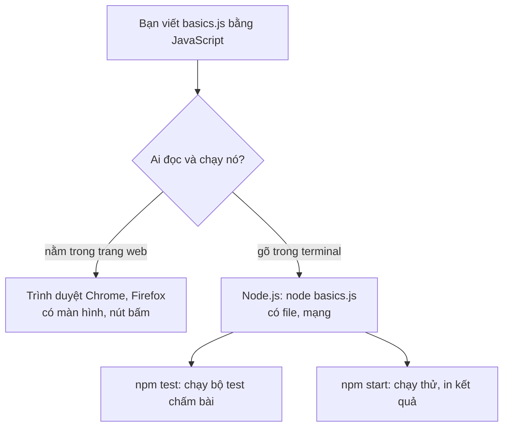

# N00 — JavaScript cho người đã biết Python

> Bài khởi động trước khi vào Node: đọc và viết được cú pháp JavaScript mà mọi bài TeamPulse dùng, bằng cách đối chiếu với Python bạn đã biết.

## 🎯 Mục tiêu

Sau buổi này (khoảng 2 giờ) bạn sẽ:

- Chạy một file `.js` bằng `node` và đọc được **JSDoc** — khối chú thích mô tả tham số và kết quả trên mỗi hàm của starter.
- Dùng đúng `let` / `const`, `===`, `null` / `undefined`, **truthy / falsy**, template literal `` `${x}` ``.
- Làm việc với **object** và **mảng**: `obj.x` / `obj[x]`, `for...of`, `push`, `includes`.
- Viết **hàm**, **arrow function**, truyền hàm làm **callback**; dùng **destructuring**, **spread**, giá trị mặc định.
- Viết **class** (`constructor`, `this`, getter) và **closure** — hàm nhớ biến của nơi tạo ra nó.
- Bắt lỗi bằng `try/catch`, đọc/ghi JSON, phân biệt `.then()` với `await`.
- **Kết quả đo được:** `basics.js` qua hết **19 test**; `npm start` in kết quả cả 9 hàm.

> 🧠 **Ghi nhớ:** bạn không học lại lập trình — biến, `if`, vòng lặp, hàm, class bạn đã biết từ Python. Bài này chỉ đổi **cách viết**. Khi đọc bài sau mà gặp cú pháp lạ, quay lại bảng Python ↔ JS ở đây.

> 📖 Từ lạ ở trên (runtime, callback, closure, Promise, JSON…) được giải nghĩa trong bảng **Từ mới trong bài** ở mục *Hiểu trước khi làm*, ngay đầu phần kiến thức nền.

## 📋 Đề bài

**Mở thư mục:** workspace của bài `N00-js-cho-nguoi-biet-python` (có `basics.js`, `package.json`). Đường dẫn đầy đủ: `academy/courses/node-realtime/workspace/N00-js-cho-nguoi-biet-python/` — sau khi bấm **Bắt đầu**, tab Bài học có dòng **Mở trong VS Code** trỏ tới thư mục này.

Viết 9 hàm nhỏ trong `basics.js` (thay chỗ `throw new Error('TODO: ...')`). Mỗi hàm luyện một nhóm cú pháp; chúng độc lập với nhau.

| Viết | Luyện | Ví dụ |
|---|---|---|
| `cleanName(value)` | `typeof`, `===`, `null`, truthy/falsy | `'  an '` → `'an'`, `42` → `null` |
| `formatMessage(msg)` | destructuring, template literal | → `'[09:05] an: Chào'` |
| `uniqueUsers(messages)` | mảng, `for...of`, `includes` | → `['an', 'binh']` |
| `pickMessages(messages, keep)` | callback | `keep = (m) => m.user === 'an'` |
| `withDefaults(options)` | spread, tham số mặc định | `{ port: 8080 }` → đủ 3 khóa |
| `class Inbox` | `constructor`, `this`, getter | `inbox.unreadCount` |
| `createIdGenerator(prefix)` | closure | `'an-1'`, `'an-2'`, ... |
| `parseJsonOr(text, fallback)` | `try/catch`, `JSON.parse` | `'{hỏng'` → `fallback` |
| `greetUser(getUser, id)` | `async`/`await` | → `'Xin chào, An!'` |

**Xong khi:** `# pass 19`, và `npm start` in ra:

```output
cleanName("  an ")                         → an
formatMessage(...)                         → [09:05] an: Deploy lúc 10h
uniqueUsers(...)                           → [ 'an', 'binh' ]
pickMessages(..., m => m.user === "an")    → [ { user: 'an', text: 'a' } ]
withDefaults({ port: 8080 })               → { host: '127.0.0.1', port: 8080, path: '/ws' }
new Inbox("an"): add 2 tin                 → an có 2 tin chưa đọc
createIdGenerator("an") gọi 2 lần          → [ 'an-1', 'an-2' ]
parseJsonOr("{hỏng", {})                   → {}
greetUser(...)                             → Xin chào, An!
```

## 🤔 Tại sao? (kiến thức nền)

### Hiểu trước khi làm

**Bối cảnh.** Khóa học xây dần một ứng dụng chat nhóm tên TeamPulse: phần hiện trên trình duyệt của người dùng và phần chạy trên máy trung tâm để chuyển tin giữa mọi người. Trình duyệt chỉ hiểu một ngôn ngữ lập trình là JavaScript, nên muốn viết cả hai phần bằng **một** ngôn ngữ thì chọn JavaScript. Để JavaScript chạy được ngoài trình duyệt, cần một chương trình tên **Node.js**. Bài này dạy cách viết JavaScript, đối chiếu từng dòng với Python bạn đã biết.

**Ví dụ đời thường.** Code giống một **công thức nấu ăn**; ngôn ngữ lập trình là thứ tiếng viết công thức. Công thức phải có **đầu bếp** đọc và nấu — đó là **runtime** (chương trình đọc và chạy code). Công thức Python cần đầu bếp `python`; công thức JavaScript có hai đầu bếp: **trình duyệt** (bếp có sẵn màn hình, nút bấm) và **Node.js** (bếp có sẵn file, mạng — thứ máy trung tâm cần). Cùng một thứ tiếng, khác bếp nên khác dụng cụ.

**Bạn đã gặp nó ở đâu.**
- Bấm "Thêm vào giỏ" trên Shopee hay thả tim trên Facebook mà trang không tải lại: JavaScript chạy trong trình duyệt.
- VS Code, Slack, Discord bản máy tính: viết bằng JavaScript, chạy trên nền Node.js.
- Netflix, PayPal, LinkedIn dùng Node.js cho một phần máy chủ của họ.
- `npm` — kho thư viện JavaScript lớn nhất thế giới — bạn sẽ dùng từ bài này.

| Câu hỏi | Trả lời |
|---|---|
| **What** — là gì | JavaScript: ngôn ngữ lập trình duy nhất trình duyệt hiểu. Node.js: runtime chạy JavaScript trong terminal, ngoài trình duyệt. |
| **Why** — vì sao cần | Một ngôn ngữ cho cả giao diện lẫn máy chủ; mọi bài sau của khóa (máy chủ web, chat thời gian thực) viết bằng nó. |
| **When** — khi nào dùng | Viết trang web có tương tác; viết máy chủ giữ nhiều kết nối mở như chat, thông báo, game online. |
| **When not** — khi nào không | Tính toán số liệu nặng, phân tích dữ liệu, học máy: Python (pandas, numpy) hợp hơn. |
| **Where** — ở đâu | Trình duyệt của người dùng (giao diện) và máy chủ (Node.js). Trong khóa: file `.js` trong thư mục workspace, chạy bằng `node`. |
| **How** — chạy thế nào | Bạn gõ `node basics.js`; Node đọc file từ trên xuống, chạy từng lệnh, in kết quả ra terminal — giống `python basics.py`. |

Người đã biết Python hiếm khi kẹt ở **ý tưởng** — kẹt ở dấu ngoặc nhọn, `===`, `=>`, `{ port } = ...`. Học riêng cú pháp một lần ở đây, các bài sau chỉ còn phải nghĩ về Node và WebSocket.



**Từ mới trong bài**

| Từ | Nghĩa đời thường |
|---|---|
| **JavaScript (JS)** | Ngôn ngữ lập trình của trình duyệt; khóa này dùng nó cho cả máy chủ |
| **Runtime** | Chương trình đọc và chạy code của bạn (đầu bếp đọc công thức) |
| **Node.js** (`node`) | Runtime chạy JavaScript ngoài trình duyệt, trong terminal |
| **Terminal** | Cửa sổ gõ lệnh bằng chữ (VS Code: menu Terminal → New Terminal) |
| **Workspace** | Thư mục làm bài của riêng bạn, app tạo khi bấm **Bắt đầu** |
| **Starter** | File code có sẵn khung hàm, phần thân để `TODO` cho bạn viết |
| **Test** | Đoạn code tự động gọi hàm của bạn và so kết quả với đáp án mong đợi; "pass" = đúng |
| **npm** | Công cụ đi kèm Node: cài thư viện và chạy lệnh đặt tên sẵn (`npm test`, `npm start`) |
| **`package.json`** | File "hồ sơ" của project: tên, thư viện cần, các lệnh `npm` |
| **JSDoc** | Khối chú thích `/** ... */` trên hàm, ghi tham số và kết quả (như docstring Python) |
| **Module**, `import` / `export` | Mỗi file là một module; `export` cho file khác dùng, `import` để lấy về |
| **Object** · **mảng** | `{ khóa: giá trị }` (≈ dict) · `[a, b]` (≈ list) |
| **Truthy / falsy** | Giá trị được `if` coi là đúng / sai |
| **Template literal** | Chuỗi trong dấu `` ` `` chèn được biến `${x}` (≈ f-string) |
| **Destructuring** | Lấy nhiều khóa của object ra biến trong một dòng: `const { a, b } = obj` |
| **Spread** `...` | "Trải" các phần tử/khóa của mảng/object vào chỗ mới |
| **Arrow function** `=>` | Cách viết hàm ngắn (≈ `lambda`, nhưng được nhiều dòng) |
| **Callback** | Hàm bạn đưa cho hàm khác để nó gọi lại sau |
| **Class**, `this`, **getter** | Khuôn tạo object; `this` ≈ `self`; getter = thuộc tính tính ra khi đọc |
| **Closure** | Hàm "nhớ" biến của nơi nó được tạo ra, kể cả khi nơi đó đã chạy xong |
| **JSON** | Định dạng chữ để lưu/gửi dữ liệu, trông giống object JS |
| **`try/catch`** | Thử chạy, có lỗi thì bắt lại xử lý (≈ `try/except`) |
| **Promise**, `async` / `await` | "Phiếu hẹn" cho kết quả chưa có; `await` = đợi phiếu có kết quả |
| **HTTP**, **WebSocket** | Hai cách máy tính nói chuyện qua mạng; học từ N02, N03 — bài này chưa cần |

### Chạy JavaScript và cú pháp chung

```bash
node --version        # cần v22 trở lên
node hello.js         # giống: python hello.py
```

| Python | JavaScript | Ghi chú |
|---|---|---|
| `print('hi', x)` | `console.log('hi', x)` | In ra terminal |
| `# chú thích` | `// chú thích` · `/* nhiều dòng */` | |
| Thụt lề tạo khối | `{ ... }` tạo khối | Thụt lề trong JS chỉ để dễ đọc |
| `if x > 0:` | `if (x > 0) { ... }` | Điều kiện nằm trong `( )` |
| Hết dòng là hết lệnh | `;` cuối lệnh | Thường tự hiểu khi thiếu, nhưng code chuẩn vẫn ghi |
| `and` · `or` · `not` | `&&` · `\|\|` · `!` | |
| `True` · `False` · `None` | `true` · `false` · `null` (và `undefined`) | Viết thường |
| `len(s)` | `s.length` | Thuộc tính, không phải hàm |
| `b if a else c` | `a ? b : c` | Toán tử ba ngôi |

```js
const fruits = ['táo', 'cam'];
if (fruits.length > 1 && !fruits.includes('xoài')) {
  console.log('có', fruits.length, 'loại, chưa có xoài');
}
const label = fruits.length > 5 ? 'nhiều' : 'ít';
console.log(label);
```
```output
có 2 loại, chưa có xoài
ít
```

### Đọc JSDoc: bản mô tả hàm trong starter

Mỗi hàm bạn viết đều có khối `/** ... */` phía trên — **JSDoc**. Nó giống docstring + type hint của Python, và ghi đủ mọi yêu cầu test kiểm tra.

```js
/**
 * Chờ `promise` nhưng không quá `ms` mili giây.
 *
 * @param {Promise<T>} promise      tham số promise: một Promise cho ra kiểu T
 * @param {number} [ms=100]         ngoặc vuông = tùy chọn, mặc định 100
 * @returns {Promise<T>}            kết quả trả về
 */
```

| JSDoc | Nghĩa | Python tương đương |
|---|---|---|
| `@param {string} line` | Tham số `line` kiểu chuỗi | `line: str` |
| `@param {number} [ms=100]` | Tùy chọn, mặc định 100 | `ms: int = 100` |
| `@returns {string \| null}` | Chuỗi **hoặc** `null` | `-> str \| None` |
| `{string[]}` | Mảng chuỗi | `list[str]` |
| `{{user: string}[]}` | Mảng object có khóa `user` | `list[dict]` |
| `{(msg: object) => boolean}` | Một **hàm** nhận object, trả boolean | `Callable[[dict], bool]` |
| `{Promise<string>}` | Promise cho ra chuỗi | `Awaitable[str]` |

JSDoc chỉ là chú thích: Node không kiểm tra kiểu khi chạy. Nhưng VS Code đọc nó để gợi ý, và bài học dùng nó làm đặc tả.

### Module: `import` và `export`

File `.js` muốn cho file khác dùng hàm thì đặt `export` trước hàm; file khác `import { tên } from './file.js'` — giống `from file import tên` của Python. Starter của bạn đã có sẵn `export`; test `import` các hàm đó để chấm. N01 học kỹ phần này.

## 🛠️ Làm

### Bước 1 — Chuẩn bị

```bash
cd academy/courses/node-realtime/workspace/N00-js-cho-nguoi-biet-python
node basics.js     # mỗi dòng in "TODO: viết ..." — bình thường
npm test           # 19 fail vì TODO — bình thường
```

Chạy riêng test của **một** hàm trong lúc làm (thay `cleanName` bằng tên hàm bạn đang viết):

```bash
node --test --test-name-pattern="cleanName" "../../curriculum/N00-js-cho-nguoi-biet-python/tests/*.test.js"
```

> ⚠️ **Lỗi hay gặp:** `npm test -- --test-name-pattern=cleanName` **không** lọc được: npm nối cờ vào **sau** mẫu tên file, và Node 22 bỏ qua cờ đặt sau tên file — cả 19 test vẫn chạy. Gõ thẳng lệnh `node --test --test-name-pattern=... "<mẫu file>"` như trên.

### Bước 2 — Biến, so sánh, truthy/falsy → `cleanName`

| Python | JavaScript | Ghi chú |
|---|---|---|
| `x = 5` | `let x = 5;` | `let`: gán lại được |
| `MAX = 5` (quy ước) | `const MAX = 5;` | `const`: gán lại báo `TypeError`. Mặc định dùng `const`, cần gán lại mới dùng `let` |
| (không có) | `var x = 5;` | Cách cũ, gặp trong code cũ: phạm vi theo **hàm** chứ không theo khối `{ }`, dùng được trước dòng khai báo (ra `undefined`). Code mới không dùng `var` |
| `a == b` | `a === b` | Luôn dùng `===` / `!==` |
| `None` | `null` | "Cố ý không có giá trị" |
| (không có) | `undefined` | "Chưa từng có giá trị": biến chưa gán, khóa không tồn tại |
| `isinstance(x, str)` | `typeof x === 'string'` | |
| `s.strip()` | `s.trim()` | |

```js
let score = 7;
score = score + 1;               // let: gán lại được
const subject = 'Toán';          // const: không gán lại được
console.log(subject, score);

console.log('1' == 1, '1' === 1, 0 == '', null == undefined, null === undefined);

const fruit = { name: 'cam' };
console.log(fruit.color, typeof fruit.color, typeof null, typeof 'cam', typeof 3);
```
```output
Toán 8
true false true true false
undefined undefined object string number
```

`==` tự **đổi kiểu** trước khi so (`'1' == 1` là `true`, `0 == ''` cũng `true`) — nguồn bug kinh điển. `===` so cả kiểu lẫn giá trị, giống `==` của Python. Đọc khóa không tồn tại **không** báo `KeyError` như Python mà ra `undefined`. Và `typeof null` là `'object'` (lỗi lịch sử của JS) — muốn biết có phải `null` thì so `x === null`.

**Truthy / falsy** — giá trị đặt trong `if (...)` được coi là đúng hay sai:

```js
const samples = [0, '', null, undefined, NaN, [], {}, 'a', 1];
for (const v of samples) {
  let kind;
  if (v) {
    kind = 'truthy';
  } else {
    kind = 'falsy';
  }
  console.log([v], kind);
}
```
```output
[ 0 ] falsy
[ '' ] falsy
[ null ] falsy
[ undefined ] falsy
[ NaN ] falsy
[ [] ] truthy
[ {} ] truthy
[ 'a' ] truthy
[ 1 ] truthy
```

> ⚠️ **Lỗi hay gặp:** trong Python `[]` và `{}` rỗng là falsy; trong JS chúng là **truthy**. Kiểm tra mảng rỗng phải viết `arr.length === 0`.

> 💡 **Mẹo:** `if (!name)` bắt cùng lúc `''`, `null`, `undefined` — nhưng cũng bắt cả số `0`. Khi `0` là giá trị hợp lệ, so cụ thể: `x === null || x === undefined`.

Hàm `cleanName` cần ba bước: không phải chuỗi → `null`; trim; chuỗi rỗng sau trim → `null`.

### Bước 3 — Template literal, destructuring → `formatMessage`

| Python | JavaScript |
|---|---|
| `f"{name} được {score} điểm"` | `` `${name} được ${score} điểm` `` (dấu backtick) |
| `s[5:7]` | `s.slice(5, 7)` |
| `a, b = pair` | `const [a, b] = pair;` |
| `x = d['x']; y = d['y']` | `const { x, y } = d;` |
| `d.get('z', 'mặc định')` | `const { z = 'mặc định' } = d;` (chỉ khi `z` là `undefined`) |

```js
const name = 'Lan';
const score = 8.5;
console.log(`Bạn ${name} được ${score} điểm, ${score >= 5 ? 'đậu' : 'rớt'}`);
console.log('2026-10-23'.slice(5, 7), '2026-10-23'.slice(0, 4));

const book = { title: 'Dế Mèn phiêu lưu ký', pages: 120, year: 1941 };
const { title, pages } = book;
const { author = 'chưa rõ' } = book;
console.log(title, '|', pages, '|', author);

const [first, second] = ['táo', 'cam', 'xoài'];
console.log(first, second);

function describe({ title, year = '?' }) {     // destructuring ngay ở tham số
  return `${title} (${year})`;
}
console.log(describe(book), '|', describe({ title: 'Truyện Kiều' }));
```
```output
Bạn Lan được 8.5 điểm, đậu
10 2026
Dế Mèn phiêu lưu ký | 120 | chưa rõ
táo cam
Dế Mèn phiêu lưu ký (1941) | Truyện Kiều (?)
```

`function describe({ title, year = '?' })` nhận **một** object và tách khóa ngay ở tham số. Bạn sẽ gặp nó ở N03: `startPolling({ url, intervalMs, onMessage })`.

> ⚠️ **Lỗi hay gặp:** `import { readFile } from 'node:fs/promises'` **trông** giống destructuring nhưng không phải: đó là cú pháp `import` (lấy tên được `export` từ module), không gán giá trị mặc định được.

### Bước 4 — Object, mảng, `for...of` → `uniqueUsers`

| Python | JavaScript | Ghi chú |
|---|---|---|
| `d = {'tao': 12}` | `const d = { tao: 12 };` | Khóa là chuỗi, không cần nháy nếu là tên hợp lệ |
| `d['tao']` | `d.tao` hoặc `d['tao']` | `d[key]` khi tên khóa nằm trong biến |
| `d['cam'] = 8` | `d.cam = 8;` | |
| `'cam' in d` | `d.cam !== undefined` (hoặc `'cam' in d`) | |
| `for k, v in d.items():` | `for (const [k, v] of Object.entries(d))` | |
| `lst.append(x)` | `arr.push(x)` | |
| `x in lst` | `arr.includes(x)` | |
| `for x in lst:` | `for (const x of arr)` | **`of`**, không phải `in` |
| `set()` | `new Set()` | `.add`, `.has`, `.size` |

```js
const prices = { tao: 12, cam: 8 };
const key = 'cam';
console.log(prices.tao, prices[key], prices.key);   // prices.key = khóa tên "key"
prices.xoai = 25;
for (const [fruit, price] of Object.entries(prices)) {
  console.log(fruit, price);
}

for (const i in ['a', 'b']) {
  console.log('for...in cho:', i, typeof i);
}
```
```output
12 8 undefined
tao 12
cam 8
xoai 25
for...in cho: 0 string
for...in cho: 1 string
```

> ⚠️ **Lỗi hay gặp:** `for (const x in arr)` cho **chỉ số dạng chuỗi** (`'0'`, `'1'`), không cho phần tử. Duyệt phần tử luôn dùng `for...of`.

Lọc trùng một danh sách, giữ thứ tự lần đầu gặp:

**Cách 1 — vòng lặp `for...of` + `includes`**

```js
const basket = ['táo', 'cam', 'táo', 'xoài', 'cam'];
const kinds = [];
for (const f of basket) {
  if (!kinds.includes(f)) {     // chưa có thì thêm
    kinds.push(f);
  }
}
console.log(kinds, basket.length);
```
```output
[ 'táo', 'cam', 'xoài' ] 5
```

**Cách 2 — `Set` + spread**

```js
const basket = ['táo', 'cam', 'táo', 'xoài', 'cam'];
console.log([...new Set(basket)]);
```
```output
[ 'táo', 'cam', 'xoài' ]
```

`new Set(basket)` giữ mỗi giá trị một lần, theo thứ tự thêm vào; `[...set]` trải nó ra thành mảng (spread, Bước 6).

> ⚖️ **So sánh:** Cách 1 là O(n²) vì `includes` tự duyệt cả mảng `kinds` cho mỗi phần tử; Cách 2 là O(n) vì `Set` tra O(1) — giống `x in list` so với `x in set` của Python. Với vài chục người gửi khác biệt không đo được; với 100.000 phần tử thì Cách 2 nhanh hơn rõ.

`uniqueUsers` nhận mảng **tin** (`{ user, ... }`), nên phần tử cần so là `m.user`.

### Bước 5 — Hàm, arrow function, callback → `pickMessages`

| Python | JavaScript |
|---|---|
| `def double(x): return x * 2` | `function double(x) { return x * 2; }` |
| `double = lambda x: x * 2` | `const double = (x) => x * 2;` |
| Lambda chỉ một biểu thức | Arrow có thân nhiều dòng: `(x) => { const y = x * 2; return y; }` |
| `sorted(lst, key=len)` | Truyền hàm làm đối số: `arr.sort(fn)`, `setTimeout(fn, 100)` |

Trong JS, hàm là **giá trị** như số hay chuỗi: gán vào biến, truyền vào hàm khác. Hàm được truyền vào để "gọi lại sau" gọi là **callback**.

```js
function countIf(numbers, test) {
  let count = 0;
  for (const n of numbers) {
    if (test(n)) {               // gọi hàm được truyền vào
      count += 1;
    }
  }
  return count;
}

const scores = [7, 4, 9, 5, 3];
function isHigh(s) {
  return s >= 8;
}
console.log(countIf(scores, (s) => s >= 5));                      // arrow function
console.log(countIf(scores, function (s) { return s % 2 === 0; }));  // hàm không tên
console.log(countIf(scores, isHigh));                              // tên hàm, KHÔNG có ()
console.log(scores.filter((s) => s >= 5).length);                  // filter: có sẵn trên mảng
```
```output
3
1
1
3
```

Dòng cuối dùng `arr.filter(fn)` có sẵn: nó chính là vòng `for` + `if` + `push` trong `countIf`. Bạn tự viết vòng lặp hay dùng `filter` cho `pickMessages` đều được — test chỉ kiểm tra kết quả.

Arrow function và `function` thường khác nhau ở vài điểm (đủ để đọc code; bài này chưa cần dùng):

| | `function f() {}` | `const f = () => {}` |
|---|---|---|
| `this` bên trong | Tùy **cách gọi** hàm | Không có `this` riêng — dùng `this` của nơi viết nó |
| Dùng với `new` | Được | Không (`TypeError`) |
| Gọi trước dòng khai báo | Được (hoisting) | Không |

Vì điểm đầu tiên, callback viết **bên trong** method của class (vd. `setTimeout(() => this.flush(), 100)`) thường dùng arrow: `this` vẫn là object đó.

> ⚠️ **Lỗi hay gặp:** `countIf(scores, isHigh())` — có `()` là **gọi ngay** và truyền kết quả (`false`), không truyền hàm. Truyền hàm thì chỉ ghi tên.

Callback cũng là cách Node báo "việc chờ đã xong" — phần lõi của N01:

```js
console.log('1. đặt hẹn giờ');
setTimeout(() => console.log('3. 100 ms sau: chuông reo'), 100);
console.log('2. làm việc khác trong lúc chờ');
```
```output
1. đặt hẹn giờ
2. làm việc khác trong lúc chờ
3. 100 ms sau: chuông reo
```

### Bước 6 — Spread, giá trị mặc định, tham chiếu → `withDefaults`

| Python | JavaScript |
|---|---|
| `{**a, **b}` | `{ ...a, ...b }` |
| `[*a, *b]` | `[...a, ...b]` |
| `f(*args)` | `f(...args)` |
| `def f(x=1):` | `function f(x = 1) {` |

```js
const base = { size: 'M', sugar: 50, ice: true };
const order = { ...base, sugar: 30 };            // khóa viết sau đè khóa viết trước
console.log(order, '| base.sugar vẫn là', base.sugar);

const menu = [...['phở', 'bún'], 'cơm'];
console.log(menu, Math.max(...[3, 9, 4]));

function brew(tea = 'trà xanh', minutes = 3) {
  return `${tea} ${minutes} phút`;
}
console.log(brew(), '|', brew('ô long'));

const a = { n: 1 };
const b = a;                     // KHÔNG copy: a và b cùng trỏ một object
b.n = 2;
const c = { ...a };              // copy (nông) sang object mới
c.n = 3;
console.log(a.n, b.n, c.n, a === b, a === c);
```
```output
{ size: 'M', sugar: 30, ice: true } | base.sugar vẫn là 50
[ 'phở', 'bún', 'cơm' ] 9
trà xanh 3 phút | ô long 3 phút
2 2 3 true false
```

Object và mảng được truyền **theo tham chiếu**, giống Python: `b = a` không tạo bản sao. `===` với object so **cùng một object**, không so nội dung. Đây cũng là lý do `const` vẫn cho sửa bên trong: `const cart = []; cart.push('táo')` hợp lệ — `const` chỉ cấm gán `cart = ...` lần nữa.

### Bước 7 — `class`, `this`, getter → `Inbox`

| Python | JavaScript |
|---|---|
| `class Playlist:` | `class Playlist {` |
| `def __init__(self, name):` | `constructor(name) {` |
| `self.name = name` | `this.name = name;` |
| `def add(self, title):` | `add(title) {` — **không** khai báo `this` ở tham số |
| `p = Playlist('Chill')` | `const p = new Playlist('Chill');` — thiếu `new` báo `TypeError` |
| `@property` + `def total(self):` | `get total() { ... }` — đọc `p.total`, không có `()` |
| `class Album(Playlist):` | `class Album extends Playlist {` |
| `super().__init__(name)` | `super(name);` — gọi trước khi dùng `this` |

```js
class Playlist {
  constructor(name) {
    this.name = name;
    this.songs = [];
  }
  add(title, minutes) {
    this.songs.push({ title, minutes });       // { title, minutes } = { title: title, minutes: minutes }
    return this;
  }
  get totalMinutes() {
    let total = 0;
    for (const s of this.songs) {
      total += s.minutes;
    }
    return total;
  }
}

class Album extends Playlist {
  constructor(name, artist) {
    super(name);                                // = super().__init__(name)
    this.artist = artist;
  }
}

const p = new Playlist('Chill');
p.add('Mưa', 4).add('Nắng', 3);
const al = new Album('Hà Nội', 'Lan');
al.add('Phố cổ', 5);
console.log(p.name, p.songs.length, 'bài,', p.totalMinutes, 'phút');
console.log(al.name, al.artist, al.totalMinutes, al instanceof Playlist);
```
```output
Chill 2 bài, 7 phút
Hà Nội Lan 5 true
```

`{ title, minutes }` là cách viết tắt khi tên khóa trùng tên biến — gặp rất nhiều trong code Node. Ở N02, `class ChatRoom extends EventEmitter` dùng đúng khuôn `extends` + `super()` này.

> ⚠️ **Lỗi hay gặp:** quên `this.` — viết `items.push(...)` thay vì `this.items.push(...)` → `ReferenceError: items is not defined`. Python bắt ghi `self.`, JS bắt ghi `this.`.

### Bước 8 — Closure: hàm nhớ biến của nơi tạo ra nó → `createIdGenerator`

Hàm tạo **bên trong** hàm khác vẫn đọc và sửa được biến của hàm ngoài, kể cả sau khi hàm ngoài đã chạy xong. Python cũng có (cần `nonlocal` để sửa); JS không cần từ khóa nào.

| Python | JavaScript |
|---|---|
| `def outer():` / `count = 0` / `def inc():` / `nonlocal count` / `count += 1` | `function outer() { let count = 0; return () => { count += 1; ... }; }` |

```js
function createScoreKeeper(player) {
  let total = 0;                       // biến riêng của MỖI lần gọi createScoreKeeper
  return {
    add(points) {                      // = add: function (points) { ... }
      total += points;
      return `${player}: ${total}`;
    },
    reset() {
      total = 0;
    },
  };
}

const lan = createScoreKeeper('Lan');
const huy = createScoreKeeper('Huy');
console.log(lan.add(3));
console.log(lan.add(5));
console.log(huy.add(2));
lan.reset();
console.log(lan.add(1), '|', lan.total);
```
```output
Lan: 3
Lan: 8
Huy: 2
Lan: 1 | undefined
```

Mỗi lần gọi `createScoreKeeper` tạo một `total` **riêng**: `lan` và `huy` không ảnh hưởng nhau, và bên ngoài không đọc được `total` (`lan.total` là `undefined`). Kiểu "hàm tạo ra đối tượng có trạng thái" (factory function) dùng nhiều ở các bài sau: `startPolling` (N03) trả `{ stop, stats }`, N05 tạo bộ heartbeat và client tự kết nối lại theo cùng khuôn.

> ⚠️ **Lỗi hay gặp:** đặt `let count = 0` **ngoài** `createIdGenerator` → mọi bộ sinh dùng chung một bộ đếm (`b()` ra `b-3` thay vì `b-1`).

### Bước 9 — `try/catch`, JSON → `parseJsonOr`

| Python | JavaScript |
|---|---|
| `try:` / `except ValueError as e:` | `try { ... } catch (err) { ... }` — bắt **mọi** lỗi, không lọc theo kiểu |
| `raise ValueError('sai')` | `throw new Error('sai');` |
| `str(e)` | `err.message` · `err.name` (vd. `'SyntaxError'`) |
| `finally:` | `finally { ... }` |
| `json.loads(s)` | `JSON.parse(s)` — chuỗi hỏng ném `SyntaxError` |
| `json.dumps(obj)` | `JSON.stringify(obj)` |

```js
const inputs = ['{"fruit":"cam","kg":2}', '[1, 2]', '{fruit: cam}', 'null', ''];
for (const text of inputs) {
  try {
    const value = JSON.parse(text);
    console.log('OK  ', value);
  } catch (err) {
    console.log('HỎNG', err.name);
  }
}
console.log(JSON.stringify({ fruit: 'cam', kg: 2, note: undefined }));

function checkAge(age) {
  if (age < 0) {
    throw new Error('tuổi âm');
  }
  return age;
}
try {
  checkAge(-1);
} catch (err) {
  console.log('bắt được:', err.message);
} finally {
  console.log('finally luôn chạy');
}
```
```output
OK   { fruit: 'cam', kg: 2 }
OK   [ 1, 2 ]
HỎNG SyntaxError
OK   null
HỎNG SyntaxError
{"fruit":"cam","kg":2}
bắt được: tuổi âm
finally luôn chạy
```

JSON bắt khóa và chuỗi nằm trong nháy kép (`{fruit: cam}` hỏng), và `'null'` là JSON **hợp lệ**. `JSON.stringify` bỏ khóa có giá trị `undefined`. Khi không cần biến lỗi, viết gọn `catch { ... }`.

### Bước 10 — Promise: `.then()` và `await` → `greetUser`

Hàm chờ mạng/file trong Node không trả kết quả ngay mà trả **Promise** — một "phiếu hẹn" sẽ có kết quả (hoặc lỗi) sau. N01 học kỹ; ở đây chỉ cần đọc được hai cách lấy kết quả:

| Cách | Viết | Lỗi bắt bằng |
|---|---|---|
| `.then` | `p.then((value) => ...)` | `.catch((err) => ...)` |
| `.then` hai đối số | `p.then(onOk, onFail)` | `onFail` — gặp trong N01 |
| `await` (trong hàm `async`) | `const value = await p;` | `try { ... } catch (err) { ... }` quanh `await` |

```js
async function findFruit(name) {        // hàm async luôn trả Promise
  if (name === '') {
    throw new Error('thiếu tên');         // throw trong async = Promise bị reject
  }
  return { name, price: 12 };
}

// Cách A — .then / .catch: truyền callback "khi xong" và "khi lỗi"
function showA(name) {
  return findFruit(name)
    .then((fruit) => `A: ${fruit.name} giá ${fruit.price}`)
    .catch((err) => `A lỗi: ${err.message}`);
}

// Cách B — async/await + try/catch: đọc từ trên xuống như code Python
async function showB(name) {
  try {
    const fruit = await findFruit(name);
    return `B: ${fruit.name} giá ${fruit.price}`;
  } catch (err) {
    return `B lỗi: ${err.message}`;
  }
}

console.log(await showA('cam'));
console.log(await showA(''));
console.log(await showB('cam'));
console.log(await showB(''));
console.log(showB('cam'));               // quên await → vẫn là phiếu hẹn
```
```output
A: cam giá 12
A lỗi: thiếu tên
B: cam giá 12
B lỗi: thiếu tên
Promise { <pending> }
```

Khóa học dùng **Cách B** cho code mới (dễ đọc, giống Python). Cách A vẫn gặp nhiều trong code công ty và thư viện, nên cần đọc được.

> ⚠️ **Lỗi hay gặp:** quên `await` → biến là `Promise { <pending> }` chứ không phải dữ liệu; `user.name` ra `undefined`.

### Bước 11 — Chạy thật

```bash
npm start
npm test
```

So kết quả `npm start` với mục **Đề bài**. Mạng (IP, cổng, TCP, HTTP) được giải thích ở đầu N02 — ngay trước khi bạn mở server đầu tiên.

## ✅ Tự kiểm tra

Bấm **Chạy test**, hoặc trong thư mục workspace của bài:

```bash
npm test
```

`npm test` chạy `scripts.test` trong `package.json`: `node --test "../../curriculum/N00-js-cho-nguoi-biet-python/tests/*.test.js"`. Dấu ngoặc kép giữ nguyên mẫu `*.test.js` để chính Node tìm file — chạy được cả trong bash lẫn PowerShell.

Mục tiêu: `# pass 19`, `# fail 0`. Mỗi test fail in thông báo tiếng Việt chỉ ra cần sửa gì.

## 🎤 Câu hỏi phỏng vấn

> 🎯 **Phỏng vấn hay hỏi:** "`==` và `===` khác nhau thế nào? `null` và `undefined`?" — `===` so cả kiểu và giá trị, `==` tự đổi kiểu trước khi so (`'1' == 1` là `true`), nên luôn dùng `===`. `undefined` là "chưa có giá trị" (biến chưa gán, khóa không tồn tại), `null` là "cố ý để trống"; `typeof null` là `'object'` do lỗi lịch sử. Nếu được hỏi tiếp "closure là gì?" — hàm nhớ biến của nơi nó được tạo, kể cả khi hàm ngoài đã chạy xong; dùng để giữ trạng thái riêng (bộ đếm, timer) mà bên ngoài không sửa được.
