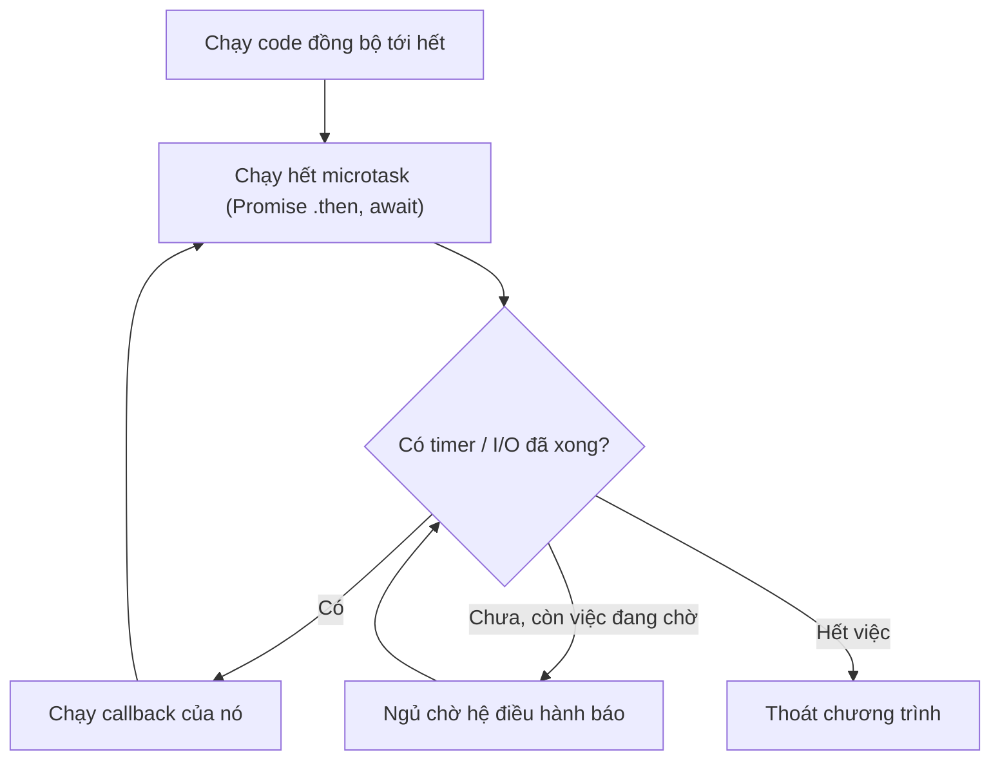

# N01 — Node cơ bản: module, npm, async, event loop

> Chạy JavaScript ngoài trình duyệt và viết module đọc log chat của TeamPulse: đọc file bất đồng bộ, bỏ dòng hỏng, đếm tin theo người gửi, đặt timeout cho việc chờ.

## 🎯 Mục tiêu

Sau buổi này (khoảng 3 giờ) bạn sẽ:

- Chạy file `.js` bằng `node`, chia code thành module bằng **`import` / `export`** (ESM).
- Dùng **npm** và **`package.json`**: `type`, `scripts`, `dependencies`, `package-lock.json`.
- Viết **Promise**, **`async` / `await`**, chạy song song bằng `Promise.all`, đặt timeout.
- Giải thích **event loop**: vì sao Node không đứng hình khi chờ file hay mạng, và vì sao một vòng lặp nặng lại làm nó đứng hình.
- Đọc file bằng **`fs/promises`** và xử lý file không tồn tại.
- **Kết quả đo được:** `chatlog.js` qua hết **15 test**, `npm start` in ra thống kê log chat.

> 🧠 **Ghi nhớ:** Node.js = engine V8 (chạy JavaScript, giống Chrome) + thư viện I/O bất đồng bộ (libuv). Server WebSocket ở công ty bạn chạy trên đúng mô hình này: **một luồng** JavaScript phục vụ hàng nghìn kết nối nhờ không bao giờ ngồi chờ I/O.

## 📋 Đề bài

**Mở thư mục:** workspace của bài `N01-node-co-ban` (có `chatlog.js`, `messages.jsonl`, `package.json`).

`messages.jsonl` là log chat thật của nhóm: mỗi dòng một JSON, có dòng trống, dòng JSON hỏng, dòng thiếu người gửi. Bạn viết 5 hàm (thay chỗ `throw new Error("TODO: ...")`) và sửa `package.json`. JSDoc trên mỗi hàm ghi đủ mọi yêu cầu test kiểm tra.

| Viết | Làm gì | Ví dụ |
|---|---|---|
| `parseLine(line)` | Một dòng → `{user, text, ts}` hoặc `null` | JSON hỏng → `null` |
| `countByUser(messages)` | Đếm tin theo người gửi | `{ an: 4, binh: 2, chi: 2, dung: 1 }` |
| `loadMessages(path)` | Đọc file bất đồng bộ, bỏ dòng hỏng | 12 dòng → 9 tin |
| `delay(ms)` | Promise xong sau `ms` mili giây | `await delay(300)` |
| `withTimeout(promise, ms)` | Chờ không quá `ms`, quá hạn → lỗi `"timeout"` | `withTimeout(delay(1000), 200)` → lỗi sau 200 ms |
| `package.json` | Thêm `scripts.start` | `npm start` chạy `node chatlog.js` |

**Xong khi:** `# pass 15`, và `npm start` in ra:

```output
Đọc 12 dòng, hợp lệ 9 tin
Theo người gửi: { an: 4, binh: 2, chi: 2, dung: 1 }
3 lần delay(300) song song: 300 ms
withTimeout(delay(1000), 200) → lỗi "timeout" sau 201 ms
```

## 🤔 Tại sao? (kiến thức nền)

> 📖 **Cú pháp:** bài này dùng cú pháp đã học ở **N00**: `const`/`let`, `===`, arrow function `(x) => ...` (= `lambda`), template literal `` `${x}` `` (= f-string), object `{}`, `for...of`, `try/catch`. Gặp chỗ lạ, mở lại bảng Python ↔ JS của N00.

### Node.js là gì

JavaScript sinh ra để chạy trong trình duyệt. Node.js lấy engine V8 của Chrome ra chạy riêng, bỏ phần trình duyệt (`document`, `window`), thêm phần server cần: file, mạng, tiến trình.

| | JS trong trình duyệt | Node.js | Python (đã học) |
|---|---|---|---|
| Chạy file | `<script>` trong HTML | `node app.js` | `python app.py` |
| Có `document`, `window` | Có | Không | Không |
| Đọc file, mở cổng mạng | Không | `node:fs`, `node:http` | `open()`, `http.server` |
| Thư viện ngoài | CDN | npm (`npm install ws`) | pip |
| Chờ I/O | Bất đồng bộ | Bất đồng bộ (mặc định) | Đồng bộ (mặc định) |

Dòng cuối là khác biệt quan trọng nhất: trong Python, `requests.get(...)` **dừng** cả chương trình tới khi có kết quả. Trong Node, lệnh đọc file/mạng **đăng ký** việc cần làm rồi chạy tiếp; khi có kết quả, Node gọi lại code của bạn.

```js
console.log('Node', process.version.split('.')[0], '| nền tảng', process.platform);
console.log('Có document không?', typeof document);
```
```output
Node v22 | nền tảng linux
Có document không? undefined
```

### Module: `import` / `export` (ESM)

Mỗi file `.js` là một module. Hàm, biến muốn cho file khác dùng thì `export`; file khác `import` theo tên.

```js
// prices.js
export const VAT = 0.1;
export function withVat(price) {
  return price * (1 + VAT);
}

// shop.js
import { withVat } from './prices.js';   // phải ghi đủ đuôi .js
console.log(withVat(100));
```

Module có sẵn của Node import bằng tiền tố `node:`:

```js
import { join, extname } from 'node:path';
import { tmpdir } from 'node:os';
console.log(extname('menu/pho-bo.json'));
console.log(join('menu', 'mon-chinh', 'pho.json'));
console.log(typeof tmpdir());
```
```output
.json
menu/mon-chinh/pho.json
string
```

| Kiểu | Cú pháp | Khi nào gặp |
|---|---|---|
| ESM (chuẩn hiện nay) | `import x from '...'` · `export function f()` | Code mới, khóa này |
| CommonJS (cũ) | `const x = require('...')` · `module.exports = f` | Code Node cũ, nhiều repo công ty |

> ⚠️ **Lỗi hay gặp:** `package.json` thiếu `"type": "module"` → Node in cảnh báo `MODULE_TYPELESS_PACKAGE_JSON` (Node cũ báo `Cannot use import statement outside a module`). Starter của khóa đã có sẵn dòng này; project tự tạo thì nhớ thêm.

> ⚠️ **Lỗi hay gặp:** `import { f } from './prices'` (thiếu `.js`) → `ERR_MODULE_NOT_FOUND`. ESM trong Node không tự đoán đuôi file.

### npm & `package.json`

`package.json` là "hồ sơ" của project — giống `requirements.txt` + lệnh chạy gộp lại.

| Trường | Ý nghĩa |
|---|---|
| `"type": "module"` | File `.js` dùng `import`/`export` |
| `"scripts"` | Lệnh đặt tên: `npm start`, `npm test`, `npm run <tên>` |
| `"dependencies"` | Thư viện cần khi chạy, vd. `"ws": "8.22.0"` |
| `"devDependencies"` | Chỉ cần khi phát triển (test, lint) |

```bash
npm install ws          # tải vào node_modules/, ghi vào dependencies
npm start               # chạy scripts.start
npm test                # chạy scripts.test
npm run dev             # chạy scripts.dev
npx some-tool           # chạy công cụ mà không cài toàn cục
```

`package-lock.json` ghi **chính xác** phiên bản mọi thư viện (kể cả thư viện con) để máy ai cài cũng ra giống nhau — luôn commit file này. `node_modules/` thì không commit (cài lại được bằng `npm install`).

> 💡 **Mẹo:** `"ws": "^8.22.0"` nghĩa là "8.x mới nhất, ≥ 8.22.0"; `"8.22.0"` là đúng bản đó. Khóa học ghim bản chính xác để test luôn ra cùng kết quả.

### Promise và `async` / `await`

**Promise** là "phiếu hẹn" cho một kết quả chưa có: lúc đầu *pending*, sau đó *fulfilled* (có giá trị) hoặc *rejected* (có lỗi). `await` dừng **hàm async hiện tại** (không dừng cả chương trình) tới khi Promise có kết quả.

```js
import { setTimeout as sleep } from 'node:timers/promises';

async function cookRice() {
  await sleep(100);              // giả lập chờ nồi cơm
  return 'cơm chín';
}

const p = cookRice();
console.log('ngay sau khi gọi:', p);
console.log('sau khi await:', await p);

async function burn() {
  throw new Error('cháy nồi');
}
try {
  await burn();
} catch (err) {
  console.log('bắt được:', err.message);
}
```
```output
ngay sau khi gọi: Promise { <pending> }
sau khi await: cơm chín
bắt được: cháy nồi
```

Gọi hàm `async` luôn trả về Promise **ngay lập tức**. `throw` trong hàm async biến thành Promise bị reject, bắt bằng `try/catch` quanh `await`.

> 💡 **Mẹo:** file ESM cho phép `await` ở ngoài cùng (top-level await) như demo trên. File CommonJS thì không.

### Event loop: vì sao Node không đứng hình khi chờ

Node chạy JavaScript trên **một luồng**. Việc chờ (timer, file, mạng) được giao cho hệ điều hành / thread pool; khi xong, callback được xếp vào hàng đợi. Event loop lặp mãi: hết code đồng bộ → chạy hàng microtask (Promise) → lấy callback kế tiếp (timer, I/O).



Đoán thứ tự in trước khi xem kết quả. Hai cú pháp cần đọc: `() => console.log('...')` là một arrow function **không tham số** — một callback để chạy sau; `Promise.resolve().then(fn)` nghĩa là "khi Promise này xong thì gọi `fn`" (N00 Bước 10).

```js
console.log('1. đồng bộ: bắt đầu');
setTimeout(() => console.log('4. timer 0 ms'), 0);
Promise.resolve().then(() => console.log('3. microtask Promise'));
console.log('2. đồng bộ: kết thúc');
```
```output
1. đồng bộ: bắt đầu
2. đồng bộ: kết thúc
3. microtask Promise
4. timer 0 ms
```

`setTimeout(..., 0)` **không** chạy ngay: nó phải chờ code đồng bộ chạy xong và hàng Promise rỗng.

Ba việc chờ 1 giây: chờ lần lượt mất 3 giây, cho chạy cùng lúc chỉ mất 1 giây — vì trong lúc chờ, luồng JavaScript rảnh.

```js
import { setTimeout as sleep } from 'node:timers/promises';

let t0 = Date.now();
await sleep(1000);
await sleep(1000);
await sleep(1000);
console.log('lần lượt:', (Math.round((Date.now() - t0) / 100) / 10).toFixed(1), 'giây');

t0 = Date.now();
await Promise.all([sleep(1000), sleep(1000), sleep(1000)]);
console.log('song song:', (Math.round((Date.now() - t0) / 100) / 10).toFixed(1), 'giây');
```
```output
lần lượt: 3.0 giây
song song: 1.0 giây
```

Ngược lại, code **tính toán** đồng bộ giữ luồng duy nhất — mọi thứ khác phải xếp hàng:

```js
const t0 = Date.now();
setTimeout(() => console.log(`timer hẹn 10 ms, thực tế chạy sau ${Math.round((Date.now() - t0) / 100) * 100} ms`), 10);

// vòng lặp bận 500 ms: event loop không được quay
while (Date.now() - t0 < 500) {}
console.log('vòng lặp bận xong');
```
```output
vòng lặp bận xong
timer hẹn 10 ms, thực tế chạy sau 500 ms
```

> 🎯 **Phỏng vấn hay hỏi:** "Node là đơn luồng, sao phục vụ được nhiều request cùng lúc?" — JavaScript chạy một luồng, nhưng I/O được giao cho hệ điều hành/libuv; trong lúc chờ, event loop xử lý request khác. Vì vậy **đừng** làm việc **chặn** luồng trong handler — vòng lặp CPU nặng, hoặc I/O đồng bộ như `readFileSync`: cả hai đều chặn mọi kết nối.

> 🧠 **Ghi nhớ:** server WebSocket giữ hàng nghìn kết nối mở, hầu hết thời gian chỉ **chờ**. Mô hình event loop của Node hợp với việc này: kết nối đang chờ gần như không tốn CPU.

## 🛠️ Làm

### Bước 1 — Chuẩn bị

```bash
node --version          # cần v22 trở lên
cd academy/courses/node-realtime/workspace/N01-node-co-ban   # dòng "Mở trong VS Code" trên tab Bài học trỏ tới đây
node chatlog.js         # chạy được nhưng báo lỗi TODO — bình thường
npm start               # lỗi "Missing script: start" — bạn sẽ sửa
```

Trong lúc làm, chạy riêng test của **một** hàm (thay `parseLine` bằng tên hàm đang viết):

```bash
node --test --test-name-pattern="parseLine" "../../curriculum/N01-node-co-ban/tests/*.test.js"
```

> ⚠️ **Lỗi hay gặp:** `npm test -- --test-name-pattern=...` **không** lọc được: npm nối cờ vào **sau** mẫu tên file, và Node 22 bỏ qua cờ đặt sau tên file — mọi test vẫn chạy. Gõ thẳng lệnh `node --test --test-name-pattern="<mẫu>" "<mẫu file>"` như trên.

Mở `package.json`: khối `"scripts"` đã có lệnh `test`. Thêm lệnh `start` chạy `node chatlog.js` vào cùng khối (nhớ dấu phẩy giữa các mục JSON). Chạy lại `npm start`: giờ nó gọi được file, chỉ còn lỗi TODO. `npm test` chạy bộ test của bài.

### Bước 2 — `JSON.parse`, `try/catch`, `typeof` → `parseLine`

`JSON.parse` ném `SyntaxError` khi chuỗi hỏng. `typeof` cho biết kiểu của giá trị:

```js
const lines = ['{"fruit": "cam", "price": 12}', '{"fruit": ', '{"fruit": 7}', 'null'];
for (const line of lines) {
  try {
    const obj = JSON.parse(line);
    console.log('OK  ', typeof obj, obj === null ? 'null' : typeof obj.fruit);
  } catch (err) {
    console.log('HỎNG', err.name);
  }
}
console.log(typeof '', typeof 0, typeof undefined, typeof [], Array.isArray([]));
console.log('"  kiwi "'.length, '  kiwi '.trim(), '   '.trim() === '');
```
```output
OK   object string
HỎNG SyntaxError
OK   object number
OK   object null
string number undefined object true
9 kiwi true
```

| `typeof x` | Khi nào |
|---|---|
| `'string'` · `'number'` · `'boolean'` | Kiểu cơ bản |
| `'undefined'` | Thiếu thuộc tính: `{}.user` |
| `'object'` | Object, mảng **và cả `null`** |

> ⚠️ **Lỗi hay gặp:** `typeof null === 'object'`. Kiểm tra `obj !== null` trước khi đọc `obj.user`, nếu không dòng `null` làm hàm ném `TypeError`.

### Bước 3 — Đếm vào object → `countByUser`

Đếm số học sinh theo xếp loại.

**Cách 1 — vòng lặp `for...of`**

```js
const students = [
  { name: 'Lan', grade: 'A' }, { name: 'Huy', grade: 'B' },
  { name: 'Mai', grade: 'A' }, { name: 'Tú', grade: 'C' },
];
const counts = {};
for (const s of students) {
  if (counts[s.grade] === undefined) {
    counts[s.grade] = 1;       // lần đầu gặp xếp loại này
  } else {
    counts[s.grade] = counts[s.grade] + 1;
  }
}
console.log(counts);
```
```output
{ A: 2, B: 1, C: 1 }
```

**Cách 2 — `reduce` và `??`**

```js
const students = [
  { name: 'Lan', grade: 'A' }, { name: 'Huy', grade: 'B' },
  { name: 'Mai', grade: 'A' }, { name: 'Tú', grade: 'C' },
];
const counts = students.reduce((acc, s) => {
  acc[s.grade] = (acc[s.grade] ?? 0) + 1;
  return acc;
}, {});
console.log(counts);
```
```output
{ A: 2, B: 1, C: 1 }
```

`arr.reduce(fn, start)` chính là vòng `for` của Cách 1: `acc` bắt đầu bằng `start` (`{}`), mỗi phần tử gọi `fn(acc, phần_tử)` và giá trị trả về thành `acc` mới. `a ?? 0` nghĩa là "`a` nếu `a` không phải `null`/`undefined`, ngược lại `0`" — thay cho khối `if (... === undefined)`.

> ⚖️ **So sánh:** cùng O(n) — tra/ghi khóa object gần như O(1) giống dict Python. `reduce` chỉ gọn hơn; nhiều người thấy vòng `for...of` dễ đọc hơn, cứ dùng Cách 1 nếu bạn thấy vậy.

Lọc và biến đổi mảng cũng đi theo cùng thứ tự:

**Cách 1 — vòng lặp `for...of`**

```js
const scores = [7.5, 4, 9, 5.5, 3];
const passed = [];
for (const s of scores) {
  if (s >= 5) {
    passed.push(s * 10);      // đổi thang 10 → thang 100
  }
}
console.log(passed);
```
```output
[ 75, 90, 55 ]
```

**Cách 2 — `filter` + `map`**

```js
const scores = [7.5, 4, 9, 5.5, 3];
console.log(scores.filter((s) => s >= 5).map((s) => s * 10));
```
```output
[ 75, 90, 55 ]
```

`filter(fn)` giữ phần tử mà `fn` trả `true` (khối `if`), `map(fn)` biến mỗi phần tử thành `fn(phần_tử)` (dòng `push(s * 10)`). `(s) => s >= 5` là **arrow function**, tương đương `function (s) { return s >= 5; }` — giống `lambda` của Python.

> ⚖️ **So sánh:** cùng O(n). Cách 2 duyệt mảng **2 lần** và tạo một mảng trung gian, Cách 1 duyệt 1 lần — với vài nghìn phần tử khác biệt không đáng kể, chọn cách dễ đọc. Quay lại phép đếm ở trên: cái cần tránh là đếm từng loại bằng `students.filter((s) => s.grade === g).length` — mỗi loại duyệt lại cả mảng, O(n × số loại), so với O(n) của Cách 1.

### Bước 4 — `fs/promises` → `loadMessages`

`readFile` của `node:fs/promises` trả Promise; file không có thì Promise bị reject với lỗi `code: 'ENOENT'`.

```js
import { readFile, writeFile, rm } from 'node:fs/promises';
import { join } from 'node:path';
import { tmpdir } from 'node:os';

const file = join(tmpdir(), 'menu-demo.txt');
await writeFile(file, 'phở\r\nbún chả\r\n\r\nbánh mì\r\n');
const content = await readFile(file, 'utf8');
console.log(JSON.stringify(content.split('\n')));
await rm(file);

try {
  await readFile(join(tmpdir(), 'khong-co.txt'), 'utf8');
} catch (err) {
  console.log('lỗi:', err.code);
}
```
```output
["phở\r","bún chả\r","\r","bánh mì\r",""]
lỗi: ENOENT
```

Dòng ghi bằng Windows kết thúc `\r\n`: tách theo `\n` vẫn còn `\r` dính ở cuối. Bỏ nó bằng `line.replace(/\r$/, '')` hoặc `line.trimEnd()`, hay tách thẳng bằng `content.split(/\r?\n/)`. `/.../` là **biểu thức chính quy** (regex, như module `re` của Python): `/\r$/` = "ký tự `\r` ở cuối chuỗi", `/\r?\n/` = "`\n`, có thể có `\r` đứng trước".

**Cách 1 — vòng lặp `for...of`**

```js
const content = 'phở\r\nbún chả\r\n\r\nbánh mì\r\n';
const dishes = [];
for (const raw of content.split('\n')) {
  const line = raw.replace(/\r$/, '');   // bỏ \r cuối dòng
  if (line !== '') {
    dishes.push(line.toUpperCase());
  }
}
console.log(dishes);
```
```output
[ 'PHỞ', 'BÚN CHẢ', 'BÁNH MÌ' ]
```

**Cách 2 — `split` bằng regex + `filter` + `map`**

```js
const content = 'phở\r\nbún chả\r\n\r\nbánh mì\r\n';
console.log(content.split(/\r?\n/).filter((l) => l !== '').map((l) => l.toUpperCase()));
```
```output
[ 'PHỞ', 'BÚN CHẢ', 'BÁNH MÌ' ]
```

> ⚖️ **So sánh:** cùng O(n), chỉ gọn hơn.

> ⚠️ **Lỗi hay gặp:** dùng `readFileSync` trong server. Nó chặn event loop tới khi đọc xong — file 100 MB làm mọi kết nối khác đứng hình. Chỉ dùng bản `Sync` trong script chạy một lần.

> ⚠️ **Lỗi hay gặp:** quên `await` → `content` là một Promise, `content.split` báo `TypeError: content.split is not a function`.

### Bước 5 — `new Promise` → `delay`

`new Promise((resolve, reject) => { ... })` biến API kiểu **callback** thành Promise: gọi `resolve(giá_trị)` khi xong, `reject(lỗi)` khi hỏng. Ví dụ bọc `fs.readFile` kiểu callback cũ:

```js
import { readFile } from 'node:fs';

function readText(path) {
  return new Promise((resolve, reject) => {
    readFile(path, 'utf8', (err, data) => {   // callback: (lỗi, dữ_liệu)
      if (err) {
        reject(err);
      } else {
        resolve(data);
      }
    });
  });
}

const pkg = JSON.parse(await readText(new URL('./package.json', import.meta.url)));
console.log('type =', pkg.type);
await readText('/khong/co/file').catch((err) => console.log('reject:', err.code));
```
```output
type = module
reject: ENOENT
```

Hai chỗ mới: `new URL('./package.json', import.meta.url)` là đường dẫn tới `package.json` **cạnh file đang chạy** (`import.meta.url` = địa chỉ của chính file này), không phụ thuộc bạn đứng ở thư mục nào khi gõ `node`. `p.catch(fn)` = "nếu Promise `p` bị reject thì gọi `fn(lỗi)`" — bắt lỗi của Promise mà không cần `try/catch`.

`setTimeout(callback, ms)` cũng là API kiểu callback: gọi `callback` sau `ms` mili giây. Hàm `delay` của bạn bọc nó theo đúng khuôn trên.

> 💡 **Mẹo:** Node có sẵn bản Promise: `import { setTimeout } from 'node:timers/promises'` (demo ở trên dùng nó). Bài này tự viết `delay` để hiểu `new Promise` — bạn sẽ dùng khuôn này khi bọc sự kiện WebSocket ở N03.

### Bước 6 — Chạy đua giữa hai Promise → `withTimeout`

`Promise.race([a, b])` xong theo **cái xong trước** (dù là resolve hay reject):

```js
import { setTimeout as sleep } from 'node:timers/promises';

const fast = sleep(50, 'xe máy');
const slow = sleep(200, 'xe buýt');
console.log('về trước:', await Promise.race([fast, slow]));

const crash = sleep(30).then(() => { throw new Error('thủng lốp'); });
try {
  await Promise.race([crash, sleep(200, 'xe buýt')]);
} catch (err) {
  console.log('race bị reject:', err.message);
}
```
```output
về trước: xe máy
race bị reject: thủng lốp
```

`withTimeout` cần ghép ba thứ: `new Promise` (Bước 5), một hẹn giờ có thể **huỷ** (`clearTimeout`), và cách nghe kết quả của promise gốc. Ví dụ mẫu **cùng khuôn, khác việc**: `firstOrDefault` chờ một promise, quá hạn thì trả giá trị mặc định (không báo lỗi):

```js
import { setTimeout as sleep } from 'node:timers/promises';

function firstOrDefault(promise, ms, fallback) {
  return new Promise((resolve) => {
    // (1) hẹn giờ: hết ms mà promise chưa xong → trả giá trị mặc định
    const timerId = setTimeout(() => resolve(fallback), ms);
    // (2) promise gốc xong trước → huỷ hẹn giờ, trả kết quả thật
    promise.then(
      (value) => {               // khi promise resolve
        clearTimeout(timerId);
        resolve(value);
      },
      () => {                    // khi promise reject: ở đây cũng trả mặc định
        clearTimeout(timerId);
        resolve(fallback);
      },
    );
  });
}

let t0 = Date.now();
const fast = await firstOrDefault(sleep(50, 'giao nhanh'), 300, 'chưa có hàng');
console.log(fast, '| sau', Math.round((Date.now() - t0) / 50) * 50, 'ms');
t0 = Date.now();
const slow = await firstOrDefault(sleep(400, 'giao chậm'), 100, 'chưa có hàng');
console.log(slow, '| sau', Math.round((Date.now() - t0) / 50) * 50, 'ms');
```
```output
giao nhanh | sau 50 ms
chưa có hàng | sau 100 ms
```

`promise.then(onOk, onFail)` với **hai** callback: `onOk(giá_trị)` chạy khi promise resolve, `onFail(lỗi)` khi nó reject — tương đương `try { onOk(await promise) } catch (err) { onFail(err) }`, nhưng không cần hàm `async`. `resolve`/`reject` chỉ có tác dụng ở **lần gọi đầu tiên**, các lần sau bị bỏ qua — nên hẹn giờ và promise gốc "chạy đua" mà không sợ trả kết quả hai lần.

Viết `withTimeout` theo từng bước nhỏ (starter có khung rỗng đánh số bước). Sau mỗi bước chạy `node --test --test-name-pattern="withTimeout" "../../curriculum/N01-node-co-ban/tests/*.test.js"`:

- **Bước 6a** — hàm trả về một Promise **mới** do bạn tự quyết khi nào xong. Khác `firstOrDefault`: lần này kết quả có thể là **lỗi**, nên cần cả hai cách kết thúc Promise. Chưa test nào xanh.
- **Bước 6b** — hết `ms` mà chưa xong thì Promise của bạn thất bại với lỗi có `message` đúng là `"timeout"`. Test "quá hạn → lỗi timeout" xanh.
- **Bước 6c** — promise gốc xong trước thì Promise của bạn xong **theo nó**: cùng giá trị nếu nó thành công, **đúng lỗi đó** (không bọc lại) nếu nó thất bại. Test "xong sớm" và "promise lỗi" xanh.
- **Bước 6d** — promise gốc xong trước thì hẹn giờ không được chạy nữa. Không test nào bắt lỗi này; tự kiểm: trong `main()` tạm đổi thành `await withTimeout(delay(10), 5000)` — script phải thoát ngay, không treo thêm 5 giây.
- **Bước 6e** — `npm test` → 15 test xanh, `npm start` in đúng dòng `withTimeout` ở mục Đề bài.

Cách khác cũng qua test: `Promise.race([promise, hẹn_giờ_reject])` rồi huỷ hẹn giờ trong `.finally(...)`.

> ⚠️ **Lỗi hay gặp:** không `clearTimeout` khi promise gốc xong sớm → timer vẫn sống, script phải chờ hết `ms` mới thoát. Lưu id trả về từ `setTimeout(...)` để huỷ.

> 🧠 **Ghi nhớ:** mọi lần chờ mạng đều cần timeout. Ở N03–N04 bạn sẽ chờ "server gửi tin" — không có timeout thì một lỗi nhỏ làm test treo vĩnh viễn.

### Bước 7 — Chạy thật

```bash
npm start
```

So kết quả với mục **Đề bài**. Thử đổi `Promise.all([delay(300), ...])` trong `main()` thành ba lệnh `await delay(300)` liên tiếp: con số đổi thế nào, vì sao?

## ✅ Tự kiểm tra

Bấm **Chạy test**, hoặc trong thư mục workspace của bài:

```bash
npm test
```

`npm test` chạy `scripts.test` trong `package.json`: `node --test "../../curriculum/N01-node-co-ban/tests/*.test.js"`. Dấu ngoặc kép giữ nguyên mẫu `*.test.js` để chính Node tìm file — chạy được cả trong bash lẫn PowerShell. Node 22 **không** nhận đường dẫn thư mục (`node --test thư-mục/` báo `Cannot find module`).

Mục tiêu: `# pass 15`, `# fail 0`. Mỗi test fail in thông báo tiếng Việt chỉ ra cần sửa gì.

## 🎤 Câu hỏi phỏng vấn

> 🎯 **Phỏng vấn hay hỏi:** event loop gần như chắc chắn xuất hiện khi phỏng vấn Node intern. Trả lời bằng ví dụ cụ thể: "đoạn `setTimeout(0)` + `Promise.then` + `console.log` in theo thứ tự đồng bộ → microtask → timer; 3 lần chờ 1 giây bằng `Promise.all` xong sau 1,0 giây vì luồng JS rảnh khi chờ I/O".
