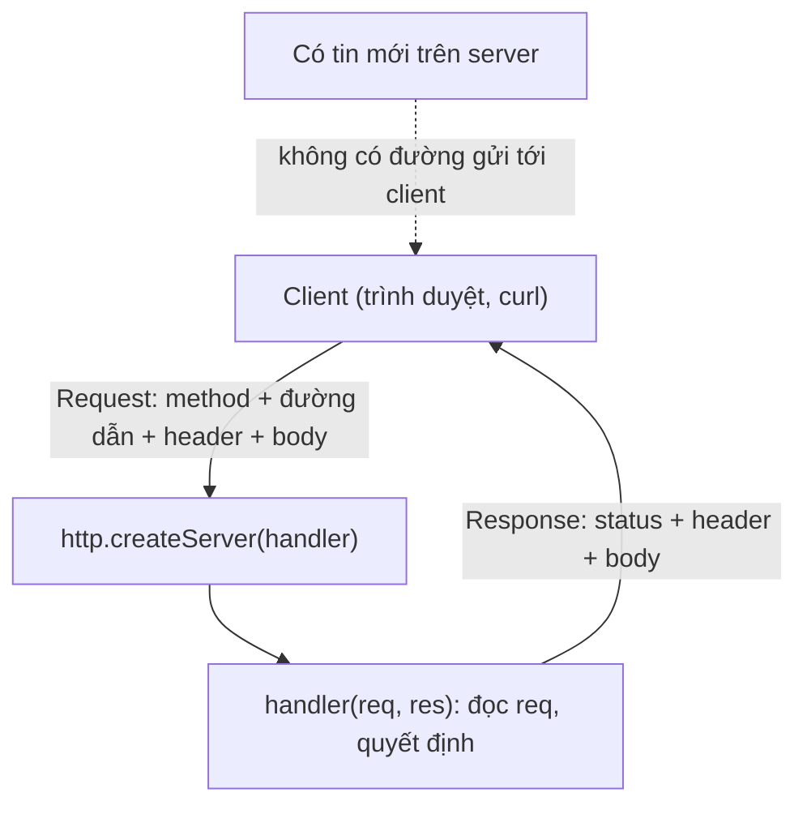

# N02 — EventEmitter & HTTP server: mô hình hỏi–đáp

> Viết REST API tin nhắn của TeamPulse bằng module `http` thuần (không Express): route, mã trạng thái, đọc body JSON có giới hạn, và phát sự kiện mỗi khi có tin mới.

## 🎯 Mục tiêu

Sau buổi này (khoảng 2,5 giờ) bạn sẽ:

- Dùng **EventEmitter**: `on`, `once`, `emit` — nền của mọi thứ trong Node (server, socket, stream, WebSocket).
- Dựng **HTTP server** bằng `http.createServer`, đọc `req.method`, `req.url`, header, body; trả lời bằng `res`.
- Trả **đúng mã trạng thái**: 200, 201, 400, 404, 405, 413, 500.
- Đọc **body** dạng stream an toàn: gom mẩu, giới hạn kích thước, JSON hỏng → 400.
- Hiểu giới hạn của mô hình **hỏi–đáp**: server không tự gửi được gì nếu client không hỏi — lý do có WebSocket ở N03.
- **Kết quả đo được:** `api.js` qua hết **15 test**; `curl` được API thật trên cổng 3000.

## 📋 Đề bài

**Mở thư mục:** workspace của bài `N02-eventemitter-http` (`api.js`, `package.json` đã có `npm start`).

| Viết | Làm gì |
|---|---|
| `ChatRoom.post(user, text)` | Kiểm tra dữ liệu, tạo tin `{id, user, text, ts}`, lưu, `emit('message')` |
| `ChatRoom.history(sinceId)` | Tin có `id > sinceId` |
| `sendJson(res, status, data)` | Trả JSON với đúng status và `Content-Type` |
| `readJsonBody(req, limit)` | Gom body, quá lớn → 413, hỏng → 400 |
| `createApp(room)` | Server: `GET /health`, `GET/POST /messages`, 404, 405, 500 |

`httpError(status, message)` đã viết sẵn: tạo `Error` có thêm thuộc tính `status`.

**Xong khi:** `# pass 15`, và `npm start` rồi gửi thử:

```output
$ curl -X POST http://127.0.0.1:3000/messages -d '{"user":"an","text":"Deploy lúc 10h"}'
{"id":1,"user":"an","text":"Deploy lúc 10h","ts":"2026-10-20T06:17:32.494Z"}
$ curl http://127.0.0.1:3000/messages?since=1
{"messages":[{"id":2,"user":"binh","text":"Ok","ts":"2026-10-20T06:17:32.498Z"}]}
$ curl -i -X DELETE http://127.0.0.1:3000/messages
HTTP/1.1 405 Method Not Allowed
Allow: GET, POST
Content-Type: application/json; charset=utf-8
```

> ⚠️ **Lỗi hay gặp:** Windows PowerShell có `curl` là bí danh của `Invoke-WebRequest`, không nhận `-X`, `-d`, `-i`. Gõ **`curl.exe`** (có sẵn trên Windows 10/11) thay cho `curl` trong mọi lệnh của bài. Dấu nháy trong JSON cũng bị PowerShell xử lý khác bash; cách chạy giống nhau ở mọi shell là ghi body ra file rồi gửi bằng `@`: tạo `body.json` chứa `{"user":"an","text":"Hi"}`, rồi `curl.exe -X POST http://127.0.0.1:3000/messages -d "@body.json"`.

## 🤔 Tại sao? (kiến thức nền)

### EventEmitter: "khi X xảy ra thì gọi hàm này"

Rất nhiều thứ trong Node là **nguồn sự kiện**: server phát `'request'`, socket phát `'data'` và `'close'`, WebSocket phát `'message'`. Tất cả kế thừa `EventEmitter`.

| Hàm | Ý nghĩa |
|---|---|
| `em.on(tên, fn)` | Đăng ký `fn`, gọi mỗi lần sự kiện xảy ra |
| `em.once(tên, fn)` | Chỉ gọi lần đầu |
| `em.emit(tên, ...args)` | Phát sự kiện: gọi **lần lượt, đồng bộ** mọi `fn` đã đăng ký |
| `em.off(tên, fn)` | Gỡ đăng ký |

```js
import { EventEmitter } from 'node:events';

const oven = new EventEmitter();
oven.on('done', (dish, minutes) => console.log(`bếp: ${dish} chín sau ${minutes} phút`));
oven.on('done', (dish) => console.log(`phục vụ: mang ${dish} ra bàn`));
oven.once('done', () => console.log('(chỉ báo lần đầu) bật quạt'));

console.log('trước emit');
oven.emit('done', 'gà nướng', 40);
oven.emit('done', 'bánh mì', 12);
console.log('sau emit, số listener:', oven.listenerCount('done'));
```
```output
trước emit
bếp: gà nướng chín sau 40 phút
phục vụ: mang gà nướng ra bàn
(chỉ báo lần đầu) bật quạt
bếp: bánh mì chín sau 12 phút
phục vụ: mang bánh mì ra bàn
sau emit, số listener: 2
```

`emit` chạy listener **ngay**, theo thứ tự đăng ký, trước khi dòng code sau nó chạy — không phải bất đồng bộ.

Tự tạo nguồn sự kiện bằng cách kế thừa:

```js
import { EventEmitter } from 'node:events';

class Thermometer extends EventEmitter {
  constructor(limit) {
    super();                       // bắt buộc gọi trước khi dùng this
    this.limit = limit;
  }
  read(celsius) {
    if (celsius > this.limit) {
      this.emit('alert', celsius);
    }
  }
}

const t = new Thermometer(38);
t.on('alert', (c) => console.log(`cảnh báo: ${c}°C`));
for (const c of [36.5, 39.2, 37, 40.1]) t.read(c);
```
```output
cảnh báo: 39.2°C
cảnh báo: 40.1°C
```

> ⚠️ **Lỗi hay gặp:** `emit('error', err)` mà không có listener `'error'` → Node **ném lỗi và sập tiến trình**. Với server, socket, WebSocket: luôn `.on('error', ...)`.

### Mô hình hỏi–đáp của HTTP

Mỗi lần trao đổi HTTP: client mở (hoặc dùng lại) kết nối, gửi **một request**, server trả **một response**. Server không có cách nào tự gửi thêm khi client không hỏi.



Một request thật trông như sau (đây là văn bản thuần đi trên TCP):

```output
POST /messages HTTP/1.1
Host: 127.0.0.1:3000
Content-Type: application/json
Content-Length: 38

{"user":"an","text":"Deploy lúc 10h"}
```

### `http.createServer`: server nhỏ nhất

`handler(req, res)` được gọi mỗi khi có request (thực chất là listener của sự kiện `'request'`). Demo dưới tự gọi chính nó bằng `fetch` (có sẵn trong Node 18+) rồi đóng server:

```js
import http from 'node:http';

const server = http.createServer((req, res) => {
  console.log('server nhận:', req.method, req.url, '| user-agent:', req.headers['user-agent']);
  res.writeHead(200, { 'Content-Type': 'text/plain; charset=utf-8' });
  res.end('Hà Nội 24°C, có mưa');
});

server.listen(0, '127.0.0.1', async () => {         // cổng 0 = hệ điều hành chọn cổng trống
  const { port } = server.address();
  const r = await fetch(`http://127.0.0.1:${port}/weather?city=hn`);
  console.log('client nhận:', r.status, r.headers.get('content-type'), '|', await r.text());
  server.close();
});
```
```output
server nhận: GET /weather?city=hn | user-agent: node
client nhận: 200 text/plain; charset=utf-8 | Hà Nội 24°C, có mưa
```

| Đối tượng | Hay dùng |
|---|---|
| `req.method` · `req.url` | `'GET'` · `'/weather?city=hn'` (gồm cả query) |
| `req.headers` | Object, **tên header viết thường**: `req.headers['content-type']` |
| `res.writeHead(status, headers)` | Đặt status + header một lần |
| `res.statusCode = 404` · `res.setHeader(k, v)` | Cách đặt từng phần |
| `res.end(body)` | Gửi body và **kết thúc** response — thiếu nó client chờ mãi |

### Tách đường dẫn và query bằng `URL`

```js
const url = new URL('/weather?city=hn&days=3', 'http://localhost');   // req.url chỉ có phần sau host
console.log(url.pathname, url.searchParams.get('city'), url.searchParams.get('days'));
console.log(url.searchParams.get('unit'));
console.log(Number('3'), Number('abc'), Number(null), Number('abc') || 7);
```
```output
/weather hn 3
null
3 NaN 0 7
```

`Number('abc')` là `NaN`, một giá trị "falsy" như `0`, `''`, `null`, `undefined` — nên `x || mặc_định` thay được cho khối `if (Number.isNaN(x)) ...`.

### Mã trạng thái cần thuộc

| Mã | Nghĩa | Dùng khi |
|---|---|---|
| 200 OK | Thành công | GET đọc dữ liệu |
| 201 Created | Đã tạo mới | POST tạo tin |
| 400 Bad Request | Request sai | JSON hỏng, thiếu trường |
| 404 Not Found | Không có tài nguyên | Sai đường dẫn |
| 405 Method Not Allowed | Có đường dẫn, sai method | `DELETE /messages`; kèm header `Allow` |
| 413 Payload Too Large | Body quá lớn | Chống bị gửi body vài trăm MB |
| 500 Internal Server Error | Lỗi phía server | Lỗi không lường trước |

> 🎯 **Phỏng vấn hay hỏi:** "400 khác 500 thế nào?" — 4xx là lỗi phía client (gửi sai, gửi lại y nguyên vẫn sai); 5xx là lỗi phía server (client không làm gì sai, có thể thử lại sau).

## 🛠️ Làm

### Bước 1 — Chuẩn bị

```bash
cd <workspace>/N02-eventemitter-http
npm start                # lỗi TODO ở createApp — bình thường
```

Đọc phần `main()` cuối `api.js`: server được tạo bằng `createApp(room)` và `room.on('message', ...)` in log mỗi khi có tin.

### Bước 2 — Kiểm tra dữ liệu, `emit` → `ChatRoom.post`

Thứ tự đúng: **kiểm tra trước**, hợp lệ mới tạo tin, lưu, rồi `emit`. Lỗi kiểm tra ném ra **trước** khi đụng vào `this.nextId`.

```js
import { EventEmitter } from 'node:events';

class Library extends EventEmitter {
  constructor() {
    super();
    this.books = [];
  }
  add(title) {
    if (typeof title !== 'string' || title.trim() === '') {
      const err = new Error('Thiếu tên sách');
      err.status = 400;
      throw err;
    }
    const book = { title: title.trim(), addedAt: new Date('2026-10-23T09:00:00Z').toISOString() };
    this.books.push(book);
    this.emit('added', book);
    return book;
  }
}

const lib = new Library();
lib.on('added', (b) => console.log('sự kiện added:', b.title));
lib.add('  Dế Mèn phiêu lưu ký ');
try {
  lib.add('   ');
} catch (err) {
  console.log('lỗi', err.status, err.message, '| số sách:', lib.books.length);
}
```
```output
sự kiện added: Dế Mèn phiêu lưu ký
lỗi 400 Thiếu tên sách | số sách: 1
```

### Bước 3 — Lọc theo id → `ChatRoom.history`

Lấy các bài có điểm lớn hơn một ngưỡng.

**Cách 1 — vòng lặp `for...of`**

```js
const results = [{ id: 1, score: 6 }, { id: 2, score: 9 }, { id: 3, score: 8 }];
const above = [];
for (const r of results) {
  if (r.id > 1) {
    above.push(r);
  }
}
console.log(above.map((r) => r.id), above === results);
```
```output
[ 2, 3 ] false
```

**Cách 2 — `filter`**

```js
const results = [{ id: 1, score: 6 }, { id: 2, score: 9 }, { id: 3, score: 8 }];
const above = results.filter((r) => r.id > 1);
console.log(above.map((r) => r.id), above === results);
```
```output
[ 2, 3 ] false
```

> ⚖️ **So sánh:** cùng O(n), chỉ gọn hơn. Cả hai đều tạo **mảng mới** (`above === results` là `false`) — trả `this.messages` trực tiếp thì bên ngoài sửa được dữ liệu trong room. Vì `id` tăng dần, có thể tìm điểm bắt đầu bằng tìm kiếm nhị phân O(log n) — chỉ đáng làm khi có hàng trăm nghìn tin.

### Bước 4 — Trả JSON → `sendJson`

`JSON.stringify` biến giá trị thành chuỗi; header `Content-Type` nói cho client biết cách đọc body. Thiếu `charset=utf-8`, một số client hiển thị sai tiếng Việt.

```js
console.log(JSON.stringify({ fruit: 'xoài', price: 25000, tags: ['ngọt'] }));
console.log(JSON.stringify([1, 'hai', null]), JSON.stringify('chuỗi'));
console.log(Buffer.byteLength('xoài'), 'byte cho', 'xoài'.length, 'ký tự');
```
```output
{"fruit":"xoài","price":25000,"tags":["ngọt"]}
[1,"hai",null] "chuỗi"
5 byte cho 4 ký tự
```

### Bước 5 — Đọc body dạng stream → `readJsonBody`

Body không đến một lần: nó đến thành nhiều **mẩu** (`Buffer`) qua sự kiện `'data'`. `req` cũng là async iterable, nên đọc được bằng `for await`. Phải **gom đủ byte rồi mới giải mã**: một chữ tiếng Việt có thể bị cắt đôi giữa hai mẩu.

```js
import { Readable } from 'node:stream';

const bytes = Buffer.from('phở');                    // 'ở' chiếm 3 byte
const parts = [bytes.subarray(0, 3), bytes.subarray(3)];
console.log('số byte:', bytes.length, '| mẩu:', parts.map((p) => p.length));

let wrong = '';
for await (const chunk of Readable.from(parts)) {
  wrong += chunk.toString('utf8');                    // giải mã từng mẩu → hỏng chữ
}
const chunks = [];
for await (const chunk of Readable.from(parts)) {
  chunks.push(chunk);
}
const right = Buffer.concat(chunks).toString('utf8'); // gom rồi giải mã một lần
console.log('giải mã từng mẩu:', wrong, '| gom rồi giải mã:', right);
```
```output
số byte: 5 | mẩu: [ 3, 2 ]
giải mã từng mẩu: ph��� | gom rồi giải mã: phở
```

Giới hạn kích thước: đếm byte trong lúc gom, vượt `limit` thì dừng ngay — không đợi gom xong 500 MB mới từ chối.

> ⚠️ **Lỗi hay gặp:** `JSON.parse('[1,2]')` và `JSON.parse('null')` **không** lỗi. Body hợp lệ về JSON nhưng không phải object vẫn phải trả 400 — nếu không `body.user` ném `TypeError` với `null` và server trả 500.

### Bước 6 — Route và xử lý lỗi → `createApp`

Chọn handler theo `method` + `pathname`.

**Cách 1 — `if` / `else`**

```js
function route(method, path) {
  if (path === '/menu') {
    if (method === 'GET') {
      return 'xem thực đơn';
    } else {
      return '405';
    }
  } else if (path === '/open') {
    return 'giờ mở cửa';
  } else {
    return '404';
  }
}
console.log(route('GET', '/menu'), '|', route('PUT', '/menu'), '|', route('GET', '/x'));
```
```output
xem thực đơn | 405 | 404
```

**Cách 2 — bảng tra object**

```js
const routes = {
  'GET /menu': () => 'xem thực đơn',
  'GET /open': () => 'giờ mở cửa',
};
function route(method, path) {
  const handler = routes[`${method} ${path}`];
  if (handler) return handler();
  const knownPath = Object.keys(routes).some((k) => k.endsWith(' ' + path));
  return knownPath ? '405' : '404';
}
console.log(route('GET', '/menu'), '|', route('PUT', '/menu'), '|', route('GET', '/x'));
```
```output
xem thực đơn | 405 | 404
```

`routes[key]` tra object O(1); `Object.keys(...).some(fn)` là vòng `for` dừng ngay khi `fn` trả `true`. Express, Fastify tổ chức route theo kiểu Cách 2.

> ⚖️ **So sánh:** với 3–4 route, cả hai đều tức thì — Cách 2 tra trúng là O(1), Cách 1 duyệt O(số route) nhưng số route quá nhỏ để đo được. Cách 2 dễ thêm route; Cách 1 dễ đọc hơn khi mới học — bài này dùng cách nào cũng được.

Một khối `try/catch` bọc toàn bộ handler: lỗi có `err.status` (do bạn ném) → trả đúng mã đó; lỗi khác → 500. Handler là `async` vì phải `await readJsonBody(req)`.

> ⚠️ **Lỗi hay gặp:** so `req.url === '/messages'` → `/messages?since=2` rơi vào 404. Luôn tách bằng `new URL(req.url, 'http://localhost').pathname`.

> ⚠️ **Lỗi hay gặp:** gọi `res.end()` hai lần, hoặc quên `return` sau khi trả 405 nên code chạy tiếp xuống 404 → lỗi `ERR_HTTP_HEADERS_SENT`.

### Bước 7 — Chạy thật và nhìn giới hạn

```bash
npm start
# terminal khác:
curl -i http://127.0.0.1:3000/health
curl -X POST http://127.0.0.1:3000/messages -d '{"user":"an","text":"Deploy lúc 10h"}'
curl "http://127.0.0.1:3000/messages?since=0"
```

Terminal của server in `[sự kiện message] #1 an: Deploy lúc 10h` — sự kiện đến **server** ngay lập tức. Nhưng một trình duyệt đang mở trang chat thì **không** biết có tin mới cho tới khi nó tự gọi `GET /messages` lần nữa. N03 đo cái giá của việc "hỏi liên tục" và thay nó bằng WebSocket.

## ✅ Tự kiểm tra

Bấm **Chạy test**, hoặc trong thư mục workspace của bài:

```bash
npm test
```

`npm test` chạy `scripts.test` trong `package.json`: `node --test "../../curriculum/N02-eventemitter-http/tests/*.test.js"`. Dấu ngoặc kép giữ nguyên mẫu `*.test.js` để chính Node tìm file — chạy được cả trong bash lẫn PowerShell. Node 22 **không** nhận đường dẫn thư mục (`node --test thư-mục/` báo `Cannot find module`).

Mục tiêu: `# pass 15`. Test mở server thật ở cổng ngẫu nhiên trên `127.0.0.1`, gọi bằng `fetch`, rồi đóng lại.

## 🎤 Câu hỏi phỏng vấn

> 🎯 **Phỏng vấn hay hỏi:** "Vì sao HTTP thuần không làm được chat realtime?" — HTTP là hỏi–đáp: mỗi response phải có một request trước. Server biết có tin mới (sự kiện `message` đã chạy) nhưng không có kênh nào để gửi cho client đang không hỏi. Hai cách chữa: client hỏi liên tục (polling) hoặc giữ một kết nối hai chiều (WebSocket).
