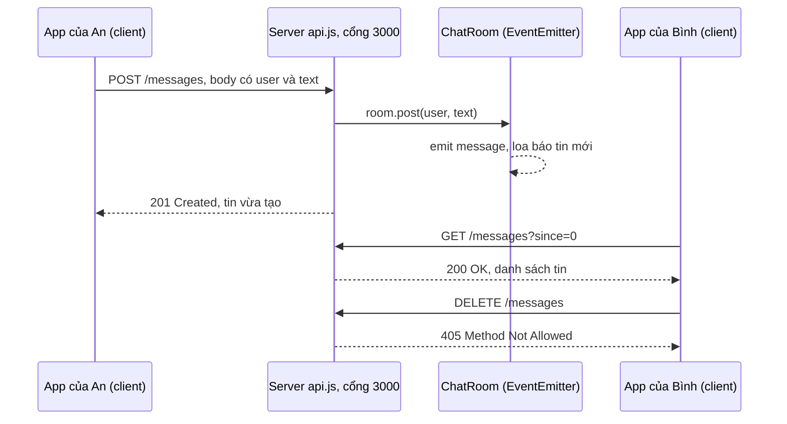
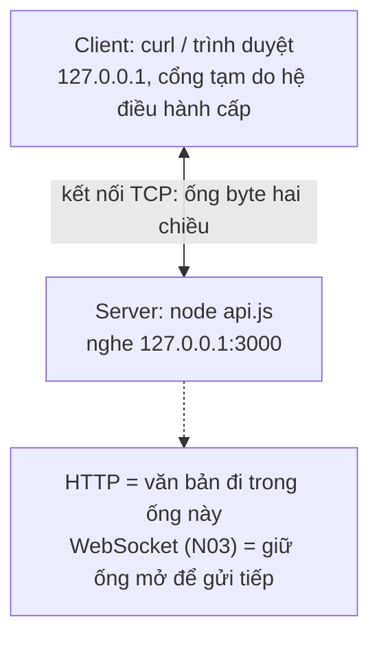
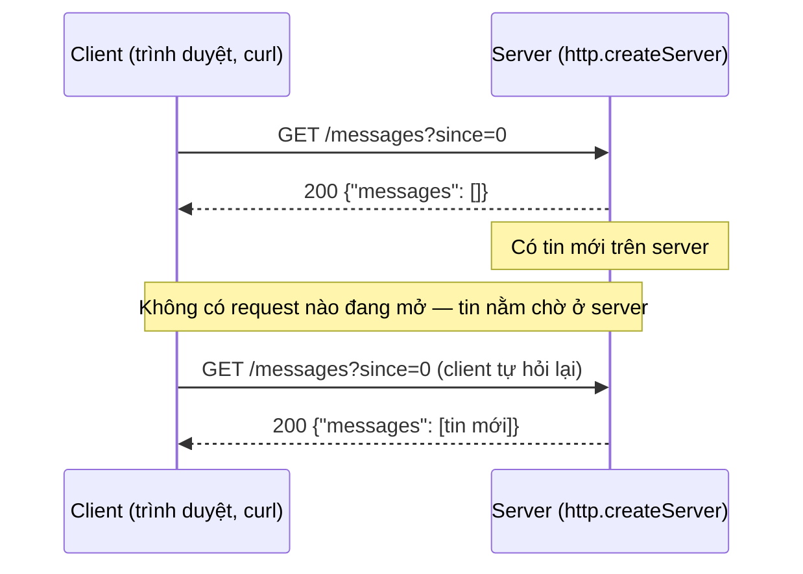

# N02 — EventEmitter & HTTP server: mô hình hỏi–đáp

> Viết REST API tin nhắn của TeamPulse bằng module `http` thuần (không Express): route, mã trạng thái, đọc body JSON có giới hạn, và phát sự kiện mỗi khi có tin mới.

## 🎯 Mục tiêu

Sau buổi này (khoảng 4 giờ) bạn sẽ:

- Giải thích **IP, localhost, cổng, kết nối TCP** — và vì sao HTTP chỉ là văn bản đi trên kết nối đó.
- Dùng **EventEmitter**: `on`, `once`, `emit` — nền của mọi thứ trong Node (server, socket, stream, WebSocket).
- Dựng **HTTP server** bằng `http.createServer`, đọc `req.method`, `req.url`, header, body; trả lời bằng `res`.
- Trả **đúng mã trạng thái**: 200, 201, 400, 404, 405, 413, 500.
- Đọc **body** dạng stream an toàn: gom mẩu, giới hạn kích thước, JSON hỏng → 400.
- Hiểu giới hạn của mô hình **hỏi–đáp**: mỗi response trả lời đúng một request, client không hỏi thì không nhận được gì — lý do có WebSocket (N03a giải thích, N03 bắt tay làm).
- **Kết quả đo được:** `api.js` qua hết **15 test**; `curl` được API thật trên cổng 3000.

> 📖 Từ lạ ở trên và trong Đề bài (server, cổng, route, body, mã trạng thái, `curl`…) được giải nghĩa ở mục *Hiểu trước khi làm*, ngay đầu phần kiến thức nền.

## 📋 Đề bài

**Mở thư mục:** workspace của bài `N02-eventemitter-http` (`api.js`, `package.json` đã có `npm start`).

| Viết | Làm gì |
|---|---|
| `ChatRoom.post(user, text)` | Kiểm tra dữ liệu, tạo tin `{id, user, text, ts}`, lưu, `emit('message')` |
| `ChatRoom.history(sinceId)` | Tin có `id > sinceId` |
| `sendJson(res, status, data)` | Trả JSON với đúng status và `Content-Type` |
| `readJsonBody(req, limit)` | Gom body, quá lớn → 413 ("body quá lớn"), hỏng → 400 ("gửi sai") |
| `createApp(room)` | Server: `GET /health`, `GET/POST /messages`, 404 ("không có đường dẫn này"), 405 ("có đường dẫn nhưng sai method"), 500 ("server lỗi") |

`httpError(status, message)` đã viết sẵn: tạo `Error` có thêm thuộc tính `status`.

**Xong khi:** `# pass 15`, và `npm start` rồi gửi thử:

```output
$ curl -X POST http://127.0.0.1:3000/messages -d '{"user":"an","text":"Deploy lúc 10h"}'
{"id":1,"user":"an","text":"Deploy lúc 10h","ts":"2026-10-20T06:17:32.494Z"}
$ curl -X POST http://127.0.0.1:3000/messages -d '{"user":"binh","text":"Ok"}'
{"id":2,"user":"binh","text":"Ok","ts":"2026-10-20T06:17:32.498Z"}
$ curl "http://127.0.0.1:3000/messages?since=1"
{"messages":[{"id":2,"user":"binh","text":"Ok","ts":"2026-10-20T06:17:32.498Z"}]}
$ curl -i -X DELETE http://127.0.0.1:3000/messages
HTTP/1.1 405 Method Not Allowed
Allow: GET, POST
Content-Type: application/json; charset=utf-8
```

> ⚠️ **Lỗi hay gặp:** Windows PowerShell có `curl` là bí danh của `Invoke-WebRequest`, không nhận `-X`, `-d`, `-i`. Gõ **`curl.exe`** (có sẵn trên Windows 10/11) thay cho `curl` trong mọi lệnh của bài. Dấu nháy trong JSON cũng bị PowerShell xử lý khác bash; cách chạy giống nhau ở mọi shell là ghi body ra file rồi gửi bằng `@`: tạo `body.json` chứa `{"user":"an","text":"Hi"}`, rồi `curl.exe -X POST http://127.0.0.1:3000/messages -d "@body.json"`.

## 🤔 Tại sao? (kiến thức nền)

> 📖 **Cú pháp:** `class ... extends`, `this`, `{ port } = ...`, `async`/`await`, `try/catch` đã học ở **N00**; Promise và `for await` ở **N01**.

### Hiểu trước khi làm

**Bối cảnh.** An và Bình mở TeamPulse trên hai máy khác nhau mà phải thấy **cùng một** danh sách tin. Vậy tin không thể nằm trên máy của từng người: phải cất ở một máy chung luôn bật, ai cần thì hỏi tới — đó là **server** (máy chủ). Hai bên cần một luật hỏi–đáp chung để hiểu nhau: **HTTP**. Bài này viết server đó: nhận câu hỏi, biết câu hỏi muốn gì, trả lời kèm mã "được" hay "lỗi gì", và báo cho phần khác của chương trình mỗi khi có tin mới.

**Ví dụ đời thường.** Một **quầy thông tin** trong tòa nhà văn phòng. Địa chỉ tòa nhà là **IP**, số quầy là **cổng (port)**. Khách điền phiếu yêu cầu (**request**): loại việc — hỏi xem (**GET**) hay nộp hồ sơ (**POST**) —, phòng nào (**đường dẫn**, vd. `/messages`), giấy tờ kèm theo (**body**). Nhân viên tra theo phòng (**route**) rồi trả phiếu kết quả (**response**) có đóng dấu mã (**status code**): 200 "xong", 404 "không có phòng này", 400 "phiếu điền sai". Còn **EventEmitter** là cái loa trong tòa nhà: mỗi khi có hồ sơ mới, loa báo, ai đã đăng ký nghe thì nghe.

**Bạn đã gặp nó ở đâu.**
- Gõ `shopee.vn` rồi Enter: trình duyệt gửi một request GET tới server của Shopee, nhận về trang web.
- Bấm link hỏng và thấy "404 Not Found" — đúng mã trạng thái bạn sẽ trả trong bài.
- Bấm "Đăng" trên Facebook: app gửi request POST kèm nội dung bài.
- App ngân hàng báo "Hệ thống đang bận, vui lòng thử lại" — server trả mã nhóm 5xx.

| Câu hỏi | Trả lời |
|---|---|
| **What** — là gì | Server: chương trình chạy liên tục, nghe ở một cổng, trả lời request. HTTP: luật viết request/response bằng chữ. |
| **Why** — vì sao cần | Dữ liệu chung (tin nhắn) phải nằm một chỗ; mọi app, trình duyệt, công cụ đều nói được HTTP. |
| **When** — khi nào dùng | Client cần hỏi lấy hoặc gửi dữ liệu: tải lịch sử chat, gửi một tin, kiểm tra server còn sống. |
| **When not** — khi nào không | Server cần **tự đẩy** tin mới ngay khi có: HTTP thường bắt client hỏi lại liên tục — lý do có WebSocket (N03a). |
| **Where** — ở đâu | Mọi trang web, app di động; trong khóa: `node api.js` trên máy bạn, cổng 3000. |
| **How** — chạy thế nào | Client mở kết nối tới `IP:cổng`, gửi vài dòng chữ (method, đường dẫn, header, body); server chọn route, xử lý, gửi lại vài dòng chữ có mã trạng thái. |



**Từ mới trong bài**

| Từ | Nghĩa đời thường |
|---|---|
| **Server** (máy chủ) · **client** | Bên trả lời · bên hỏi (trình duyệt, `curl`, `fetch`, app) |
| **Địa chỉ IP**, **`localhost` / `127.0.0.1`** | "Số nhà" của một máy trên mạng · chính máy bạn, tin không ra khỏi máy |
| **Cổng (port)** | "Số quầy" 0–65535; mỗi server nghe một cổng (N02 dùng 3000; web thật 80, 443) |
| **Kết nối TCP** | Đường ống byte hai chiều giữa hai đầu `IP:cổng`: đúng thứ tự, không mất |
| **Byte**, **UTF-8** | Đơn vị dữ liệu nhỏ nhất · cách ghi chữ thành byte (chữ có dấu tốn 2–3 byte) |
| **HTTP** | Luật hỏi–đáp bằng văn bản đi trên kết nối TCP |
| **Request** · **response** | Phiếu hỏi client gửi · phiếu trả lời server gửi lại |
| **Method** (`GET`, `POST`, `DELETE`) | Loại việc: hỏi xem · gửi tạo mới · xoá |
| **URL**, **đường dẫn (path)**, **query** | Địa chỉ đầy đủ · phần `/messages` · phần sau dấu `?`, vd. `?since=1` |
| **Route** | Cặp method + đường dẫn mà server biết xử lý, vd. `GET /messages` |
| **Header** · **body** | Các dòng "Tên: giá trị" mô tả request/response · phần nội dung chính phía sau |
| **`Content-Type`** | Header nói body là loại gì, vd. `application/json` |
| **Status code** (mã trạng thái) | Số 3 chữ số trong response: 2xx được, 4xx client gửi sai, 5xx server lỗi |
| **API**, **REST API** | Bộ địa chỉ để chương trình khác gọi lấy/gửi dữ liệu · kiểu API dùng method + đường dẫn như trên |
| **Express** | Thư viện làm server phổ biến; bài này **không** dùng để thấy phần bên dưới |
| **`curl`** · **`fetch`** | Công cụ gửi request từ terminal · hàm gửi request trong JavaScript |
| **EventEmitter**, **listener** | Nguồn phát sự kiện (cái loa) · hàm đăng ký nghe sự kiện |
| **`on` / `once` / `emit`** | Đăng ký nghe mãi · nghe một lần · phát sự kiện |
| **Stream**, **chunk**, **Buffer** | Dữ liệu đến từng mẩu · một mẩu · kiểu chứa byte thô của Node |
| **Timestamp** (`ts`) | Mốc thời gian, dạng `2026-10-20T06:17:32.494Z` (giờ UTC) |
| **`EADDRINUSE`** | Lỗi "cổng này đã có chương trình khác nghe" |
| **Biến môi trường** (`PORT`) | Giá trị đặt ngoài code khi chạy lệnh, chương trình đọc qua `process.env` |
| **PowerShell** | Terminal mặc định của Windows; lệnh hơi khác bash của Linux/macOS |

### Mạng 101: HTTP chỉ là văn bản trên kết nối TCP

Các từ client, server, IP, cổng, TCP đã có trong bảng trên; sơ đồ dưới ghép chúng lại:



**HTTP chỉ là văn bản** gửi qua ống TCP: client gõ vài dòng chữ (request), server gõ lại vài dòng chữ (response). Demo dưới mở ống TCP bằng module `net` rồi tự gõ request bằng tay, không dùng thư viện HTTP nào ở phía client:

```js
import http from 'node:http';
import net from 'node:net';

const server = http.createServer((req, res) => {
  const body = 'xin chào';
  res.writeHead(200, {
    'Content-Type': 'text/plain; charset=utf-8',
    'Content-Length': Buffer.byteLength(body),   // số byte của body
  });
  res.end(body);
});
server.listen(0, '127.0.0.1', () => {
  const { port } = server.address();
  console.log('client: mở kết nối TCP tới 127.0.0.1, gõ request bằng tay');
  const sock = net.connect(port, '127.0.0.1');               // mở kết nối TCP
  sock.write('GET /hello HTTP/1.1\r\nHost: 127.0.0.1\r\nConnection: close\r\n\r\n');
  let reply = '';
  sock.on('data', (chunk) => { reply += chunk; });
  sock.on('end', () => {
    for (const line of reply.split('\r\n')) {
      if (!line.startsWith('Date:')) {     // bỏ dòng ngày giờ (mỗi lần chạy một khác)
        console.log(line);
      }
    }
    server.close();
  });
});
```
```output
client: mở kết nối TCP tới 127.0.0.1, gõ request bằng tay
HTTP/1.1 200 OK
Content-Type: text/plain; charset=utf-8
Content-Length: 9
Connection: close

xin chào
```

`server.listen(0, ...)`: cổng `0` nghĩa là "hệ điều hành chọn giúp một cổng trống" — test của khóa dùng cách này để không đụng cổng nào đang chạy. Dòng trống ngăn phần header với phần body; `Content-Length: 9` vì `xin chào` chiếm 9 **byte** (chữ `à` tốn 2 byte trong UTF-8).

Một cổng chỉ một chương trình nghe được. Mở server thứ hai cùng cổng → lỗi `EADDRINUSE` (address in use):

```js
import http from 'node:http';

const first = http.createServer();
first.listen(0, '127.0.0.1', () => {
  const { port } = first.address();
  const second = http.createServer();
  second.on('error', (err) => {
    console.log('server thứ hai không mở được cổng', port === first.address().port, '→', err.code);
    first.close();
  });
  second.listen(port, '127.0.0.1');            // cùng cổng với server thứ nhất
});
console.log('PORT trong biến môi trường:', process.env.PORT, '→ dùng', Number(process.env.PORT) || 3000);
```
```output
PORT trong biến môi trường: undefined → dùng 3000
server thứ hai không mở được cổng true → EADDRINUSE
```

> ⚠️ **Lỗi hay gặp:** `Error: listen EADDRINUSE: address already in use 127.0.0.1:3000` khi `npm start` → một server cũ (thường là terminal khác bạn quên tắt) vẫn giữ cổng. Tắt nó bằng Ctrl+C, hoặc chạy trên cổng khác: `PORT=3005 npm start` (PowerShell: `$env:PORT=3005; npm start`). `process.env.PORT` đọc biến môi trường `PORT` — giống `os.environ.get('PORT')` của Python; `Number(...) || 3000` dùng 3000 khi biến không có.

### EventEmitter: "khi X xảy ra thì gọi hàm này"

Rất nhiều thứ trong Node là **nguồn sự kiện**: server phát `'request'`, socket phát `'data'` và `'close'`, WebSocket phát `'message'`. Tất cả kế thừa `EventEmitter`.

| Hàm | Ý nghĩa |
|---|---|
| `em.on(tên, fn)` | Đăng ký `fn`, gọi mỗi lần sự kiện xảy ra |
| `em.once(tên, fn)` | Chỉ gọi lần đầu |
| `em.emit(tên, ...args)` | Phát sự kiện: gọi **lần lượt, đồng bộ** mọi `fn` đã đăng ký |
| `em.off(tên, fn)` | Gỡ đăng ký |

```js
import { EventEmitter } from 'node:events';

const oven = new EventEmitter();
oven.on('done', (dish, minutes) => console.log(`bếp: ${dish} chín sau ${minutes} phút`));
oven.on('done', (dish) => console.log(`phục vụ: mang ${dish} ra bàn`));
oven.once('done', () => console.log('(chỉ báo lần đầu) bật quạt'));

console.log('trước emit');
oven.emit('done', 'gà nướng', 40);
oven.emit('done', 'bánh mì', 12);
console.log('sau emit, số listener:', oven.listenerCount('done'));
```
```output
trước emit
bếp: gà nướng chín sau 40 phút
phục vụ: mang gà nướng ra bàn
(chỉ báo lần đầu) bật quạt
bếp: bánh mì chín sau 12 phút
phục vụ: mang bánh mì ra bàn
sau emit, số listener: 2
```

`emit` chạy listener **ngay**, theo thứ tự đăng ký, trước khi dòng code sau nó chạy — không phải bất đồng bộ.

Tự tạo nguồn sự kiện bằng cách kế thừa:

```js
import { EventEmitter } from 'node:events';

class Thermometer extends EventEmitter {
  constructor(limit) {
    super();                       // bắt buộc gọi trước khi dùng this
    this.limit = limit;
  }
  read(celsius) {
    if (celsius > this.limit) {
      this.emit('alert', celsius);
    }
  }
}

const t = new Thermometer(38);
t.on('alert', (c) => console.log(`cảnh báo: ${c}°C`));
for (const c of [36.5, 39.2, 37, 40.1]) t.read(c);
```
```output
cảnh báo: 39.2°C
cảnh báo: 40.1°C
```

Đối chiếu với class Python (chi tiết ở N00 Bước 7):

| Python | JavaScript |
|---|---|
| `class Thermometer(EventEmitter):` | `class Thermometer extends EventEmitter {` |
| `def __init__(self, limit):` + `super().__init__()` | `constructor(limit) {` + `super();` — gọi trước khi dùng `this` |
| `self.limit = limit` | `this.limit = limit;` — `this` không khai báo ở tham số |
| `t = Thermometer(38)` | `const t = new Thermometer(38);` |

`ChatRoom` trong starter cũng `extends EventEmitter`: `this.emit('message', tin)` bên trong class phát sự kiện cho mọi `room.on('message', ...)` bên ngoài.

> ⚠️ **Lỗi hay gặp:** `emit('error', err)` mà không có listener `'error'` → Node **ném lỗi và sập tiến trình**. Với server, socket, WebSocket: luôn `.on('error', ...)`.

### Mô hình hỏi–đáp của HTTP

Mỗi lần trao đổi HTTP: client mở (hoặc dùng lại) kết nối TCP, gửi **một request**, server trả **một response**. Trong mô hình hỏi–đáp **thông thường** này, mỗi response trả lời đúng một request: server có tin mới cũng phải chờ client hỏi lại. (Có cách giữ response mở để đẩy dần — Server-Sent Events, long polling — N03 so sánh chúng với WebSocket.)



Một request thật trông như sau (văn bản thuần đi trên kết nối TCP, như demo Mạng 101):

```output
POST /messages HTTP/1.1
Host: 127.0.0.1:3000
Content-Type: application/json
Content-Length: 38

{"user":"an","text":"Deploy lúc 10h"}
```

### `http.createServer`: server nhỏ nhất

`handler(req, res)` được gọi mỗi khi có request (thực chất là listener của sự kiện `'request'`). Demo dưới tự gọi chính nó bằng `fetch` (có sẵn trong Node 18+) rồi đóng server:

```js
import http from 'node:http';

const server = http.createServer((req, res) => {
  console.log('server nhận:', req.method, req.url, '| user-agent:', req.headers['user-agent']);
  res.writeHead(200, { 'Content-Type': 'text/plain; charset=utf-8' });
  res.end('Hà Nội 24°C, có mưa');
});

server.listen(0, '127.0.0.1', async () => {         // cổng 0 = hệ điều hành chọn cổng trống
  const { port } = server.address();
  const r = await fetch(`http://127.0.0.1:${port}/weather?city=hn`);
  console.log('client nhận:', r.status, r.headers.get('content-type'), '|', await r.text());
  server.close();
});
```
```output
server nhận: GET /weather?city=hn | user-agent: node
client nhận: 200 text/plain; charset=utf-8 | Hà Nội 24°C, có mưa
```

| Đối tượng | Hay dùng |
|---|---|
| `req.method` · `req.url` | `'GET'` · `'/weather?city=hn'` (gồm cả query) |
| `req.headers` | Object, **tên header viết thường**: `req.headers['content-type']` |
| `res.writeHead(status, headers)` | Đặt status + header một lần |
| `res.statusCode = 404` · `res.setHeader(k, v)` | Cách đặt từng phần |
| `res.end(body)` | Gửi body và **kết thúc** response — thiếu nó client chờ mãi |

Hai cách đặt header **dùng chung được**: header đặt bằng `res.setHeader(tên, giá_trị)` **trước** sẽ được `res.writeHead(status, headers)` gộp vào (trùng tên thì `writeHead` thắng). Vì vậy muốn thêm một header cho riêng một response mà vẫn dùng hàm trả JSON chung, gọi `setHeader` trước khi gọi hàm đó:

```js
import http from 'node:http';

function reply(res, status, data) {             // giống sendJson, viết gọn cho demo
  res.writeHead(status, { 'Content-Type': 'application/json; charset=utf-8' });
  res.end(JSON.stringify(data));
}

const server = http.createServer((req, res) => {
  res.setHeader('X-Shop', 'bun-cha');           // đặt trước, writeHead sau: hai header được GỘP
  reply(res, 405, { error: 'chỉ nhận GET' });
});
server.listen(0, '127.0.0.1', async () => {
  const r = await fetch(`http://127.0.0.1:${server.address().port}/`);
  console.log(r.status, r.headers.get('x-shop'), '|', r.headers.get('content-type'));
  server.close();
});
```
```output
405 bun-cha | application/json; charset=utf-8
```

`sendJson` của bạn dùng đúng cách này cho response 405: `res.setHeader('Allow', ...)` rồi mới `sendJson(res, 405, ...)` — không cần đổi chữ ký `sendJson`.

### Tách đường dẫn và query bằng `URL`

```js
const url = new URL('/weather?city=hn&days=3', 'http://localhost');   // req.url chỉ có phần sau host
console.log(url.pathname, url.searchParams.get('city'), url.searchParams.get('days'));
console.log(url.searchParams.get('unit'));
console.log(Number('3'), Number('abc'), Number(null), Number('abc') || 7);
```
```output
/weather hn 3
null
3 NaN 0 7
```

`Number('abc')` là `NaN`, một giá trị "falsy" như `0`, `''`, `null`, `undefined` — nên `x || mặc_định` thay được cho khối `if (Number.isNaN(x)) ...`.

### Mã trạng thái cần thuộc

| Mã | Nghĩa | Dùng khi |
|---|---|---|
| 200 OK | Thành công | GET đọc dữ liệu |
| 201 Created | Đã tạo mới | POST tạo tin |
| 400 Bad Request | Request sai | JSON hỏng, thiếu trường |
| 404 Not Found | Không có tài nguyên | Sai đường dẫn |
| 405 Method Not Allowed | Có đường dẫn, sai method | `DELETE /messages`; kèm header `Allow` |
| 413 Payload Too Large | Body quá lớn | Chống bị gửi body vài trăm MB |
| 500 Internal Server Error | Lỗi phía server | Lỗi không lường trước |

> 🎯 **Phỏng vấn hay hỏi:** "400 khác 500 thế nào?" — 4xx là lỗi phía client (gửi sai, gửi lại y nguyên vẫn sai); 5xx là lỗi phía server (client không làm gì sai, có thể thử lại sau).

## 🛠️ Làm

### Bước 1 — Chuẩn bị

```bash
cd academy/courses/node-realtime/workspace/N02-eventemitter-http
npm start                # lỗi TODO ở createApp — bình thường
node --test --test-name-pattern="ChatRoom" "../../curriculum/N02-eventemitter-http/tests/*.test.js"   # chỉ chạy test của ChatRoom
```

Đổi `ChatRoom` thành `sendJson`, `readJsonBody`, `createApp` để chạy test của từng hàm.

> ⚠️ **Lỗi hay gặp:** `npm test -- --test-name-pattern=...` **không** lọc được: npm nối cờ vào **sau** mẫu tên file, và Node 22 bỏ qua cờ đặt sau tên file — mọi test vẫn chạy. Gõ thẳng lệnh `node --test --test-name-pattern="<mẫu>" "<mẫu file>"` như trên.

Đọc phần `main()` cuối `api.js`: server được tạo bằng `createApp(room)` và `room.on('message', ...)` in log mỗi khi có tin.

### Bước 2 — Kiểm tra dữ liệu, `emit` → `ChatRoom.post`

Thứ tự đúng: **kiểm tra trước**, hợp lệ mới tạo tin, lưu, rồi `emit`. Lỗi kiểm tra ném ra **trước** khi đụng vào `this.nextId`.

```js
import { EventEmitter } from 'node:events';

class Library extends EventEmitter {
  constructor() {
    super();
    this.books = [];
  }
  add(title) {
    if (typeof title !== 'string' || title.trim() === '') {
      const err = new Error('Thiếu tên sách');
      err.status = 400;
      throw err;
    }
    const book = { title: title.trim(), addedAt: new Date('2026-10-23T09:00:00Z').toISOString() };
    this.books.push(book);
    this.emit('added', book);
    return book;
  }
}

const lib = new Library();
lib.on('added', (b) => console.log('sự kiện added:', b.title));
lib.add('  Dế Mèn phiêu lưu ký ');
try {
  lib.add('   ');
} catch (err) {
  console.log('lỗi', err.status, err.message, '| số sách:', lib.books.length);
}
```
```output
sự kiện added: Dế Mèn phiêu lưu ký
lỗi 400 Thiếu tên sách | số sách: 1
```

### Bước 3 — Lọc theo id → `ChatRoom.history`

Lấy các bài có điểm lớn hơn một ngưỡng.

**Cách 1 — vòng lặp `for...of`**

```js
const results = [{ id: 1, score: 6 }, { id: 2, score: 9 }, { id: 3, score: 8 }];
const above = [];
for (const r of results) {
  if (r.id > 1) {
    above.push(r);
  }
}
console.log(above, above === results);
```
```output
[ { id: 2, score: 9 }, { id: 3, score: 8 } ] false
```

**Cách 2 — `filter`**

```js
const results = [{ id: 1, score: 6 }, { id: 2, score: 9 }, { id: 3, score: 8 }];
const above = results.filter((r) => r.id > 1);
console.log(above, above === results);
```
```output
[ { id: 2, score: 9 }, { id: 3, score: 8 } ] false
```

> ⚖️ **So sánh:** cùng O(n), chỉ gọn hơn. Cả hai đều tạo **mảng mới** (`above === results` là `false`) — trả `this.messages` trực tiếp thì bên ngoài sửa được dữ liệu trong room. Vì `id` tăng dần, có thể tìm điểm bắt đầu bằng tìm kiếm nhị phân O(log n) — chỉ đáng làm khi có hàng trăm nghìn tin.

### Bước 4 — Trả JSON → `sendJson`

`JSON.stringify` biến giá trị thành chuỗi; header `Content-Type` nói cho client biết cách đọc body. Thiếu `charset=utf-8`, một số client hiển thị sai tiếng Việt.

```js
console.log(JSON.stringify({ fruit: 'xoài', price: 25000, tags: ['ngọt'] }));
console.log(JSON.stringify([1, 'hai', null]), JSON.stringify('chuỗi'));
console.log(Buffer.byteLength('xoài'), 'byte cho', 'xoài'.length, 'ký tự');
```
```output
{"fruit":"xoài","price":25000,"tags":["ngọt"]}
[1,"hai",null] "chuỗi"
5 byte cho 4 ký tự
```

`Buffer` là dãy **byte** thô — giống `bytes` của Python. Mạng và file trong Node đưa dữ liệu dạng `Buffer`; `buf.toString('utf8')` đổi sang chuỗi, `Buffer.from('chữ')` đổi ngược lại. Chữ có dấu tốn nhiều byte hơn số ký tự.

### Bước 5 — Đọc body dạng stream → `readJsonBody`

Body không đến một lần: nó đến thành nhiều **mẩu** (`Buffer`) qua sự kiện `'data'`. `req` cũng là async iterable, nên đọc được bằng `for await`. Phải **gom đủ byte rồi mới giải mã**: một chữ tiếng Việt có thể bị cắt đôi giữa hai mẩu.

```js
import { Readable } from 'node:stream';

const bytes = Buffer.from('phở');                    // 'ở' chiếm 3 byte
const parts = [bytes.subarray(0, 3), bytes.subarray(3)];
console.log('số byte:', bytes.length, '| mẩu:', parts.map((p) => p.length));

let wrong = '';
for await (const chunk of Readable.from(parts)) {
  wrong += chunk.toString('utf8');                    // giải mã từng mẩu → hỏng chữ
}
const chunks = [];
for await (const chunk of Readable.from(parts)) {
  chunks.push(chunk);
}
const right = Buffer.concat(chunks).toString('utf8'); // gom rồi giải mã một lần
console.log('giải mã từng mẩu:', wrong, '| gom rồi giải mã:', right);
```
```output
số byte: 5 | mẩu: [ 3, 2 ]
giải mã từng mẩu: ph��� | gom rồi giải mã: phở
```

`for await (const chunk of req)` duyệt một **async iterable**: thứ duyệt được bằng `for await`, mỗi vòng **chờ** mẩu dữ liệu kế tiếp tới mạng rồi mới chạy thân vòng lặp (event loop rảnh trong lúc chờ). Nó giống `for...of` nhưng từng phần tử đến theo thời gian.

Giới hạn kích thước: đếm **trong lúc** gom, vượt giới hạn thì ném lỗi ngay ở giữa vòng lặp — không đợi gom xong 500 MB mới từ chối. Ví dụ cùng khuôn với hàng hoá: dừng nhận thùng khi tổng cân vượt tải:

```js
import { Readable } from 'node:stream';

async function totalWeight(boxes, maxKg) {
  let kg = 0;
  let opened = 0;
  for await (const box of boxes) {          // mỗi vòng CHỜ mẩu kế tiếp tới
    opened += 1;
    kg += box;
    if (kg > maxKg) {
      throw new Error(`quá ${maxKg} kg sau ${opened} thùng — dừng ngay, không nhận thêm`);
    }
  }
  return `${kg} kg, ${opened} thùng`;
}

console.log(await totalWeight(Readable.from([10, 20, 5]), 50));
try {
  await totalWeight(Readable.from([30, 30, 30, 30, 30]), 50);
} catch (err) {
  console.log(err.message);
}
```
```output
35 kg, 3 thùng
quá 50 kg sau 2 thùng — dừng ngay, không nhận thêm
```

`throw` bên trong `for await` thoát vòng lặp ngay; với `req` thật, Node ngừng đọc tiếp body. Trong `readJsonBody`, "cân" là `chunk.length` (số byte của mẩu) và lỗi là `httpError(413, ...)`.

> ⚠️ **Lỗi hay gặp:** `JSON.parse('[1,2]')` và `JSON.parse('null')` **không** lỗi. Body hợp lệ về JSON nhưng không phải object vẫn phải trả 400 — nếu không `body.user` ném `TypeError` với `null` và server trả 500.

### Bước 6 — Route và xử lý lỗi → `createApp`

Chọn handler theo `method` + `pathname`.

**Cách 1 — `if` / `else`**

```js
function route(method, path) {
  if (path === '/menu') {
    if (method === 'GET') {
      return 'xem thực đơn';
    } else {
      return '405';
    }
  } else if (path === '/open') {
    return 'giờ mở cửa';
  } else {
    return '404';
  }
}
console.log(route('GET', '/menu'), '|', route('PUT', '/menu'), '|', route('GET', '/x'));
```
```output
xem thực đơn | 405 | 404
```

**Cách 2 — bảng tra object**

```js
const routes = {
  'GET /menu': () => 'xem thực đơn',
  'GET /open': () => 'giờ mở cửa',
};
function route(method, path) {
  const handler = routes[`${method} ${path}`];
  if (handler) return handler();
  const knownPath = Object.keys(routes).some((k) => k.endsWith(' ' + path));
  return knownPath ? '405' : '404';
}
console.log(route('GET', '/menu'), '|', route('PUT', '/menu'), '|', route('GET', '/x'));
```
```output
xem thực đơn | 405 | 404
```

`routes[key]` tra object O(1); `Object.keys(...).some(fn)` là vòng `for` dừng ngay khi `fn` trả `true`. Express, Fastify tổ chức route theo kiểu Cách 2.

> ⚖️ **So sánh:** với 3–4 route, cả hai đều tức thì — Cách 2 tra trúng là O(1), Cách 1 duyệt O(số route) nhưng số route quá nhỏ để đo được. Cách 2 dễ thêm route; Cách 1 dễ đọc hơn khi mới học — bài này dùng cách nào cũng được.

Ghép route + đọc body + xử lý lỗi thành một server. Ví dụ mẫu **cùng khuôn, khác miền**: quán ăn có `GET /menu?max=...` (lọc theo giá), `POST /orders` (đọc body JSON), method khác trên `/menu` → 405 kèm `Allow`, đường dẫn lạ → 404, lỗi bất ngờ → 500. Demo tự gọi chính nó bằng `fetch` để in kết quả:

```js
import http from 'node:http';

const menu = [
  { dish: 'phở bò', price: 50000 },
  { dish: 'bún chả', price: 45000 },
  { dish: 'bánh mì', price: 25000 },
];
const orders = [];

function reply(res, status, data) {
  res.writeHead(status, { 'Content-Type': 'application/json; charset=utf-8' });
  res.end(JSON.stringify(data));
}
function fail(status, message) {                 // giống httpError của starter
  const err = new Error(message);
  err.status = status;
  return err;
}
async function readText(req) {
  const chunks = [];
  for await (const chunk of req) {
    chunks.push(chunk);
  }
  return Buffer.concat(chunks).toString('utf8');
}

const server = http.createServer(async (req, res) => {
  const url = new URL(req.url, 'http://localhost');      // tách path và query
  try {
    if (url.pathname === '/menu') {
      if (req.method !== 'GET') {
        res.setHeader('Allow', 'GET');
        return reply(res, 405, { error: `Không hỗ trợ ${req.method}` });
      }
      const max = Number(url.searchParams.get('max')) || Infinity;
      const cheap = [];
      for (const item of menu) {
        if (item.price <= max) {
          cheap.push(item);
        }
      }
      return reply(res, 200, { menu: cheap });
    }
    if (url.pathname === '/orders' && req.method === 'POST') {
      const body = JSON.parse(await readText(req));     // JSON hỏng → SyntaxError → 500 (demo không kiểm tra)
      if (typeof body.dish !== 'string') {
        throw fail(400, 'Thiếu tên món');
      }
      orders.push(body.dish);
      return reply(res, 201, { order: orders.length, dish: body.dish });
    }
    return reply(res, 404, { error: `Không có ${url.pathname}` });
  } catch (err) {
    const status = err.status ?? 500;                    // lỗi tự ném có status; lỗi khác → 500
    return reply(res, status, { error: status === 500 ? 'Lỗi server' : err.message });
  }
});

server.listen(0, '127.0.0.1', async () => {
  const base = `http://127.0.0.1:${server.address().port}`;
  const calls = [
    ['GET', '/menu?max=45000'],
    ['POST', '/orders', '{"dish":"phở bò"}'],
    ['POST', '/orders', '{"note":"không hành"}'],
    ['POST', '/orders', '{hỏng'],
    ['DELETE', '/menu'],
    ['GET', '/khong-co'],
  ];
  for (const [method, path, body] of calls) {
    const r = await fetch(base + path, { method, body });
    let line = `${method.padEnd(6)} ${path.padEnd(16)} → ${r.status} ${await r.text()}`;
    if (r.headers.get('allow')) {
      line += ` | Allow: ${r.headers.get('allow')}`;
    }
    console.log(line);
  }
  server.close();
});
```
```output
GET    /menu?max=45000  → 200 {"menu":[{"dish":"bún chả","price":45000},{"dish":"bánh mì","price":25000}]}
POST   /orders          → 201 {"order":1,"dish":"phở bò"}
POST   /orders          → 400 {"error":"Thiếu tên món"}
POST   /orders          → 500 {"error":"Lỗi server"}
DELETE /menu            → 405 {"error":"Không hỗ trợ DELETE"} | Allow: GET
GET    /khong-co        → 404 {"error":"Không có /khong-co"}
```

Đọc khuôn của nó: **một** `try/catch` bọc toàn bộ handler; nhánh nào trả lời xong thì `return` ngay; lỗi tự ném (có `err.status`) trả đúng mã đó, lỗi khác (ở đây `JSON.parse` của body hỏng) thành 500 — server không sập. Handler là `async` vì phải `await` đọc body. `fetch(url, { method, body })` là cách client gửi request có method và body (N03 dùng lại).

Viết `createApp` theo từng bước nhỏ (starter có khung xương trong comment), chạy `node --test --test-name-pattern="createApp" "../../curriculum/N02-eventemitter-http/tests/*.test.js"` sau mỗi bước — số test xanh tăng dần:

- **Bước 6a** — hàm trả về một HTTP server (chưa `listen`) trả lời `GET /health` như JSDoc; mọi đường dẫn khác trả 404 dạng JSON `{ error }`. Nhớ: so **đường dẫn**, không so cả `req.url` (có query). Test "GET /health" xanh.
- **Bước 6b** — `GET /messages` trả các tin mới hơn `?since=`; thiếu hoặc không phải số thì trả mọi tin. Test "GET /messages?since=N" xanh.
- **Bước 6c** — `POST /messages` tạo tin **qua `room`** (để sự kiện `message` được phát) từ body JSON, trả 201 kèm tin vừa tạo. Test "POST /messages → 201" xanh.
- **Bước 6d** — method khác GET/POST trên `/messages` → 405, response có header `Allow: GET, POST` (cách thêm header cho riêng một response: mục `setHeader`/`writeHead` ở phần Tại sao). Test "sai route → 404, sai method → 405" xanh.
- **Bước 6e** — lỗi ném ra ở bất cứ đâu trong handler đều thành response JSON: lỗi có `status` (400, 413) dùng đúng mã đó, lỗi khác thành 500; server vẫn trả lời request sau. Ba test còn lại (400, 413, 500) xanh.

> ⚠️ **Lỗi hay gặp:** so `req.url === '/messages'` → `/messages?since=2` rơi vào 404. Luôn tách bằng `new URL(req.url, 'http://localhost').pathname`.

> ⚠️ **Lỗi hay gặp:** gọi `res.end()` hai lần, hoặc quên `return` sau khi trả 405 nên code chạy tiếp xuống 404 → lỗi `ERR_HTTP_HEADERS_SENT`.

### Bước 7 — Chạy thật và nhìn giới hạn

```bash
npm start
# terminal khác:
curl -i http://127.0.0.1:3000/health
curl -X POST http://127.0.0.1:3000/messages -d '{"user":"an","text":"Deploy lúc 10h"}'
curl "http://127.0.0.1:3000/messages?since=0"
```

Terminal của server in `[sự kiện message] #1 an: Deploy lúc 10h` — sự kiện đến **server** ngay lập tức. Nhưng một trình duyệt đang mở trang chat thì **không** biết có tin mới cho tới khi nó tự gọi `GET /messages` lần nữa: API hỏi–đáp này không giữ request nào mở để đẩy tin. N03 đo cái giá của việc "hỏi liên tục" và thay nó bằng WebSocket.

## ✅ Tự kiểm tra

Bấm **Chạy test**, hoặc trong thư mục workspace của bài:

```bash
npm test
```

`npm test` chạy `scripts.test` trong `package.json`: `node --test "../../curriculum/N02-eventemitter-http/tests/*.test.js"`. Dấu ngoặc kép giữ nguyên mẫu `*.test.js` để chính Node tìm file — chạy được cả trong bash lẫn PowerShell. Node 22 **không** nhận đường dẫn thư mục (`node --test thư-mục/` báo `Cannot find module`).

Mục tiêu: `# pass 15`. Test mở server thật ở cổng ngẫu nhiên trên `127.0.0.1`, gọi bằng `fetch`, rồi đóng lại.

## 🎤 Câu hỏi phỏng vấn

> 🎯 **Phỏng vấn hay hỏi:** "Vì sao HTTP thuần không làm được chat realtime?" — trong mô hình hỏi–đáp thông thường, mỗi response trả lời đúng một request. Server biết có tin mới (sự kiện `message` đã chạy) nhưng không có kênh nào để gửi cho client đang không hỏi. Cách chữa: client hỏi liên tục (polling), giữ một response HTTP mở để đẩy dần (long polling, Server-Sent Events — chỉ một chiều server → client), hoặc nâng cấp lên một kết nối hai chiều (WebSocket).
