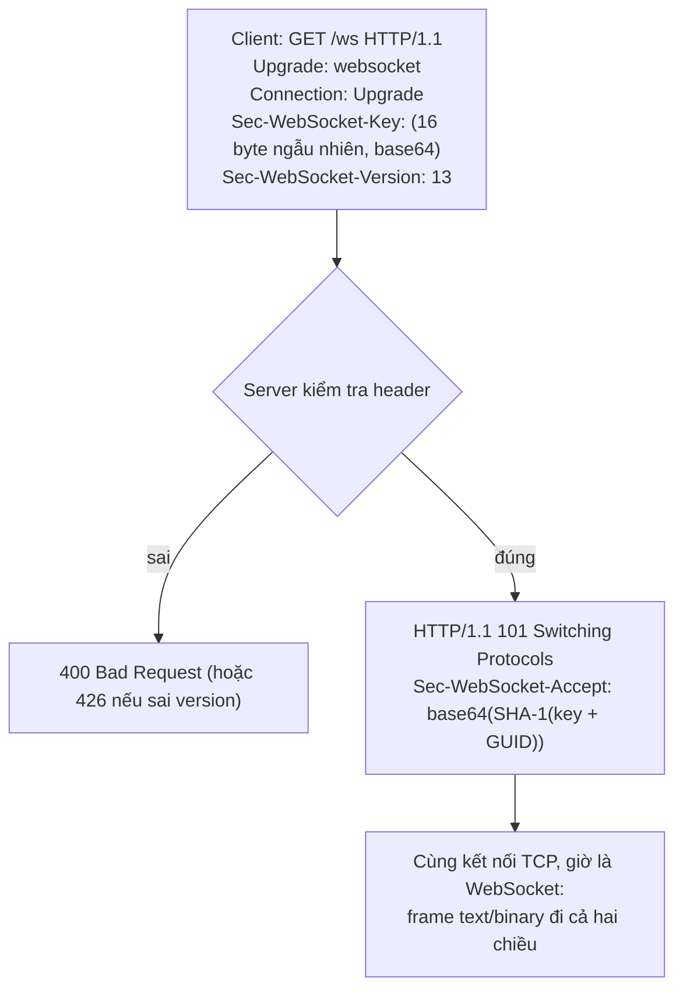

# N03 — WebSocket đầu tiên: từ polling tới handshake

> Đo bằng số vì sao chat không chạy tốt trên HTTP hỏi–đáp, rồi mở kết nối WebSocket đầu tiên: tự tính handshake bằng tay, viết echo server với thư viện `ws`, và nhìn từng frame trong DevTools.

## 🎯 Mục tiêu

Sau buổi này (khoảng 2,5 giờ) bạn sẽ:

- Viết **polling** và đo được cái giá của nó: bao nhiêu request rỗng, tin đến trễ bao lâu.
- Giải thích **handshake WebSocket**: request HTTP có `Upgrade: websocket` → `101 Switching Protocols`, và tự tính **`Sec-WebSocket-Accept`** từ `Sec-WebSocket-Key`.
- Dùng 4 sự kiện **`open` / `message` / `close` / `error`**, phân biệt tin **text** và **binary**, đọc **`readyState`**.
- Viết **echo server** bằng `ws` và client trình duyệt; xem frame trong **DevTools → Network → WS**.
- **Kết quả đo được:** `echo.js` qua hết **16 test**; `npm run measure` in số liệu polling vs WebSocket trên máy bạn.

> 🧠 **Ghi nhớ:** WebSocket **không** thay HTTP. Nó **bắt đầu** bằng một request HTTP bình thường, rồi hai bên đồng ý "đổi giao thức" trên chính kết nối TCP đó. Từ lúc ấy, cả server lẫn client đều gửi được bất cứ lúc nào.

## 📋 Đề bài

**Mở thư mục:** workspace của bài `N03-websocket-dau-tien` (`echo.js`, `measure.js`, `public/index.html`). Thư viện `ws` đã cài sẵn ở thư mục khóa học; Node tự tìm thấy nó.

| Viết | Làm gì |
|---|---|
| `startPolling({url, intervalMs, onMessage})` | Hỏi `GET ...?since=<id>` liên tục, đếm request rỗng |
| `computeAccept(key)` | `base64(SHA-1(key + GUID))` |
| `handshakeResponse(headers)` | Request nâng cấp hợp lệ → 101; sai version → 426; sai khác → 400 |
| `readyStateName(ws)` | 0–3 → `CONNECTING` / `OPEN` / `CLOSING` / `CLOSED` |
| `createEchoServer()` | Trang `/` + WebSocket `/ws`: gửi `welcome`, text → `echo: ...`, binary → trả lại byte |

`measure.js` (đã viết sẵn) dùng `startPolling` của bạn để đo; `public/index.html` là client trình duyệt hoàn chỉnh.

**Xong khi:** `# pass 16`, `npm run measure` chạy hết, và `npm start` mở được `http://127.0.0.1:3001`, gửi tin thấy echo.

## 🤔 Tại sao? (kiến thức nền)

### Bài toán: server có tin mới, làm sao báo client?

Ở N02, server biết ngay khi có tin (sự kiện `message`), nhưng HTTP chỉ cho server **trả lời**, không cho **chủ động gửi**. Ba cách thường gặp:

| Cách | Hoạt động | Nhược điểm |
|---|---|---|
| Polling | Client hỏi lại mỗi N giây | Phần lớn request rỗng; tin trễ tới N giây |
| Long polling | Client hỏi, server **giữ** request tới khi có tin | Mỗi tin vẫn tốn một request + header; phức tạp |
| **WebSocket** | Một kết nối TCP mở lâu, **hai chiều** | Phải quản lý kết nối (N04, P2) |

Số đo thật bằng `npm run measure` (20 giây, 10 tin, 1 client, chạy trên `127.0.0.1`):

```output
Polling 1000 ms : 21 request, 11 rỗng (52%), nhận 10/10, trễ TB 416 ms, tối đa 769 ms, 8641 byte
WebSocket      : 1 kết nối, nhận 10/10, trễ TB 0 ms, tối đa 1 ms, 837 byte (gồm cả handshake)

Polling 3000 ms : 8 request, 1 rỗng (13%), nhận 10/10, trễ TB 1344 ms, tối đa 2406 ms, 3584 byte
```

| | Polling 1 giây | Polling 3 giây | WebSocket |
|---|---|---|---|
| Request / 20 giây | 21 | 8 | 0 (1 kết nối) |
| Trễ trung bình | 0,42 s | 1,34 s | < 1 ms |
| Byte trên mạng | 8.641 | 3.584 | 837 |

Polling buộc chọn giữa **tốn** (hỏi dày) và **chậm** (hỏi thưa). Mỗi request polling mang ~400 byte header dù body rỗng; trình duyệt thật còn gửi kèm cookie nên lớn hơn. Nhân lên 100 người online, polling 1 giây là 6.000 request/phút chỉ để hỏi "có gì mới không".

> ⚠️ **Lỗi hay gặp:** đo trên `127.0.0.1` thì mạng gần như không tốn thời gian. Qua Internet, mỗi request polling cộng thêm 20–200 ms đi về, còn WebSocket chỉ trả chi phí đó **một lần** lúc kết nối.

### Handshake: từ HTTP sang WebSocket



`Sec-WebSocket-Accept` chứng minh server **thật sự hiểu WebSocket** (không phải một server HTTP thường vô tình trả 200). Nó **không** phải mã hóa hay bảo mật: ai cũng tính được. Bảo mật đến từ `wss://` (TLS) và xác thực (P2).

Handshake thật, gửi bằng socket TCP thô tới một server `ws` (key lấy từ ví dụ trong chuẩn):

```js
import net from 'node:net';
import { WebSocketServer } from 'ws';

const wss = new WebSocketServer({ port: 0, host: '127.0.0.1' });
await new Promise((r) => wss.once('listening', r));
const sock = net.connect(wss.address().port, '127.0.0.1');
sock.write([
  'GET / HTTP/1.1',
  'Host: 127.0.0.1',
  'Upgrade: websocket',
  'Connection: Upgrade',
  'Sec-WebSocket-Key: dGhlIHNhbXBsZSBub25jZQ==',
  'Sec-WebSocket-Version: 13',
  '', '',
].join('\r\n'));
const reply = await new Promise((r) => sock.once('data', r));
console.log(reply.toString().trim());
sock.destroy();
wss.close();
```
```output
HTTP/1.1 101 Switching Protocols
Upgrade: websocket
Connection: Upgrade
Sec-WebSocket-Accept: s3pPLMBiTxaQ9kYGzzhZRbK+xOo=
```

Hàm `computeAccept` của bạn phải ra đúng chuỗi ở dòng cuối khi nhận key `dGhlIHNhbXBsZSBub25jZQ==`.

### Frame: text, binary và vì sao gọn

Sau handshake, dữ liệu đi theo **frame**: 2–14 byte đầu frame + nội dung. Byte đầu chứa **opcode**: `0x1` text (UTF-8), `0x2` binary, `0x8` close, `0x9`/`0xA` ping/pong (P2). Xem byte thật server gửi:

```js
import net from 'node:net';
import { WebSocketServer } from 'ws';

const wss = new WebSocketServer({ port: 0, host: '127.0.0.1' });
wss.on('connection', (ws) => {
  ws.send('hi');                                  // text
  ws.send(Buffer.from([7, 8]), { binary: true }); // binary
});
await new Promise((r) => wss.once('listening', r));
const sock = net.connect(wss.address().port, '127.0.0.1');
sock.write('GET / HTTP/1.1\r\nHost: x\r\nUpgrade: websocket\r\nConnection: Upgrade\r\n' +
  'Sec-WebSocket-Key: dGhlIHNhbXBsZSBub25jZQ==\r\nSec-WebSocket-Version: 13\r\n\r\n');
let buf = Buffer.alloc(0);
sock.on('data', (d) => { buf = Buffer.concat([buf, d]); });
await new Promise((r) => setTimeout(r, 200));
const frames = buf.subarray(buf.indexOf('\r\n\r\n') + 4);  // bỏ phần handshake
console.log('byte sau handshake:', [...frames].map((b) => b.toString(16).padStart(2, '0')).join(' '));
sock.destroy();
wss.close();
```
```output
byte sau handshake: 81 02 68 69 82 02 07 08
```

Đọc: `81 02 68 69` = `0x81` (FIN + opcode 1 = text), `02` (dài 2 byte), `68 69` = `"hi"`. `82 02 07 08` = binary, 2 byte `07 08`. Một tin chat chỉ tốn **2 byte** đầu frame (client → server thêm 4 byte mặt nạ), so với ~400 byte header của mỗi request polling.

### Bốn sự kiện và `readyState`

| Sự kiện (thư viện `ws` / trình duyệt) | Khi nào |
|---|---|
| `open` | Handshake xong, gửi được |
| `message` | Nhận một tin. `ws`: `(data, isBinary)`, `data` là `Buffer`; trình duyệt: `event.data` là chuỗi hoặc `ArrayBuffer`/`Blob` |
| `close` | Kết nối đóng: `(code, reason)`; 1000 = đóng bình thường, 1006 = mất kết nối không báo |
| `error` | Lỗi mạng/giao thức; luôn kèm `close` sau đó |

| `readyState` | Tên | Gửi được? |
|---|---|---|
| 0 | `CONNECTING` | Chưa |
| 1 | `OPEN` | Được |
| 2 | `CLOSING` | Không |
| 3 | `CLOSED` | Không |

Một phiên hỏi–đáp đầy đủ, theo dõi thứ tự sự kiện (đố vui toán, server hỏi trước):

```js
import { WebSocketServer, WebSocket } from 'ws';

const wss = new WebSocketServer({ port: 0, host: '127.0.0.1' });
wss.on('connection', (ws) => {
  ws.on('error', console.error);
  ws.send('Câu hỏi: 7 x 8 = ?');
  ws.on('message', (data, isBinary) => {
    console.log(`[server] nhận ${isBinary ? 'binary' : 'text'}:`, data.toString());
    ws.close(1000, 'het gio');
  });
});
await new Promise((r) => wss.once('listening', r));

const client = new WebSocket(`ws://127.0.0.1:${wss.address().port}`);
console.log('[client] readyState', client.readyState);
client.on('open', () => console.log('[client] open, readyState', client.readyState));
client.on('message', (data) => {
  console.log('[client] nhận:', data.toString(), '| data là Buffer?', Buffer.isBuffer(data));
  client.send('56');
});
client.on('close', (code, reason) => {
  console.log('[client] close', code, reason.toString(), '| readyState', client.readyState);
  wss.close();
});
```
```output
[client] readyState 0
[client] open, readyState 1
[client] nhận: Câu hỏi: 7 x 8 = ? | data là Buffer? true
[server] nhận text: 56
[client] close 1000 het gio | readyState 3
```

> ⚠️ **Lỗi hay gặp:** `ws.send(...)` khi `readyState` chưa là `OPEN` → thư viện `ws` ném lỗi, trình duyệt báo `InvalidStateError`. Gửi trong (hoặc sau) sự kiện `open`.

> ⚠️ **Lỗi hay gặp:** trong `ws` 8.x, `data` của tin text vẫn là `Buffer`. `JSON.parse(data)` chạy được vì nó tự gọi `toString()`, nhưng so sánh `data === 'hi'` luôn `false` — dùng `data.toString()`.

## 🛠️ Làm

### Bước 1 — Chuẩn bị

```bash
cd <workspace>/N03-websocket-dau-tien
node -e "import('ws').then(m => console.log('ws OK'))"   # kiểm tra Node thấy thư viện ws
npm test   # 16 fail vì TODO — bình thường
```

> ⚠️ **Lỗi hay gặp:** `ERR_MODULE_NOT_FOUND: Cannot find package 'ws'` → workspace không nằm trong thư mục khóa học, hoặc chưa chạy `npm install` ở thư mục `courses/node-realtime/`.

### Bước 2 — Lặp có nghỉ, không chồng nhau → `startPolling`

`setInterval(fn, 100)` gọi `fn` mỗi 100 ms **bất kể** lần trước xong chưa. Khi `fn` là request mạng chậm hơn khoảng nghỉ, các request chồng lên nhau. Hẹn lại bằng `setTimeout` **sau khi** việc xong thì không bao giờ chồng:

```js
import { setTimeout as sleep } from 'node:timers/promises';

async function slowTask(log, name) {         // giả lập request mất 250 ms
  log.running += 1;
  log.maxParallel = Math.max(log.maxParallel, log.running);
  await sleep(250);
  log.running -= 1;
  log.done += 1;
}

const a = { running: 0, maxParallel: 0, done: 0 };
const id = setInterval(() => slowTask(a, 'interval'), 100);
await sleep(1000);
clearInterval(id);

const b = { running: 0, maxParallel: 0, done: 0 };
let timer;
let stopped = false;
async function loop() {
  await slowTask(b, 'timeout');
  if (!stopped) timer = setTimeout(loop, 100);   // hẹn lượt sau khi lượt này xong
}
loop();
await sleep(1000);
stopped = true;
clearTimeout(timer);
await sleep(300);
console.log('setInterval : chạy song song tối đa', a.maxParallel);
console.log('setTimeout  : chạy song song tối đa', b.maxParallel, '| xong', b.done, 'lượt');
```
```output
setInterval : chạy song song tối đa 3
setTimeout  : chạy song song tối đa 1 | xong 3 lượt
```

`startPolling` trả `{ stop, stats }` **ngay**, còn các lượt hỏi chạy nền. `stats` là một object; bạn sửa thuộc tính của nó (`stats.requests += 1`) chứ không gán object mới, để người giữ tham chiếu luôn thấy số mới nhất. Mỗi lượt bọc trong `try/catch`: server tắt thì `fetch` ném lỗi — đếm `errors` rồi vẫn hẹn lượt sau.

### Bước 3 — Băm SHA-1 và base64 → `computeAccept`

```js
import { createHash, randomBytes } from 'node:crypto';

console.log(createHash('sha1').update('banana').digest('hex'));
console.log(createHash('sha1').update('banana').digest('base64'));
console.log(createHash('sha1').update('banana').digest().length, 'byte');

const nonce = randomBytes(16).toString('base64');         // giống cách trình duyệt tạo Sec-WebSocket-Key
console.log(nonce.length, 'ký tự base64 →', Buffer.from(nonce, 'base64').length, 'byte');
```
```output
250e77f12a5ab6972a0895d290c4792f0a326ea8
JQ538SpatpcqCJXSkMR5Lwoybqg=
20 byte
24 ký tự base64 → 16 byte
```

SHA-1 luôn ra 20 byte; `digest('hex')` và `digest('base64')` chỉ là hai cách viết cùng 20 byte đó. Chuẩn WebSocket dùng base64.

### Bước 4 — Đọc header không phân biệt hoa thường → `handshakeResponse`

Node đưa tên header về **chữ thường** (`req.headers.upgrade`), nhưng **giá trị** giữ nguyên như client gửi: `WebSocket`, `keep-alive, Upgrade`... Kiểm tra một danh sách token có chứa một từ:

**Cách 1 — vòng lặp `for...of`**

```js
const header = 'gzip, Deflate , br';
let found = false;
for (const part of header.split(',')) {
  if (part.trim().toLowerCase() === 'deflate') {
    found = true;
    break;                       // thấy rồi thì dừng
  }
}
console.log(found);
```
```output
true
```

**Cách 2 — `split` + `map` + `includes`**

```js
const header = 'gzip, Deflate , br';
console.log(header.toLowerCase().split(',').map((t) => t.trim()).includes('deflate'));
```
```output
true
```

> ⚖️ **So sánh:** cùng O(n) theo số token (vài token, không đáng đo). Cách 1 dừng sớm khi thấy; Cách 2 luôn tạo hết mảng rồi mới tìm — gọn hơn, chậm hơn không đáng kể.

> ⚠️ **Lỗi hay gặp:** `headers.connection.toLowerCase()` khi header **không có** → `TypeError: Cannot read properties of undefined`. Dùng giá trị mặc định: `(headers.connection ?? '')`, hoặc optional chaining `headers.connection?.toLowerCase()` (trả `undefined` thay vì ném lỗi).

Thứ tự kiểm tra theo JSDoc: lỗi cơ bản (thiếu `upgrade`, `connection`, key sai) → 400; chỉ sai version → 426.

### Bước 5 — Tra số ra tên → `readyStateName`

Đèn giao thông: 0 đỏ, 1 xanh, 2 vàng.

**Cách 1 — `if` / `else`**

```js
function lightName(code) {
  if (code === 0) {
    return 'ĐỎ';
  } else if (code === 1) {
    return 'XANH';
  } else if (code === 2) {
    return 'VÀNG';
  } else {
    return 'HỎNG';
  }
}
console.log([0, 1, 2, 9].map(lightName));
```
```output
[ 'ĐỎ', 'XANH', 'VÀNG', 'HỎNG' ]
```

**Cách 2 — mảng tra cứu + `??`**

```js
const LIGHTS = ['ĐỎ', 'XANH', 'VÀNG'];
const lightName = (code) => LIGHTS[code] ?? 'HỎNG';
console.log([0, 1, 2, 9].map(lightName));
```
```output
[ 'ĐỎ', 'XANH', 'VÀNG', 'HỎNG' ]
```

`LIGHTS[9]` là `undefined` (JS không báo lỗi khi đọc ngoài mảng, khác `IndexError` của Python), nên `?? 'HỎNG'` lo trường hợp còn lại.

> ⚖️ **So sánh:** cả hai O(1) với số trường hợp cố định; Cách 2 gọn và dễ thêm giá trị, Cách 1 rõ ràng hơn khi mỗi nhánh làm việc khác nhau.

### Bước 6 — Echo server → `createEchoServer`

`new WebSocketServer({ server, path: '/ws' })` **gắn** WebSocket vào HTTP server có sẵn: request thường đi vào handler HTTP của bạn, request `Upgrade` tới `/ws` được `ws` xử lý handshake (đúng phần bạn viết tay ở Bước 3–4), đường dẫn khác bị từ chối. Một cổng phục vụ cả trang web lẫn WebSocket.

Khung xử lý mỗi kết nối (demo đố vui ở trên): `wss.on('connection', (ws) => { ws.on('error', ...); ws.send(...); ws.on('message', (data, isBinary) => ...) })`. Mỗi `ws` là **một** client — gửi bằng `ws.send` chỉ tới đúng client đó.

> 💡 **Mẹo:** gửi lại byte nhận được mà không có `{ binary: true }` thì `ws` 8.x mặc định gửi `Buffer` dưới dạng binary — nhưng gửi chuỗi luôn là text. Ghi rõ `{ binary: isBinary }` giúp người đọc code khỏi đoán.

### Bước 7 — Chạy trên trình duyệt và xem frame

```bash
npm start
```

Mở `http://127.0.0.1:3001` → DevTools (F12) → tab **Network** → bộ lọc **WS** → tải lại trang → bấm vào dòng `ws`:

| Tab trong DevTools | Thấy gì |
|---|---|
| Headers | `Status Code: 101 Switching Protocols`, `Sec-WebSocket-Key`, `Sec-WebSocket-Accept` |
| Messages | Mỗi frame một dòng: mũi tên xanh ↑ client gửi, đỏ ↓ server gửi; binary hiện dạng `Binary Message` |

Chép `Sec-WebSocket-Key` từ tab Headers, kiểm tra bằng hàm của bạn:

```bash
node -e "import('./echo.js').then(m => console.log(m.computeAccept('<dán key vào đây>')))"
```

Kết quả phải trùng `Sec-WebSocket-Accept` trình duyệt nhận được. Terminal server cũng in `handshakeResponse(req.headers)` cho mỗi lần kết nối. Bấm **Đóng kết nối**: badge chuyển `CLOSED`, tab Messages có frame close.

### Bước 8 — Đo trên máy bạn

```bash
npm run measure                  # polling 1 giây
POLL_MS=3000 npm run measure     # polling 3 giây (PowerShell: $env:POLL_MS=3000; npm run measure)
```

So với bảng ở phần "Tại sao". Con số trên máy bạn sẽ hơi khác (tin đến lúc ngẫu nhiên), nhưng tỉ lệ thì không.

## ✅ Tự kiểm tra

Bấm **Chạy test**, hoặc trong thư mục workspace của bài:

```bash
npm test
```

`npm test` chạy `scripts.test` trong `package.json`: `node --test "../../curriculum/N03-websocket-dau-tien/tests/*.test.js"`. Dấu ngoặc kép giữ nguyên mẫu `*.test.js` để chính Node tìm file — chạy được cả trong bash lẫn PowerShell. Node 22 **không** nhận đường dẫn thư mục (`node --test thư-mục/` báo `Cannot find module`).

Mục tiêu: `# pass 16`. Test mở server thật ở cổng ngẫu nhiên trên `127.0.0.1`, kết nối bằng client `ws`, mỗi lần chờ tin có giới hạn 2 giây — code sai sẽ fail với thông báo rõ ràng chứ không treo.

## 🎤 Câu hỏi phỏng vấn

> 🎯 **Phỏng vấn hay hỏi:** "WebSocket bắt đầu thế nào?" — trả lời đủ 4 ý: (1) client gửi `GET` HTTP/1.1 với `Upgrade: websocket`, `Connection: Upgrade`, `Sec-WebSocket-Key`, `Sec-WebSocket-Version: 13`; (2) server trả `101 Switching Protocols` với `Sec-WebSocket-Accept = base64(SHA-1(key + GUID))`; (3) từ đó cùng kết nối TCP chuyển sang frame hai chiều; (4) kèm số liệu: "polling 1 giây tốn 21 request trong 20 giây, trễ trung bình 0,4 s; WebSocket một kết nối, trễ dưới 1 ms".
