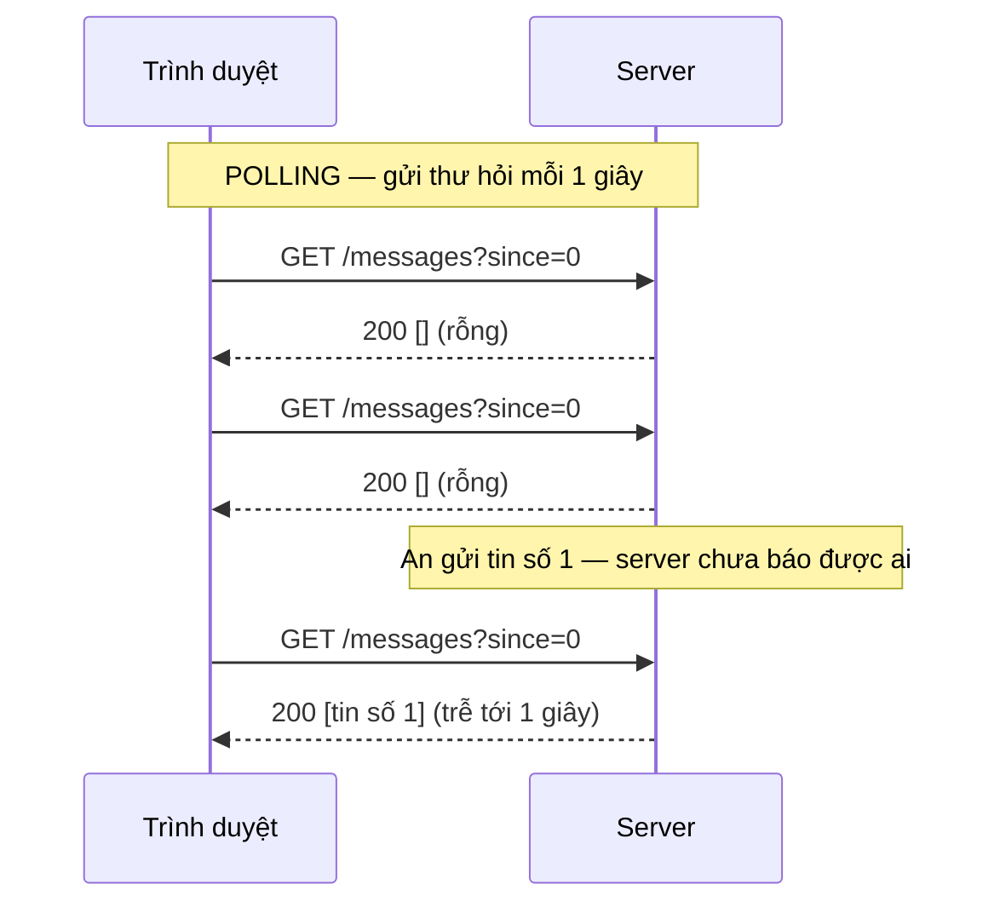
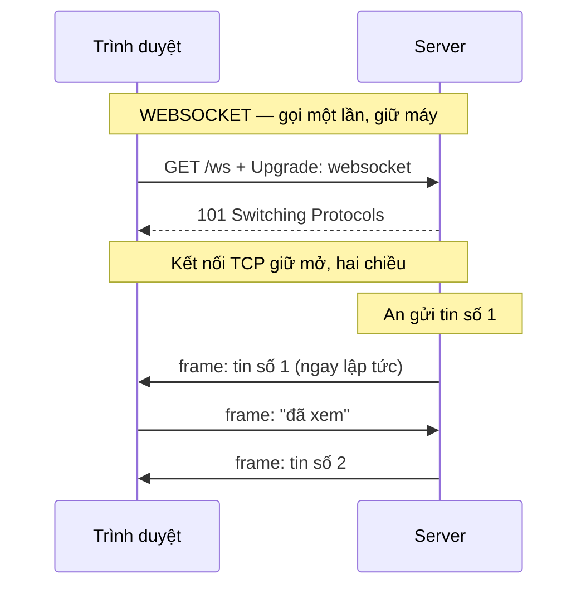
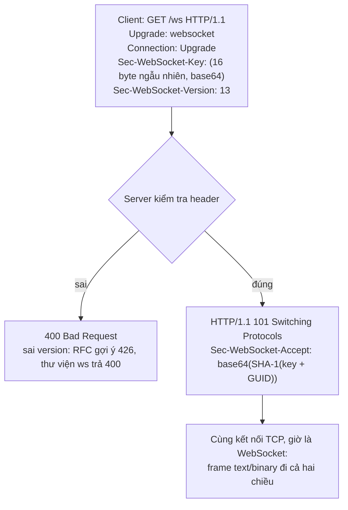

# N03 — WebSocket đầu tiên: từ polling tới handshake

> Thấy WebSocket chạy trên trình duyệt trước, rồi mới mổ xẻ: đo bằng số vì sao chat không chạy tốt trên HTTP hỏi–đáp, tự tính handshake bằng tay, viết echo server với thư viện `ws`, đọc client trình duyệt, và tra được lỗi khi kết nối hỏng.

## 🎯 Mục tiêu

Sau buổi này (khoảng 4 giờ) bạn sẽ:

- Giải thích WebSocket bằng một hình ảnh: **gửi thư hỏi liên tục** (polling) so với **giữ máy gọi điện** (WebSocket) — kèm sơ đồ trình tự.
- Viết **polling** và đo được cái giá của nó: bao nhiêu request rỗng, tin đến trễ bao lâu.
- Giải thích **handshake WebSocket**: request HTTP có `Upgrade: websocket` → `101 Switching Protocols`, và tự tính **`Sec-WebSocket-Accept`** từ `Sec-WebSocket-Key`.
- Dùng 4 sự kiện **`open` / `message` / `close` / `error`**, phân biệt tin **text** và **binary**, đọc **`readyState`** — ở cả Node (`ws`) lẫn **trình duyệt** (`new WebSocket`, `addEventListener`, `binaryType`, `ws://` / `wss://`).
- Viết **echo server** bằng `ws`; xem frame trong **DevTools → Network → WS**; tra lỗi kết nối hỏng (400/426, sai đường dẫn, proxy, 1006).
- **Kết quả đo được:** `echo.js` qua hết **16 test**; `npm run measure` in số liệu polling vs WebSocket trên máy bạn.

> 🧠 **Ghi nhớ:** WebSocket **không** thay HTTP. Nó **bắt đầu** bằng một request HTTP bình thường, rồi hai bên đồng ý "đổi giao thức" trên chính kết nối TCP đó (Mạng 101 ở N02). Từ lúc ấy, cả server lẫn client đều gửi được bất cứ lúc nào.

## 📋 Đề bài

**Mở thư mục:** workspace của bài `N03-websocket-dau-tien` (`echo.js`, `measure.js`, `preview.js`, `public/index.html`). Thư viện `ws` đã cài sẵn ở thư mục khóa học; Node tự tìm thấy nó.

| Viết | Làm gì |
|---|---|
| `startPolling({url, intervalMs, onMessage})` | Hỏi `GET ...?since=<id>` liên tục, đếm request rỗng |
| `computeAccept(key)` | `base64(SHA-1(key + GUID))` |
| `handshakeResponse(headers)` | Request nâng cấp hợp lệ → 101; sai version → 426; sai khác → 400 |
| `readyStateName(ws)` | 0–3 → `CONNECTING` / `OPEN` / `CLOSING` / `CLOSED` |
| `createEchoServer()` | Trang `/` + WebSocket `/ws`: gửi `welcome`, text → `echo: ...`, binary → trả lại byte |

Viết sẵn: `preview.js` (server WebSocket mẫu — Bước 1 chạy nó để **thấy WebSocket hoạt động trước** khi viết code), `measure.js` (dùng `startPolling` của bạn để đo), `public/index.html` (client trình duyệt hoàn chỉnh).

**Xong khi:** `# pass 16`, `npm run measure` chạy hết, và `npm start` mở được `http://127.0.0.1:3001`, gửi tin thấy echo.

## 🤔 Tại sao? (kiến thức nền)

### Hình dung: gửi thư hỏi liên tục, hay giữ máy gọi điện

Ở N02, server biết ngay khi có tin (sự kiện `message`), nhưng HTTP hỏi–đáp chỉ cho server **trả lời**, không cho **chủ động gửi**.

- **Polling** giống **gửi thư hỏi** "có gì mới không?" mỗi giây. Hầu hết thư hồi âm là "không có gì"; tin mới phải đợi lá thư hỏi kế tiếp mới về được.
- **WebSocket** giống **gọi điện rồi giữ máy**. Quay số một lần ("A lô, nói chuyện kiểu WebSocket nhé?" — "Được", mã 101), sau đó bên nào có chuyện thì nói ngay, không phải quay số lại.





Hai sơ đồ chỉ khác nhau ở chiều mũi tên: polling luôn là trình duyệt hỏi → server đáp; WebSocket có mũi tên **server → trình duyệt** mà không cần ai hỏi.

### Bài toán: các cách báo tin cho client

| Cách | Hoạt động | Nhược điểm |
|---|---|---|
| Polling | Client hỏi lại mỗi N giây | Phần lớn request rỗng; tin trễ tới N giây |
| Long polling | Client hỏi, server **giữ** request tới khi có tin | Mỗi tin vẫn tốn một request + header; phức tạp |
| Server-Sent Events (SSE) | Client mở một response HTTP, server giữ nó mở và **đẩy dần** từng sự kiện (`text/event-stream`); trình duyệt dùng `EventSource`, tự kết nối lại | **Một chiều** server → client, chỉ text; client gửi lên phải dùng request riêng |
| **WebSocket** | Một kết nối TCP mở lâu, **hai chiều**, text và binary | Phải tự quản lý kết nối: rớt mạng, kết nối lại, nhiều server (N04, P2) |

> 🎯 **Phỏng vấn hay hỏi:** "SSE hay WebSocket?" — chỉ cần server đẩy xuống (bảng giá, thông báo, log build) thì SSE đơn giản hơn: HTTP thường, qua proxy dễ, tự reconnect. Cần hai chiều tần suất cao (chat, game, cộng tác) hoặc binary thì WebSocket.

Số đo thật bằng `npm run measure` (20 giây, 10 tin, 1 client, chạy trên `127.0.0.1`):

```output
Polling 1000 ms : 21 request, 11 rỗng (52%), nhận 10/10, trễ TB 416 ms, tối đa 769 ms, 8641 byte
WebSocket      : 1 kết nối, nhận 10/10, trễ TB 0 ms, tối đa 1 ms, 837 byte (gồm cả handshake)

Polling 3000 ms : 8 request, 1 rỗng (13%), nhận 10/10, trễ TB 1344 ms, tối đa 2406 ms, 3584 byte
```

| | Polling 1 giây | Polling 3 giây | WebSocket |
|---|---|---|---|
| Request / 20 giây | 21 | 8 | 1 (handshake), sau đó 0 |
| Trễ trung bình | 0,42 s | 1,34 s | < 1 ms |
| Byte trên mạng | 8.641 | 3.584 | 837 |

Polling buộc chọn giữa **tốn** (hỏi dày) và **chậm** (hỏi thưa). Mỗi request polling mang ~400 byte header dù body rỗng; trình duyệt thật còn gửi kèm cookie nên lớn hơn. Nhân lên 100 người online, polling 1 giây là 6.000 request/phút chỉ để hỏi "có gì mới không".

> ⚠️ **Lỗi hay gặp:** đo trên `127.0.0.1` thì mạng gần như không tốn thời gian. Qua Internet, mỗi request polling cộng thêm 20–200 ms đi về, còn WebSocket chỉ trả chi phí đó **một lần** lúc kết nối.

### Handshake: từ HTTP sang WebSocket



Văn bản thật đi trên kết nối TCP (key lấy từ ví dụ trong chuẩn RFC 6455; Bước 9 cho bạn tự gửi đoạn này bằng socket thô):

```output
GET /ws HTTP/1.1
Host: 127.0.0.1:3001
Upgrade: websocket
Connection: Upgrade
Sec-WebSocket-Key: dGhlIHNhbXBsZSBub25jZQ==
Sec-WebSocket-Version: 13

HTTP/1.1 101 Switching Protocols
Upgrade: websocket
Connection: Upgrade
Sec-WebSocket-Accept: s3pPLMBiTxaQ9kYGzzhZRbK+xOo=
```

`Sec-WebSocket-Accept` chứng minh server **thật sự hiểu WebSocket** (không phải một server HTTP thường vô tình trả 200). Nó **không** phải mã hóa hay bảo mật: ai cũng tính được. Bảo mật đến từ `wss://` (TLS) và xác thực (P2). Hàm `computeAccept` của bạn phải ra đúng chuỗi ở dòng cuối khi nhận key `dGhlIHNhbXBsZSBub25jZQ==`.

### Frame: text, binary và vì sao gọn

Sau handshake, dữ liệu đi theo **frame**: vài byte đầu frame + nội dung.

| Phần của frame | Ý nghĩa |
|---|---|
| Byte 1 | Bit FIN (frame cuối của tin) + **opcode**: `0x1` text (UTF-8), `0x2` binary, `0x8` close, `0x9`/`0xA` ping/pong (N05) |
| Byte 2 | Bit MASK + độ dài 7 bit: `0–125` là độ dài thật; `126` → 2 byte sau là độ dài (tới 65.535); `127` → 8 byte sau là độ dài |
| 4 byte mặt nạ | **Chỉ client → server**, luôn có: nội dung được XOR với 4 byte này (để proxy cũ không hiểu nhầm thành HTTP — không phải bảo mật). Server → client không mask |

Vì vậy đầu frame dài **2–14 byte**: tin chat ngắn từ server chỉ tốn **2 byte**, từ client 6 byte — so với ~400 byte header của mỗi request polling. Bước 9 in ra byte thật để bạn tự đọc.

### Bốn sự kiện và `readyState`

| Sự kiện (thư viện `ws` / trình duyệt) | Khi nào |
|---|---|
| `open` | Handshake xong, gửi được |
| `message` | Nhận một tin. `ws`: `(data, isBinary)`, `data` là `Buffer`; trình duyệt: `event.data` là chuỗi hoặc `ArrayBuffer`/`Blob` |
| `close` | Kết nối đóng: `(code, reason)`; 1000 = đóng bình thường, 1006 = mất kết nối không báo |
| `error` | Lỗi mạng/giao thức; luôn kèm `close` sau đó |

| `readyState` | Tên | Gửi được? |
|---|---|---|
| 0 | `CONNECTING` | Chưa |
| 1 | `OPEN` | Được |
| 2 | `CLOSING` | Không |
| 3 | `CLOSED` | Không |

Một phiên hỏi–đáp đầy đủ, theo dõi thứ tự sự kiện (đố vui toán, server hỏi trước):

```js
import { WebSocketServer, WebSocket } from 'ws';

const wss = new WebSocketServer({ port: 0, host: '127.0.0.1' });
wss.on('connection', (ws) => {
  ws.on('error', console.error);
  ws.send('Câu hỏi: 7 x 8 = ?');
  ws.on('message', (data, isBinary) => {
    console.log(`[server] nhận ${isBinary ? 'binary' : 'text'}:`, data.toString());
    ws.close(1000, 'het gio');
  });
});
await new Promise((r) => wss.once('listening', r));

const client = new WebSocket(`ws://127.0.0.1:${wss.address().port}`);
console.log('[client] readyState', client.readyState);
client.on('open', () => console.log('[client] open, readyState', client.readyState));
client.on('message', (data) => {
  console.log('[client] nhận:', data.toString(), '| data là Buffer?', Buffer.isBuffer(data));
  client.send('56');
});
client.on('close', (code, reason) => {
  console.log('[client] close', code, reason.toString(), '| readyState', client.readyState);
  wss.close();
});
```
```output
[client] readyState 0
[client] open, readyState 1
[client] nhận: Câu hỏi: 7 x 8 = ? | data là Buffer? true
[server] nhận text: 56
[client] close 1000 het gio | readyState 3
```

`new Promise((r) => wss.once('listening', r))` là khuôn "chờ một sự kiện xảy ra một lần" (bọc callback thành Promise, N01 Bước 5): `r` chính là `resolve`, được gọi khi server bắt đầu nghe.

> ⚠️ **Lỗi hay gặp:** `ws.send(...)` khi `readyState` chưa là `OPEN` → thư viện `ws` ném lỗi, trình duyệt báo `InvalidStateError`. Gửi trong (hoặc sau) sự kiện `open`.

> ⚠️ **Lỗi hay gặp:** trong `ws` 8.x, `data` của tin text vẫn là `Buffer`. `JSON.parse(data)` chạy được vì nó tự gọi `toString()`, nhưng so sánh `data === 'hi'` luôn `false` — dùng `data.toString()`.

### Phía trình duyệt: API `WebSocket`

Code ở công ty gần như chắc chắn có cả phía client. Trình duyệt có sẵn class `WebSocket` (không cần cài gì). Đây là phần lõi của `public/index.html` — trang bạn dùng với `preview.js` ở Bước 1:

```js
// ws:// cho trang http, wss:// cho trang https; cùng host với trang
const ws = new WebSocket((location.protocol === 'https:' ? 'wss://' : 'ws://') + location.host + '/ws');
ws.binaryType = 'arraybuffer';           // tin binary đến dạng ArrayBuffer (mặc định là Blob)
showState();                              // readyState lúc này là 0 = CONNECTING
ws.addEventListener('open', () => { showState(); log('sys', 'open — đã bắt tay xong (101)'); });
ws.addEventListener('message', (e) => {
  if (typeof e.data === 'string') log('in', '← text: ' + e.data);
  else log('in', '← binary: [' + new Uint8Array(e.data).join(',') + ']');
});
ws.addEventListener('close', (e) => { showState(); log('sys', 'close — code ' + e.code); });
ws.addEventListener('error', () => log('sys', 'error'));
// gửi khi bấm nút:
ws.send(input.value);                     // text
ws.send(new Uint8Array([1, 2, 3, 255]));  // binary
ws.close(1000, 'bye');
```

| Việc | Node (thư viện `ws`) | Trình duyệt |
|---|---|---|
| Tạo kết nối | `import { WebSocket } from 'ws'` rồi `new WebSocket(url)` | `new WebSocket(url)` có sẵn |
| Nghe sự kiện | `ws.on('message', (data, isBinary) => ...)` | `ws.addEventListener('message', (e) => ...)` hoặc `ws.onmessage = (e) => ...` |
| Tin text | `data` là `Buffer` → `data.toString()` | `e.data` là chuỗi |
| Tin binary | `data` là `Buffer`, `isBinary === true` | `e.data` là `Blob`, hoặc `ArrayBuffer` nếu đặt `ws.binaryType = 'arraybuffer'` |
| Đóng | `(code, reason)` | `e.code`, `e.reason`, `e.wasClean` |
| Lỗi | `(err)` có `err.message` | Sự kiện `error` **không** có chi tiết (vì bảo mật) — xem tab Console/Network |
| URL | `ws://` hoặc `wss://` | Trang `https://` bắt buộc `wss://` (`ws://` bị chặn vì "mixed content") |
| Header tùy ý khi handshake | Được (`new WebSocket(url, { headers })`) | **Không** được — token phải đi qua query, cookie hoặc tin đầu tiên (N07) |

`location.protocol` là `'http:'` hoặc `'https:'` của trang đang mở, `location.host` là `host:cổng` của nó — nên cùng một file HTML chạy được cả ở máy bạn lẫn trên server thật.

### Kết nối WebSocket hỏng — tra lỗi

| Thấy gì | Nguyên nhân thường gặp | Sửa |
|---|---|---|
| Handshake trả `400 Bad Request` | Thiếu/sai `Upgrade`, `Connection` hoặc `Sec-WebSocket-Key`; hoặc **sai đường dẫn** (`ws://host/` trong khi server chỉ nhận `/ws` — thư viện `ws` trả 400) | So URL client với `path` của server; xem tab Headers trong DevTools |
| `426 Upgrade Required`, hoặc `400` kèm header `Sec-WebSocket-Version: 13, 8` | **Sai version**: RFC 6455 gợi ý 426 kèm bản server hỗ trợ (hàm `handshakeResponse` của bạn làm vậy); thư viện `ws` nhận cả bản 13 lẫn 8, bản khác trả **400** kèm `Sec-WebSocket-Version: 13, 8`. 426 cũng gặp khi gửi request HTTP **thường** (không `Upgrade`) vào một server chỉ nói WebSocket | Dùng client WebSocket thật, không dùng `fetch`/`curl` thường |
| Client nhận `200` + trang HTML thay vì `101` ("Unexpected response code: 200") | Proxy/nginx phía trước **bỏ** header `Upgrade`, server chỉ thấy một `GET` thường | nginx: `proxy_http_version 1.1;` `proxy_set_header Upgrade $http_upgrade;` `proxy_set_header Connection "upgrade";` |
| `close` code **1006** | Kết nối đứt mà không có frame close: server sập/khởi động lại, mất mạng, proxy cắt kết nối im lặng (nginx mặc định `proxy_read_timeout 60s`) | Xem log server; thêm heartbeat ping/pong (N05) |
| `ERR_CONNECTION_REFUSED` (Node: `ECONNREFUSED`) | Server chưa chạy, sai cổng | Kiểm tra `npm start` còn chạy, đúng cổng |
| Lỗi "mixed content" | Trang `https://` mở `ws://` | Dùng `wss://` (khuôn `location.protocol` ở trên) |
| Nghi "lỗi CORS" | WebSocket **không** bị CORS chặn: trình duyệt gửi header `Origin`, **server** tự quyết nhận hay từ chối (403). "CORS" thường là handshake hỏng ở một dòng khác trong bảng này | Server kiểm tra `Origin` có chủ đích (N07); đọc status thật trong tab Network |

> 💡 **Mẹo:** sự kiện `error` trên trình duyệt không nói lý do. Luôn mở DevTools → Network → WS: cột **Status** cho biết 101 (thành công), 400, 426, hay `(failed)`; tab **Headers** cho thấy request thật đã gửi.

## 🛠️ Làm

### Bước 1 — Chuẩn bị, và xem WebSocket chạy trước

```bash
cd academy/courses/node-realtime/workspace/N03-websocket-dau-tien
node -e "import('ws').then(m => console.log('ws OK'))"   # kiểm tra Node thấy thư viện ws
npm run preview          # server mẫu đã viết sẵn → mở http://127.0.0.1:3003
```

Trước khi viết gì, dùng thử WebSocket trên trình duyệt với server mẫu `preview.js` ("loa phóng thanh"):

1. Mở `http://127.0.0.1:3003`: badge chuyển `CONNECTING` → `OPEN`, dòng đầu là lời chào server **tự gửi** khi bạn vừa kết nối — không ai hỏi nó.
2. Gõ `xin chào` → nhận `XIN CHÀO!`. Bấm **Gửi binary** → nhận `nhận 4 byte`.
3. F12 → tab **Network** → bộ lọc **WS** → tải lại trang → bấm dòng `ws` → tab **Messages**: mỗi tin là một dòng, mũi tên lên = trình duyệt gửi, xuống = server gửi.
4. Bấm **Đóng kết nối** → badge `CLOSED`. Ctrl+C ở terminal để tắt server.

Các phần sau (và tab **Kiến thức nền**) giải thích từng thứ bạn vừa thấy; Bước 6 bạn viết một server cùng khuôn.

```bash
npm test   # 16 fail vì TODO — bình thường
```

Chạy riêng test của **một** hàm trong lúc làm (đổi `startPolling` thành tên hàm bạn đang viết):

```bash
node --test --test-name-pattern="startPolling" "../../curriculum/N03-websocket-dau-tien/tests/*.test.js"
```

> ⚠️ **Lỗi hay gặp:** `npm test -- --test-name-pattern=...` **không** lọc được: npm nối cờ vào **sau** mẫu tên file, và Node 22 bỏ qua cờ đặt sau tên file — mọi test vẫn chạy. Gõ thẳng lệnh `node --test --test-name-pattern="<mẫu>" "<mẫu file>"` như trên.

> ⚠️ **Lỗi hay gặp:** `ERR_MODULE_NOT_FOUND: Cannot find package 'ws'` → workspace không nằm trong thư mục khóa học, hoặc chưa chạy `npm install` ở thư mục `courses/node-realtime/`.

### Bước 2 — Lặp có nghỉ, không chồng nhau → `startPolling`

`setInterval(fn, 100)` gọi `fn` mỗi 100 ms **bất kể** lần trước xong chưa. Khi `fn` là request mạng chậm hơn khoảng nghỉ, các request chồng lên nhau. Hẹn lại bằng `setTimeout` **sau khi** việc xong thì không bao giờ chồng:

```js
import { setTimeout as sleep } from 'node:timers/promises';

async function slowTask(log, name) {         // giả lập request mất 250 ms
  log.running += 1;
  log.maxParallel = Math.max(log.maxParallel, log.running);
  await sleep(250);
  log.running -= 1;
  log.done += 1;
}

const a = { running: 0, maxParallel: 0, done: 0 };
const id = setInterval(() => slowTask(a, 'interval'), 100);
await sleep(1000);
clearInterval(id);

const b = { running: 0, maxParallel: 0, done: 0 };
let timer;
let stopped = false;
async function loop() {
  await slowTask(b, 'timeout');
  if (!stopped) timer = setTimeout(loop, 100);   // hẹn lượt sau khi lượt này xong
}
loop();
await sleep(1000);
stopped = true;
clearTimeout(timer);
await sleep(300);
console.log('setInterval : chạy song song tối đa', a.maxParallel);
console.log('setTimeout  : chạy song song tối đa', b.maxParallel, '| xong', b.done, 'lượt');
```
```output
setInterval : chạy song song tối đa 3
setTimeout  : chạy song song tối đa 1 | xong 3 lượt
```

Mỗi lượt polling gọi `fetch` rồi đọc body JSON. `fetch` trả Promise của một **response**; body đọc riêng bằng `await res.json()` (đọc hết body rồi `JSON.parse`) hoặc `await res.text()` (chuỗi thô, N02). Server tắt thì chính `fetch` ném lỗi:

```js
import http from 'node:http';

const server = http.createServer((req, res) => {
  res.writeHead(200, { 'Content-Type': 'application/json; charset=utf-8' });
  res.end(JSON.stringify({ city: 'Huế', temps: [24, 27, 26] }));
});
await new Promise((resolve) => server.listen(0, '127.0.0.1', resolve));
const url = `http://127.0.0.1:${server.address().port}/weather`;

const res = await fetch(url);              // (1) chờ status + header
console.log('status', res.status, '| ok?', res.ok);
const data = await res.json();             // (2) chờ đọc hết body, rồi JSON.parse
console.log(data.city, data.temps.length, 'ngày');

server.close();
try {
  await fetch(url);                        // server đã đóng → fetch ném lỗi
} catch (err) {
  console.log('fetch lỗi:', err.name, err.message, '|', err.cause.code);
}
```
```output
status 200 | ok? true
Huế 3 ngày
fetch lỗi: TypeError fetch failed | ECONNREFUSED
```

`startPolling` là một **factory function có trạng thái** (closure, N00 Bước 8): các biến `stats`, `lastId`, `timer`, `stopped` khai báo **trong** `startPolling` và sống tiếp giữa các lượt hỏi. Hàm trả `{ stop, stats }` **ngay**, còn các lượt hỏi chạy nền. `stats` là một object: bạn sửa thuộc tính của nó (`stats.requests += 1`) chứ không gán object mới — người gọi giữ **tham chiếu** tới đúng object đó (N00 Bước 6), nên luôn thấy số mới nhất. Tham số `{ url, intervalMs, onMessage }` là destructuring ngay ở tham số (N00 Bước 3).

Viết theo từng bước nhỏ (starter có khung rỗng đánh số bước). Sau mỗi bước chạy `node --test --test-name-pattern="startPolling" "../../curriculum/N03-websocket-dau-tien/tests/*.test.js"`:

- **Bước 2a** — hàm trả về **ngay** (không `async`) một object có hàm `stop` và `stats` gồm đúng 4 bộ đếm bằng 0. Chưa test nào xanh.
- **Bước 2b** — một **lượt hỏi**: gọi `url?since=<id tin cuối đã nhận>` (lần đầu là 0), mỗi tin trong response được đưa cho `onMessage` theo thứ tự, id tin cuối được nhớ cho lượt sau, các bộ đếm `requests` / `received` / `empty` được cập nhật. Lượt đầu chạy ngay khi gọi `startPolling`, không chờ. Test "trả về ngay {stop, stats}, lượt đầu since=0" xanh.
- **Bước 2c** — mỗi lượt **xong** mới hẹn lượt kế tiếp sau `intervalMs` (không bao giờ hai lượt chồng nhau — demo `setTimeout` ở trên). Test "nhận tin theo thứ tự, since tăng theo id cuối" xanh.
- **Bước 2d** — sau `stop()` không còn request nào được gửi, kể cả lượt đã hẹn trước đó. Test "stop() dừng hẳn" xanh.
- **Bước 2e** — lượt bị lỗi (server tắt, JSON hỏng) không làm hàm ném lỗi hay dừng: nó được đếm vào `errors`, vẫn tính là một request, và lượt sau vẫn được hẹn. Test "lỗi mạng không làm dừng polling" xanh; rồi chạy `npm run measure`.

### Bước 3 — Băm SHA-1 và base64 → `computeAccept`

```js
import { createHash, randomBytes } from 'node:crypto';

console.log(createHash('sha1').update('banana').digest('hex'));
console.log(createHash('sha1').update('banana').digest('base64'));
console.log(createHash('sha1').update('banana').digest().length, 'byte');

const nonce = randomBytes(16).toString('base64');         // giống cách trình duyệt tạo Sec-WebSocket-Key
console.log(nonce.length, 'ký tự base64 →', Buffer.from(nonce, 'base64').length, 'byte');
```
```output
250e77f12a5ab6972a0895d290c4792f0a326ea8
JQ538SpatpcqCJXSkMR5Lwoybqg=
20 byte
24 ký tự base64 → 16 byte
```

SHA-1 luôn ra 20 byte; `digest('hex')` và `digest('base64')` chỉ là hai cách viết cùng 20 byte đó. Chuẩn WebSocket dùng base64. Cú pháp `a.b().c().d()` gọi nối tiếp: mỗi hàm trả về một object có hàm kế tiếp.

### Bước 4 — Đọc header không phân biệt hoa thường → `handshakeResponse`

Node đưa tên header về **chữ thường** (`req.headers.upgrade`), nhưng **giá trị** giữ nguyên như client gửi: `WebSocket`, `keep-alive, Upgrade`... Kiểm tra một danh sách token có chứa một từ:

**Cách 1 — vòng lặp `for...of`**

```js
const header = 'gzip, Deflate , br';
let found = false;
for (const part of header.split(',')) {
  if (part.trim().toLowerCase() === 'deflate') {
    found = true;
    break;                       // thấy rồi thì dừng
  }
}
console.log(found);
```
```output
true
```

**Cách 2 — `split` + `map` + `includes`**

```js
const header = 'gzip, Deflate , br';
console.log(header.toLowerCase().split(',').map((t) => t.trim()).includes('deflate'));
```
```output
true
```

> ⚖️ **So sánh:** cùng O(n) theo số token (vài token, không đáng đo). Cách 1 dừng sớm khi thấy; Cách 2 luôn tạo hết mảng rồi mới tìm — gọn hơn, chậm hơn không đáng kể.

> ⚠️ **Lỗi hay gặp:** `headers.connection.toLowerCase()` khi header **không có** → `TypeError: Cannot read properties of undefined`. Dùng giá trị mặc định: `(headers.connection ?? '')`, hoặc optional chaining `headers.connection?.toLowerCase()` (trả `undefined` thay vì ném lỗi).

Thứ tự kiểm tra theo JSDoc: lỗi cơ bản (thiếu `upgrade`, `connection`, key sai) → 400; chỉ sai version → 426 (đúng như RFC 6455 gợi ý). Server thật có thể khác: thư viện `ws` chấp nhận cả version 8 lẫn 13, version khác trả **400** kèm `Sec-WebSocket-Version: 13, 8` — đọc log server thật đừng chỉ tìm 426.

### Bước 5 — Tra số ra tên → `readyStateName`

Đèn giao thông: 0 đỏ, 1 xanh, 2 vàng.

**Cách 1 — `if` / `else`**

```js
function lightName(code) {
  if (code === 0) {
    return 'ĐỎ';
  } else if (code === 1) {
    return 'XANH';
  } else if (code === 2) {
    return 'VÀNG';
  } else {
    return 'HỎNG';
  }
}
for (const code of [0, 1, 2, 9]) {
  console.log(code, lightName(code));
}
```
```output
0 ĐỎ
1 XANH
2 VÀNG
9 HỎNG
```

**Cách 2 — mảng tra cứu + `??`**

```js
const LIGHTS = ['ĐỎ', 'XANH', 'VÀNG'];
const lightName = (code) => LIGHTS[code] ?? 'HỎNG';
for (const code of [0, 1, 2, 9]) {
  console.log(code, lightName(code));
}
```
```output
0 ĐỎ
1 XANH
2 VÀNG
9 HỎNG
```

`LIGHTS[9]` là `undefined` (JS không báo lỗi khi đọc ngoài mảng, khác `IndexError` của Python), nên `?? 'HỎNG'` lo trường hợp còn lại.

> ⚖️ **So sánh:** cả hai O(1) với số trường hợp cố định; Cách 2 gọn và dễ thêm giá trị, Cách 1 rõ ràng hơn khi mỗi nhánh làm việc khác nhau.

### Bước 6 — Echo server → `createEchoServer`

Ví dụ mẫu cùng khuôn là `preview.js` bạn đã chạy ở Bước 1 — mở nó trong editor và đọc theo ba khối đánh số:

```js
// (1) HTTP server thường (như N02): mọi GET đều trả trang public/index.html
const server = http.createServer(async (req, res) => {
  const html = await readFile(new URL('./public/index.html', import.meta.url));
  res.writeHead(200, { 'Content-Type': 'text/html; charset=utf-8' });
  res.end(html);
});

// (2) Gắn WebSocket vào CÙNG server đó, chỉ nhận ở đường dẫn /ws
const wss = new WebSocketServer({ server, path: '/ws' });

// (3) Mỗi client kết nối thành công → một lần 'connection', `ws` là kênh riêng tới client đó
wss.on('connection', (ws) => {
  ws.on('error', (err) => console.error('[preview] lỗi kết nối:', err.message));
  ws.send('Loa đã bật — gõ gì tôi nói to lên');
  ws.on('message', (data, isBinary) => {
    if (isBinary) {
      ws.send(`nhận ${data.length} byte`);
    } else {
      ws.send(data.toString().toUpperCase() + '!');
    }
  });
});
```

`new WebSocketServer({ server, path: '/ws' })` **gắn** WebSocket vào HTTP server có sẵn: request thường đi vào handler HTTP của bạn, request `Upgrade` tới `/ws` được `ws` xử lý handshake (đúng phần bạn viết tay ở Bước 3–4), đường dẫn khác bị từ chối bằng 400. Một cổng phục vụ cả trang web lẫn WebSocket. Mỗi `ws` là **một** client — `ws.send` chỉ gửi tới đúng client đó. `preview.js` tự `listen`; `createEchoServer` thì **không** (trả server cho `main()` và test tự `listen`).

`createEchoServer` khác `preview.js` ở chỗ nào — viết theo từng bước, chạy `node --test --test-name-pattern="createEchoServer" "../../curriculum/N03-websocket-dau-tien/tests/*.test.js"` sau mỗi bước. Làm `readyStateName` (Bước 5) trước: test của `createEchoServer` dùng nó để kiểm tra trạng thái kết nối.

- **Bước 6a** — phần HTTP: chỉ `GET /` trả trang `public/index.html` (đúng `Content-Type`), đường dẫn khác → 404; hàm trả server, không `listen`. Test "GET / trả trang HTML" xanh. (Test "đường dẫn khác /ws bị từ chối" cũng xanh ngay: server chưa có WebSocket thì từ chối mọi kết nối WebSocket. Nó phải **vẫn xanh** sau 6b.)
- **Bước 6b** — gắn WebSocket vào **chính** server đó, chỉ nhận ở đường dẫn `/ws` (đọc lại khối (2) để biết option nào làm việc này).
- **Bước 6c** — mỗi kết nối mới: lỗi của kết nối được ghi log thay vì làm sập server, và client nhận ngay tin text `welcome`. Test "nhận welcome, readyState OPEN" xanh.
- **Bước 6d** — tin text `xin chào` → client nhận lại text `echo: xin chào`; tin binary → client nhận lại đúng các byte đó, **vẫn là binary**. Ba test còn lại xanh.
- **Bước 6e** — `npm test` → 16 test xanh, rồi `npm start`.

> 💡 **Mẹo:** luôn ghi rõ `ws.send(data, { binary: isBinary })` hoặc `{ binary: true }`: text trả text, binary trả binary — người đọc code không phải đoán thư viện mặc định làm gì.

### Bước 7 — Chạy trên trình duyệt và xem frame

```bash
npm start
```

Mở `http://127.0.0.1:3001` → DevTools (F12) → tab **Network** → bộ lọc **WS** → tải lại trang → bấm vào dòng `ws`:

| Tab trong DevTools | Thấy gì |
|---|---|
| Headers | `Status Code: 101 Switching Protocols`, `Sec-WebSocket-Key`, `Sec-WebSocket-Accept` |
| Messages | Mỗi frame một dòng: mũi tên xanh ↑ client gửi, đỏ ↓ server gửi; binary hiện dạng `Binary Message` |

Chép `Sec-WebSocket-Key` từ tab Headers, kiểm tra bằng hàm của bạn:

```bash
node -e "import('./echo.js').then(m => console.log(m.computeAccept('<dán key vào đây>')))"
```

Kết quả phải trùng `Sec-WebSocket-Accept` trình duyệt nhận được. Terminal server cũng in `handshakeResponse(req.headers)` cho mỗi lần kết nối. Bấm **Đóng kết nối**: badge chuyển `CLOSED`, tab Messages có frame close.

Thử gây lỗi để quen bảng "tra lỗi" ở trên: trong Console của trang, gõ `new WebSocket('ws://' + location.host + '/sai')` → tab Network thấy status 400, Console báo kết nối thất bại; tắt server (Ctrl+C) khi trang đang mở → badge `CLOSED`, code 1006.

### Bước 8 — Đo trên máy bạn

```bash
npm run measure                  # polling 1 giây
POLL_MS=3000 npm run measure     # polling 3 giây (PowerShell: $env:POLL_MS=3000; npm run measure)
```

So với bảng ở phần "Tại sao". Con số trên máy bạn sẽ hơi khác (tin đến lúc ngẫu nhiên), nhưng tỉ lệ thì không.

### Bước 9 — Nhìn tận byte (đọc thêm, không cần gõ)

Hai demo dưới bỏ qua thư viện ở phía client: mở **socket TCP thô** bằng `net.connect` (như demo Mạng 101 ở N02) rồi tự gõ handshake. Đọc để thấy những gì bảng ở phần "Tại sao" mô tả là có thật; không cần thuộc cú pháp.

Handshake thật, gửi tới một server `ws`:

```js
import net from 'node:net';
import { WebSocketServer } from 'ws';

const wss = new WebSocketServer({ port: 0, host: '127.0.0.1' });
await new Promise((r) => wss.once('listening', r));
const sock = net.connect(wss.address().port, '127.0.0.1');
sock.write([
  'GET / HTTP/1.1',
  'Host: 127.0.0.1',
  'Upgrade: websocket',
  'Connection: Upgrade',
  'Sec-WebSocket-Key: dGhlIHNhbXBsZSBub25jZQ==',
  'Sec-WebSocket-Version: 13',
  '', '',
].join('\r\n'));
const reply = await new Promise((r) => sock.once('data', r));
console.log(reply.toString().trim());
sock.destroy();
wss.close();
```
```output
HTTP/1.1 101 Switching Protocols
Upgrade: websocket
Connection: Upgrade
Sec-WebSocket-Accept: s3pPLMBiTxaQ9kYGzzhZRbK+xOo=
```

Byte thật server gửi sau handshake (một tin text, một tin binary):

```js
import net from 'node:net';
import { WebSocketServer } from 'ws';

const wss = new WebSocketServer({ port: 0, host: '127.0.0.1' });
wss.on('connection', (ws) => {
  ws.send('hi');                                  // text
  ws.send(Buffer.from([7, 8]), { binary: true }); // binary
});
await new Promise((r) => wss.once('listening', r));
const sock = net.connect(wss.address().port, '127.0.0.1');
sock.write('GET / HTTP/1.1\r\nHost: x\r\nUpgrade: websocket\r\nConnection: Upgrade\r\n' +
  'Sec-WebSocket-Key: dGhlIHNhbXBsZSBub25jZQ==\r\nSec-WebSocket-Version: 13\r\n\r\n');
let buf = Buffer.alloc(0);
sock.on('data', (d) => { buf = Buffer.concat([buf, d]); });
await new Promise((r) => setTimeout(r, 200));
const frames = buf.subarray(buf.indexOf('\r\n\r\n') + 4);  // bỏ phần handshake
const hex = [];
for (const byte of frames) {
  hex.push(byte.toString(16).padStart(2, '0'));          // 129 → '81', 2 → '02'
}
console.log('byte sau handshake:', hex.join(' '));
sock.destroy();
wss.close();
```
```output
byte sau handshake: 81 02 68 69 82 02 07 08
```

Đọc: `81 02 68 69` = `0x81` (FIN + opcode 1 = text), `02` (bit MASK = 0, dài 2 byte), `68 69` = `"hi"`. `82 02 07 08` = binary, 2 byte `07 08`. Tin từ client sẽ có byte thứ hai ≥ `0x80` (bit MASK = 1) và thêm 4 byte mặt nạ trước nội dung; tin dài hơn 125 byte dùng thêm 2 hoặc 8 byte độ dài như bảng Frame ở trên.

## ✅ Tự kiểm tra

Bấm **Chạy test**, hoặc trong thư mục workspace của bài:

```bash
npm test
```

`npm test` chạy `scripts.test` trong `package.json`: `node --test "../../curriculum/N03-websocket-dau-tien/tests/*.test.js"`. Dấu ngoặc kép giữ nguyên mẫu `*.test.js` để chính Node tìm file — chạy được cả trong bash lẫn PowerShell. Node 22 **không** nhận đường dẫn thư mục (`node --test thư-mục/` báo `Cannot find module`).

Mục tiêu: `# pass 16`. Test mở server thật ở cổng ngẫu nhiên trên `127.0.0.1`, kết nối bằng client `ws`, mỗi lần chờ tin có giới hạn 2 giây — code sai sẽ fail với thông báo rõ ràng chứ không treo.

## 🎤 Câu hỏi phỏng vấn

> 🎯 **Phỏng vấn hay hỏi:** "WebSocket bắt đầu thế nào?" — trả lời đủ 4 ý: (1) client gửi `GET` HTTP/1.1 với `Upgrade: websocket`, `Connection: Upgrade`, `Sec-WebSocket-Key`, `Sec-WebSocket-Version: 13`; (2) server trả `101 Switching Protocols` với `Sec-WebSocket-Accept = base64(SHA-1(key + GUID))`; (3) từ đó cùng kết nối TCP chuyển sang frame hai chiều; (4) kèm số liệu: "polling 1 giây tốn 21 request trong 20 giây, trễ trung bình 0,4 s; WebSocket một kết nối, trễ dưới 1 ms". Nếu được hỏi "kết nối WebSocket lỗi thì debug thế nào?" — mở DevTools → Network → WS xem status (101/400/426/failed) và header; 1006 là đứt không báo (server sập, proxy cắt); sau nginx thì kiểm tra cấu hình chuyển tiếp `Upgrade`.
