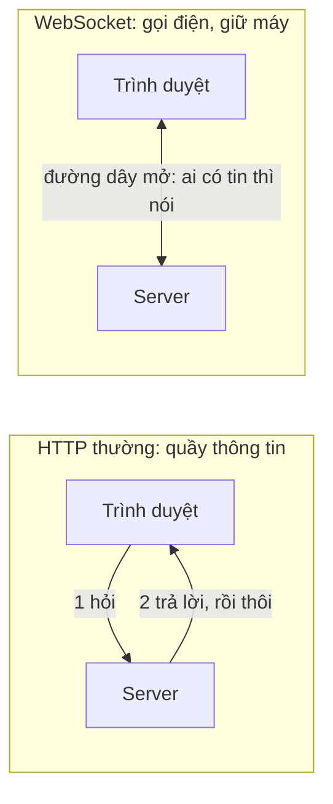
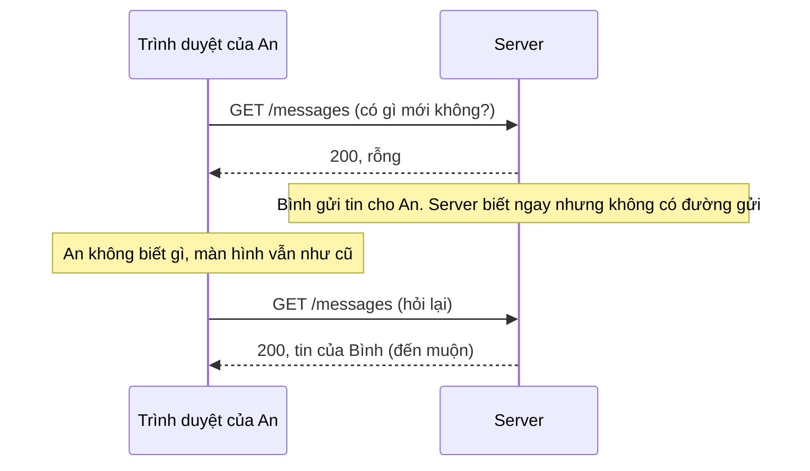
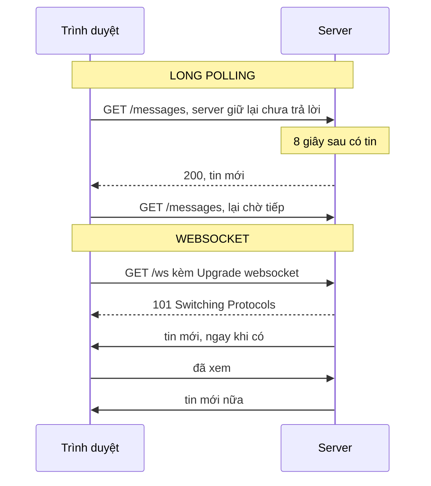
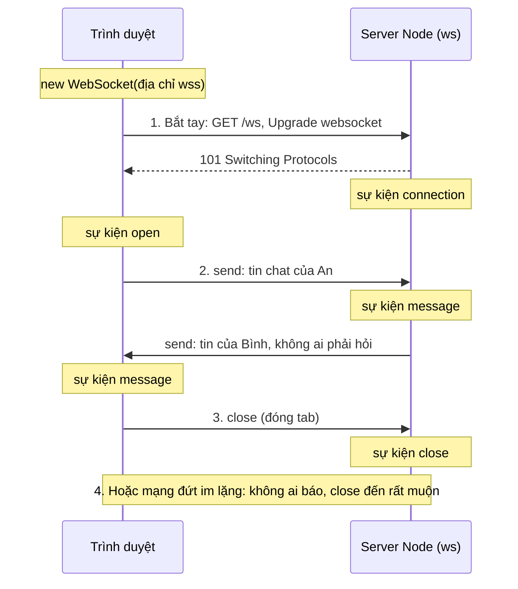
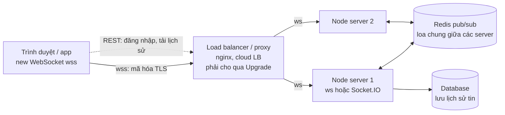

# N03a — WebSocket là gì? Vì sao cần?

> Bài khái niệm, **không viết code**. Bạn đọc, chạy một trang demo đã viết sẵn để **tận mắt** thấy hai cách nhận tin mới, rồi trả lời 13 câu trắc nghiệm. Xong bài này, N03 (viết WebSocket thật) sẽ không còn từ nào lạ.

## 🎯 Mục tiêu

Sau buổi này (khoảng 75 phút, không cần lập trình) bạn sẽ:

- Nói được bằng lời thường: **HTTP** là "hỏi mới trả lời", nên server **không tự báo** được tin mới; **WebSocket** là "gọi điện rồi giữ máy", hai bên nói bất cứ lúc nào.
- Trả lời đủ **5W1H** về WebSocket: là gì, vì sao cần, khi nào dùng, khi nào **không** dùng, nằm ở đâu trong hệ thống, hoạt động thế nào.
- So sánh **polling**, **long polling**, **SSE** và **WebSocket** — và chọn đúng cách cho một sản phẩm cụ thể.
- Kể lại **vòng đời** một kết nối WebSocket: bắt tay (`Upgrade` → `101`), mở, gửi/nhận tin, đóng — và chuyện kết nối **chết im lặng**.
- Đọc được đoạn code WebSocket của công ty: sự kiện nào chạy khi nào (`connection`/`open`, `message`, `close`, `error`) và `send()` làm gì.
- **Kết quả đo được:** trang demo chạy trên máy bạn cho số thật (bao nhiêu request rỗng, trễ bao lâu); `answers.js` qua **13/13 test**.

> 📖 Từ lạ ở trên (polling, SSE, handshake, frame, 101…) được giải nghĩa ở mục *Hiểu trước khi làm*, ngay đầu phần kiến thức nền.

## 📋 Đề bài

**Mở thư mục:** workspace của bài `N03a-websocket-la-gi`. Bài này **không** có hàm nào phải viết.

| File | Bạn làm gì |
|---|---|
| `demo.js` + `public/index.html` | **Chỉ chạy và quan sát** (đã viết sẵn): một server có tin mới, trang web nhận tin đó theo hai cách đặt cạnh nhau — hỏi đi hỏi lại (polling) và giữ kết nối mở (WebSocket) |
| `answers.js` | Đọc 13 câu hỏi trong chú thích, thay `null` bằng một chữ `'A'`, `'B'`, `'C'` hoặc `'D'` |

Câu hỏi chia 4 phần: **A** vì sao cần WebSocket, **B** nó hoạt động thế nào, **C** chọn đúng công cụ cho từng sản phẩm, **D** đọc đoạn code kiểu công ty. Câu sai → test in ra **lời giải thích vì sao**, đọc rồi sửa.

**Xong khi:** đã chạy `npm run demo` và ghi lại số của hai cột; `npm test` báo `# pass 13`; bạn nói lại được bảng 5W1H trong 1 phút không cần nhìn.

## 🤔 Tại sao? (kiến thức nền)

### Hiểu trước khi làm

**Bối cảnh.** Bạn mở Zalo trên máy tính. Bạn bè gửi tin, nó **tự hiện ra** — bạn không phải bấm "tải lại". Nghe hiển nhiên, nhưng web truyền thống **không làm được điều đó**: trang web chỉ nhận được thứ nó **chủ động hỏi**. Máy chủ biết có tin mới cho bạn mà không có cách nào "lên tiếng trước". WebSocket sinh ra để giải đúng chuyện này: cho máy chủ **báo ngay** khi có tin, và cho cả hai bên nói qua lại bất cứ lúc nào.

**Ví dụ đời thường.**
- **HTTP = quầy thông tin.** Bạn ra quầy hỏi, nhân viên trả lời. Nhân viên **không bao giờ** tự chạy tới bàn bạn báo tin — kể cả khi họ có thư cho bạn.
- **Polling = cứ 1 giây chạy ra quầy hỏi "có thư không?"** Phần lớn câu trả lời là "chưa có". Mệt cho bạn, mệt cho quầy, và thư tới ngay sau lúc bạn vừa hỏi vẫn phải đợi lần hỏi sau.
- **WebSocket = gọi điện rồi giữ máy.** Quay số một lần ("nói chuyện kiểu WebSocket nhé?" — "được"), sau đó **bên nào có chuyện thì nói ngay**, không ai phải gọi lại.

**Bạn đã gặp nó ở đâu.**
- **Zalo / Messenger trên web:** tin nhắn, "đang soạn tin…", dấu "đã xem" hiện ngay.
- **Grab / Be:** chấm xe tài xế nhích dần trên bản đồ mỗi vài giây.
- **Bảng giá chứng khoán, sàn coin:** giá nhấp nháy xanh đỏ liên tục.
- **Game online** (cờ, bắn súng nhiều người): nước đi của đối thủ hiện tức thì.
- **Google Docs:** thấy con trỏ và chữ người khác gõ cùng lúc; app bán hàng kêu "**có đơn hàng mới**".

| Câu hỏi | Trả lời |
|---|---|
| **What** — là gì | Một **giao thức** (luật nói chuyện) giữ **một kết nối mở lâu dài, hai chiều** giữa trình duyệt (hoặc app) và server: mở một lần, sau đó hai bên gửi tin bất cứ lúc nào. |
| **Why** — vì sao cần | HTTP chỉ cho server **trả lời**, không cho **chủ động gửi**. Cách chữa cháy là polling thì vừa tốn (đo trong khóa: 52% request trả về rỗng) vừa chậm (tin trễ tới 1 nhịp hỏi). |
| **When** — khi nào dùng | Server phải báo **ngay** và/hoặc hai bên gửi qua lại **thường xuyên**: chat, thông báo, vị trí xe, bảng giá, game, sửa tài liệu chung. |
| **When not** — khi nào không | Việc "hỏi một lần rồi xong": đăng nhập, tải trang, tìm kiếm, tải lịch sử → **REST/HTTP thường** (kiểu API hỏi–đáp bạn viết ở N02). Chỉ cần server đẩy **một chiều** dạng chữ → **SSE** (Server-Sent Events: server giữ một response mở và nhỏ giọt tin xuống) đơn giản hơn. Dữ liệu đổi vài phút một lần → polling thưa là đủ. |
| **Where** — ở đâu | Phía trình duyệt: `new WebSocket('wss://...')` có sẵn. Phía server Node: thư viện **`ws`** (khóa này dùng) hoặc **Socket.IO** (N06). Ở giữa thường có proxy/load balancer ("lễ tân" đứng trước server, nhận kết nối từ Internet rồi chia cho các server phía sau, vd. nginx) — xem sơ đồ hệ thống bên dưới. |
| **How** — chạy thế nào | Trình duyệt gửi một request HTTP xin **"Upgrade: websocket"** → server đồng ý **`101 Switching Protocols`** → chính kết nối đó thành "đường dây mở" → hai bên gửi **message** (thường là JSON) → một bên **close** (hoặc mạng đứt). |



**Từ mới trong bài**

| Từ | Nghĩa đời thường |
|---|---|
| **Client** · **server** | Bên hỏi / dùng dịch vụ (trình duyệt, app) · máy chủ luôn bật, phục vụ nhiều client |
| **Request** · **response** | Phiếu hỏi client gửi đi · phiếu trả lời server gửi lại (luôn một đáp cho một hỏi) |
| **HTTP** | Luật hỏi–đáp của web: client hỏi, server trả lời, xong lượt |
| **Stateless** (không trạng thái) | Mỗi lần hỏi HTTP là độc lập, server không "nhớ" cuộc trò chuyện trước — như mỗi lần ra quầy gặp một nhân viên mới |
| **Kết nối TCP** | Đường ống nối hai máy, chở byte hai chiều, đúng thứ tự (N02) — HTTP và WebSocket đều đi trong ống này |
| **Cổng (port)** | "Số quầy" trên một máy; server nghe ở một cổng (demo bài này: 3004; web thật: 80, 443) |
| **Giao thức (protocol)** | Bộ luật hai bên thống nhất để hiểu nhau (HTTP, WebSocket, TLS…) |
| **Realtime** (thời gian thực) | Tin đến "ngay" theo cảm nhận con người — thường dưới vài trăm mili giây, **không** phải 0 ms |
| **Độ trễ (latency)** | Khoảng thời gian từ lúc có tin ở server tới lúc bạn thấy nó |
| **Polling** | Client hỏi lại đều đặn "có gì mới không?" |
| **Long polling** | Client hỏi, server **giữ** câu hỏi chưa trả lời cho tới khi có tin (hoặc hết giờ), rồi client hỏi lại |
| **SSE** (Server-Sent Events) | Server giữ một response HTTP mở và nhỏ giọt từng sự kiện xuống — **một chiều**, chỉ chữ |
| **WebSocket** | Kết nối mở lâu, **hai chiều**, gửi chữ hoặc byte bất cứ lúc nào |
| **Handshake** (bắt tay) | Màn chào hỏi đầu tiên để hai bên đồng ý cách nói chuyện |
| **Upgrade** · **101** | Header client xin "đổi sang WebSocket" · mã trả lời "đồng ý, đổi giao thức" (`101 Switching Protocols`) |
| **Message** (tin) · **frame** | Một gói tin ứng dụng gửi (vd. một dòng chat) · "phong bì" WebSocket bọc gói tin đó khi đi trên mạng, chỉ vài byte vỏ |
| **Sự kiện (event)** | "Khi X xảy ra thì chạy hàm này" (như EventEmitter ở N02): `open`, `message`, `close`, `error` |
| **`send()`** | Lệnh gửi một tin qua kết nối đang mở |
| **Broadcast** | Gửi một tin tới **mọi** client đang kết nối (cả phòng chat thấy) |
| **JSON** | Cách viết dữ liệu thành chữ, vd. `{"type":"chat","text":"hi"}` (N00, N02) |
| **`ws://`** · **`wss://`** | Địa chỉ WebSocket không mã hóa · có mã hóa TLS (như `http://` · `https://`) |
| **TLS** | Lớp mã hóa đường truyền — chữ "s" trong https/wss |
| **Proxy / load balancer** | "Lễ tân" đứng trước server: nhận kết nối từ Internet, chia cho các server phía sau (vd. nginx) |
| **Redis** | Kho dữ liệu trong bộ nhớ, rất nhanh; ở đây dùng làm "loa chung" để nhiều server báo tin cho nhau (N08) |
| **Heartbeat** (ping/pong) | Định kỳ hỏi "còn sống không?" để phát hiện kết nối đã chết (N05) |
| **Socket.IO** | Thư viện realtime phổ biến, có giao thức **riêng** chạy trên WebSocket (N06) |
| **REST API** | Kiểu API hỏi–đáp bằng HTTP (`GET /messages`, `POST /messages`) bạn viết ở N02 |
| **DevTools** | Bộ công cụ trong trình duyệt (phím F12) để xem request, kết nối, lỗi |

### HTTP từ con số 0: vì sao server không tự nói được

Mỗi lần bạn mở một trang hay bấm một nút, trình duyệt (client) viết một **request** — vài dòng chữ — gửi qua kết nối TCP tới server, server viết lại một **response**. Request gửi `GET /messages`, response trả về danh sách tin:

```output
GET /messages?since=5 HTTP/1.1          ← request: "cho tôi các tin sau tin số 5"
Host: teampulse.example

HTTP/1.1 200 OK                          ← response: "được, đây"
Content-Type: application/json

[]                                       ← rỗng: chưa có tin nào mới
```

Ba luật quyết định mọi thứ:

1. **Một hỏi — một đáp.** Response luôn là câu trả lời cho **một** request. Không có request thì không có chỗ để server "nói".
2. **Client luôn mở lời.** Trình duyệt mở kết nối tới server (server có địa chỉ và cổng cố định). Ngược lại thì không: trình duyệt của bạn không "nghe" ở cổng nào, lại nằm sau router/Wi-Fi — server không có cách gọi tới.
3. **Stateless.** Trả lời xong, server không giữ "cuộc trò chuyện". Lần hỏi sau là một lượt mới hoàn toàn.

Ghép lại: server biết có tin mới cho An (N02 có sự kiện `message` ngay lập tức) nhưng **phải ngồi chờ** An hỏi. Đó không phải lỗi của Node hay của bạn — đó là **thiết kế của HTTP**: nó sinh ra để tải trang và tài liệu, không phải để báo tin.



> 🧠 **Ghi nhớ:** HTTP = "hỏi mới trả lời". Mọi cách làm realtime trên web đều là cách lách hoặc thay thế luật này.

### Bốn cách báo tin mới: polling, long polling, SSE, WebSocket

Cùng một bài toán "có tin mới thì client biết ngay", ngành web đã thử bốn cách — từ chữa cháy tới giải pháp thật:

- **Polling — chạy ra quầy hỏi mỗi giây.** Đơn giản nhất: một vòng lặp `fetch` cứ N giây một lần. Hỏi dày thì tốn, hỏi thưa thì chậm. Đo trong khóa (20 giây, 10 tin, hỏi mỗi 1 giây): **21 request, 52% rỗng, tin trễ trung bình 0,42 giây**; giãn ra 3 giây thì trễ trung bình **1,34 giây**.
- **Long polling — ra quầy hỏi rồi đứng chờ ở đó.** Nhân viên không trả lời "chưa có" mà bảo "đợi đấy, có thư tôi đưa ngay". Có thư → bạn cầm về → lại ra quầy đứng chờ tiếp. Ít câu trả lời rỗng hơn, nhưng mỗi tin vẫn tốn một lượt hỏi–đáp đầy đủ, và server phải giữ rất nhiều request đang treo.
- **SSE — bật đài nghe phát thanh.** Mở một lần, đài nói liên tục, bạn chỉ **nghe**. Muốn nói lại với đài thì phải gọi số khác (request HTTP riêng). Trình duyệt có sẵn `EventSource`, tự kết nối lại khi rớt.
- **WebSocket — gọi điện rồi giữ máy.** Một kết nối, **hai chiều**, gửi chữ hoặc byte, mỗi tin chỉ thêm vài byte "vỏ" thay vì cả trăm byte header như mỗi request HTTP.



| | Polling | Long polling | SSE | WebSocket |
|---|---|---|---|---|
| **Ví dụ đời thường** | Chạy ra quầy hỏi mỗi giây | Ra quầy đứng chờ tới khi có thư | Bật đài, chỉ nghe | Gọi điện, giữ máy |
| **Ai mở lời mỗi lần có tin** | Client (hỏi liên tục) | Client (hỏi, chờ) | Server đẩy | Bên nào cũng được |
| **Chiều** | Client hỏi → server đáp | Như polling | **Một chiều** server → client | **Hai chiều** |
| **Độ trễ** | Tới 1 nhịp hỏi (0,42 s – 1,34 s trong đo) | Gần ngay | Gần ngay | Gần ngay (dưới 1 ms khi đo trong Node; ~10–15 ms ở demo trình duyệt) |
| **Tốn gì** | Nhiều request rỗng, mỗi request ~400 byte header | Một request đầy đủ cho mỗi tin; server giữ nhiều request treo | Một kết nối mở / người | Một kết nối mở / người; vỏ mỗi tin 2–14 byte |
| **Khó ở đâu** | Chọn nhịp: tốn hay chậm | Hết giờ, hỏi lại, thứ tự tin | Chỉ chữ; gửi lên phải dùng request khác | Tự lo rớt mạng, kết nối lại, nhiều server (P2) |
| **Dùng khi** | Dữ liệu đổi chậm (vài phút), ít người, cần làm nhanh | Môi trường chặn WebSocket (Socket.IO tự lùi về cách này) | Bảng giá, thông báo, log build, AI trả lời từng chữ | Chat, game, cộng tác, vị trí xe, mọi thứ hai chiều tần suất cao |
| **Không dùng khi** | Cần ngay, nhiều người | Có thể dùng SSE/WebSocket | Client cũng gửi lên dày, cần byte | Chỉ hỏi một lần (dùng REST), hoặc chỉ đẩy một chiều (SSE đủ) |

> 🧠 **Ghi nhớ:** vì sao số đo "dưới 1 ms" của khóa khác con số ~14 ms trên trang demo? `npm run measure` (N03) đo **bên trong Node**, client và server cùng một tiến trình. Trang demo đo **đầu–cuối trong trình duyệt**: tin đi qua mạng nội bộ của máy, trình duyệt nhận, rồi JavaScript trên trang xử lý và vẽ lên màn hình. Cả hai đều "ngay" với mắt người; khoảng cách lớn là giữa WebSocket (vài ms) và polling (hàng trăm ms).

> 💡 **Mẹo:** câu "chọn gì?" có thể trả lời bằng hai câu hỏi. (1) Server có cần **báo ngay** không? Không → REST/polling thưa. (2) Client có **gửi lên thường xuyên** không? Không → SSE; có → WebSocket.

### Vòng đời một kết nối WebSocket

Một kết nối đi qua 4 chặng. Bên dưới là đúng những gì xảy ra khi nhân viên mở trang TeamPulse:



| Chặng | Phía trình duyệt | Phía server Node (`ws`) | Đời thường |
|---|---|---|---|
| Bắt tay | `new WebSocket(url)` | (thư viện tự xử lý request `Upgrade`) | Quay số |
| Mở | sự kiện **`open`** | sự kiện **`connection`** — mỗi kết nối mới một lần | Hai bên nhấc máy |
| Nói chuyện | `ws.send(...)`; nhận qua **`message`** | `socket.send(...)`; nhận qua **`message`** | Ai có chuyện thì nói |
| Kết thúc | **`close`** (kèm mã, vd. 1000 bình thường, 1006 đứt không báo) | **`close`** | Cúp máy, hoặc rớt sóng |
| Trục trặc | **`error`** (luôn kèm `close` sau đó) | **`error`** | Đường dây rè |

Bốn sự kiện + `send()` là **toàn bộ** vốn từ cần để đọc code WebSocket ở công ty. Phần còn lại (giao thức JSON, broadcast, heartbeat, xác thực) đều được xây từ 5 thứ này.

> ⚠️ **Lỗi hay gặp:** gửi ngay sau `new WebSocket(url)`. Lúc đó đang bắt tay, chưa `open` → trình duyệt báo lỗi `InvalidStateError`. Gửi trong (hoặc sau) sự kiện `open`.

### Một "tin" trông như thế nào

WebSocket chỉ chở **chữ** (text) hoặc **byte** (binary) — nó không biết "tin chat" hay "đơn hàng" là gì. Ý nghĩa do ứng dụng **tự quy ước**, gần như luôn bằng JSON có trường `type`:

```output
→ {"type":"join","name":"An"}                         client xin vào phòng
← {"type":"welcome","users":["An","Binh"]}            server chào, kèm danh sách online
→ {"type":"chat","text":"hi"}                          An gửi tin
← {"type":"chat","from":"An","text":"hi","ts":"..."}   server broadcast cho cả phòng
← {"type":"error","error":"invalid_json"}              client gửi dữ liệu hỏng
```

`→` là client gửi lên, `←` là server gửi xuống — đúng ký hiệu bạn sẽ thấy trong **DevTools → Network → WS → Messages**. Server đọc `type` để quyết định làm gì, giống route `GET /messages` ở N02 nhưng nằm **trong** tin. Bạn sẽ tự thiết kế bộ `type` này ở N04.

> 🧠 **Ghi nhớ:** WebSocket là **đường ống**, JSON `{type, ...}` là **ngôn ngữ** hai bên nói trong ống. Hai thứ tách biệt.

### `ws://` và `wss://`

Giống `http://` và `https://`:

| | `ws://` | `wss://` |
|---|---|---|
| Mã hóa | Không — ai đứng giữa (Wi-Fi quán cà phê) đọc được | Có, qua **TLS** |
| Cổng mặc định | 80 | 443 |
| Dùng ở đâu | Máy bạn khi học (`ws://127.0.0.1:3004/ws`) | Mọi môi trường thật |
| Trang `https://` mở được không | **Không** — trình duyệt chặn ("mixed content") | Được |

Mẹo trong code trình duyệt: `(location.protocol === 'https:' ? 'wss://' : 'ws://') + location.host + '/ws'` — cùng một file chạy được cả ở máy bạn lẫn trên server thật. Bắt tay xong, `wss://` bảo vệ **đường truyền**; còn "ai được kết nối" là chuyện xác thực (N07).

### WebSocket nằm ở đâu trong một hệ thống thật

Ở máy bạn: trình duyệt ↔ `node demo.js`. Ở công ty, giữa hai đầu có thêm vài tầng:



| Tầng | Vai trò | Hay hỏng ở đâu |
|---|---|---|
| Trình duyệt / app | Mở kết nối, nghe `message`, vẽ lên màn hình | Gửi trước `open`; trang https dùng `ws://` |
| Load balancer / proxy | Nhận kết nối từ Internet, giải mã TLS, chia cho các server | Cấu hình bỏ header `Upgrade` → bắt tay thất bại; tự cắt kết nối im lặng sau ~60 giây (N03, N05) |
| Node server (`ws`, Socket.IO) | Giữ hàng nghìn kết nối mở, xử lý `message`, broadcast | Quên dọn kết nối đã đóng → rò bộ nhớ (N04) |
| Redis pub/sub | An nối vào server 1, Bình nối vào server 2 — Redis chuyển tin giữa hai server | Thiếu tầng này thì An và Bình không thấy tin của nhau (N08) |
| Database | Lưu tin để người vào sau tải lịch sử qua **REST** | — |

Lưu ý mũi tên chấm: **REST vẫn ở đó**. Ứng dụng realtime thật dùng **cả hai** — REST cho việc hỏi một lần, WebSocket cho tin cần báo ngay.

### Hiểu lầm hay gặp

| Hiểu lầm | Sự thật |
|---|---|
| "Socket.IO chính là WebSocket" | Socket.IO là **thư viện có giao thức riêng** chạy trên WebSocket (lùi về long polling khi bị chặn), thêm room, ack, tự kết nối lại. Server Socket.IO cần client Socket.IO; `new WebSocket()` thuần **không** nói chuyện được với nó (N06). |
| "Có WebSocket rồi thì bỏ REST" | Không. Đăng nhập, tải lịch sử, upload, tìm kiếm vẫn là REST: có mã lỗi rõ, dễ cache, dễ test. WebSocket chỉ thay **polling**. |
| "Mất mạng thì server biết ngay" | Rút dây mạng / tắt Wi-Fi: không ai gửi tín hiệu đóng. Kết nối **chết im lặng**, server vẫn tưởng người đó online, có khi hàng giờ. Phải có **heartbeat** (N05). |
| "Kết nối mở thì tin không bao giờ mất" | Tin gửi đúng lúc mạng đứt sẽ mất; kết nối lại không tự gửi bù. Phải tự thiết kế (N05, N06). |
| "WebSocket tự bảo mật" | `wss://` chỉ mã hóa đường truyền. Ai cũng mở được kết nối nếu server không kiểm tra token / Origin (N07). |
| "Realtime = 0 giây" | Realtime là "đủ nhanh để con người thấy là ngay" — qua Internet thường vài chục tới vài trăm ms. |

### Đọc code công ty: 4 sự kiện + `send()`

Không cần viết, chỉ cần **đọc được**. Đoạn dưới rút gọn từ kiểu code gateway WebSocket thường gặp (cũng là đoạn code của Phần D trong `answers.js`):

```js
const online = new Map();                         // kết nối → tên người dùng
wss.on('connection', (socket) => {                // (1) một trình duyệt vừa bắt tay xong
  socket.on('message', (raw) => {                 // (2) trình duyệt này gửi một tin lên
    const msg = JSON.parse(raw);
    if (msg.type === 'join') online.set(socket, msg.name);
    if (msg.type === 'chat') broadcast({ type: 'chat', from: online.get(socket), text: msg.text });
  });
  socket.on('close', () => {                      // (3) kết nối này đóng (hoặc được phát hiện đã chết)
    broadcast({ type: 'left', name: online.get(socket) });
    online.delete(socket);
  });
  socket.on('error', (err) => log.warn(err));     // (4) lỗi trên kết nối này
});
```

Cách đọc: `wss` là "tổng đài", `socket` là **một cuộc gọi** với **một** trình duyệt. (1) chạy **một lần** mỗi khi có người mới gọi tới; bên trong nó, (2) (3) (4) là "khi người **này** nói / cúp máy / gặp sự cố thì làm gì". `broadcast(...)` = vòng lặp `send()` tới mọi `socket` đang mở. Phía trình duyệt là bản soi gương: `ws.addEventListener('open' | 'message' | 'close' | 'error', ...)` và `ws.send(...)`.

## 🛠️ Làm

### Bước 1 — Chạy demo

```bash
cd academy/courses/node-realtime/workspace/N03a-websocket-la-gi
npm run demo          # → mở http://127.0.0.1:3004 trên trình duyệt
```

```output
Demo polling vs WebSocket: http://127.0.0.1:3004  (Ctrl+C để dừng)
[server] connection — một trình duyệt vừa "gọi điện và giữ máy" (đang mở: 1)
```

Trang có hai cột nhận **cùng một nguồn tin** từ server: ① **Polling** hỏi `GET /poll?since=…` đều đặn, ② **WebSocket** giữ một kết nối mở. Chưa bấm gì, cột ① đã chạy liên tục những dòng xám `→ [] (chưa có gì)`, còn cột ② đứng yên — đó là bản chất của hai cách.

> ⚠️ **Lỗi hay gặp:** `EADDRINUSE` = cổng 3004 đang bận (bạn mở demo ở terminal khác?). Tắt cái cũ bằng Ctrl+C, hoặc đổi cổng: `PORT=3014 npm run demo` (PowerShell: `$env:PORT=3014; npm run demo`).

### Bước 2 — Bấm "Server gửi tin" và so hai cột

Bấm nút **📣 Server gửi tin** 5 lần, mỗi lần cách nhau một chút (giả lập "có đơn hàng mới"). Quan sát:

- Cột ② hiện tin **gần như cùng lúc** bạn bấm; cột ① hiện sau một khoảng — có lúc gần 1 giây.
- Số **request đã gửi** của ① tăng đều kể cả khi không có tin; của ② đứng ở **1** (lần bắt tay).
- Terminal in `→ đẩy ngay qua 1 kết nối WebSocket; người polling phải đợi lần hỏi kế tiếp`.

Một lần chạy trên máy tác giả (5 tin trong khoảng 12 giây, polling 1 giây):

```output
① Polling   : 11 request, 8 rỗng (73%), nhận 5/5, trễ TB 454 ms, lâu nhất 941 ms
② WebSocket : 1 request (bắt tay), 0 rỗng, nhận 5/5, trễ TB 14 ms, lâu nhất 14 ms
```

14 ms chứ không phải "dưới 1 ms" như số đo của khóa, vì trang này đo đầu–cuối trong trình duyệt (gồm cả thời gian trình duyệt nhận tin và vẽ lên màn hình) — xem ghi chú ở bảng so sánh.

Số của bạn sẽ khác chút ít, nhưng **hình dạng** giống nhau: polling tốn nhiều request mà vẫn trễ; WebSocket một kết nối, tin đến ngay.

### Bước 3 — Bật tự động, đổi nhịp polling

Tick **Tự động** (server có tin mỗi 2–5 giây), đợi 30 giây, ghi lại số. Bấm **Đặt lại số đếm**, đổi **Polling hỏi mỗi** sang **5 giây**, đợi 30 giây nữa. So sánh: request ít đi, nhưng **trễ trung bình** tăng vọt — polling luôn bắt chọn giữa *tốn* và *chậm*. Dòng cuối trang nhân lên **1.000 người**: polling 1 giây ≈ 60.000 request/phút chỉ để hỏi.

### Bước 4 — Nhìn tận mắt bằng DevTools

Nhấn **F12** → tab **Network**:

1. Lọc **Fetch/XHR**: một dòng `poll?since=…` mới **mỗi giây**, hầu hết response là `[]`.
2. Lọc **WS** (hoặc **Socket**): chỉ **một** dòng `ws`, cột Status là **101**. Bấm vào nó → tab **Headers** thấy `Upgrade: websocket`; tab **Messages** thấy từng tin JSON đi xuống (mũi tên xuống) ngay khi bạn bấm nút.

Đây đúng là thứ bạn sẽ mở khi debug WebSocket ở công ty.

### Bước 5 — Tắt server, xem chuyện gì xảy ra

Trong terminal bấm **Ctrl+C**. Trên trang:

- Cột ② chuyển **CLOSED**, mã đóng **1006** = "đứt mà không ai báo" (server chết đột ngột, không kịp chào).
- Cột ① đếm **lỗi mạng** nhưng **vẫn hỏi tiếp**.

Chạy lại `npm run demo`: cột ① tự chạy tiếp, còn cột ② **vẫn CLOSED** — WebSocket **không tự kết nối lại**; trang thật phải tự làm việc đó (N05). Tải lại trang (F5) để có kết nối mới.

### Bước 6 — Đọc log server

Nhìn lại terminal: mỗi tab mở → một dòng `connection`; mỗi tab đóng → một dòng `close`. Mở thêm một tab thứ hai cùng địa chỉ, bấm gửi tin ở tab này → tab kia cũng nhận (server đẩy qua **2** kết nối) — đó là **broadcast**, thứ bạn sẽ tự viết ở N04.

### Bước 7 — Trả lời trắc nghiệm

Mở `answers.js`, đọc từng câu trong chú thích, thay `null` bằng `'A'`/`'B'`/`'C'`/`'D'`. Chạy test (nút **Chạy test**, hoặc `npm test`). Câu sai sẽ in lời giải thích, ví dụ:

```output
✖ q2: polling 1 giây với 1.000 người
  Câu 2 chưa đúng (bạn chọn A). <lời giải thích vì sao đáp án đúng là đúng>
```

Đọc giải thích, đối chiếu lại mục tương ứng trong phần kiến thức nền, rồi sửa. Mục tiêu là **hiểu vì sao**, không phải đoán trúng.

### Bước 8 — Nói lại trong 1 phút

Không nhìn bài, tự nói to (hoặc gõ vào tab **Phỏng vấn thử**): WebSocket là gì, vì sao cần, khi nào dùng / không dùng, nằm ở đâu, chạy thế nào. Nói được trơn tru nghĩa là bạn sẵn sàng cho N03.

## ✅ Tự kiểm tra

Bấm **Chạy test**, hoặc trong thư mục workspace của bài:

```bash
npm test
```

Mục tiêu: `# pass 13`. Test chỉ đọc `answers.js` (không mở mạng, không chạy demo). Mỗi câu sai/chưa trả lời báo riêng bằng tiếng Việt, kèm lời giải thích.

## 🎤 Câu hỏi phỏng vấn

> 🎯 **Phỏng vấn hay hỏi:** "WebSocket là gì, khác HTTP thế nào?" — trả lời theo khung: (1) HTTP là hỏi–đáp, server chỉ trả lời khi được hỏi, nên không tự đẩy tin; (2) WebSocket bắt đầu bằng một request HTTP có `Upgrade: websocket`, server trả `101`, sau đó **cùng kết nối TCP** thành kênh **hai chiều, mở lâu**; (3) dùng cho chat, thông báo, game, vị trí xe — không thay REST cho việc hỏi một lần; (4) đổi lại phải tự lo kết nối chết im lặng (heartbeat), kết nối lại và nhiều server (Redis pub/sub). Kèm một con số: "polling 1 giây, 52% request trả về rỗng, tin vẫn trễ ~0,4 giây; WebSocket một kết nối, trễ dưới 1 ms khi đo trong Node trên cùng máy".
