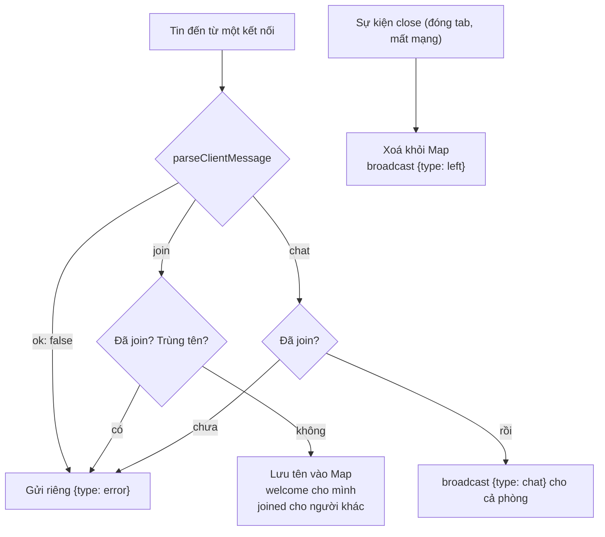

# N04 — Chat realtime: broadcast, giao thức, presence

> Biến echo server thành phòng chat nhiều người của TeamPulse: tin JSON có `type` được kiểm tra, gửi cho cả phòng, có tên, thông báo vào/ra, danh sách đang online — và server không sập khi client gửi bậy hay rớt mạng.

## 🎯 Mục tiêu

Sau buổi này (khoảng 2,5 giờ) bạn sẽ:

- Thiết kế **giao thức tin nhắn JSON** `{type, ...}` và **kiểm tra** mọi tin client gửi lên.
- **Broadcast**: gửi cho mọi người, hoặc mọi người trừ một người; bỏ qua kết nối không còn `OPEN`.
- Giữ **trạng thái theo kết nối** bằng `Map` (kết nối → tên): join, trùng tên, rời phòng.
- Làm **presence**: thông báo vào/ra và danh sách online luôn đúng, kể cả khi client mất kết nối đột ngột.
- **Kết quả đo được:** `chat.js` qua hết **13 test**; hai tab trình duyệt chat được với nhau.

> 🧠 **Ghi nhớ:** WebSocket chỉ chuyển **byte**. Nó không biết "tin chat", "vào phòng" hay "ai gửi" — mọi ý nghĩa đó là **giao thức** do bạn tự định nghĩa ở tầng trên. Code WebSocket ở công ty bạn chắc chắn có một giao thức như vậy; đọc được nó là hiểu được nửa hệ thống.

## 📋 Đề bài

**Mở thư mục:** workspace của bài `N04-chat-realtime` (`chat.js`, `public/index.html` — giao diện hoàn chỉnh).

Giao thức (ghi đầy đủ ở đầu `chat.js`):

| Hướng | `type` | Trường | Ai nhận |
|---|---|---|---|
| client → server | `join` | `name` | — |
| client → server | `chat` | `text` | — |
| server → client | `welcome` | `name, users` | Người vừa vào |
| server → client | `joined` | `name, users` | Những người khác trong phòng |
| server → client | `left` | `name, users` | Những người còn lại |
| server → client | `chat` | `from, text, ts` | Mọi người trong phòng, kể cả người gửi |
| server → client | `error` | `error` | Chỉ người gửi sai |

| Viết | Làm gì |
|---|---|
| `parseClientMessage(raw)` | Chuỗi/Buffer → `{ok: true, msg}` hoặc `{ok: false, error}`, không bao giờ ném lỗi |
| `broadcast(clients, payload, except)` | Gửi một JSON cho mọi client `OPEN`, trừ `except`; trả số đã gửi |
| `createChatServer()` | Trang `/` + WebSocket `/ws`: join, chat, rời phòng, mã lỗi |

**Xong khi:** `# pass 13`, rồi `npm start`, mở `http://127.0.0.1:3002` ở **hai tab**, đặt hai tên, chat qua lại; đóng một tab thì tab kia thấy "đã rời phòng".

## 🤔 Tại sao? (kiến thức nền)

### Từ echo tới phòng chat

Echo server (N03): mỗi kết nối chỉ nói chuyện với chính nó. Phòng chat: server phải **nhớ mọi kết nối** và **ai là ai**, rồi chuyển tin của người này tới người khác.



### Vì sao phải kiểm tra mọi tin

Client là **bất kỳ ai** mở được kết nối: trang web của bạn, một script, hay người đang thử phá. Server nhận được mọi thứ: JSON hỏng, `type` lạ, tên dài 10.000 ký tự, `text` là một mảng. Không kiểm tra thì:

| Tin gửi lên | Server không kiểm tra sẽ... |
|---|---|
| `{hỏng` | `JSON.parse` ném lỗi trong listener `message` → **sập cả tiến trình**, mọi người mất kết nối |
| `{"type":"chat","text":["a"]}` | `text.trim` không tồn tại → `TypeError`, cũng sập |
| `{"type":"join","name":"<10.000 ký tự>"}` | Danh sách online của mọi người bị phình ra |
| `{"type":"chat"}` trước khi join | Tin không có người gửi |

Quy tắc: **một** hàm kiểm tra ở cửa vào, trả mã lỗi rõ ràng; phần còn lại của server chỉ làm việc với tin đã sạch.

> 🎯 **Phỏng vấn hay hỏi:** "Client gửi JSON hỏng qua WebSocket thì server của bạn làm gì?" — bắt lỗi parse, trả `{type: "error", error: "invalid_json"}` cho đúng client đó, giữ kết nối; không bao giờ để một client làm sập tiến trình phục vụ mọi người.

### Mất kết nối: `close` luôn đến

| Tình huống | Client gửi frame close? | Server thấy |
|---|---|---|
| Bấm nút đóng, `ws.close()` | Có | `close` code 1000 (hoặc code client chọn) |
| Đóng tab, tải lại trang | Thường có | `close` code 1001 |
| Mất mạng, tiến trình chết, `terminate()` | Không | `close` code 1006 khi TCP báo đứt |

Dù kiểu nào, sự kiện `close` của kết nối đó **luôn** chạy (với mất mạng im lặng thì có thể rất muộn — heartbeat ở P2 xử lý chuyện này). Vì vậy dọn dẹp (xoá tên, báo `left`) đặt trong `close`, không đặt trong một tin `leave` mà client có thể không kịp gửi.

```js
import { WebSocketServer, WebSocket } from 'ws';

const wss = new WebSocketServer({ port: 0, host: '127.0.0.1' });
await new Promise((r) => wss.once('listening', r));
let closedCount = 0;
wss.on('connection', (ws, req) => {
  const label = new URL(req.url, 'http://x').searchParams.get('who');
  ws.on('close', (code) => {
    console.log(`server: ${label} đóng, code ${code}`);
    closedCount += 1;
    if (closedCount === 2) wss.close();
  });
});

const url = `ws://127.0.0.1:${wss.address().port}/?who=`;
const polite = new WebSocket(url + 'lịch-sự');
polite.on('open', () => polite.close(1000));
const rude = new WebSocket(url + 'đột-ngột');
rude.on('open', () => setTimeout(() => rude.terminate(), 50));
```
```output
server: lịch-sự đóng, code 1000
server: đột-ngột đóng, code 1006
```

## 🛠️ Làm

### Bước 1 — Chuẩn bị

```bash
cd <workspace>/N04-chat-realtime
npm test    # 13 fail vì TODO — bình thường
```

Đọc khối comment đầu `chat.js` và phần `<script>` trong `public/index.html`: giao diện gửi `join`/`chat` và hiển thị mọi `type` server gửi về. Bạn chỉ viết phía server.

### Bước 2 — Kiểm tra theo `type` → `parseClientMessage`

Ví dụ một giao thức khác (điều khiển nhà thông minh) — cùng khuôn: parse an toàn → kiểm tra là object → rẽ nhánh theo trường loại → kiểm tra trường riêng của từng loại → trả object **mới** chỉ có trường đã kiểm tra.

```js
function parseCommand(raw) {
  let data;
  try {
    data = JSON.parse(String(raw));
  } catch {
    return { ok: false, error: 'bad_json' };
  }
  if (typeof data !== 'object' || data === null || Array.isArray(data)) {
    return { ok: false, error: 'bad_json' };
  }
  if (data.cmd === 'light') {
    if (typeof data.on !== 'boolean') return { ok: false, error: 'bad_on' };
    return { ok: true, value: { cmd: 'light', on: data.on } };
  }
  if (data.cmd === 'temp') {
    if (typeof data.c !== 'number' || data.c < 16 || data.c > 30) return { ok: false, error: 'bad_temp' };
    return { ok: true, value: { cmd: 'temp', c: data.c } };
  }
  return { ok: false, error: 'bad_cmd' };
}

for (const raw of ['{"cmd":"light","on":true,"hack":1}', '{"cmd":"temp","c":45}', '{"cmd":"door"}', '[1]', Buffer.from('{oops')]) {
  console.log(String(raw).padEnd(34), '→', JSON.stringify(parseCommand(raw)));
}
```
```output
{"cmd":"light","on":true,"hack":1} → {"ok":true,"value":{"cmd":"light","on":true}}
{"cmd":"temp","c":45}              → {"ok":false,"error":"bad_temp"}
{"cmd":"door"}                     → {"ok":false,"error":"bad_cmd"}
[1]                                → {"ok":false,"error":"bad_json"}
{oops                              → {"ok":false,"error":"bad_json"}
```

`String(raw)` chạy được cho cả chuỗi lẫn `Buffer` (thư viện `ws` đưa `Buffer`). Trả object mới giúp khóa thừa như `"hack"` không lọt vào phần còn lại của server.

> 💡 **Mẹo:** kiểu `{ ok: true, value } | { ok: false, error }` thay cho `throw` khi lỗi là chuyện **bình thường, hay xảy ra** (dữ liệu người dùng). Người gọi buộc phải xét `ok`, không quên `try/catch`.

### Bước 3 — Gửi cho nhiều người → `broadcast`

`clients` có thể là `Set`, mảng, hay `map.keys()` — mọi thứ duyệt được bằng `for...of`. Ví dụ báo tin cho các bàn ăn đang có khách, trừ bàn vừa gọi món:

**Cách 1 — vòng lặp `for...of` + `continue`**

```js
const tables = new Set([
  { no: 1, busy: true, inbox: [] },
  { no: 2, busy: false, inbox: [] },
  { no: 3, busy: true, inbox: [] },
  { no: 4, busy: true, inbox: [] },
]);
const caller = [...tables][2];                    // bàn số 3
const note = JSON.stringify({ type: 'promo', text: 'Giảm 10% chè' });
let sent = 0;
for (const t of tables) {
  if (t === caller || !t.busy) {
    continue;                                     // bỏ qua, sang bàn kế tiếp
  }
  t.inbox.push(note);
  sent += 1;
}
console.log('đã báo', sent, 'bàn:', [...tables].filter((t) => t.inbox.length).map((t) => t.no));
```
```output
đã báo 2 bàn: [ 1, 4 ]
```

**Cách 2 — spread + `filter` + `forEach`**

```js
const tables = new Set([
  { no: 1, busy: true, inbox: [] },
  { no: 2, busy: false, inbox: [] },
  { no: 3, busy: true, inbox: [] },
  { no: 4, busy: true, inbox: [] },
]);
const caller = [...tables][2];
const note = JSON.stringify({ type: 'promo', text: 'Giảm 10% chè' });
const targets = [...tables].filter((t) => t !== caller && t.busy);
targets.forEach((t) => t.inbox.push(note));
console.log('đã báo', targets.length, 'bàn:', targets.map((t) => t.no));
```
```output
đã báo 2 bàn: [ 1, 4 ]
```

`[...tables]` (**spread**) trải mọi phần tử của Set ra một mảng mới — tương đương vòng `for (const t of tables) arr.push(t)`. Cần nó vì `Set` không có `filter`/`map`.

> ⚖️ **So sánh:** cùng O(n). Cách 2 tạo thêm 2 mảng tạm (spread, filter); với vài nghìn kết nối vẫn không đáng kể, nhưng broadcast chạy cho **mọi** tin nên server lớn thường viết kiểu Cách 1. Cả hai đều `JSON.stringify` **một lần** ngoài vòng lặp: stringify trong vòng lặp là n lần cùng một việc.

> ⚠️ **Lỗi hay gặp:** gửi cho kết nối không còn `OPEN`. Đang `CONNECTING`: thư viện `ws` và trình duyệt đều ném lỗi (trình duyệt: `InvalidStateError`). Đang `CLOSING`/`CLOSED`: không ném lỗi — trình duyệt **lặng lẽ bỏ** dữ liệu, `ws` chỉ báo lỗi qua callback của `send` nếu bạn truyền vào. Tin mất mà không ai biết, nên luôn kiểm tra `readyState === OPEN` trước khi `send`.

### Bước 4 — Trạng thái theo kết nối: `Map`, trùng tên → join

`Map` giống `dict` của Python nhưng **khóa có thể là object** — ở đây khóa là chính kết nối `ws`. Object thường `{}` chỉ nhận khóa chuỗi.

```js
const lockers = new Map();             // khách (object) → số tủ
const lan = { name: 'Lan' };
const huy = { name: 'Huy' };
lockers.set(lan, 12);
lockers.set(huy, 7);
console.log(lockers.get(lan), lockers.has(huy), lockers.size);
lockers.delete(huy);
console.log(lockers.has(huy), lockers.size, [...lockers.values()]);

const asObject = {};
asObject[lan] = 12;                    // object bị đổi thành chuỗi "[object Object]"
console.log(Object.keys(asObject));
```
```output
12 true 2
false 1 [ 12 ]
[ '[object Object]' ]
```

Kiểm tra tên đã có người dùng (không phân biệt hoa thường):

**Cách 1 — vòng lặp `for...of`**

```js
const members = new Map([[{}, 'Lan'], [{}, 'Huy']]);
function taken(wanted) {
  for (const name of members.values()) {
    if (name.toLowerCase() === wanted.toLowerCase()) {
      return true;
    }
  }
  return false;
}
console.log(taken('lan'), taken('Mai'));
```
```output
true false
```

**Cách 2 — spread + `some`**

```js
const members = new Map([[{}, 'Lan'], [{}, 'Huy']]);
const taken = (wanted) => [...members.values()].some((n) => n.toLowerCase() === wanted.toLowerCase());
console.log(taken('lan'), taken('Mai'));
```
```output
true false
```

**Cách 3 — thêm một `Set` tên viết thường**

```js
const lowerNames = new Set(['lan', 'huy']);    // cập nhật cùng lúc với Map khi join / rời
const taken = (wanted) => lowerNames.has(wanted.toLowerCase());
console.log(taken('lan'), taken('Mai'));
```
```output
true false
```

`arr.some(fn)` = vòng `for` trả `true` ngay khi `fn` đúng (Cách 1).

> ⚖️ **So sánh:** Cách 1 và 2 là O(n) theo số người online; Cách 3 là O(1) nhưng phải giữ **hai** cấu trúc đồng bộ (quên xoá khỏi `Set` khi rời phòng là lỗi "tên bị giữ mãi"). Phòng vài chục người → dùng Cách 1; hàng chục nghìn người mỗi server → Cách 3.

Danh sách online sắp A→Z:

```js
const names = new Map([[{}, 'Mai'], [{}, 'An'], [{}, 'Huy']]);
const users = [...names.values()].sort();
console.log(users, [...names.values()]);
console.log([10, 9, 1].sort(), [10, 9, 1].sort((a, b) => a - b));
```
```output
[ 'An', 'Huy', 'Mai' ] [ 'Mai', 'An', 'Huy' ]
[ 1, 10, 9 ] [ 1, 9, 10 ]
```

`.sort()` **sửa tại chỗ** mảng gọi nó — sort trên bản sao (`[...]`) để không đụng dữ liệu gốc. Không truyền hàm so sánh thì `.sort()` so **chuỗi**: đúng cho tên, sai cho số.

### Bước 5 — Chat và rời phòng → hoàn thiện `createChatServer`

Ba listener cho mỗi kết nối, đều nằm trong `wss.on('connection', (ws) => { ... })`:

| Listener | Việc |
|---|---|
| `ws.on('error', ...)` | Ghi log — thiếu nó, một lỗi socket làm sập tiến trình |
| `ws.on('message', (raw) => ...)` | `parseClientMessage` → rẽ nhánh `join` / `chat` như sơ đồ ở trên |
| `ws.on('close', () => ...)` | Có tên trong `Map` thì xoá, rồi `broadcast` `left` cho người còn lại |

Người nhận `chat` là **những kết nối đã join** — tức các khóa của `Map`, không phải `wss.clients` (gồm cả người chưa join).

> ⚠️ **Lỗi hay gặp:** gửi `joined` bằng `broadcast(..., ws)` **trước** khi `names.set(ws, ...)` → `users` thiếu chính người vừa vào. Thứ tự: lưu tên → `welcome` → `joined`.

> ⚠️ **Lỗi hay gặp:** giao diện hiển thị tin bằng `innerHTML` → người gửi `` chạy được JavaScript trên máy mọi người (XSS). `public/index.html` dùng `textContent`; giữ nguyên như vậy khi bạn sửa giao diện.

### Bước 6 — Chạy hai tab, xem frame

```bash
npm start
```

Mở `http://127.0.0.1:3002` ở hai tab (hoặc một tab thường + một tab ẩn danh). Đặt tên `An` và `an` → tab thứ hai báo "Tên này đã có người dùng". Đổi tên khác, chat qua lại. DevTools → Network → WS → Messages: mỗi tin là một frame JSON, đúng bảng giao thức ở trên. Đóng một tab: tab còn lại hiện "… đã rời phòng" và danh sách online giảm.

Thử gửi tin hỏng ngay trong Console của tab đang mở (giao diện giữ kết nối trong biến `ws`):

```js
ws.send('{hỏng');                                   // → ⚠ Tin không phải JSON hợp lệ
ws.send(JSON.stringify({ type: 'chat', text: '' })); // → ⚠ Tin phải từ 1 đến 500 ký tự
```

Server vẫn chạy, các tab khác không bị ảnh hưởng.

## ✅ Tự kiểm tra

Bấm **Chạy test**, hoặc trong thư mục workspace của bài:

```bash
npm test
```

`npm test` chạy `scripts.test` trong `package.json`: `node --test "../../curriculum/N04-chat-realtime/tests/*.test.js"`. Dấu ngoặc kép giữ nguyên mẫu `*.test.js` để chính Node tìm file — chạy được cả trong bash lẫn PowerShell. Node 22 **không** nhận đường dẫn thư mục (`node --test thư-mục/` báo `Cannot find module`).

Mục tiêu: `# pass 13`. Test dựng server thật, mở nhiều client `ws` cùng lúc, kiểm tra ai nhận tin gì — kể cả client chưa join, client gửi JSON hỏng và client bị ngắt đột ngột (`terminate()`).

## 🎤 Câu hỏi phỏng vấn

> 🎯 **Phỏng vấn hay hỏi:** "Bạn thiết kế giao thức tin nhắn cho chat WebSocket thế nào?" — mọi tin là JSON có `type`; client chỉ gửi `join`/`chat`, server gửi `welcome`/`joined`/`left`/`chat`/`error`; mọi tin vào đều qua một hàm kiểm tra trả mã lỗi; trạng thái theo kết nối giữ trong `Map`; dọn dẹp ở sự kiện `close` vì client có thể mất kết nối mà không gửi gì. Nếu được hỏi tiếp "chạy 2 server thì sao?" — mỗi server chỉ biết kết nối của mình; cần Redis pub/sub để chuyển tin giữa các server (P2).
