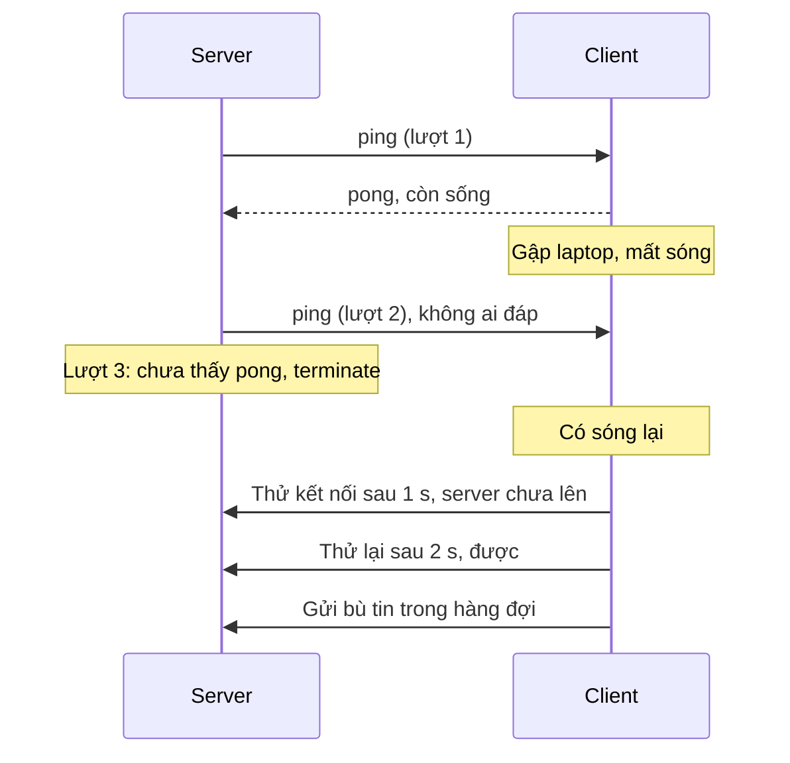
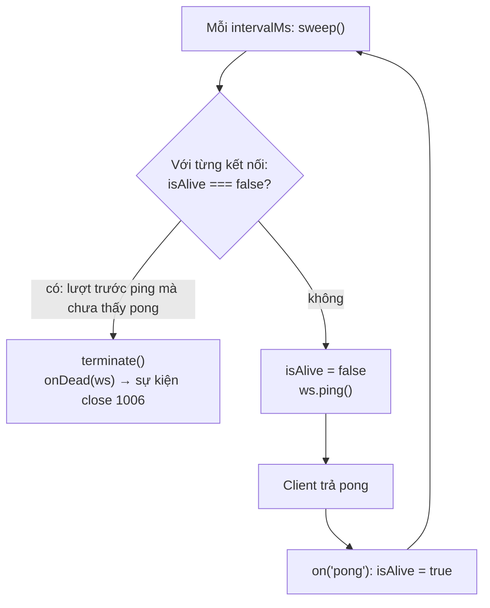

# N05 — Heartbeat ping/pong & tự kết nối lại

> Kết nối WebSocket có thể chết mà không bên nào biết. Bài này cho server TeamPulse tự phát hiện kết nối chết bằng ping/pong, và cho client tự kết nối lại có backoff, không mất tin gửi trong lúc offline.

## 🎯 Mục tiêu

Sau buổi này (khoảng 4 giờ với người mới) bạn sẽ:

- Giải thích vì sao kết nối **chết im lặng** (half-open TCP, NAT/proxy cắt kết nối nhàn rỗi) và vì sao `close` có thể tới sau **hàng giờ**.
- Viết **heartbeat** phía server: ping định kỳ, kết nối không trả pong thì `terminate()`.
- Tính **backoff mũ có jitter** cho việc kết nối lại, và biết jitter chống "cả nghìn client cùng ập vào" thế nào.
- Viết **client tự kết nối lại**: xử lý `readyState`, xếp hàng tin lúc offline, gửi bù khi có mạng.
- **Kết quả đo được:** `heartbeat.js` qua hết **9 test**; với heartbeat 5 giây, client bị treo được phát hiện sau **6,3 giây** (chạy thật ở Bước 6).

> 📖 Từ lạ ở trên và trong Đề bài (half-open, NAT, proxy, heartbeat, backoff, jitter…) được giải nghĩa ở mục *Hiểu trước khi làm*, ngay đầu phần kiến thức nền.

## 📋 Đề bài

**Mở thư mục:** workspace của bài `N05-heartbeat-reconnect` (`heartbeat.js`).

| Viết | Làm gì |
|---|---|
| `startHeartbeat(wss, {intervalMs, onDead})` | Ping mọi kết nối mỗi `intervalMs`; lượt sau chưa thấy pong → `terminate()`. Trả `{sweep, stop}` |
| `backoffDelay(attempt, {baseMs, maxMs, random})` | Thời gian chờ lần thử thứ `attempt`: nhân đôi, có trần, jitter trong [cap/2, cap] |
| `createReconnectingClient(url, options)` | Client tự kết nối lại theo `backoffDelay`, xếp hàng tin lúc offline, `close()` dừng hẳn |

Phần chạy thử (`npm start`, `npm run client`, `npm run client:freeze`) đã viết sẵn ở cuối file, dùng chính các hàm của bạn.

**Xong khi:** `# pass 9`, rồi chạy server + client ở 2 terminal, tắt/bật server và thấy client tự nối lại, gửi bù tin.

## 🤔 Tại sao? (kiến thức nền)

### Hiểu trước khi làm

**Bối cảnh.** Bạn gập laptop, hay đi vào thang máy mất sóng. Máy bạn không kịp nói "tạm biệt" với server, nên server vẫn tưởng bạn đang online: tên bạn vẫn sáng chấm xanh, tin gửi cho bạn rơi vào khoảng không — có khi suốt hàng giờ. Ở phía bạn, khi có sóng lại, app phải **tự nối lại** mà không bắt người dùng tải lại trang, và không làm mất những tin bạn gõ lúc mất sóng. Bài này giải cả hai phía.

**Ví dụ đời thường.** Đang gọi điện mà đầu bên kia im lặng lâu, bạn hỏi "Alo, còn nghe không?" (**ping**), bên kia đáp "Còn" (**pong**). Hỏi một lượt mà tới lượt sau vẫn không ai đáp → cúp máy (**terminate**). Đó là **heartbeat** — nhịp tim. Còn khi máy bị rớt: bạn không bấm gọi lại liên tục mỗi giây, mà chờ 1 giây, rồi 2, rồi 4… (**backoff mũ**). Sau một sự cố tổng đài, nghìn người cùng gọi lại đúng một giây thì tổng đài lại nghẽn — nên mỗi người chờ lệch nhau một chút ngẫu nhiên (**jitter**). Tin gõ lúc mất sóng thì ghi tạm vào giấy nháp (**hàng đợi offline**), có sóng gửi bù theo đúng thứ tự.

**Bạn đã gặp nó ở đâu.**
- Zalo, Messenger hiện "Đang kết nối…" khi xe đi qua hầm, rồi tự trở lại bình thường.
- Tin nhắn gửi lúc mất mạng hiện "Đang gửi", có mạng thì tự đi.
- Google Docs báo "Đang cố kết nối lại… thay đổi sẽ được lưu khi có mạng".
- Game online (Liên Quân, PUBG) báo "Mất kết nối, đang kết nối lại".
- Slack, Discord hiện thanh "Reconnecting…" sau khi bạn mở lại laptop.

| Câu hỏi | Trả lời |
|---|---|
| **What** — là gì | Heartbeat: server định kỳ ping từng kết nối, ai không pong thì cắt. Reconnect: client tự mở kết nối mới khi mất, chờ lâu dần, có jitter. |
| **Why** — vì sao cần | Kết nối có thể chết mà không bên nào nhận được tín hiệu gì; chỉ chủ động hỏi mới biết sớm. |
| **When** — khi nào dùng | Mọi kết nối giữ mở lâu: chat, thông báo, game, bảng giá chứng khoán. |
| **When not** — khi nào không | Request HTTP ngắn (hỏi xong là đóng) không cần heartbeat; thư viện đã có sẵn (Socket.IO, N06) thì không tự viết lại. |
| **Where** — ở đâu | Heartbeat ở **server** (`startHeartbeat`); reconnect và hàng đợi ở **client** (`createReconnectingClient`). |
| **How** — chạy thế nào | Mỗi `intervalMs`: kết nối nào lượt trước chưa pong → cắt; còn lại → đánh dấu "chờ pong" và ping. Client mất kết nối → chờ `backoffDelay(lần thử)` → thử lại; được thì gửi bù hàng đợi. |



**Từ mới trong bài**

| Từ | Nghĩa đời thường |
|---|---|
| **TCP** | "Đường ống byte" tin cậy giữa hai máy mà WebSocket (và HTTP) chạy bên trên; byte gửi đi được đánh số, mất thì gửi lại |
| **FIN** · **RST** | Gói "tạm biệt" — đóng đàng hoàng · gói "cúp máy" — huỷ ngay. Phải có máy còn sống gửi đi thì bên kia mới biết |
| **Kết nối chết im lặng**, **half-open** | Một bên đã mất mà bên kia vẫn tưởng kết nối mở |
| **NAT**, **proxy**, **load balancer** | Trạm trung gian giữa client và server (router Wi-Fi, proxy công ty, bộ chia tải); im lặng lâu thì nó **quên** kết nối mà không báo ai |
| **nginx**, **AWS ALB** | Hai phần mềm/dịch vụ trung gian phổ biến; thường cắt kết nối im lặng sau 60 giây |
| **TCP keepalive** | Hệ điều hành tự gửi gói thăm dò khi im lặng — mặc định sau 2 giờ mới bắt đầu, quá muộn cho chat |
| **Heartbeat** | Định kỳ hỏi "còn sống không" để phát hiện kết nối chết |
| **Ping / pong** | Gói hỏi / gói đáp có sẵn trong WebSocket; bên nhận ping tự trả pong |
| **Frame điều khiển**, **opcode** | Gói WebSocket dùng để quản lý kết nối (ping, pong, close) · số ghi loại gói |
| **`terminate()`** · **`close()`** | Cắt ngay · chào rồi chờ bên kia chào lại (kết nối chết thì chờ vô ích) |
| **Interval**, **sweep** | Khoảng thời gian lặp lại · một lượt đi kiểm tra mọi kết nối |
| **Bộ đệm (buffer)** | Vùng nhớ chứa dữ liệu chờ gửi; `send` không lỗi chỉ nghĩa là đã vào bộ đệm |
| **Reconnect** | Tự kết nối lại sau khi mất |
| **Retry** | Thử lại một việc bị lỗi |
| **Backoff mũ** (exponential backoff) | Mỗi lần thử lại chờ gấp đôi lần trước, có **trần** (`cap`, `maxMs`) |
| **Jitter** (full / equal) | Cộng một khoảng ngẫu nhiên để các client không thử cùng lúc · full: 0 → `cap`; equal: `cap/2` → `cap` |
| **Thundering herd** | "Đàn trâu chạy loạn": rất nhiều client cùng ập vào server một lúc |
| **Hàng đợi (queue)**, **FIFO** | Danh sách chờ · vào trước ra trước |
| **Online / offline** | Đang có / không có kết nối |
| **`readyState`** | Trạng thái kết nối: `CONNECTING` 0, `OPEN` 1, `CLOSING` 2, `CLOSED` 3 |
| **Seed** | Số khởi đầu cho hàm ngẫu nhiên giả, để lần nào chạy cũng ra cùng dãy |
| **Đồng hồ giả** (`mock.timers`) | Test tua nhanh thời gian thay vì chờ thật |
| **Thuộc tính nội bộ** (`_socket`) | Phần bên trong thư viện, dấu `_` = không phải API công khai, chỉ dùng trong demo/test |

### Kết nối chết im lặng

| Tình huống | Server thấy gì | Bao lâu mới có `close` |
|---|---|---|
| Client gọi `ws.close()` / đóng tab | Frame close | Ngay (code 1000/1001) |
| Tiến trình client bị kill | Hệ điều hành của client gửi FIN/RST | Ngay (code 1006) |
| Wi-Fi rớt, laptop gập máy, mất điện | **Không gì cả** | Nếu server đang gửi dữ liệu: khi TCP gửi lại mãi không được, Linux bỏ cuộc sau ≈ **15 phút**. Nếu không ai gửi gì: chỉ TCP keepalive phát hiện, mặc định ≈ **2 giờ 11 phút** |
| NAT / proxy / load balancer cắt kết nối nhàn rỗi | Không gì cả | Như trên. Nhiều proxy cắt sau 60 giây im lặng (vd. nginx mặc định 60 giây; AWS ALB — bộ cân bằng tải của Amazon — mặc định 60 giây) |

> 🧠 **Ghi nhớ:** `close` chỉ đến khi TCP **biết** kết nối đã đứt; mất điện, gập máy, NAT quên kết nối — không gói tin nào báo cho server. Muốn biết sớm, phải **chủ động hỏi**: ping, chờ pong. Nguồn các con số Linux: `tcp_retries2 = 15` (≈ 15 phút gửi lại); `tcp_keepalive_time = 7200` giây + 9 lần thăm dò × `tcp_keepalive_intvl = 75` giây ≈ 2 giờ 11 phút. Không cần nhớ tên tham số; chỉ cần nhớ cỡ "phút tới giờ".

Hậu quả của kết nối **half-open** với TeamPulse: tên "ma" nằm mãi trong danh sách online, tin gửi đi không ai nhận, bộ nhớ cho kết nối chết không được giải phóng.

Chạy thử: client "treo" (ngừng đọc socket), server vẫn gửi được, `readyState` vẫn `OPEN`. (`client._socket` là socket TCP bên dưới — thuộc tính nội bộ của `ws`, không dùng trong code thật.)

```js
import { WebSocketServer, WebSocket } from 'ws';

const wss = new WebSocketServer({ port: 0, host: '127.0.0.1' });
await new Promise((r) => wss.once('listening', r));
const client = new WebSocket(`ws://127.0.0.1:${wss.address().port}`);
await new Promise((r) => client.once('open', r));
client._socket.pause();                    // giả lập máy client treo / mạng đứt im lặng

const [conn] = wss.clients;
let pongs = 0;
conn.on('pong', () => { pongs += 1; });
for (let s = 1; s <= 3; s += 1) {
  await new Promise((r) => setTimeout(r, 1000));
  conn.send(JSON.stringify({ type: 'chat', text: `tin ${s}` }));
  conn.ping();
  console.log(`giây ${s}: readyState=${conn.readyState} (OPEN), send không lỗi, pong nhận được: ${pongs}`);
}
client.terminate();
wss.close();
```
```output
giây 1: readyState=1 (OPEN), send không lỗi, pong nhận được: 0
giây 2: readyState=1 (OPEN), send không lỗi, pong nhận được: 0
giây 3: readyState=1 (OPEN), send không lỗi, pong nhận được: 0
```

`send` không lỗi vì dữ liệu chỉ vào **bộ đệm** của hệ điều hành; không có nghĩa là bên kia đã nhận. Chỉ có **pong** chứng minh đầu bên kia còn sống.

### Ping/pong: frame điều khiển có sẵn trong giao thức

WebSocket có 2 loại frame điều khiển: **ping** (opcode 0x9) và **pong** (0xA). Bên nhận ping **bắt buộc** trả pong cùng payload. Thư viện `ws` và mọi trình duyệt tự làm việc này, bạn không phải viết gì phía client.

```js
import { WebSocketServer, WebSocket } from 'ws';

const wss = new WebSocketServer({ port: 0, host: '127.0.0.1' });
await new Promise((r) => wss.once('listening', r));
const client = new WebSocket(`ws://127.0.0.1:${wss.address().port}`);
await new Promise((r) => client.once('open', r));
client.on('ping', (data) => console.log('client: nhận ping', JSON.stringify(String(data)), '→ ws tự trả pong'));

const [conn] = wss.clients;
const t0 = performance.now();
conn.on('pong', (data) => {
  console.log('server: nhận pong', JSON.stringify(String(data)), `sau ${(performance.now() - t0).toFixed(2)} ms`);
  client.close();
  wss.close();
});
conn.ping('t1');
```
```output
client: nhận ping "t1" → ws tự trả pong
server: nhận pong "t1" sau 1.07 ms
```

| | Server ping (bài này) | Ping ở tầng ứng dụng `{type: "ping"}` |
|---|---|---|
| Ai trả lời | Thư viện/trình duyệt tự trả | Code của bạn phải trả |
| JavaScript trình duyệt thấy không | Không (API trình duyệt không có sự kiện ping) | Có |
| Dùng để | Server phát hiện client chết | **Client** phát hiện server chết, đo độ trễ hiển thị cho người dùng |

Kế hoạch heartbeat (mẫu chuẩn trong tài liệu của `ws`):



Kết nối chết bị phát hiện sau khoảng `intervalMs` tới `2 × intervalMs`. Chọn `intervalMs` **nhỏ hơn** thời gian cắt nhàn rỗi của proxy (vd. 25–30 giây khi proxy cắt ở 60 giây): ping còn có tác dụng phụ là giữ kết nối "không nhàn rỗi".

> ⚠️ **Lỗi hay gặp:** dùng `ws.close()` cho kết nối chết. `close()` gửi frame close rồi **chờ** bên kia trả lời — bên kia đã chết nên phải chờ tới timeout (30 giây trong `ws`). Kết nối chết dùng `terminate()`: huỷ socket ngay.

### Kết nối lại: backoff mũ và jitter

Client mất kết nối thì thử lại. Thử lại **ngay lập tức, liên tục** thì khi server sập, mỗi client gửi hàng trăm request/giây vào server đang khởi động. Ý tưởng giống retry khi gọi API lỗi: **chờ lâu dần** (exponential backoff), và **mỗi client chờ một khoảng hơi khác nhau** (jitter). Bạn đã gặp đúng ý tưởng này ở `backoff_delays` bài L06 khóa AI & Data (retry khi gặp 429). Khác ở hai chỗ: ở đó dùng full jitter, bài này dùng equal jitter (bảng dưới); và thứ được thử lại là **cả một kết nối**, không phải một request.

Vì sao cần jitter: server khởi động lại, 1000 client cùng mất kết nối cùng lúc. Không jitter → cả 1000 kết nối lại trong **cùng 1 ms** ("thundering herd"), rồi lại cùng lúc ở lần thử sau.

```js
// 1000 client cùng mất kết nối khi server khởi động lại; lần thử đầu chờ 1000 ms.
// random có seed để lần nào chạy cũng in giống nhau.
let seed = 42;
const random = () => ((seed = (seed * 1103515245 + 12345) % 2 ** 31) / 2 ** 31);

function histogram(delays) {
  const buckets = [0, 0, 0, 0, 0];             // 0–199, 200–399, ..., 800–1000 ms
  for (const d of delays) {
    const i = Math.min(4, Math.floor(d / 200));
    buckets[i] += 1;
  }
  return buckets;
}

const noJitter = [];
const fullJitter = [];
for (let c = 0; c < 1000; c += 1) {
  noJitter.push(1000);
  fullJitter.push(Math.floor(random() * 1000));
}
console.log('không jitter  :', histogram(noJitter), '→ 1000 kết nối trong cùng 1 ms');
console.log('jitter 0–1000 :', histogram(fullJitter));
```
```output
không jitter  : [ 0, 0, 0, 0, 1000 ] → 1000 kết nối trong cùng 1 ms
jitter 0–1000 : [ 221, 194, 182, 193, 210 ]
```

| Kiểu jitter | Công thức (`cap` = trần của lần thử) | Ghi chú |
|---|---|---|
| Không jitter | `cap` | Mọi client trùng nhau |
| Full jitter | `random() × cap` | Trải đều nhất, nhưng có thể gần 0 ms |
| Equal jitter (bài này) | `cap/2 + random() × cap/2` | Luôn chờ ít nhất một nửa, vẫn trải ra |

## 🛠️ Làm

### Bước 1 — Chuẩn bị

```bash
cd academy/courses/node-realtime/workspace/N05-heartbeat-reconnect
npm test    # 9 fail vì TODO — bình thường
```

Chạy **riêng một nhóm test** khi đang làm một hàm — nhanh hơn và output gọn hơn. Mẫu (`--test-name-pattern` là biểu thức chính quy so với tên test; dùng được y hệt trên PowerShell):

```bash
node --test --test-name-pattern="backoffDelay" "../../curriculum/N05-heartbeat-reconnect/tests/*.test.js"
```

> ⚠️ **Lỗi hay gặp:** `npm test -- --test-name-pattern=backoffDelay` **không** lọc được: npm nối cờ vào **sau** đường dẫn file test, mà `node --test` bỏ qua cờ đứng sau file → vẫn chạy cả 9 test. Cờ phải đứng **trước** đường dẫn như lệnh trên.

Dòng `ExperimentalWarning: The MockTimers API` là bình thường: một test dùng **đồng hồ giả** (`mock.timers` của `node:test`) để kiểm tra `setInterval` mà không phải chờ thật. Đồng hồ giả hoạt động thế này:

```js
import { mock } from 'node:test';

mock.timers.enable({ apis: ['setInterval'] });   // từ đây setInterval dùng đồng hồ giả
let ticks = 0;
const id = setInterval(() => { ticks += 1; }, 1000);
mock.timers.tick(3500);                           // "tua" 3,5 giây — chạy ngay, không chờ thật
console.log('sau tick(3500):', ticks, 'lần gọi');
clearInterval(id);
mock.timers.reset();                              // trả lại đồng hồ thật
```
```output
sau tick(3500): 3 lần gọi
(node:565540) ExperimentalWarning: The MockTimers API is an experimental feature and might change at any time
(Use `node --trace-warnings ...` to show where the warning was created)
```

`tick(3500)` chạy ngay lập tức mọi callback lẽ ra đến hạn trong 3,5 giây. Test `startHeartbeat` dùng cách này để kiểm tra "mỗi `intervalMs` gọi `sweep` một lần" trong vài mili giây.

### Bước 2 — Một lượt kiểm tra → `startHeartbeat`

Mẫu "mỗi lượt: ai chưa báo cáo từ lượt trước thì loại, còn lại đặt cờ chờ báo cáo" — ví dụ cảm biến nhiệt độ trong toà nhà:

**Cách 1 — vòng lặp `for...of` + `continue`**

```js
const sensors = new Set([
  { name: 'kho-lanh', reported: true },
  { name: 'phong-may', reported: false },
  { name: 'san-thuong', reported: true },
]);
let offline = 0;
for (const s of sensors) {
  if (!s.reported) {
    console.log('offline:', s.name);
    sensors.delete(s);            // xoá phần tử đang duyệt khỏi Set là an toàn
    offline += 1;
    continue;
  }
  s.reported = false;             // vòng sau phải báo cáo lại
}
console.log('offline', offline, '| còn lại:', [...sensors].map((s) => `${s.name}:${s.reported}`).join(', '));
```
```output
offline: phong-may
offline 1 | còn lại: kho-lanh:false, san-thuong:false
```

**Cách 2 — `filter` rồi hai lần `forEach`**

```js
const sensors = new Set([
  { name: 'kho-lanh', reported: true },
  { name: 'phong-may', reported: false },
  { name: 'san-thuong', reported: true },
]);
const silent = [...sensors].filter((s) => !s.reported);
silent.forEach((s) => { console.log('offline:', s.name); sensors.delete(s); });
sensors.forEach((s) => { s.reported = false; });
console.log('offline', silent.length, '| còn lại:', [...sensors].map((s) => `${s.name}:${s.reported}`).join(', '));
```
```output
offline: phong-may
offline 1 | còn lại: kho-lanh:false, san-thuong:false
```

> ⚖️ **So sánh:** cùng O(n). Cách 1 duyệt **một** lần và không tạo mảng tạm; Cách 2 duyệt ba lần (spread, filter, forEach) và tách rõ "loại" với "đặt cờ". Heartbeat chạy trên mọi kết nối mỗi 30 giây — với 10.000 kết nối cả hai đều dưới 1 ms, chọn cách bạn đọc dễ hơn; Cách 1 là kiểu thường gặp trong code server.

Ghép vào `startHeartbeat`:

| Phần | Việc |
|---|---|
| Listener `connection` | `ws.isAlive = true`; `ws.on('pong', ...)` đặt lại `true` |
| `sweep()` | Duyệt `wss.clients` như Cách 1: `isAlive === false` → `terminate()` + `onDead(ws)`; còn lại → `isAlive = false`, `ping()`. Trả số đã terminate |
| `setInterval(sweep, intervalMs)` | Giữ id timer để `stop()` gọi `clearInterval` |
| `stop()` | `clearInterval` + `wss.off('connection', <đúng hàm đã gắn>)` |

> ⚠️ **Lỗi hay gặp:** `wss.off('connection', (ws) => ...)` với một arrow function **mới** — không gỡ được gì, vì `off` cần **đúng tham chiếu** hàm đã truyền cho `on`. Đặt tên hàm (`function onConnection(ws) {...}`) rồi dùng tên đó cho cả `on` và `off`.

> 💡 **Mẹo:** quên `stop()` thì `setInterval` giữ tiến trình sống mãi: test không thoát, server không tắt êm. Mọi timer bạn tạo phải có đường dọn.

Chạy riêng 3 test của hàm này:

```bash
node --test --test-name-pattern="startHeartbeat" "../../curriculum/N05-heartbeat-reconnect/tests/*.test.js"
```

### Bước 3 — Thời gian chờ → `backoffDelay`

Ví dụ: lịch thử gọi lại một API thời tiết, bắt đầu 200 ms, trần 5000 ms (chưa có jitter):

**Cách 1 — vòng lặp `for`, nhân đôi từng bước**

```js
const startMs = 200;
const ceilingMs = 5000;
let wait = startMs;
const plan = [];
for (let i = 0; i < 7; i += 1) {
  plan.push(wait);
  wait = wait * 2;
  if (wait > ceilingMs) {
    wait = ceilingMs;
  }
}
console.log(plan.join(' → '));
```
```output
200 → 400 → 800 → 1600 → 3200 → 5000 → 5000
```

**Cách 2 — `Array.from` + công thức trực tiếp `2 ** i`**

```js
const plan = Array.from({ length: 7 }, (_, i) => Math.min(5000, 200 * 2 ** i));
console.log(plan.join(' → '));
```
```output
200 → 400 → 800 → 1600 → 3200 → 5000 → 5000
```

`Array.from({ length: 7 }, (_, i) => ...)` = vòng `for (let i = 0; i < 7; i++) arr.push(...)`. `2 ** i` là lũy thừa (`Math.pow(2, i)`).

> ⚖️ **So sánh:** cả lịch là O(n), chỉ khác cách viết. Nhưng `backoffDelay` chỉ cần **một** giá trị cho một `attempt` — công thức trực tiếp (Cách 2) là O(1), không cần vòng lặp. Lưu ý `2 ** attempt` rất lớn khi `attempt` lớn (2^1024 = `Infinity`); `Math.min(maxMs, ...)` vẫn trả đúng `maxMs`.

Trong `backoffDelay`: tính `cap` theo Cách 2, rồi cộng jitter "một nửa" như docstring. `random` là **tham số** để test truyền `() => 0` hoặc `() => 1` và có kết quả xác định.

```bash
node --test --test-name-pattern="backoffDelay" "../../curriculum/N05-heartbeat-reconnect/tests/*.test.js"
```

### Bước 4 — `readyState` và hàng đợi offline → `createReconnectingClient`

Đây là hàm khó nhất bài: một object có **trạng thái riêng** (kết nối hiện tại, số lần thử, hàng đợi, timer) sống qua nhiều lần kết nối. Làm theo 4 bước con 4a → 4d; starter đã có **khung chú thích** ghi rõ chỗ của từng bước.

#### 🧩 Hàm tạo object giữ trạng thái (closure) và getter

Ôn nhanh hai cú pháp JavaScript bài này cần (getter ở Bước 7, closure ở Bước 8 của bài N00 nói kỹ hơn). Một hàm tạo biến bằng `let`, rồi trả về object có các hàm dùng biến đó: mỗi lần gọi hàm có **một bộ biến riêng**, bên ngoài không đụng vào được — gọi là **closure**. Còn `get value() {...}` là **getter**: đọc như thuộc tính (`c.value`, không có ngoặc) nhưng chạy lại hàm mỗi lần đọc.

```js
function createCounter() {
  let n = 0;                     // biến riêng: chỉ các hàm viết bên trong createCounter thấy được
  return {
    inc() { n += 1; },           // hàm trong object vẫn đọc/sửa được n (closure)
    snapshot: n,                 // giá trị CHỤP MỘT LẦN lúc tạo object
    get value() { return n; },   // getter: đọc như thuộc tính, nhưng chạy lại hàm MỖI LẦN đọc
  };
}
const a = createCounter();
a.inc();
a.inc();
console.log('a.snapshot:', a.snapshot, '| a.value:', a.value);
const b = createCounter();       // lần gọi mới → biến n mới, không dính tới a
b.inc();
console.log('a.value:', a.value, '| b.value:', b.value);
console.log('a.n:', a.n, '← bên ngoài không đụng được n');
```
```output
a.snapshot: 0 | a.value: 2
a.value: 2 | b.value: 1
a.n: undefined ← bên ngoài không đụng được n
```

Viết bằng `class` (như `class ... extends EventEmitter` ở N02) cho kết quả y hệt:

```js
class Counter {
  #n = 0;                        // trường riêng (#) của class
  inc() { this.#n += 1; }
  get value() { return this.#n; }
}
const a = new Counter();
a.inc();
a.inc();
console.log('a.value:', a.value);
```
```output
a.value: 2
```

> ⚖️ **So sánh:** hàm tạo object + closure và `class` + trường `#` làm cùng một việc, cùng tốc độ; chọn theo thói quen của codebase. Điều quan trọng là **getter so với giá trị chụp**: `snapshot: n` lấy giá trị **một lần** lúc tạo object (mãi là 0), `get value()` tính lại **mỗi lần đọc**. Test đọc `c.queued` sau khi gửi thêm tin, nên `queued` và `readyState` của bạn **phải** là getter — viết `queued: queue.length` sẽ fail với thông báo khó hiểu ("queued phải là 2, nhận 0").

#### Bước 4a — `send` và hàng đợi

Ví dụ hàng đợi: máy in mất mạng, lệnh in xếp hàng tối đa 3 lệnh, có mạng thì in bù đúng thứ tự:

```js
const MAX = 3;
const queue = [];
let online = false;

function print(job) {
  if (online) {
    console.log('in ngay :', job);
    return 'printed';
  }
  if (queue.length >= MAX) {
    const dropped = queue.shift();             // bỏ lệnh cũ nhất
    console.log('bỏ      :', dropped);
  }
  queue.push(job);
  return 'queued';
}

for (const job of ['hoa-don-1', 'hoa-don-2', 'hoa-don-3', 'hoa-don-4']) print(job);
online = true;
while (queue.length > 0) {
  console.log('in bù   :', queue.shift());
}
print('hoa-don-5');
```
```output
bỏ      : hoa-don-1
in bù   : hoa-don-2
in bù   : hoa-don-3
in bù   : hoa-don-4
in ngay : hoa-don-5
```

`push` thêm vào cuối, `shift` lấy ra từ đầu → thứ tự vào trước ra trước (FIFO).

Trong client: `send(obj)` → `JSON.stringify(obj)`; kết nối hiện tại đang `OPEN` (`ws.readyState === OPEN`) → `ws.send`, trả `'sent'`; không thì làm như máy in: đầy (`queue.length >= maxQueue`) thì `shift()` bỏ tin cũ nhất, rồi `push`, trả `'queued'`. Cùng bước này: listener `message` gọi `onMessage(String(data))`, và một listener `error` rỗng (thiếu nó thì lỗi `ECONNREFUSED` làm sập tiến trình); getter `queued`, `readyState` (chưa có kết nối → `CLOSED`).

#### Bước 4b — `open`: gửi bù

Khi `open`: `attempt = 0`, gửi bù bằng vòng `while (queue.length > 0 && <kết nối>.readyState === OPEN)` + `shift()` (như vòng "in bù" ở trên), rồi `onOpen()`. Chạy test của 4a + 4b:

```bash
node --test --test-name-pattern="xếp hàng rồi gửi bù" "../../curriculum/N05-heartbeat-reconnect/tests/*.test.js"
```

#### Bước 4c — `close`: hẹn giờ thử lại

Cùng khuôn ở miền khác — máy pha cà phê dò Wi-Fi, hỏng thì **tự hẹn giờ gọi lại chính hàm dò**, chờ lâu dần, tắt máy thì huỷ hẹn giờ:

```js
// Máy pha cà phê dò Wi-Fi: hỏng thì hẹn giờ thử lại, chờ lâu dần; tắt máy thì huỷ hẹn giờ.
function createWifiProbe(name, results) {
  let attempt = 0;
  let timer = null;
  function probe() {
    timer = null;
    const ok = results.shift();
    if (ok) {
      console.log(`${name}: lần ${attempt + 1} có Wi-Fi`);
      attempt = 0;
      return;
    }
    const delay = 100 * 2 ** attempt;
    console.log(`${name}: lần ${attempt + 1} lỗi, hẹn thử lại sau ${delay} ms`);
    attempt += 1;
    timer = setTimeout(probe, delay);
  }
  probe();
  return {
    turnOff() {
      if (timer) clearTimeout(timer);         // huỷ lần thử đang chờ — không có dòng này máy vẫn tự thử tiếp
      console.log(`${name}: tắt máy, đã huỷ hẹn giờ`);
    },
  };
}
createWifiProbe('máy 1', [false, false, true]);
const m2 = createWifiProbe('máy 2', [false, false, false, false, false]);
setTimeout(() => m2.turnOff(), 250);
```
```output
máy 1: lần 1 lỗi, hẹn thử lại sau 100 ms
máy 2: lần 1 lỗi, hẹn thử lại sau 100 ms
máy 1: lần 2 lỗi, hẹn thử lại sau 200 ms
máy 2: lần 2 lỗi, hẹn thử lại sau 200 ms
máy 2: tắt máy, đã huỷ hẹn giờ
máy 1: lần 3 có Wi-Fi
```

Hai máy chạy xen kẽ nhưng mỗi máy có `attempt`, `timer` riêng — đúng là closure ở mục 🧩.

Vòng đời client tự kết nối lại:

| Sự kiện của kết nối hiện tại | Việc |
|---|---|
| `open` | `attempt = 0`; gửi bù hàng đợi (`while` + `shift`, chỉ khi `readyState === OPEN`); `onOpen()` |
| `message` | `onMessage(String(data))` |
| `error` | Lắng nghe để không sập; không làm gì thêm — `close` luôn đến sau |
| `close` | Đã gọi `close()` → thôi. Không thì `delay = backoffDelay(attempt, ...)`, `onRetry({attempt, delay})`, `attempt += 1`, `setTimeout(connect, delay)` |

Mỗi lần kết nối lại là một `new WebSocket(url)` **mới** — một object WebSocket đã `CLOSED` không mở lại được. Vì vậy `send` phải dùng biến "kết nối hiện tại", không giữ object cũ. Thứ tự trong `close` quan trọng: tính `delay` với `attempt` **hiện tại** (lần đầu là 0) rồi mới tăng.

```bash
node --test --test-name-pattern="onRetry|từ chối|hàng đợi đầy" "../../curriculum/N05-heartbeat-reconnect/tests/*.test.js"
```

#### Bước 4d — `close()`: dừng hẳn

`close()`: đặt `stopped = true`, `clearTimeout(timer)` (huỷ lần nối lại đang chờ, như `turnOff`), rồi đóng kết nối hiện tại. Đóng kết nối vẫn phát sự kiện `close` — listener ở 4c thấy `stopped` thì thôi, không gọi `onRetry`.

> ⚠️ **Lỗi hay gặp:** `close()` chỉ đóng socket mà không huỷ `setTimeout` đang chờ → client vẫn tự kết nối lại sau khi "đã đóng". Cần cờ `stopped` và `clearTimeout`.

> 💡 **Mẹo:** hàng đợi **phải có giới hạn**. Mất mạng 1 giờ, mỗi giây 1 tin → 3600 tin dồn lại, ập tới server cùng lúc khi có mạng. Bỏ tin cũ nhất (như bài này) hợp với dữ liệu "mới nhất mới quan trọng" (vị trí, trạng thái); tin chat quan trọng thì lưu lại để gửi lại sau, hoặc báo người dùng.

```bash
node --test --test-name-pattern="không kết nối lại" "../../curriculum/N05-heartbeat-reconnect/tests/*.test.js"
```

### Bước 5 — Chạy test

```bash
npm test
```

Test kiểm tra heartbeat bằng `wss` giả và đồng hồ giả (không chờ thật), rồi bằng `ws` thật: client gọi `_socket.pause()` để giả lập treo, server phải `terminate()` nó trong khoảng 2 × 50 ms. Client tự kết nối lại được thử với server cắt kết nối đột ngột, và server từ chối 3 lần đầu.

### Bước 6 — Chạy thật: treo client, tắt server

Terminal 1: `npm start`. Terminal 2: `npm run client:freeze` — client chạy bình thường, tới giây 3,7 tự **đóng băng** 11 giây rồi chạy tiếp. Đóng băng = chặn event loop bằng một vòng lặp bận: tiến trình không đọc socket, không trả pong, không gửi gì — giống laptop gập máy. Khoảng giây 17, Ctrl+C server; chờ 3–4 giây rồi `npm start` lại.

| Hệ điều hành | Cách giả lập "gập máy" |
|---|---|
| Mọi nơi (Windows PowerShell, macOS, Linux, WSL) | `npm run client:freeze` (hoặc `node heartbeat.js client --freeze 11`) |
| Chỉ Linux / WSL / macOS (cách phụ) | `npm run client`, rồi ở terminal thứ ba `kill -STOP $(pgrep -f "heartbeat.js client")`, 11 giây sau `kill -CONT $(pgrep -f "heartbeat.js client")` — `pgrep -f` tìm số tiến trình (pid) theo dòng lệnh |

Log thật (cột giây tính từ lúc mỗi tiến trình chạy, client chạy sau server 0,5 giây; `…` là dòng lặp lại đã lược):

```output
# server (heartbeat 5 s)
  0.5s server: kết nối #1 mở (1 đang mở)
  3.5s server: #1 gửi {"type":"chat","n":3}
 10.0s server: #1 không trả pong → terminate        ← client đóng băng từ 3,7 s: phát hiện sau 6,3 s
 10.0s server: kết nối #1 đóng, code 1006
 15.5s server: kết nối #2 mở (1 đang mở)           ← client chạy lại, tự nối lại
 16.2s server: #2 gửi {"type":"chat","n":5}         ← không có dòng nào gửi n:4
# (Ctrl+C ở 17,2 s; npm start lại — server mới đếm giây từ 0)
  1.7s server: kết nối #1 mở (1 đang mở)
  1.7s server: #1 gửi {"type":"chat","n":6}
  …
  1.7s server: #1 gửi {"type":"chat","n":11}

# client
  3.0s client: gửi tin 3 → 'sent'
  3.0s client: nhận {"type":"ack","got":"{\"type\":\"chat\",\"n\":3}"}
  3.7s client: ĐÓNG BĂNG 11 giây (không đọc socket, không trả pong)
 14.7s client: chạy lại
 14.7s client: gửi tin 4 → 'sent'                     ← kết nối đã chết từ 10,0 s nhưng client chưa biết
 14.7s client: mất kết nối, thử lại lần 1 sau 311 ms
 15.0s client: đã kết nối
 15.7s client: gửi tin 5 → 'sent'
 16.7s client: mất kết nối, thử lại lần 1 sau 293 ms   ← Ctrl+C server
 16.7s client: tin 6 vào hàng đợi (1 tin)
 17.0s client: mất kết nối, thử lại lần 2 sau 977 ms
 17.9s client: mất kết nối, thử lại lần 3 sau 1152 ms
 19.1s client: mất kết nối, thử lại lần 4 sau 2770 ms
 21.7s client: tin 11 vào hàng đợi (6 tin)
 21.9s client: đã kết nối
 21.9s client: nhận {"type":"ack","got":"{\"type\":\"chat\",\"n\":6}"}    ← gửi bù 6…11 đúng thứ tự
 …
 21.9s client: nhận {"type":"ack","got":"{\"type\":\"chat\",\"n\":11}"}
```

Đọc kỹ log: tin số **4** mất — server không có dòng `gửi {"type":"chat","n":4}` ở kết nối nào, client không nhận ack của nó. Lúc gửi (14,7 s), client vừa chạy lại và vẫn thấy `readyState === OPEN` (sự kiện `close` chưa kịp xử lý), nên `send` trả `'sent'` — hàng đợi không cứu được tin "đang bay". Tin 6–11 gửi lúc server tắt thì vào hàng đợi và tới nơi đủ. Muốn chắc chắn tới nơi cần **xác nhận (ack)** từ server và gửi lại khi không có ack — đó là phần đầu của N06.

> 💡 **Mẹo:** báo `EADDRINUSE` (cổng 3005 đang bận)? Đổi cổng cho cả server lẫn client: bash `PORT=3006 npm start` và `PORT=3006 npm run client:freeze`; PowerShell `$env:PORT=3006; npm start` (biến `$env:` giữ tới khi đóng cửa sổ terminal, nên terminal client cũng phải đặt `$env:PORT=3006`).

## ✅ Tự kiểm tra

Bấm **Chạy test**, hoặc trong thư mục workspace của bài:

```bash
npm test
```

Mục tiêu: `# pass 9`. Test dùng `mock.timers` cho phần `setInterval`, server `ws` thật ở cổng ngẫu nhiên trên `127.0.0.1` cho phần còn lại; cả bộ chạy dưới 2 giây.

## 🎤 Câu hỏi phỏng vấn

> 🎯 **Phỏng vấn hay hỏi:** "Làm sao server biết một client WebSocket đã mất mạng?" — sự kiện `close` chỉ đến khi TCP biết kết nối đứt; mất mạng im lặng (half-open, NAT/proxy cắt) có thể không báo gì trong hàng giờ. Giải pháp: heartbeat — server ping mỗi 25–30 giây (nhỏ hơn idle timeout của proxy), lượt sau chưa có pong thì `terminate()`, phát hiện trong tối đa 2 × chu kỳ. Phía client: tự kết nối lại với exponential backoff + jitter để tránh thundering herd, hàng đợi có giới hạn cho tin lúc offline, và ack để không mất tin đang bay.
