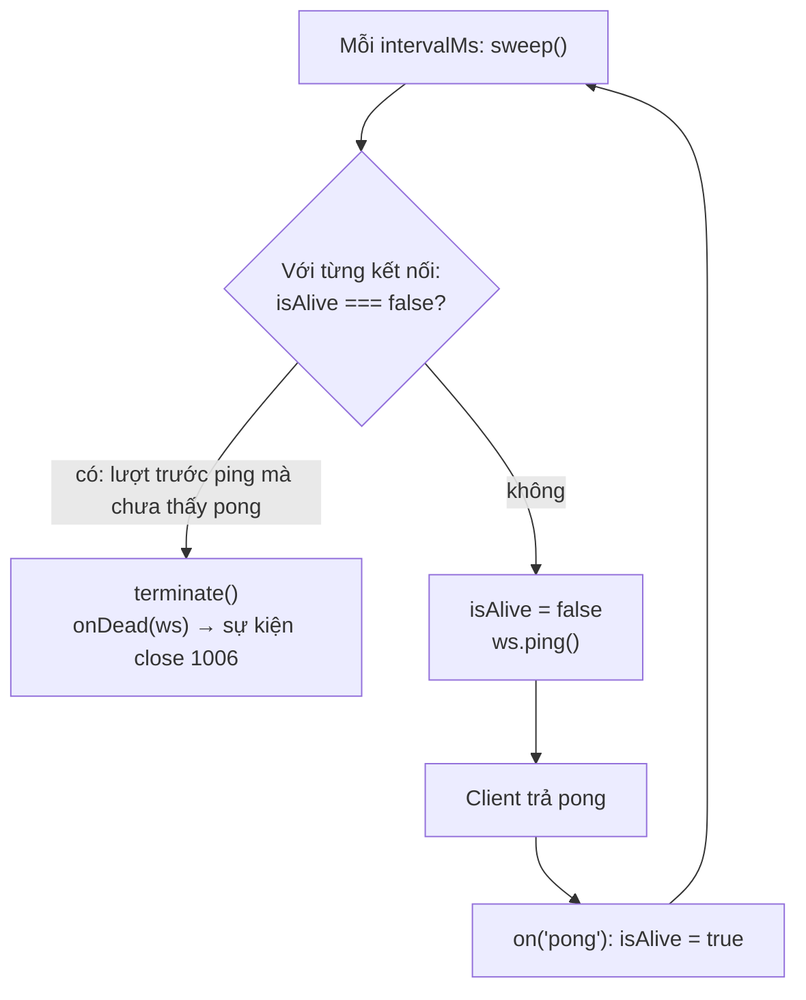

# N05 — Heartbeat ping/pong & tự kết nối lại

> Kết nối WebSocket có thể chết mà không bên nào biết. Bài này cho server TeamPulse tự phát hiện kết nối chết bằng ping/pong, và cho client tự kết nối lại có backoff, không mất tin gửi trong lúc offline.

## 🎯 Mục tiêu

Sau buổi này (khoảng 2–2,5 giờ) bạn sẽ:

- Giải thích vì sao kết nối **chết im lặng** (half-open TCP, NAT/proxy cắt kết nối nhàn rỗi) và vì sao `close` có thể tới sau **hàng giờ**.
- Viết **heartbeat** phía server: ping định kỳ, kết nối không trả pong thì `terminate()`.
- Tính **backoff mũ có jitter** cho việc kết nối lại, và biết jitter chống "cả nghìn client cùng ập vào" thế nào.
- Viết **client tự kết nối lại**: xử lý `readyState`, xếp hàng tin lúc offline, gửi bù khi có mạng.
- **Kết quả đo được:** `heartbeat.js` qua hết **9 test**; với heartbeat 5 giây, client bị treo được phát hiện sau **6,3 giây** (chạy thật ở Bước 6).

> 🧠 **Ghi nhớ:** `close` chỉ đến khi TCP **biết** kết nối đã đứt. Mất điện, rút cáp, laptop gập máy, NAT xoá bảng ánh xạ — không gói tin nào báo cho server. Muốn biết sớm, phải **chủ động hỏi**: gửi ping, chờ pong.

## 📋 Đề bài

**Mở thư mục:** workspace của bài `N05-heartbeat-reconnect` (`heartbeat.js`).

| Viết | Làm gì |
|---|---|
| `startHeartbeat(wss, {intervalMs, onDead})` | Ping mọi kết nối mỗi `intervalMs`; lượt sau chưa thấy pong → `terminate()`. Trả `{sweep, stop}` |
| `backoffDelay(attempt, {baseMs, maxMs, random})` | Thời gian chờ lần thử thứ `attempt`: nhân đôi, có trần, jitter trong [cap/2, cap] |
| `createReconnectingClient(url, options)` | Client tự kết nối lại theo `backoffDelay`, xếp hàng tin lúc offline, `close()` dừng hẳn |

Phần chạy thử (`npm start`, `npm run client`) đã viết sẵn ở cuối file, dùng chính các hàm của bạn.

**Xong khi:** `# pass 9`, rồi chạy server + client ở 2 terminal, tắt/bật server và thấy client tự nối lại, gửi bù tin.

## 🤔 Tại sao? (kiến thức nền)

### Kết nối chết im lặng

| Tình huống | Server thấy gì | Bao lâu mới có `close` |
|---|---|---|
| Client gọi `ws.close()` / đóng tab | Frame close | Ngay (code 1000/1001) |
| Tiến trình client bị kill | TCP FIN/RST từ hệ điều hành | Ngay (code 1006) |
| Wi-Fi rớt, laptop gập máy, mất điện | **Không gì cả** | Khi server gửi dữ liệu và TCP hết lượt gửi lại: Linux `tcp_retries2 = 15` ≈ **15 phút**, hoặc TCP keepalive: Linux mặc định 7200 giây + 9 × 75 giây ≈ **2 giờ 11 phút** |
| NAT / load balancer cắt kết nối nhàn rỗi | Không gì cả | Như trên. Nhiều proxy cắt sau 60 giây im lặng (vd. nginx `proxy_read_timeout`, AWS ALB idle timeout mặc định) |

Kết nối mà một bên đã mất còn bên kia vẫn tưởng mở gọi là **half-open**. Hậu quả với TeamPulse: tên "ma" nằm mãi trong danh sách online, tin gửi đi không ai nhận, bộ nhớ cho kết nối chết không được giải phóng.

Chạy thử: client "treo" (ngừng đọc socket), server vẫn gửi được, `readyState` vẫn `OPEN`:

```js
import { WebSocketServer, WebSocket } from 'ws';

const wss = new WebSocketServer({ port: 0, host: '127.0.0.1' });
await new Promise((r) => wss.once('listening', r));
const client = new WebSocket(`ws://127.0.0.1:${wss.address().port}`);
await new Promise((r) => client.once('open', r));
client._socket.pause();                    // giả lập máy client treo / mạng đứt im lặng

const [conn] = wss.clients;
let pongs = 0;
conn.on('pong', () => { pongs += 1; });
for (let s = 1; s <= 3; s += 1) {
  await new Promise((r) => setTimeout(r, 1000));
  conn.send(JSON.stringify({ type: 'chat', text: `tin ${s}` }));
  conn.ping();
  console.log(`giây ${s}: readyState=${conn.readyState} (OPEN), send không lỗi, pong nhận được: ${pongs}`);
}
client.terminate();
wss.close();
```
```output
giây 1: readyState=1 (OPEN), send không lỗi, pong nhận được: 0
giây 2: readyState=1 (OPEN), send không lỗi, pong nhận được: 0
giây 3: readyState=1 (OPEN), send không lỗi, pong nhận được: 0
```

`send` không lỗi vì dữ liệu chỉ vào **bộ đệm** của hệ điều hành; không có nghĩa là bên kia đã nhận. Chỉ có **pong** chứng minh đầu bên kia còn sống.

### Ping/pong: frame điều khiển có sẵn trong giao thức

WebSocket có 2 loại frame điều khiển: **ping** (opcode 0x9) và **pong** (0xA). Bên nhận ping **bắt buộc** trả pong cùng payload. Thư viện `ws` và mọi trình duyệt tự làm việc này, bạn không phải viết gì phía client.

```js
import { WebSocketServer, WebSocket } from 'ws';

const wss = new WebSocketServer({ port: 0, host: '127.0.0.1' });
await new Promise((r) => wss.once('listening', r));
const client = new WebSocket(`ws://127.0.0.1:${wss.address().port}`);
await new Promise((r) => client.once('open', r));
client.on('ping', (data) => console.log('client: nhận ping', JSON.stringify(String(data)), '→ ws tự trả pong'));

const [conn] = wss.clients;
const t0 = performance.now();
conn.on('pong', (data) => {
  console.log('server: nhận pong', JSON.stringify(String(data)), `sau ${(performance.now() - t0).toFixed(2)} ms`);
  client.close();
  wss.close();
});
conn.ping('t1');
```
```output
client: nhận ping "t1" → ws tự trả pong
server: nhận pong "t1" sau 1.07 ms
```

| | Server ping (bài này) | Ping ở tầng ứng dụng `{type: "ping"}` |
|---|---|---|
| Ai trả lời | Thư viện/trình duyệt tự trả | Code của bạn phải trả |
| JavaScript trình duyệt thấy không | Không (API trình duyệt không có sự kiện ping) | Có |
| Dùng để | Server phát hiện client chết | **Client** phát hiện server chết, đo độ trễ hiển thị cho người dùng |

Kế hoạch heartbeat (mẫu chuẩn trong tài liệu của `ws`):



Kết nối chết bị phát hiện sau khoảng `intervalMs` tới `2 × intervalMs`. Chọn `intervalMs` **nhỏ hơn** thời gian cắt nhàn rỗi của proxy (vd. 25–30 giây khi proxy cắt ở 60 giây): ping còn có tác dụng phụ là giữ kết nối "không nhàn rỗi".

> ⚠️ **Lỗi hay gặp:** dùng `ws.close()` cho kết nối chết. `close()` gửi frame close rồi **chờ** bên kia trả lời — bên kia đã chết nên phải chờ tới timeout (30 giây trong `ws`). Kết nối chết dùng `terminate()`: huỷ socket ngay.

### Kết nối lại: backoff mũ và jitter

Client mất kết nối thì thử lại. Thử lại **ngay lập tức, liên tục** thì khi server sập, mỗi client gửi hàng trăm request/giây vào server đang khởi động. Ý tưởng giống retry khi gọi API lỗi: **chờ lâu dần** (exponential backoff), và **mỗi client chờ một khoảng hơi khác nhau** (jitter).

Vì sao cần jitter: server khởi động lại, 1000 client cùng mất kết nối cùng lúc. Không jitter → cả 1000 kết nối lại trong **cùng 1 ms** ("thundering herd"), rồi lại cùng lúc ở lần thử sau.

```js
// 1000 client cùng mất kết nối khi server khởi động lại; lần thử đầu chờ 1000 ms.
// random có seed để lần nào chạy cũng in giống nhau.
let seed = 42;
const random = () => ((seed = (seed * 1103515245 + 12345) % 2 ** 31) / 2 ** 31);

function histogram(delays) {
  const buckets = [0, 0, 0, 0, 0];             // 0–199, 200–399, ..., 800–1000 ms
  for (const d of delays) {
    const i = Math.min(4, Math.floor(d / 200));
    buckets[i] += 1;
  }
  return buckets;
}

const noJitter = [];
const fullJitter = [];
for (let c = 0; c < 1000; c += 1) {
  noJitter.push(1000);
  fullJitter.push(Math.floor(random() * 1000));
}
console.log('không jitter  :', histogram(noJitter), '→ 1000 kết nối trong cùng 1 ms');
console.log('jitter 0–1000 :', histogram(fullJitter));
```
```output
không jitter  : [ 0, 0, 0, 0, 1000 ] → 1000 kết nối trong cùng 1 ms
jitter 0–1000 : [ 221, 194, 182, 193, 210 ]
```

| Kiểu jitter | Công thức (`cap` = trần của lần thử) | Ghi chú |
|---|---|---|
| Không jitter | `cap` | Mọi client trùng nhau |
| Full jitter | `random() × cap` | Trải đều nhất, nhưng có thể gần 0 ms |
| Equal jitter (bài này) | `cap/2 + random() × cap/2` | Luôn chờ ít nhất một nửa, vẫn trải ra |

## 🛠️ Làm

### Bước 1 — Chuẩn bị

```bash
cd <workspace>/N05-heartbeat-reconnect
npm test    # 9 fail vì TODO — bình thường
```

Dòng `ExperimentalWarning: The MockTimers API` là bình thường: một test dùng **đồng hồ giả** (`mock.timers` của `node:test`) để kiểm tra `setInterval` mà không phải chờ thật.

### Bước 2 — Một lượt kiểm tra → `startHeartbeat`

Mẫu "mỗi lượt: ai chưa báo cáo từ lượt trước thì loại, còn lại đặt cờ chờ báo cáo" — ví dụ cảm biến nhiệt độ trong toà nhà:

**Cách 1 — vòng lặp `for...of` + `continue`**

```js
const sensors = new Set([
  { name: 'kho-lanh', reported: true },
  { name: 'phong-may', reported: false },
  { name: 'san-thuong', reported: true },
]);
let offline = 0;
for (const s of sensors) {
  if (!s.reported) {
    console.log('offline:', s.name);
    sensors.delete(s);            // xoá phần tử đang duyệt khỏi Set là an toàn
    offline += 1;
    continue;
  }
  s.reported = false;             // vòng sau phải báo cáo lại
}
console.log('offline', offline, '| còn lại:', [...sensors].map((s) => `${s.name}:${s.reported}`).join(', '));
```
```output
offline: phong-may
offline 1 | còn lại: kho-lanh:false, san-thuong:false
```

**Cách 2 — `filter` rồi hai lần `forEach`**

```js
const sensors = new Set([
  { name: 'kho-lanh', reported: true },
  { name: 'phong-may', reported: false },
  { name: 'san-thuong', reported: true },
]);
const silent = [...sensors].filter((s) => !s.reported);
silent.forEach((s) => { console.log('offline:', s.name); sensors.delete(s); });
sensors.forEach((s) => { s.reported = false; });
console.log('offline', silent.length, '| còn lại:', [...sensors].map((s) => `${s.name}:${s.reported}`).join(', '));
```
```output
offline: phong-may
offline 1 | còn lại: kho-lanh:false, san-thuong:false
```

> ⚖️ **So sánh:** cùng O(n). Cách 1 duyệt **một** lần và không tạo mảng tạm; Cách 2 duyệt ba lần (spread, filter, forEach) và tách rõ "loại" với "đặt cờ". Heartbeat chạy trên mọi kết nối mỗi 30 giây — với 10.000 kết nối cả hai đều dưới 1 ms, chọn cách bạn đọc dễ hơn; Cách 1 là kiểu thường gặp trong code server.

Ghép vào `startHeartbeat`:

| Phần | Việc |
|---|---|
| Listener `connection` | `ws.isAlive = true`; `ws.on('pong', ...)` đặt lại `true` |
| `sweep()` | Duyệt `wss.clients` như Cách 1: `isAlive === false` → `terminate()` + `onDead(ws)`; còn lại → `isAlive = false`, `ping()`. Trả số đã terminate |
| `setInterval(sweep, intervalMs)` | Giữ id timer để `stop()` gọi `clearInterval` |
| `stop()` | `clearInterval` + `wss.off('connection', <đúng hàm đã gắn>)` |

> ⚠️ **Lỗi hay gặp:** `wss.off('connection', (ws) => ...)` với một arrow function **mới** — không gỡ được gì, vì `off` cần **đúng tham chiếu** hàm đã truyền cho `on`. Đặt tên hàm (`function onConnection(ws) {...}`) rồi dùng tên đó cho cả `on` và `off`.

> 💡 **Mẹo:** quên `stop()` thì `setInterval` giữ tiến trình sống mãi: test không thoát, server không tắt êm. Mọi timer bạn tạo phải có đường dọn.

### Bước 3 — Thời gian chờ → `backoffDelay`

Ví dụ: lịch thử gọi lại một API thời tiết, bắt đầu 200 ms, trần 5000 ms (chưa có jitter):

**Cách 1 — vòng lặp `for`, nhân đôi từng bước**

```js
const startMs = 200;
const ceilingMs = 5000;
let wait = startMs;
const plan = [];
for (let i = 0; i < 7; i += 1) {
  plan.push(wait);
  wait = wait * 2;
  if (wait > ceilingMs) {
    wait = ceilingMs;
  }
}
console.log(plan.join(' → '));
```
```output
200 → 400 → 800 → 1600 → 3200 → 5000 → 5000
```

**Cách 2 — `Array.from` + công thức trực tiếp `2 ** i`**

```js
const plan = Array.from({ length: 7 }, (_, i) => Math.min(5000, 200 * 2 ** i));
console.log(plan.join(' → '));
```
```output
200 → 400 → 800 → 1600 → 3200 → 5000 → 5000
```

`Array.from({ length: 7 }, (_, i) => ...)` = vòng `for (let i = 0; i < 7; i++) arr.push(...)`. `2 ** i` là lũy thừa (`Math.pow(2, i)`).

> ⚖️ **So sánh:** cả lịch là O(n), chỉ khác cách viết. Nhưng `backoffDelay` chỉ cần **một** giá trị cho một `attempt` — công thức trực tiếp (Cách 2) là O(1), không cần vòng lặp. Lưu ý `2 ** attempt` rất lớn khi `attempt` lớn (2^1024 = `Infinity`); `Math.min(maxMs, ...)` vẫn trả đúng `maxMs`.

Trong `backoffDelay`: tính `cap` theo Cách 2, rồi cộng jitter "một nửa" như docstring. `random` là **tham số** để test truyền `() => 0` hoặc `() => 1` và có kết quả xác định.

### Bước 4 — `readyState` và hàng đợi offline → `createReconnectingClient`

Ví dụ hàng đợi: máy in mất mạng, lệnh in xếp hàng tối đa 3 lệnh, có mạng thì in bù đúng thứ tự:

```js
const MAX = 3;
const queue = [];
let online = false;

function print(job) {
  if (online) {
    console.log('in ngay :', job);
    return 'printed';
  }
  if (queue.length >= MAX) {
    const dropped = queue.shift();             // bỏ lệnh cũ nhất
    console.log('bỏ      :', dropped);
  }
  queue.push(job);
  return 'queued';
}

for (const job of ['hoa-don-1', 'hoa-don-2', 'hoa-don-3', 'hoa-don-4']) print(job);
online = true;
while (queue.length > 0) {
  console.log('in bù   :', queue.shift());
}
print('hoa-don-5');
```
```output
bỏ      : hoa-don-1
in bù   : hoa-don-2
in bù   : hoa-don-3
in bù   : hoa-don-4
in ngay : hoa-don-5
```

`push` thêm vào cuối, `shift` lấy ra từ đầu → thứ tự vào trước ra trước (FIFO).

Vòng đời client tự kết nối lại:

| Sự kiện của kết nối hiện tại | Việc |
|---|---|
| `open` | `attempt = 0`; gửi bù hàng đợi (`while` + `shift`, chỉ khi `readyState === OPEN`); `onOpen()` |
| `message` | `onMessage(String(data))` |
| `error` | Lắng nghe để không sập; không làm gì thêm — `close` luôn đến sau |
| `close` | Đã gọi `close()` → thôi. Không thì `delay = backoffDelay(attempt, ...)`, `onRetry({attempt, delay})`, `attempt += 1`, `setTimeout(connect, delay)` |

Mỗi lần kết nối lại là một `new WebSocket(url)` **mới** — một object WebSocket đã `CLOSED` không mở lại được. Vì vậy `send` phải dùng biến "kết nối hiện tại", không giữ object cũ.

> ⚠️ **Lỗi hay gặp:** `close()` chỉ đóng socket mà không huỷ `setTimeout` đang chờ → client vẫn tự kết nối lại sau khi "đã đóng". Cần cờ `stopped` và `clearTimeout`.

> 💡 **Mẹo:** hàng đợi **phải có giới hạn**. Mất mạng 1 giờ, mỗi giây 1 tin → 3600 tin dồn lại, ập tới server cùng lúc khi có mạng. Bỏ tin cũ nhất (như bài này) hợp với dữ liệu "mới nhất mới quan trọng" (vị trí, trạng thái); tin chat quan trọng thì lưu lại để gửi lại sau, hoặc báo người dùng.

### Bước 5 — Chạy test

```bash
npm test
```

Test kiểm tra heartbeat bằng `wss` giả và đồng hồ giả (không chờ thật), rồi bằng `ws` thật: client gọi `_socket.pause()` để giả lập treo, server phải `terminate()` nó trong khoảng 2 × 50 ms. Client tự kết nối lại được thử với server cắt kết nối đột ngột, và server từ chối 3 lần đầu.

### Bước 6 — Chạy thật: treo client, tắt server

Terminal 1: `npm start`. Terminal 2: `npm run client`. Rồi giả lập sự cố: `kill -STOP <pid client>` (dừng tiến trình như laptop gập máy), 11 giây sau `kill -CONT`; sau đó Ctrl+C server, 3,5 giây sau `npm start` lại. Log thật (cột giây tính từ lúc mỗi tiến trình chạy):

```output
# server (heartbeat 5 s) — client bị dừng ở giây 3,7
  0.5s server: kết nối #1 mở (1 đang mở)
  3.5s server: #1 gửi {"type":"chat","n":3}
 10.0s server: #1 không trả pong → terminate        ← phát hiện sau 6,3 s
 10.0s server: kết nối #1 đóng, code 1006
 15.0s server: kết nối #2 mở (1 đang mở)           ← client chạy lại, tự nối lại

# client
  3.0s client: nhận {"type":"ack","got":"{\"type\":\"chat\",\"n\":3}"}
 14.2s client: mất kết nối, thử lại lần 1 sau 326 ms
 14.5s client: đã kết nối
 17.2s client: mất kết nối, thử lại lần 1 sau 457 ms      ← Ctrl+C server
 17.6s client: mất kết nối, thử lại lần 2 sau 564 ms
 18.2s client: tin 8 vào hàng đợi (1 tin)
 18.2s client: mất kết nối, thử lại lần 3 sau 1991 ms
 20.2s client: mất kết nối, thử lại lần 4 sau 2829 ms
 22.2s client: tin 12 vào hàng đợi (5 tin)
 23.0s client: đã kết nối
 23.0s client: nhận {"type":"ack","got":"{\"type\":\"chat\",\"n\":8}"}   ← gửi bù 8…12 đúng thứ tự
 23.0s client: nhận {"type":"ack","got":"{\"type\":\"chat\",\"n\":12}"}
```

Đọc kỹ log: tin số **4** và **7** mất. Lúc gửi, client vẫn thấy `readyState === OPEN` (chưa biết kết nối đã chết), nên `send` trả `'sent'` — hàng đợi không cứu được tin "đang bay". Muốn chắc chắn tới nơi cần **xác nhận (ack)** từ server và gửi lại khi không có ack — đó là phần đầu của N06.

## ✅ Tự kiểm tra

Bấm **Chạy test**, hoặc trong thư mục workspace của bài:

```bash
npm test
```

Mục tiêu: `# pass 9`. Test dùng `mock.timers` cho phần `setInterval`, server `ws` thật ở cổng ngẫu nhiên trên `127.0.0.1` cho phần còn lại; cả bộ chạy dưới 2 giây.

## 🎤 Câu hỏi phỏng vấn

> 🎯 **Phỏng vấn hay hỏi:** "Làm sao server biết một client WebSocket đã mất mạng?" — sự kiện `close` chỉ đến khi TCP biết kết nối đứt; mất mạng im lặng (half-open, NAT/proxy cắt) có thể không báo gì trong hàng giờ. Giải pháp: heartbeat — server ping mỗi 25–30 giây (nhỏ hơn idle timeout của proxy), lượt sau chưa có pong thì `terminate()`, phát hiện trong tối đa 2 × chu kỳ. Phía client: tự kết nối lại với exponential backoff + jitter để tránh thundering herd, hàng đợi có giới hạn cho tin lúc offline, và ack để không mất tin đang bay.
