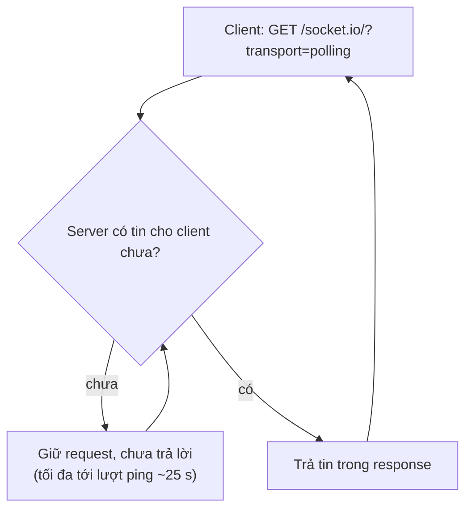
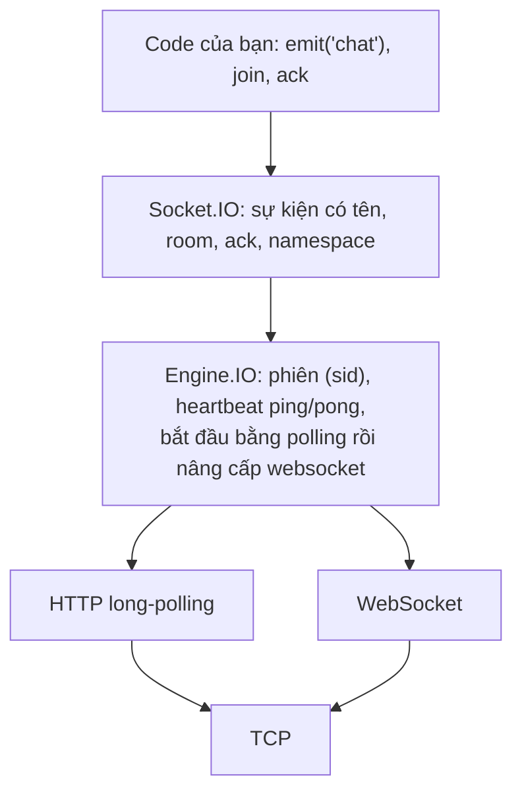
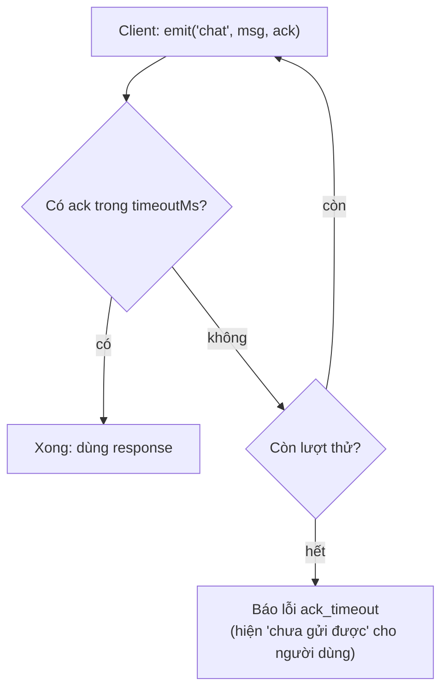

# N06 — Socket.IO: room, ack, so với ws thuần

> Viết lại phòng chat TeamPulse bằng Socket.IO: sự kiện có tên thay cho `{type}`, nhiều room, ack có timeout và gửi lại, tự kết nối lại. Rồi đo xem Socket.IO tốn thêm gì so với `ws`, để chọn đúng công cụ khi đọc code ở công ty.

## 🎯 Mục tiêu

Sau buổi này (khoảng 3,5 giờ với người mới) bạn sẽ:

- Dùng **sự kiện** của Socket.IO (`emit`/`on`) thay cho giao thức JSON `{type}` tự viết.
- Làm **room**: `socket.join`, `socket.leave`, `io.to(room).emit`, `socket.to(room).emit`.
- Dùng **ack**: server trả lời đúng tin client gửi; client chờ có **timeout** và **gửi lại**; server **chống trùng** tin gửi lại bằng `clientId` (idempotent).
- Dùng **middleware** `io.use` để từ chối kết nối trước khi vào (bước đệm cho xác thực ở N07).
- Giải thích trung thực **ws thuần vs Socket.IO**: Socket.IO **không phải** WebSocket thuần, tốn thêm gì, khi nào chọn cái nào.
- **Kết quả đo được:** `rooms.js` qua hết **11 test**; `npm run compare`: 10 tin chat tốn 1.833 byte với `ws`, 1.910 byte với Socket.IO chỉ-websocket, 2.995 byte với Socket.IO mặc định (4 request HTTP).

> 🧠 **Ghi nhớ:** Socket.IO là **một giao thức riêng chạy trên** WebSocket (hoặc HTTP long-polling). Client `ws` hay `new WebSocket()` của trình duyệt **không** nói chuyện được với server Socket.IO, và ngược lại.

## 📋 Đề bài

**Mở thư mục:** workspace của bài `N06-socketio-rooms-ack` (`rooms.js`, `compare.js` — đã viết sẵn, `public/index.html` — giao diện hoàn chỉnh). `socket.io` và `socket.io-client` đã cài ở thư mục khóa học.

Giao thức (ghi đầy đủ ở đầu `rooms.js`):

| Client gửi | Ack trả về | Server phát |
|---|---|---|
| `join(room)` | `{ok, room, members}` / `invalid_room` | `joined {room, name}` → người khác trong room |
| `leave(room)` | `{ok, room}` / `not_in_room` | `left {room, name}` → người còn lại |
| `chat({room, text, clientId?})` | `{ok, id}` / `not_in_room` / `invalid_text`; gửi lại cùng `clientId` → `{ok, id}` cũ | `chat {id, room, from, text, ts}` → cả room (một lần cho mỗi `clientId`) |
| (ngắt kết nối) | — | `left {room, name}` → mỗi room đã vào |

| Viết | Làm gì |
|---|---|
| `normalizeRoom(room)` | Trim + chữ thường; chỉ `a-z 0-9 -`, 1–30 ký tự; sai → `null` |
| `createRoomServer()` | `{server, io}`: trang `/`, middleware tên, `join`/`leave`/`chat` có ack, chống trùng theo `clientId`, `left` khi ngắt |
| `sendWithRetry(socket, event, payload, {timeoutMs, retries})` | Chờ ack có hạn; không có thì gửi lại; hết lượt → `ack_timeout` |

**Xong khi:** `# pass 11`, `npm run compare` chạy hết, và `npm start` → `http://127.0.0.1:3006` ở hai tab chat được theo room.

## 🤔 Tại sao? (kiến thức nền)

### Socket.IO làm sẵn những gì bạn đã tự viết

| Việc | `ws` thuần (N03–N05) | Socket.IO |
|---|---|---|
| Phân loại tin | Tự đặt `{type: "chat"}`, tự `JSON.parse` + kiểm tra | `socket.emit('chat', data)` / `socket.on('chat', ...)`, tự serialize |
| Gửi cho một nhóm | Tự giữ `Map`/`Set`, tự lặp `broadcast` | `socket.join('dev')`, `io.to('dev').emit(...)` |
| Trả lời đúng một tin | Tự gắn `id`, tự ghép câu trả lời | Ack: callback cuối của `emit` |
| Heartbeat | Tự viết (N05) | Có sẵn: Engine.IO ping mỗi 25 giây, timeout 20 giây |
| Kết nối lại | Tự viết backoff (N05) | Có sẵn ở client: backoff + jitter |
| Mạng chặn WebSocket | Hỏng | Tự lùi về HTTP long-polling |
| Nhiều server | Tự làm pub/sub (N08) | Adapter có sẵn (`@socket.io/redis-adapter`) |

**HTTP long-polling** (dòng "Mạng chặn WebSocket" ở trên) khác polling ở N03. Polling N03: cứ 1 giây hỏi một lần, phần lớn câu trả lời rỗng. Long-polling: client gửi một request, server **giữ** request đó chưa trả lời cho tới khi có tin (hoặc tới lượt ping, khoảng 25 giây), trả tin về, client gửi ngay request kế tiếp. Tin đến gần như ngay, ít request rỗng — nhưng mỗi lượt vẫn là một request HTTP đủ header, và chiều client → server phải gửi bằng request riêng.



Socket.IO xếp thành tầng; Engine.IO là tầng giữa, lo "đường truyền" để tầng trên chỉ thấy sự kiện:



Room và ack trong một ví dụ khác (bếp nhà hàng: mỗi khu chỉ nhận order của khu mình):

```js
import http from 'node:http';
import { Server } from 'socket.io';
import { io } from 'socket.io-client';

const server = http.createServer();
const kitchen = new Server(server);
kitchen.on('connection', (socket) => {
  socket.on('vao-khu', (area, ack) => {
    socket.join(area);
    ack({ ok: true, area });
  });
  socket.on('order', (o, ack) => {
    kitchen.to(o.area).emit('order', o.dish);          // mọi socket trong room
    ack({ ok: true });
  });
});
await new Promise((r) => server.listen(0, '127.0.0.1', r));
const url = `http://127.0.0.1:${server.address().port}`;

const bep = io(url, { transports: ['websocket'] });
const bar = io(url, { transports: ['websocket'] });
const quay = io(url, { transports: ['websocket'] });
bep.on('order', (d) => console.log('bếp nhận:', d));
bar.on('order', (d) => console.log('bar nhận:', d));
// emitWithAck: gửi sự kiện rồi trả Promise, resolve bằng giá trị server truyền vào ack(...) — giải thích kỹ ở Bước 4
console.log('ack vào khu:', await bep.emitWithAck('vao-khu', 'bep'), await bar.emitWithAck('vao-khu', 'bar'));
console.log('ack order  :', await quay.emitWithAck('order', { area: 'bep', dish: 'phở bò' }));
await quay.emitWithAck('order', { area: 'bar', dish: 'trà đào' });
setTimeout(() => { for (const s of [bep, bar, quay]) s.disconnect(); kitchen.close(); }, 100);
```
```output
ack vào khu: { ok: true, area: 'bep' } { ok: true, area: 'bar' }
bếp nhận: phở bò
ack order  : { ok: true }
bar nhận: trà đào
```

Ba cách gửi trên server, hay bị nhầm:

| Lệnh | Ai nhận |
|---|---|
| `socket.emit(ev, data)` | Chỉ socket đó |
| `socket.to(room).emit(ev, data)` | Mọi socket trong room **trừ** chính socket đó |
| `io.to(room).emit(ev, data)` | Mọi socket trong room, **gồm** cả socket gửi |
| `io.emit(ev, data)` | Mọi socket đang kết nối |

Mỗi socket tự động ở trong một room riêng tên bằng `socket.id` — vì vậy khi duyệt `socket.rooms` phải bỏ room đó.

**Namespace** (`io.of('/admin')`) là một "kênh" riêng trên cùng kết nối, có middleware và sự kiện riêng; dùng để tách khu vực (vd. trang quản trị) — room thì nằm **bên trong** một namespace. Bài này chỉ dùng namespace mặc định `/`.

### Ack: biết chắc server đã nhận

N05 kết thúc với tin số 4 và 7 bị mất: client tưởng kết nối còn mở nên `send` "thành công". Ack sửa đúng chỗ này: client chỉ coi tin là đã gửi khi **server trả lời**.



> ⚠️ **Lỗi hay gặp:** gửi lại khi không có ack có thể làm server nhận **hai lần** (lần đầu server đã xử lý, chỉ có ack bị mất). Tin quan trọng cần một **id do client sinh** (vd. `crypto.randomUUID()`) để server bỏ qua bản trùng — gọi là xử lý **idempotent**: làm một lần hay làm lại nhiều lần với cùng id thì kết quả như nhau. Bài này làm đúng việc đó với trường `clientId` của `chat` (Bước 3d).

### Tự kết nối lại: socket mới, room cũ mất

Client Socket.IO tự kết nối lại (backoff có jitter như N05), nhưng mỗi lần là một **socket mới** với `id` mới. Room nằm ở server theo từng socket, nên **mất hết**:

```js
import http from 'node:http';
import { Server } from 'socket.io';
import { io } from 'socket.io-client';

const server = http.createServer();
const srv = new Server(server);
srv.on('connection', (socket) => {
  socket.on('join', (room, ack) => { socket.join(room); ack(); });
});
await new Promise((r) => server.listen(0, '127.0.0.1', r));

const client = io(`http://127.0.0.1:${server.address().port}`, { transports: ['websocket'], reconnectionDelay: 200 });
const roomsOnServer = () => [...srv.sockets.sockets.get(client.id).rooms].filter((r) => r !== client.id);
let round = 0;
client.on('connect', async () => {
  round += 1;
  if (round === 1) {
    await client.emitWithAck('join', 'ops');
    console.log(`connect #1: id=${client.id}, rooms trên server =`, roomsOnServer());
    srv.sockets.sockets.get(client.id).conn.close();      // cắt transport như mạng rớt
  } else {
    console.log(`connect #2: id=${client.id}, rooms trên server =`, roomsOnServer());
    client.disconnect();
    srv.close();
  }
});
client.on('disconnect', (reason) => console.log('disconnect:', reason));
```
```output
connect #1: id=ViG5S9R6u24vFuUqAAAA, rooms trên server = [ 'ops' ]
disconnect: transport close
connect #2: id=hDZHB9kSYlm55lS_AAAB, rooms trên server = []
disconnect: io client disconnect
```

Cách chữa: client nhớ danh sách room của mình và `join` lại trong `socket.on('connect', ...)` — `public/index.html` làm đúng như vậy. (Socket.IO 4.6+ có tùy chọn `connectionStateRecovery` giữ room trong một khoảng ngắn, nhưng không thay được việc join lại khi server khởi động lại.)

### ws thuần hay Socket.IO? Đo bằng số

`npm run compare` (đã viết sẵn) cho một client gửi 10 tin chat, server trả lại từng tin, đếm byte trên socket TCP phía server:

```output
10 tin chat, mỗi tin được server trả lại:
A. ws thuần                                   1 request    353 byte bắt tay   1833 byte tổng
B. Socket.IO mặc định (polling → websocket)   4 request   1625 byte bắt tay   2995 byte tổng
C. Socket.IO chỉ websocket                    1 request    540 byte bắt tay   1910 byte tổng
Một tin ws thuần   : {"type":"chat","room":"dev","text":"Build #128 xong, deploy lúc 10h"} (70 byte payload)
Một tin Socket.IO  : 429["chat",{"room":"dev","text":"Build #128 xong, deploy lúc 10h"}] (68 byte payload)
ws thuần → /: lỗi "socket hang up"
ws thuần → /socket.io/?EIO=4&transport=websocket: nhận "0{"sid":"dRMKhislibjjX3QUAAAC","upgrades":[],"pingInterval":..." (gói Engine.IO, không phải tin chat)
```

Đọc kết quả:

- **Mỗi tin** gần như bằng nhau: `429[...]` = `4` (gói message của Engine.IO) + `2` (sự kiện Socket.IO) + `9` (số thứ tự ack), thay cho `"type":"chat"` mà bạn tự thêm ở `ws`.
- **Bắt tay** đắt hơn: mặc định Socket.IO mở bằng HTTP long-polling (4 request trong lần đo này; có thể lệch 1 tuỳ thời điểm nâng cấp) rồi mới nâng cấp lên WebSocket — 1.625 byte so với 353. Đặt `transports: ['websocket']` thì còn 540 byte, 1 request.
- **Không tương thích**: client `ws` thuần vào `/` bị cắt; vào đúng đường `/socket.io/` thì nhận gói `0{"sid":...}` của Engine.IO và phải tự nói giao thức đó.

| Chọn | Khi |
|---|---|
| `ws` thuần | Client không phải trình duyệt của bạn (IoT, app khác ngôn ngữ, đối tác dùng WebSocket chuẩn); cần ít phụ thuộc, kiểm soát từng byte; số kết nối rất lớn |
| Socket.IO | Web app cần room, ack, tự kết nối lại, fallback polling qua proxy khó tính; đội muốn có sẵn thay vì tự viết; chấp nhận client phải dùng thư viện Socket.IO |

> 🎯 **Phỏng vấn hay hỏi:** "Socket.IO có phải WebSocket không?" — không. Socket.IO là giao thức riêng (Engine.IO bên dưới) có thể chạy trên WebSocket hoặc HTTP long-polling, thêm sự kiện, room, ack, heartbeat, tự kết nối lại. Client WebSocket chuẩn không kết nối được với server Socket.IO.

## 🛠️ Làm

### Bước 1 — Chuẩn bị

```bash
cd academy/courses/node-realtime/workspace/N06-socketio-rooms-ack
npm test          # 10 fail vì TODO — bình thường
npm run compare   # chạy được ngay, không phụ thuộc code của bạn
```

Đang làm hàm nào thì chạy riêng test của hàm đó: cờ `--test-name-pattern` (biểu thức chính quy so với tên test) phải đứng **trước** đường dẫn file — `npm test -- --test-name-pattern=...` không lọc được vì npm nối cờ vào sau đường dẫn. Lệnh dùng y hệt trên PowerShell:

```bash
node --test --test-name-pattern="normalizeRoom" "../../curriculum/N06-socketio-rooms-ack/tests/*.test.js"
```

### Bước 2 — Kiểm tra từng ký tự → `normalizeRoom`

Ví dụ: mã kho hàng hợp lệ có 3–8 ký tự, chỉ gồm `A-Z` và `0-9`.

**Cách 1 — vòng lặp `for...of` qua từng ký tự**

```js
function normalizeSku(raw) {
  if (typeof raw !== 'string') return null;
  const s = raw.trim().toUpperCase();
  if (s.length < 3 || s.length > 8) return null;
  for (const ch of s) {
    const isLetter = ch >= 'A' && ch <= 'Z';
    const isDigit = ch >= '0' && ch <= '9';
    if (!isLetter && !isDigit) return null;
  }
  return s;
}
for (const x of [' ab12 ', 'TAO-01', 'X1', 'cam2026', 99]) console.log(JSON.stringify(x), '→', normalizeSku(x));
```
```output
" ab12 " → AB12
"TAO-01" → null
"X1" → null
"cam2026" → CAM2026
99 → null
```

**Cách 2 — biểu thức chính quy (regex)**

```js
function normalizeSku(raw) {
  if (typeof raw !== 'string') return null;
  const s = raw.trim().toUpperCase();
  return /^[A-Z0-9]{3,8}$/.test(s) ? s : null;
}
for (const x of [' ab12 ', 'TAO-01', 'X1', 'cam2026', 99]) console.log(JSON.stringify(x), '→', normalizeSku(x));
console.log('quên ^ và $:', /[A-Z0-9]{3,8}/.test('TAO-01'), '← sai: chỉ cần một đoạn con khớp');
```
```output
" ab12 " → AB12
"TAO-01" → null
"X1" → null
"cam2026" → CAM2026
99 → null
quên ^ và $: true ← sai: chỉ cần một đoạn con khớp
```

`/^[A-Z0-9]{3,8}$/` đọc là: từ đầu (`^`) tới cuối (`$`) chuỗi, 3 tới 8 (`{3,8}`) ký tự, mỗi ký tự thuộc nhóm `[A-Z0-9]` — đúng vòng lặp ở Cách 1.

> ⚖️ **So sánh:** cùng O(n) theo độ dài chuỗi, regex chỉ gọn hơn. Regex dễ sai âm thầm (quên `^`/`$` như dòng cuối), Cách 1 dài hơn nhưng đọc từng điều kiện rõ ràng. Với room chỉ 30 ký tự, tốc độ không khác biệt; chọn cách bạn đọc lại được sau 3 tháng.

> ⚠️ **Lỗi hay gặp:** `'phòng'.toLowerCase()` vẫn có `ò` — chữ có dấu không nằm trong `a-z`, nên phải trả `null` chứ không "bỏ dấu" giùm người dùng.

### Bước 3 — Middleware và sự kiện → `createRoomServer`

Một hàm phủ 7/11 test — làm từng phần 3a → 3e, mỗi phần chạy riêng test của nó. Khung chú thích trong starter đánh dấu chỗ của từng phần.

| Phần | Việc |
|---|---|
| `http.createServer` | `GET /` → `public/index.html` (đọc theo `new URL('./public/index.html', import.meta.url)` như N04); khác → 404 |
| `new Server(server)` | Gắn Socket.IO vào chính HTTP server đó; nó tự xử lý `/socket.io/...` |
| `io.use((socket, next) => ...)` | Đọc `socket.handshake.auth.name`; sai → `next(new Error('invalid_name'))`; đúng → `socket.data.name = ...; next()` |
| `socket.on('join' / 'leave' / 'chat', (data, ack) => ...)` | Theo bảng giao thức; trả lời bằng `ack(...)` nếu `typeof ack === 'function'` |
| `socket.on('disconnecting', ...)` | `socket.rooms` còn đủ ở đây (ở `disconnect` thì đã rỗng) |

#### Bước 3a — Trang `/` và 404

Giống `createChatServer` ở N04: `req.method === 'GET' && req.url === '/'` → đọc file, `writeHead(200, {'Content-Type': 'text/html; charset=utf-8'})`; còn lại 404. Rồi `const io = new Server(server)` và `return { server, io }` (chưa `listen`).

```bash
node --test --test-name-pattern="GET / trả giao diện" "../../curriculum/N06-socketio-rooms-ack/tests/*.test.js"
```

#### Bước 3b — Middleware `io.use`: cổng kiểm tra trước khi vào

**Middleware** là hàm chạy **trước** khi kết nối được nhận (trước sự kiện `connection`). Nhận `(socket, next)`; gọi `next()` để cho đi tiếp, `next(new Error('...'))` để chặn (client nhận `connect_error` với đúng message đó). Nhiều `io.use` chạy **lần lượt** theo thứ tự khai báo. Ví dụ toà nhà có hai cổng:

```js
import http from 'node:http';
import { Server } from 'socket.io';
import { io } from 'socket.io-client';

const server = http.createServer();
const building = new Server(server);
building.use((socket, next) => {                       // cổng 1: bảo vệ
  const badge = socket.handshake.auth.badge;
  console.log(`  cổng 1 (bảo vệ): thẻ ${JSON.stringify(badge)}`);
  if (!badge) return next(new Error('no_badge'));      // chặn: cổng sau không chạy, client nhận connect_error
  next();                                              // cho đi tiếp
});
building.use((socket, next) => {                       // cổng 2: lễ tân
  console.log('  cổng 2 (lễ tân): ghi sổ');
  if (socket.handshake.auth.badge === 'quen-next') return;   // LỖI CỐ Ý: quên gọi next()
  socket.data.floor = 3;
  next();
});
building.on('connection', (socket) => console.log(`  connection: vào toà nhà, tầng ${socket.data.floor}`));
await new Promise((r) => server.listen(0, '127.0.0.1', r));
const url = `http://127.0.0.1:${server.address().port}`;

for (const badge of ['NV-07', undefined, 'quen-next']) {
  console.log(`khách có thẻ ${JSON.stringify(badge)}:`);
  const c = io(url, { auth: { badge }, transports: ['websocket'], reconnection: false });
  await new Promise((resolve) => {
    const t = setTimeout(() => { console.log('  client: 500 ms rồi, không connect cũng không lỗi → đang treo'); resolve(); }, 500);
    c.once('connect', () => { clearTimeout(t); console.log('  client: connect'); resolve(); });
    c.once('connect_error', (err) => { clearTimeout(t); console.log(`  client: connect_error "${err.message}"`); resolve(); });
  });
  c.disconnect();
}
building.close();
```
```output
khách có thẻ "NV-07":
  cổng 1 (bảo vệ): thẻ "NV-07"
  cổng 2 (lễ tân): ghi sổ
  connection: vào toà nhà, tầng 3
  client: connect
khách có thẻ undefined:
  cổng 1 (bảo vệ): thẻ undefined
  client: connect_error "no_badge"
khách có thẻ "quen-next":
  cổng 1 (bảo vệ): thẻ "quen-next"
  cổng 2 (lễ tân): ghi sổ
  client: 500 ms rồi, không connect cũng không lỗi → đang treo
```

Khách thứ ba cho thấy lỗi nguy hiểm nhất: middleware **quên gọi `next`** thì client không vào được mà cũng không nhận lỗi — cứ treo (server Socket.IO chỉ tự cắt sau `connectTimeout`, mặc định 45 giây). Mỗi nhánh của middleware phải kết thúc bằng `next()` hoặc `next(err)`. `socket.data` là chỗ middleware để lại thông tin (tên, tầng...) cho các handler sau dùng.

Trong bài: tên lấy từ `socket.handshake.auth.name` (client gửi qua `io(url, { auth: { name } })`), phải là chuỗi, sau trim dài 1–`MAX_NAME`.

```bash
node --test --test-name-pattern="middleware" "../../curriculum/N06-socketio-rooms-ack/tests/*.test.js"
```

#### Bước 3c — `join` + ack

Ví dụ bếp nhà hàng ở đầu bài là cùng khuôn (`socket.join(area)` rồi `ack(...)`). Trong bài: `normalizeRoom` (Bước 2) sai → ack lỗi; đã ở room (`socket.rooms.has(r)`) → chỉ ack; chưa → `socket.join(r)`, `socket.to(r).emit('joined', ...)` (người khác, không gồm mình), rồi ack kèm `members`.

Số người trong room: `io.sockets.adapter.rooms` là một `Map` từ tên room → `Set` các socket id; `.get(r)?.size` là số người. `socket.rooms` là `Set` các room của một socket; `socket.rooms.has(r)` kiểm tra đã vào chưa.

```bash
node --test --test-name-pattern="join trả ack" "../../curriculum/N06-socketio-rooms-ack/tests/*.test.js"
```

#### Bước 3d — `chat`: kiểm tra, phát, chống trùng

Thứ tự kiểm tra như docstring: room (sai hoặc chưa vào → `not_in_room`) → text (`invalid_text`) → chống trùng → `seq += 1`, `io.to(r).emit('chat', msg)` (gồm người gửi), ack `{ok: true, id}`.

Chống trùng (idempotent) cùng khuôn với máy POS gửi lại lệnh thanh toán — `Map` từ mã giao dịch → kết quả đã cấp:

```js
// Máy POS gửi lệnh thanh toán qua mạng chập chờn: không nhận được trả lời thì gửi lại CÙNG mã giao dịch.
const seen = new Map();             // mã giao dịch → số hoá đơn đã cấp
let lastInvoice = 100;

function pay(txId, amount) {
  if (seen.has(txId)) {
    return { ok: true, invoice: seen.get(txId) };   // đã xử lý: trả lại kết quả cũ, KHÔNG trừ tiền lần nữa
  }
  lastInvoice += 1;
  seen.set(txId, lastInvoice);
  console.log(`  trừ ${amount}đ → hoá đơn #${lastInvoice}`);
  return { ok: true, invoice: lastInvoice };
}

console.log('tx-1     :', pay('tx-1', 50000));
console.log('tx-1 lại :', pay('tx-1', 50000));      // gửi lại vì trả lời lần đầu bị mất
console.log('tx-2     :', pay('tx-2', 20000));
```
```output
  trừ 50000đ → hoá đơn #101
tx-1     : { ok: true, invoice: 101 }
tx-1 lại : { ok: true, invoice: 101 }
  trừ 20000đ → hoá đơn #102
tx-2     : { ok: true, invoice: 102 }
```

Trong bài: `clientId` là chuỗi không rỗng và đã có trong `Map` → ack lại `{ok: true, id: <id cũ>}`, không phát `chat`, không tăng `seq`. Chỉ ghi vào `Map` khi tin **hợp lệ** (tin bị từ chối thì gửi lại vẫn bị từ chối như thường). Kết hợp với `sendWithRetry` (Bước 4): client sinh `clientId` một lần (`crypto.randomUUID()`), gửi lại bao nhiêu lần cũng chỉ ra một tin.

> 💡 **Mẹo:** `Map` này lớn dần mãi. Production giới hạn nó (chỉ nhớ vài phút gần nhất, hoặc N tin cuối mỗi người), hoặc để database làm việc này bằng ràng buộc `UNIQUE` trên cột `client_id`.

```bash
node --test --test-name-pattern="chat chỉ tới|chat sai|clientId" "../../curriculum/N06-socketio-rooms-ack/tests/*.test.js"
```

#### Bước 3e — `leave` và `disconnecting`

`leave`: chưa ở room (hoặc room sai) → `not_in_room`; có → `socket.leave(r)`, ack, rồi gửi `left` cho người còn lại. Ngắt kết nối: ở `disconnecting`, duyệt `socket.rooms` bằng `for...of`, bỏ qua room tên bằng `socket.id`, gửi `left` vào từng room.

> ⚠️ **Lỗi hay gặp:** gửi `left` ở sự kiện `disconnect` — lúc đó socket đã rời mọi room, `socket.rooms` rỗng, không ai nhận được. Dùng `disconnecting`.

> ⚠️ **Lỗi hay gặp:** gọi `ack(...)` khi client không truyền callback → `TypeError: ack is not a function`. Socket.IO **không** bắt lỗi này: đã thử thật, cả tiến trình server sập (`exit 1`), mọi người mất kết nối. Kiểm tra `typeof ack === 'function'` trước.

```bash
node --test --test-name-pattern="leave và ngắt" "../../curriculum/N06-socketio-rooms-ack/tests/*.test.js"
```

### Bước 4 — Chờ có hạn, thử lại → `sendWithRetry`

Ví dụ khác cùng khuôn: đọc cảm biến qua mạng chập chờn, có lần không bao giờ trả lời. `withTimeout` là hàm bạn viết ở N01.

```js
let calls = 0;
function readSensor() {
  calls += 1;
  if (calls <= 2) return new Promise(() => {});          // lần 1, 2: treo mãi
  return Promise.resolve({ celsius: 24.5 });
}
function withTimeout(promise, ms) {
  let timer;
  const timeout = new Promise((_, reject) => { timer = setTimeout(() => reject(new Error('timeout')), ms); });
  return Promise.race([promise, timeout]).finally(() => clearTimeout(timer));
}

const t0 = Date.now();
let result = null;
for (let attempt = 1; attempt <= 4; attempt += 1) {
  try {
    result = await withTimeout(readSensor(), 100);
    console.log(`lần ${attempt}: ok`, result, `sau ${Date.now() - t0} ms`);
    break;
  } catch (err) {
    console.log(`lần ${attempt}: ${err.message}`);
  }
}
```
```output
lần 1: timeout
lần 2: timeout
lần 3: ok { celsius: 24.5 } sau 210 ms
```

Socket.IO có sẵn phần "chờ có hạn": `socket.timeout(ms).emitWithAck(event, payload)` trả Promise, resolve bằng giá trị ack, reject khi hết `ms`. Bạn chỉ cần vòng lặp thử lại quanh nó.

```bash
node --test --test-name-pattern="sendWithRetry" "../../curriculum/N06-socketio-rooms-ack/tests/*.test.js"
```

> 💡 **Mẹo:** client Socket.IO cũng có tùy chọn `retries` + `ackTimeout` khi tạo kết nối (`io(url, { retries: 3, ackTimeout: 2000 })`) làm đúng việc này cho mọi `emit`. Viết tay một lần để hiểu nó làm gì, và để chọn timeout cho từng loại tin.

### Bước 5 — Chạy hai tab

```bash
npm start
```

Mở `http://127.0.0.1:3006` ở hai tab, kết nối với hai tên, vào `#dev` ở cả hai rồi chat. DevTools → Network: lọc `socket.io` thấy vài request `?EIO=4&transport=polling` rồi một request `transport=websocket` (101); bấm vào nó → Messages: `2`/`3` là ping/pong của Engine.IO, `42[...]` là sự kiện, `43[...]` là ack trả về. Kết quả thật khi chạy bằng client Node:

```output
???  ✕ connect_error: invalid_name
An   → join dev     ack {"ok":true,"room":"dev","members":1}
An   ← joined {"room":"dev","name":"Binh"}
Binh → join " Dev " ack {"ok":true,"room":"dev","members":2}
Binh → chat general ack {"ok":false,"error":"not_in_room"}
An   ← chat {"id":1,"room":"dev","from":"An","text":"Build #128 xong","ts":"2026-10-20T08:21:12.248Z"}
An   → chat dev     ack {"response":{"ok":true,"id":1},"attempts":1}
Binh ← chat {"id":1,"room":"dev","from":"An","text":"Build #128 xong","ts":"2026-10-20T08:21:12.248Z"}
An   ← left {"room":"dev","name":"Binh"}
```

## ✅ Tự kiểm tra

Bấm **Chạy test**, hoặc trong thư mục workspace của bài:

```bash
npm test
```

Mục tiêu: `# pass 11`. Test dựng server của bạn ở cổng ngẫu nhiên, mở nhiều client `socket.io-client` (chỉ transport websocket, tắt tự kết nối lại để test xác định), kiểm tra ai nhận sự kiện gì và ack trả gì (gồm gửi lại cùng `clientId` chỉ ra một tin); `sendWithRetry` được thử với server cố tình bỏ qua 2 lần đầu.

## 🎤 Câu hỏi phỏng vấn

> 🎯 **Phỏng vấn hay hỏi:** "Khi nào bạn dùng Socket.IO thay vì ws?" — Socket.IO là giao thức riêng trên WebSocket/long-polling: có sẵn sự kiện, room, ack, heartbeat, tự kết nối lại, fallback qua proxy chặn WebSocket, adapter Redis cho nhiều server. Đổi lại: client bắt buộc dùng thư viện Socket.IO (WebSocket chuẩn không nói chuyện được), bắt tay mặc định tốn vài request polling (đo được 1.625 byte và 4 request so với 353 byte, 1 request của ws), và thêm một tầng để debug. Mỗi tin thì gần bằng nhau. Chọn ws khi client đa dạng hoặc cần kiểm soát giao thức; chọn Socket.IO cho web app cần room/ack nhanh. Nhớ: kết nối lại là socket mới, phải join lại room; gửi lại theo ack cần id để chống trùng.
