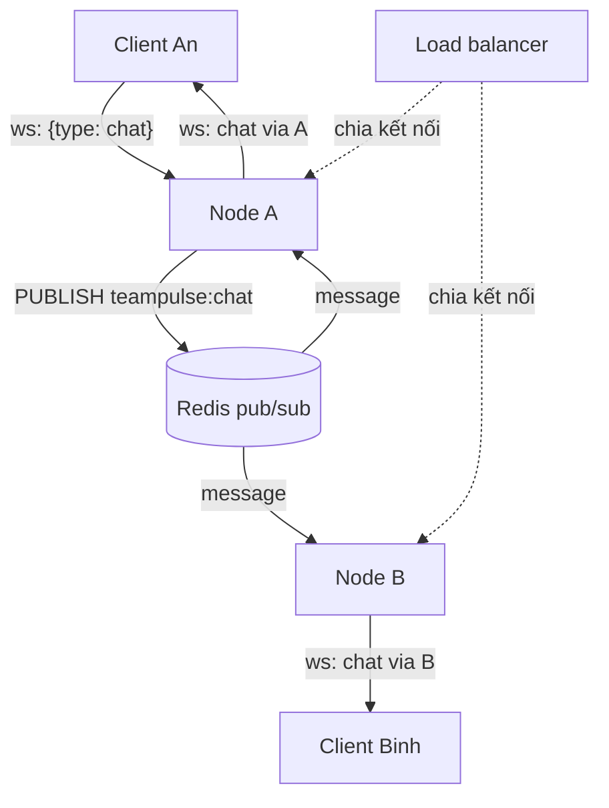

# N08 — Nhiều server với Redis pub/sub

> Một tiến trình Node có giới hạn; production chạy nhiều instance sau load balancer. Nhưng mỗi instance chỉ giữ kết nối của nó: người ở server A không thấy tin của người ở server B. Bài này nối các instance bằng pub/sub — trước bằng broker trong bộ nhớ để test offline, rồi bằng Redis thật.

## 🎯 Mục tiêu

Sau buổi này (khoảng 2–2,5 giờ) bạn sẽ:

- Giải thích vì sao **broadcast trong một tiến trình** không đủ khi chạy nhiều instance.
- Thiết kế một **interface broker** nhỏ (`publish`/`subscribe`) và viết bản **trong bộ nhớ** (EventEmitter) để test không cần Redis.
- Dùng **Redis pub/sub** thật bằng thư viện `redis`: hai kết nối, subscriber mode, `PUBLISH` trả gì.
- Viết **chat node**: mọi tin đi qua broker, mỗi node giao cho client của mình.
- Tính được **chi phí fan-out**, biết khi nào cần **sticky session**, và Socket.IO giải bài này bằng adapter ra sao.
- **Kết quả đo được:** `scale.js` qua hết **8 test** không cần Redis; với Redis thật, 2 tiến trình ở cổng 3108/3109 thấy tin của nhau; 2.000 tin giao trong 0,03 s, độ trễ trung vị 4,3 ms (Redis) so với 2,3 ms (bộ nhớ).

> 🧠 **Ghi nhớ:** WebSocket là kết nối **có trạng thái**: một client gắn với **một** tiến trình cho tới khi đứt. Muốn tin tới client ở tiến trình khác, phải có một kênh **giữa các tiến trình** — pub/sub.

## 📋 Đề bài

**Mở thư mục:** workspace của bài `N08-scale-redis-pubsub` (`scale.js`, `bench.js` — đã viết sẵn).

| Viết | Làm gì |
|---|---|
| `createMemoryBroker()` | `publish(channel, string) → số subscriber`, `subscribe(channel, handler) → unsubscribe`; giao tin bất đồng bộ |
| `createRedisBroker({pub, sub})` | Cùng interface, bọc 2 client `redis`: `pub` để publish, `sub` để subscribe |
| `createChatNode({broker, nodeId})` | Server chat `/ws?name=`: tin hợp lệ → publish; tin từ kênh → gửi mọi client của node; `stats` |

`npm start` chạy node A (:3008) và B (:3009); thêm `REDIS_URL` để dùng Redis. `npm run bench` đo fan-out bằng chính code của bạn.

**Xong khi:** `# pass 8`; nếu máy có Docker: chạy Redis, 2 tiến trình node riêng, client ở hai cổng thấy tin của nhau (Bước 6).

## 🤔 Tại sao? (kiến thức nền)

### Vấn đề: mỗi instance chỉ biết client của nó

```js
function createInstance(id) {
  const clients = new Set();
  return {
    id,
    connect(name) {
      const c = { name, inbox: [] };
      clients.add(c);
      return c;
    },
    broadcast(text) {
      for (const c of clients) c.inbox.push(`${text} (qua ${id})`);
    },
  };
}
const a = createInstance('A');
const b = createInstance('B');
const lan = a.connect('Lan');      // load balancer chia Lan vào A
const minh = b.connect('Minh');    // ...và Minh vào B
a.broadcast('Lan: trưa nay ăn gì?');
console.log('Lan  nhận:', lan.inbox);
console.log('Minh nhận:', minh.inbox);
```
```output
Lan  nhận: [ 'Lan: trưa nay ăn gì? (qua A)' ]
Minh nhận: []
```

Đây đúng là `broadcast` của N04 khi chạy 2 bản. Cách chữa: instance nhận tin **không** tự gửi cho client, mà **publish** lên một kênh chung; **mọi** instance (kể cả chính nó) **subscribe** kênh đó và gửi cho client của mình.



Node gửi cũng nhận lại tin của chính mình qua Redis — **một đường duy nhất** cho mọi tin, nên mọi client thấy cùng một thứ tự, và không có chuyện người gửi nhận 2 lần (một lần gửi thẳng, một lần qua Redis).

### Redis pub/sub: những điều phải biết

Chạy với Redis thật (Bước 6 có lệnh Docker):

```js
import { createClient } from 'redis';

const pub = createClient({ url: 'redis://127.0.0.1:6379' });
const sub = pub.duplicate();                      // kết nối thứ hai, cùng cấu hình
await pub.connect();
await sub.connect();

await sub.subscribe('kho:nhap', (message, channel) => console.log(`sub nhận [${channel}]`, message));
await sub.subscribe('kho:nhap', (message) => console.log('listener thứ hai cũng nhận', message));
console.log('PUBLISH trả', await pub.publish('kho:nhap', '{"sku":"TAO-01","qty":30}'), '(đếm theo KẾT NỐI subscribe, không theo listener)');
console.log('kênh không ai nghe:', await pub.publish('kho:xuat', 'mất luôn'));
try {
  await sub.publish('kho:nhap', 'x');
} catch (err) {
  console.log('sub.publish →', err.message.slice(0, 40) + '...');
}
await new Promise((r) => setTimeout(r, 100));
await sub.close();
await pub.close();
```
```output
PUBLISH trả 1 (đếm theo KẾT NỐI subscribe, không theo listener)
sub nhận [kho:nhap] {"sku":"TAO-01","qty":30}
listener thứ hai cũng nhận {"sku":"TAO-01","qty":30}
kênh không ai nghe: 0
sub.publish → ERR Can't execute 'publish': only (P|S)S...
```

| Đặc điểm | Hệ quả cho TeamPulse |
|---|---|
| Kết nối đã `SUBSCRIBE` vào **subscriber mode**, chỉ được (UN)SUBSCRIBE/PING | Cần **2 kết nối**: một publish, một subscribe (`pub.duplicate()`) |
| Chỉ chở **chuỗi** (hoặc Buffer) | `JSON.stringify` trước khi publish, `JSON.parse` (có `try`) khi nhận |
| **Fire-and-forget**: không lưu, không gửi lại | Node đang khởi động lại hay mất kết nối Redis thì **mất** tin của khoảng đó. Cần lịch sử → lưu DB; cần giao chắc chắn → Redis Streams/Kafka |
| `PUBLISH` trả số **kết nối** đang nghe | `0` nghĩa là không node nào nghe — tin mất luôn |

Bản **trong bộ nhớ** giữ đúng các đặc điểm đó (chuỗi, bất đồng bộ, trả số subscriber) để test chạy offline mà vẫn bắt được lỗi giống khi chạy Redis.

### Sticky session và Socket.IO adapter

| Câu hỏi | `ws` thuần (bài này) | Socket.IO |
|---|---|---|
| Có cần sticky session (load balancer gửi cùng client về cùng instance)? | Không: một kết nối WebSocket nằm trên một TCP, tự dính vào một instance | **Có**, nếu bật long-polling: các request polling của cùng một phiên phải về cùng instance (vd. nginx `ip_hash`). Chỉ dùng `transports: ['websocket']` thì không cần |
| Đồng bộ tin giữa instance | Tự làm: broker + chat node (bài này) | Adapter: `io.adapter(createAdapter(pubClient, subClient))` từ gói `@socket.io/redis-adapter` — `io.to(room).emit` tự đi qua Redis |
| Đếm "ai đang online" toàn hệ thống | Tự làm (mỗi node chỉ biết client của nó; cần lưu chung, vd. Redis SET có hạn dùng) | `io.fetchSockets()` hỏi qua adapter, chậm hơn gọi local |

> 🎯 **Phỏng vấn hay hỏi:** "Chạy 2 instance chat sau load balancer thì sao?" — mỗi instance chỉ có kết nối của nó nên broadcast local không tới người ở instance kia; dùng pub/sub (Redis) làm kênh chung: instance nhận tin publish, mọi instance subscribe và giao cho client local. Redis pub/sub không lưu tin; Socket.IO giải bằng redis-adapter và cần sticky session nếu dùng long-polling.

## 🛠️ Làm

### Bước 1 — Chuẩn bị

```bash
cd <workspace>/N08-scale-redis-pubsub
npm test    # 8 fail vì TODO — bình thường; test KHÔNG cần Redis
```

### Bước 2 — Đồng bộ hay bất đồng bộ → `createMemoryBroker`

`EventEmitter` (N02) đã là pub/sub trong một tiến trình: tên sự kiện = tên kênh. Nhưng `emit` gọi listener **ngay lập tức**, trước khi `emit` trả về — khác với tin đi qua mạng:

```js
import { EventEmitter } from 'node:events';

const shop = new EventEmitter();
shop.on('order', (o) => console.log('  listener: nhận đơn', o));

console.log('1. trước emit');
shop.emit('order', 'A01');                      // gọi listener NGAY, trước khi emit trả về
console.log('2. sau emit');

setImmediate(() => shop.emit('order', 'A02'));  // để dành tới vòng event loop sau
console.log('3. sau setImmediate (đơn A02 chưa tới)');
```
```output
1. trước emit
  listener: nhận đơn A01
2. sau emit
3. sau setImmediate (đơn A02 chưa tới)
  listener: nhận đơn A02
```

Vì sao quan trọng: code chạy đúng với broker đồng bộ có thể sai với Redis (vd. đọc `stats` ngay sau `publish` và mong đã giao xong). Broker trong bộ nhớ giao tin **bất đồng bộ** để lộ lỗi đó ngay khi test.

| Phần | Gợi ý |
|---|---|
| `publish` | Kiểm tra `typeof message === 'string'` (sai → `throw new TypeError(...)` trong hàm `async` = Promise reject); đếm `emitter.listenerCount(channel)`; phát bằng `setImmediate` |
| `subscribe` | Bọc `handler` trong một listener **mới**, `on(channel, listener)`, trả `async () => off(channel, listener)` |

> ⚠️ **Lỗi hay gặp:** `subscribe` hai lần cùng một hàm `handler` rồi `off(channel, handler)` — `off` chỉ gỡ **một** bản. Bọc mỗi lần subscribe trong một listener riêng thì unsubscribe gỡ đúng lần subscribe đó.

> 💡 **Mẹo:** EventEmitter cảnh báo `MaxListenersExceededWarning` khi một sự kiện có hơn 10 listener. Broker có thể có nhiều subscriber hợp lệ: `emitter.setMaxListeners(0)` tắt giới hạn.

### Bước 3 — Bọc client Redis → `createRedisBroker`

Interface y hệt bản bộ nhớ, chỉ khác bên trong: `publish` → `pub.publish(channel, message)`; `subscribe` → `sub.subscribe(channel, listener)` với `listener(message, channel)`, unsubscribe → `sub.unsubscribe(channel, listener)`. Test dùng client Redis **giả**: `sub.publish` ném đúng lỗi subscriber mode như Redis thật — dùng nhầm kết nối là fail ngay.

Đây là lợi ích của interface: `createChatNode` không biết (và không cần biết) broker là bộ nhớ hay Redis. Test chạy với bộ nhớ, production chạy với Redis, cùng một code.

### Bước 4 — Mọi tin qua broker → `createChatNode`

| Sự kiện | Việc |
|---|---|
| Kết nối `/ws?name=...` | Tên rỗng → `ws.close(1008)` |
| Tin từ client | Kiểm tra `{type: 'chat', text}`; sai → `bad_message`; đúng → `stats.published++`, publish JSON `{origin, from, text, ts}` |
| Tin từ broker | `stats.received++`; `JSON.parse` trong `try` (hỏng → bỏ qua); gửi `{type: 'chat', ..., via: nodeId}` cho mọi client OPEN, mỗi lần gửi `stats.sent++` |
| `server.on('close')` | Gọi hàm unsubscribe |

`createChatNode` là `async` vì phải chờ `subscribe` xong (với Redis là một lệnh mạng) trước khi nhận kết nối — nếu không, tin đến trong khoảng đó bị mất.

> ⚠️ **Lỗi hay gặp:** gửi thẳng cho client local **và** publish → người cùng node nhận 2 lần. Hoặc lọc bỏ tin có `origin === nodeId` khi nhận từ kênh → người cùng node không nhận lần nào. Một đường duy nhất: chỉ publish, mọi node (kể cả node gửi) giao từ kênh.

### Bước 5 — Chi phí fan-out

Mỗi tin chat: Redis giao 1 lần **cho mỗi node**, mỗi node `ws.send` cho **mọi client của nó**:

**Cách 1 — vòng lặp `for` nhân đôi số node**

```js
const rate = 50;
const clientsPerNode = 2000;
console.log('node | client | Redis giao/giây | ws.send/giây mỗi node | ws.send/giây tổng');
for (let nodes = 1; nodes <= 8; nodes *= 2) {
  const clients = nodes * clientsPerNode;
  const redisDeliveries = rate * nodes;          // mỗi tin tới mọi node
  const sendsPerNode = rate * clientsPerNode;    // mỗi node gửi mỗi tin cho mọi client của nó
  const sendsTotal = sendsPerNode * nodes;
  console.log(`${String(nodes).padStart(4)} | ${String(clients).padStart(6)} | ${String(redisDeliveries).padStart(15)} | ${String(sendsPerNode).padStart(21)} | ${String(sendsTotal).padStart(17)}`);
}
```
```output
node | client | Redis giao/giây | ws.send/giây mỗi node | ws.send/giây tổng
   1 |   2000 |              50 |                100000 |            100000
   2 |   4000 |             100 |                100000 |            200000
   4 |   8000 |             200 |                100000 |            400000
   8 |  16000 |             400 |                100000 |            800000
```

**Cách 2 — `map` ra mảng object, in bằng `console.table`**

```js
const rate = 50;
const clientsPerNode = 2000;
const rows = [1, 2, 4, 8].map((nodes) => ({
  nodes, clients: nodes * clientsPerNode, redis: rate * nodes, perNode: rate * clientsPerNode, total: rate * clientsPerNode * nodes,
}));
console.table(rows);
```
```output
┌─────────┬───────┬─────────┬───────┬─────────┬────────┐
│ (index) │ nodes │ clients │ redis │ perNode │ total  │
├─────────┼───────┼─────────┼───────┼─────────┼────────┤
│ 0       │ 1     │ 2000    │ 50    │ 100000  │ 100000 │
│ 1       │ 2     │ 4000    │ 100   │ 100000  │ 200000 │
│ 2       │ 4     │ 8000    │ 200   │ 100000  │ 400000 │
│ 3       │ 8     │ 16000   │ 400   │ 100000  │ 800000 │
└─────────┴───────┴─────────┴───────┴─────────┴────────┘
```

> ⚖️ **So sánh:** cùng O(số dòng), chỉ khác cách trình bày; `console.table` tiện khi xem nhanh, Cách 1 kiểm soát được định dạng cột.

Đọc bảng: thêm node giữ **tải mỗi node** không đổi (100.000 `ws.send`/giây) — đó là lý do scale ngang được. Phần Redis rất nhẹ (vài trăm tin/giây). Nhưng đây là **một phòng chung**: thực tế càng đông người càng nhiều tin, nên tổng `ws.send` tăng theo **bình phương** số người. Chia room (N06) để mỗi tin chỉ tới người cần nhận.

### Bước 6 — Chạy với Redis thật

```bash
docker run --rm -d --name tp-redis -p 127.0.0.1:6379:6379 redis:7-alpine
export REDIS_URL=redis://127.0.0.1:6379
NODES=A PORT=3108 npm start      # terminal 1
NODES=B PORT=3109 npm start      # terminal 2
```

Client An nối vào cổng 3108, Binh vào 3109, An gửi một tin. Kết quả thật — trước tiên **không** có `REDIS_URL` (mỗi tiến trình một broker bộ nhớ riêng), rồi với Redis:

```output
### memory (2 tiến trình, mỗi tiến trình một broker riêng)
An   (cổng 3108) ← {"type":"chat","from":"An","text":"Build #128 xong","ts":"2026-10-20T08:31:07.105Z","origin":"A","via":"A"}
### redis
Binh (cổng 3109) ← {"type":"chat","from":"An","text":"Build #128 xong","ts":"2026-10-20T08:31:08.583Z","origin":"A","via":"B"}
An   (cổng 3108) ← {"type":"chat","from":"An","text":"Build #128 xong","ts":"2026-10-20T08:31:08.583Z","origin":"A","via":"A"}

$ redis-cli PUBSUB NUMSUB teampulse:chat
teampulse:chat
2
$ redis-cli SUBSCRIBE teampulse:chat
subscribe
teampulse:chat
1
message
teampulse:chat
{"origin":"A","from":"An","text":"Build #128 xong","ts":"2026-10-20T08:31:19.443Z"}
```

`redis-cli SUBSCRIBE` (chạy bằng `docker exec tp-redis redis-cli ...`) là cách debug nhanh nhất: thấy đúng chuỗi JSON đi qua kênh. Đo fan-out bằng code của bạn (tất cả node và client trong **một** tiến trình):

```output
$ npm run bench
Broker: memory broker (1 tiến trình)
2 node × 5 client, mỗi client gửi 20 tin → 200 tin gửi, mỗi tin tới 10 client
Client nhận 2000/2000 tin trong 0.03 s → 73460 tin/giây
Độ trễ gửi → nhận lại tin của chính mình: trung vị 2.3 ms, tối đa 5.6 ms
stats {"published":100,"received":200,"sent":1000}
stats {"published":100,"received":200,"sent":1000}

$ REDIS_URL=redis://127.0.0.1:6379 npm run bench
Broker: Redis redis://127.0.0.1:6379
2 node × 5 client, mỗi client gửi 20 tin → 200 tin gửi, mỗi tin tới 10 client
Client nhận 2000/2000 tin trong 0.03 s → 72678 tin/giây
Độ trễ gửi → nhận lại tin của chính mình: trung vị 4.3 ms, tối đa 6.2 ms
stats {"published":100,"received":200,"sent":1000}
stats {"published":100,"received":200,"sent":1000}
```

Redis thêm khoảng 2 ms mỗi tin (một vòng qua mạng loopback + Docker). Với `BENCH_NODES=4 BENCH_CLIENTS=25 BENCH_MSGS=10` (100.000 tin giao), độ trễ trung vị lên ~92 ms (bộ nhớ) và ~115 ms (Redis): lúc này thời gian nằm ở **100.000 lần `ws.send` trong một tiến trình**, không phải ở Redis — đúng như bảng fan-out dự đoán. Xong thì `docker stop tp-redis`.

## ✅ Tự kiểm tra

Bấm **Chạy test**, hoặc trong thư mục workspace của bài:

```bash
npm test
```

Mục tiêu: `# pass 8`. Test không cần Redis: `createMemoryBroker` kiểm tra hành vi pub/sub, `createRedisBroker` dùng client Redis giả (có lỗi subscriber mode như thật), `createChatNode` chạy 2 node thật dùng chung một broker bộ nhớ và đếm `stats` của fan-out.

## 🎤 Câu hỏi phỏng vấn

> 🎯 **Phỏng vấn hay hỏi:** "Scale server WebSocket ra nhiều instance thế nào?" — kết nối WebSocket có trạng thái, gắn với một instance; cần kênh giữa các instance: mỗi instance publish tin lên Redis, mọi instance subscribe và giao cho client local (một đường duy nhất, kể cả node gửi). Redis cần 2 kết nối (subscriber mode), pub/sub không lưu tin (cần lịch sử thì lưu DB, cần chắc chắn thì Streams). Tải mỗi node giữ nguyên khi thêm node, nhưng tổng fan-out tăng theo số người × số tin — chia room. Socket.IO: redis-adapter, và sticky session nếu dùng long-polling. Test thì thay Redis bằng broker trong bộ nhớ cùng interface.
