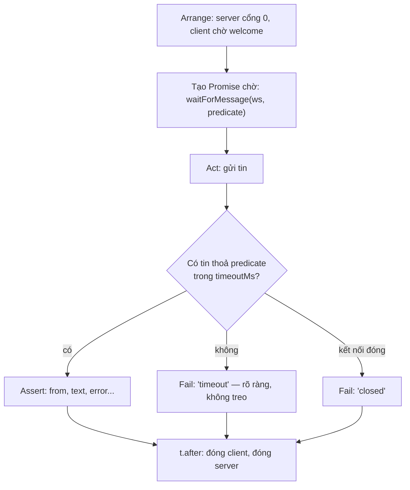

# N09 — Test & debug ứng dụng realtime

> Tới giờ bạn chạy test có sẵn. Bài này bạn **tự viết test** cho một server WebSocket, viết bộ công cụ chờ tin không dùng `sleep`, đo tải với nhiều client và tính phân vị độ trễ, và học các cách debug khi realtime "lúc được lúc không".

## 🎯 Mục tiêu

Sau buổi này (khoảng 2–2,5 giờ) bạn sẽ:

- Viết **`waitForMessage`**: chờ tin có điều kiện, có timeout, không rò listener — thay cho `sleep` gây test chập chờn (flaky).
- **Tự viết test tích hợp** cho server chat: mở server cổng 0, nhiều client, kiểm tra ai nhận gì; test của bạn phải **bắt được 4 bug** cài sẵn.
- Viết **load test**: N client, đo **tin/giây** và độ trễ **p50/p95/p99** bằng hàm **`percentile`** tự viết.
- Debug bằng **log vòng đời kết nối có id**, client dòng lệnh, DevTools; nhận ra **5 lỗi realtime hay gặp**.
- **Kết quả đo được:** chấm bài qua hết **10 test** (5 cho testkit, 5 chạy chính `chat.test.js` của bạn với 1 server đúng + 4 server lỗi); `npm run load`: 20 client × 20 tin → 8.000 tin giao trong 38 ms (~209.000 tin/giây), p50 33,8 ms, p99 37,3 ms.

> 🧠 **Ghi nhớ:** test realtime khó vì **thời gian**: tin đến "lúc nào đó". Test tốt không bao giờ đoán thời gian (`sleep(100)` rồi hy vọng), mà **chờ sự kiện cụ thể** với giới hạn tối đa — nhanh khi máy nhanh, vẫn đúng khi máy chậm, và báo lỗi rõ khi tin không bao giờ đến.

## 📋 Đề bài

**Mở thư mục:** workspace của bài `N09-test-debug-realtime`.

| File | Ai viết | Nội dung |
|---|---|---|
| `testkit.js` | **Bạn** | `waitForMessage`, `percentile`, `runLoadTest` |
| `chat.test.js` | **Bạn** | 4 test còn thiếu (đã có 1 test mẫu hoàn chỉnh) |
| `chat-server.js` | Có sẵn, đúng | Server chat cần test: welcome, chat tới mọi người, `bad_json`, log vòng đời |
| `cli.js`, `load.js` | Có sẵn | Client dòng lệnh để debug; đo tải bằng `runLoadTest` của bạn |

| Viết | Làm gì |
|---|---|
| `waitForMessage(ws, predicate, {timeoutMs})` | Promise tin JSON đầu tiên thoả `predicate`; `timeout`/`closed` → reject; luôn gỡ listener |
| `percentile(values, p)` | Nearest-rank trên bản sao đã sắp theo số; rỗng → `null` |
| `runLoadTest({url, clients, messagesPerClient})` | Mở N client, gửi, đếm, đo độ trễ tin của chính mình, trả p50/p95/p99/max |
| `chat.test.js` | 4 test: tới người khác, tới người gửi, JSON hỏng, một người rời đi |

Chấm `chat.test.js`: bài chấm chạy file của bạn với server đúng (phải pass hết) và với **4 server lỗi** (mỗi server phải làm ít nhất 1 test của bạn fail). Bạn không thấy code server lỗi — giống thực tế: test viết theo **hành vi mong muốn**, không theo code. Bài chấm giả định bạn làm trung thực (đọc file trong repo để "đoán" server nào lỗi thì lúc nào cũng làm được); mục đích là học viết test bắt được bug thật.

**Xong khi:** `# pass 10` ở `npm test`, `npm run test:mine` pass 5/5, và `npm run load` in số liệu.

## 🤔 Tại sao? (kiến thức nền)

### `sleep` làm test chập chờn

Server trả lời sau 30 ms lúc máy rảnh, 80 ms lúc máy CI bận:

```js
import { once } from 'node:events';
import { WebSocketServer, WebSocket } from 'ws';

// Server trả lời sau 30 ms lần đầu, 80 ms lần sau (giống máy CI lúc rảnh / lúc bận)
const delays = [30, 80];
const wss = new WebSocketServer({ port: 0, host: '127.0.0.1' });
wss.on('connection', (ws) => ws.on('message', (d) => setTimeout(() => ws.send(`kq:${d}`), delays.shift())));
await once(wss, 'listening');
const ws = new WebSocket(`ws://127.0.0.1:${wss.address().port}`);
await once(ws, 'open');

// Cách 1 — sleep cố định rồi xem hộp thư
const inbox = [];
ws.on('message', (d) => inbox.push(String(d)));
for (const q of ['a', 'b']) {
  inbox.length = 0;
  ws.send(q);
  await new Promise((r) => setTimeout(r, 50));
  console.log(`sleep(50) sau khi gửi ${q}:`, inbox.length ? inbox[0] : 'CHƯA CÓ → test fail ngẫu nhiên');
}
await new Promise((r) => setTimeout(r, 100)); // chờ tin "b" tới muộn, cho sạch

// Cách 2 — chờ đúng sự kiện bằng events.once
delays.push(30, 80);
for (const q of ['c', 'd']) {
  const t0 = Date.now();
  const next = once(ws, 'message');      // đăng ký TRƯỚC khi gửi
  ws.send(q);
  const [data] = await next;
  console.log(`once('message') sau khi gửi ${q}: ${data} sau ${Date.now() - t0} ms`);
}
ws.close();
wss.close();
```
```output
sleep(50) sau khi gửi a: kq:a
sleep(50) sau khi gửi b: CHƯA CÓ → test fail ngẫu nhiên
once('message') sau khi gửi c: kq:c sau 32 ms
once('message') sau khi gửi d: kq:d sau 82 ms
```

| Cách chờ | Máy nhanh | Máy chậm | Tin không bao giờ đến |
|---|---|---|---|
| `sleep(50)` | Phí thời gian chờ thừa | **Fail ngẫu nhiên** | Fail, nhưng thông báo khó hiểu |
| `sleep(2000)` "cho chắc" | Mỗi test chậm 2 giây | Thường qua | Fail sau 2 giây |
| `events.once(ws, 'message')` | Xong ngay khi có tin | Đúng | **Treo mãi** (không có timeout) |
| `waitForMessage` (bài này) | Xong ngay | Đúng | Lỗi `timeout` rõ ràng sau `timeoutMs` |

Một test realtime đúng khuôn:



`events.once` từ `node:events` đã gần đủ, nhưng thiếu ba thứ test realtime cần: **lọc theo điều kiện** (bỏ qua `welcome` để chờ `chat`), **timeout**, và **phát hiện kết nối đóng**. `waitForMessage` thêm đúng ba thứ đó.

> ⚠️ **Lỗi hay gặp:** gửi trước rồi mới bắt đầu chờ: `ws.send(x); await waitForMessage(...)`. Trên localhost tin trả lời có thể đến trước khi listener được gắn → chờ mãi tới timeout. Luôn **tạo Promise chờ trước**, rồi gửi, rồi `await` (như Cách 2 và test mẫu).

### Năm lỗi realtime hay gặp

**1. Rò listener** — mỗi lần chờ gắn thêm một listener mà không gỡ:

```js
import { EventEmitter } from 'node:events';

const conn = new EventEmitter();
function waitLeaky() {
  return new Promise((resolve) => conn.on('message', resolve));
}
for (let i = 0; i < 12; i += 1) {
  const p = waitLeaky();
  conn.emit('message', i);
  await p;
}
console.log('listener còn gắn:', conn.listenerCount('message'));
```
```output
listener còn gắn: 12
(node:4168261) MaxListenersExceededWarning: Possible EventEmitter memory leak detected. 11 message listeners added to [EventEmitter]. MaxListeners is 10. Use emitter.setMaxListeners() to increase limit
(Use `node --trace-warnings ...` to show where the warning was created)
```

Thấy `MaxListenersExceededWarning` trong log server là dấu hiệu gần như chắc chắn có listener gắn trong vòng lặp hay theo mỗi tin mà không gỡ. Mỗi listener giữ lại mọi biến nó tham chiếu → bộ nhớ tăng dần tới khi tiến trình chết.

**2. `JSON.parse` không `try`** — một client làm sập server của mọi người:

```js
import { once } from 'node:events';
import { WebSocketServer, WebSocket } from 'ws';

process.on('uncaughtException', (err) => {
  console.log(`TIẾN TRÌNH SẬP: ${err.name}: ${err.message}`);
  process.exit(1);
});
const wss = new WebSocketServer({ port: 0, host: '127.0.0.1' });
wss.on('connection', (ws) => {
  ws.on('message', (raw) => {
    const msg = JSON.parse(raw);          // không try/catch
    console.log('server: nhận', msg);
  });
});
await once(wss, 'listening');
const url = `ws://127.0.0.1:${wss.address().port}`;
const good = new WebSocket(url);
const bad = new WebSocket(url);
await Promise.all([once(good, 'open'), once(bad, 'open')]);
good.send('{"type":"chat","text":"hi"}');
await new Promise((r) => setTimeout(r, 50));
bad.send('{hỏng');
```
```output
server: nhận { type: 'chat', text: 'hi' }
TIẾN TRÌNH SẬP: SyntaxError: Expected property name or '}' in JSON at position 1 (line 1 column 2)
```

**3. Gửi cho kết nối đã đóng** — không lỗi, không gì cả:

```js
import { once } from 'node:events';
import { WebSocketServer, WebSocket } from 'ws';

const wss = new WebSocketServer({ port: 0, host: '127.0.0.1' });
await once(wss, 'listening');
const client = new WebSocket(`ws://127.0.0.1:${wss.address().port}`);
const [[peer]] = await Promise.all([once(wss, 'connection'), once(client, 'open')]);
client.close();
await once(peer, 'close');
console.log('readyState phía server:', peer.readyState, '(CLOSED)');
peer.send('tin cho người đã đi');                         // không ném lỗi, không gửi gì
peer.send('lần nữa', (err) => console.log('callback send:', err?.message));
wss.close();
```
```output
readyState phía server: 3 (CLOSED)
callback send: WebSocket is not open: readyState 3 (CLOSED)
```

Tự giữ danh sách kết nối (mảng, `Map`) mà quên xoá ở `close` thì danh sách phình mãi và vòng broadcast chạy qua cả "xác chết". Xoá **sai** còn tệ hơn: `arr.splice(i)` (thiếu tham số thứ hai) xoá luôn mọi người **sau** vị trí `i` — đó là một trong 4 bug test của bạn phải bắt.

**4. Backpressure: client đọc chậm** — server cứ gửi, dữ liệu dồn trong bộ nhớ server:

```js
import { once } from 'node:events';
import { WebSocketServer, WebSocket } from 'ws';

const wss = new WebSocketServer({ port: 0, host: '127.0.0.1' });
await once(wss, 'listening');
const slow = new WebSocket(`ws://127.0.0.1:${wss.address().port}`);
const [[peer]] = await Promise.all([once(wss, 'connection'), once(slow, 'open')]);
slow._socket.pause();                                   // client đọc chậm (mạng 3G, tab bị treo)

const chunk = 'x'.repeat(10_000);
for (let round = 1; round <= 4; round += 1) {
  for (let i = 0; i < 250; i += 1) peer.send(chunk);
  await new Promise((r) => setTimeout(r, 50));
  console.log(`sau ${round * 250} tin 10 KB: bufferedAmount = ${(peer.bufferedAmount / 1e6).toFixed(1)} MB chờ gửi trong bộ nhớ server`);
}
slow.terminate();
wss.close();
```
```output
sau 250 tin 10 KB: bufferedAmount = 0.0 MB chờ gửi trong bộ nhớ server
sau 500 tin 10 KB: bufferedAmount = 2.3 MB chờ gửi trong bộ nhớ server
sau 750 tin 10 KB: bufferedAmount = 4.8 MB chờ gửi trong bộ nhớ server
sau 1000 tin 10 KB: bufferedAmount = 7.3 MB chờ gửi trong bộ nhớ server
```

250 tin đầu (~2,5 MB) nằm trong bộ đệm TCP của hệ điều hành nên `bufferedAmount` còn 0; sau đó mỗi tin dồn vào bộ nhớ tiến trình. 1.000 client chậm như vậy là vài GB. `chat-server.js` kiểm tra `bufferedAmount > 1 MB` thì bỏ qua tin cho client đó (cách khác: đóng kết nối client quá chậm).

**5. Không có id trong log** — "có người bị mất tin" mà log chỉ ghi "client connected" thì không lần ra được ai. Mỗi kết nối một id, log mọi sự kiện vòng đời kèm id (xem Bước 6).

| Triệu chứng | Nghi ngờ đầu tiên |
|---|---|
| `MaxListenersExceededWarning`, RAM tăng dần | Listener gắn theo mỗi tin/mỗi lần chờ, không gỡ |
| Server khởi động lại, mọi người cùng mất kết nối | Exception chưa bắt trong handler (`JSON.parse`, `ack` không phải hàm) |
| Danh sách online có tên "ma" | Không dọn ở `close`; kết nối half-open (N05) |
| Một nhóm người "tự nhiên" không nhận tin | Xoá nhầm khỏi danh sách kết nối; gửi theo danh sách cũ |
| RAM tăng khi có vài client mạng yếu | Không kiểm tra `bufferedAmount` |

## 🛠️ Làm

### Bước 1 — Chuẩn bị

```bash
cd <workspace>/N09-test-debug-realtime
npm test           # 10 fail vì TODO — bình thường
npm run test:mine  # test của bạn: 5 fail (testkit chưa có, 4 test chưa viết)
```

### Bước 2 — Chờ có điều kiện, có giới hạn → `waitForMessage`

Khuôn: một `new Promise`, ba thứ cần dọn (listener `message`, listener `close`, timer), và **một hàm `cleanup`** gọi ở cả ba lối ra (có tin, đóng, hết giờ).

| Lối ra | Việc |
|---|---|
| Tin đến, `JSON.parse` được, `predicate(msg)` đúng | `cleanup()`, `resolve(msg)` |
| Tin không phải JSON, hoặc predicate sai | Bỏ qua, chờ tiếp |
| `close` | `cleanup()`, `reject(new Error('closed: ...'))` |
| Hết `timeoutMs` | `cleanup()`, `reject(new Error('timeout: ...'))` |

Listener phải là hàm có **tên** (hoặc biến) để `ws.off('message', onMessage)` gỡ đúng nó (như `stop()` ở N05).

### Bước 3 — Tự viết test → `chat.test.js`

Đọc test mẫu và hai helper `startServer(t)`, `connect(t, url, name)` đã viết sẵn ở đầu file. Mỗi test theo khuôn **Arrange – Act – Assert**:

| Test | Arrange | Act | Assert |
|---|---|---|---|
| Tới người khác | Server, An, Binh | Binh bắt đầu chờ `chat`; An gửi | `from`, `text` đúng |
| Tới người gửi | Server, An (+ một người khác) | An bắt đầu chờ; An gửi | An nhận lại tin của mình |
| JSON hỏng | Server, An | Gửi `'{hỏng'`; rồi gửi một tin hợp lệ | Nhận `bad_json`, rồi vẫn nhận được tin hợp lệ |
| Một người rời đi | Server, An, Binh, Chi | Binh đóng; An gửi | Chi vẫn nhận |

Viết để test **fail khi hành vi sai**, không chỉ "chạy không lỗi". Tự kiểm tra: tạm sửa `chat-server.js` cho sai một chỗ (vd. bỏ qua người gửi trong `broadcast`), chạy `npm run test:mine` → phải có test đỏ; sửa lại.

> 💡 **Mẹo:** test "một người rời đi" là chỗ hiếm hoi cần chờ một chút sau `close`: server không gửi tin báo "đã xử lý xong việc người này rời đi", nên test không có sự kiện nào để chờ. Chờ sự kiện `close` của client rồi thêm một khoảng ngắn (vài chục ms). Nếu server có tin `left` như N04, chờ tin đó — luôn tốt hơn chờ thời gian.

> ⚠️ **Lỗi hay gặp:** quên đóng server/client cuối test → `node --test` không thoát (handle còn mở) hoặc test sau dùng nhầm kết nối của test trước. `t.after(...)` trong helper đã lo việc này; giữ thói quen đó.

### Bước 4 — Phân vị → `percentile`

Độ trễ **trung bình** che mất đuôi chậm: 99 tin 5 ms + 1 tin 2.000 ms có trung bình 25 ms, nhưng người nhận tin thứ 100 chờ 2 giây. Vì vậy đo **p50** (trung vị), **p95**, **p99**: "99% tin đến trong vòng X ms". Bước đầu của mọi cách tính phân vị là tìm giá trị **nhỏ thứ k**:

**Cách 1 — vòng lặp lồng nhau, không sắp xếp**

```js
// giá trị nhỏ thứ k là giá trị có đúng (k-1) giá trị khác nhỏ hơn nó (giả sử không có giá trị trùng)
const responseMs = [120, 85, 300, 95, 110, 2000, 90];
function kthSmallest(values, k) {
  for (const candidate of values) {
    let smaller = 0;
    for (const other of values) {
      if (other < candidate) smaller += 1;
    }
    if (smaller === k - 1) return candidate;
  }
  return null;
}
console.log('nhỏ thứ 1:', kthSmallest(responseMs, 1), '| thứ 4:', kthSmallest(responseMs, 4), '| thứ 7:', kthSmallest(responseMs, 7));
```
```output
nhỏ thứ 1: 85 | thứ 4: 110 | thứ 7: 2000
```

**Cách 2 — sắp xếp bản sao một lần rồi lấy theo chỉ số**

```js
const responseMs = [120, 85, 300, 95, 110, 2000, 90];
const sorted = [...responseMs].sort((a, b) => a - b);
console.log('nhỏ thứ 1:', sorted[0], '| thứ 4:', sorted[3], '| thứ 7:', sorted[6]);
console.log('sort() không truyền hàm:', [...responseMs].sort().join(', '), '← so như chuỗi');
console.log('mảng gốc không đổi:', responseMs.join(', '));
```
```output
nhỏ thứ 1: 85 | thứ 4: 110 | thứ 7: 2000
sort() không truyền hàm: 110, 120, 2000, 300, 85, 90, 95 ← so như chuỗi
mảng gốc không đổi: 120, 85, 300, 95, 110, 2000, 90
```

> ⚖️ **So sánh:** Cách 1 là O(n²) cho mỗi lần hỏi và sai khi có giá trị trùng; Cách 2 sắp O(n log n) **một lần** rồi mỗi phân vị chỉ là O(1) tra chỉ số — với 10.000 mẫu độ trễ, Cách 1 cần ~100 triệu phép so sánh cho mỗi phân vị, Cách 2 ~130.000 cho cả p50/p95/p99. Dùng Cách 2; nhớ hàm so sánh `(a, b) => a - b` và sắp **bản sao** (`[...values]`) vì `.sort()` sửa tại chỗ.

Nearest-rank (công thức trong docstring): phân vị p là phần tử thứ `ceil(p/100 × n)` của mảng đã sắp, đếm từ 1.

### Bước 5 — Đo tải → `runLoadTest`

Theo đúng 5 bước trong docstring. Độ trễ đo trên tin **của chính client đó** (client biết `sentAt` của nó, cùng một đồng hồ `performance.now()` trong cùng tiến trình). Tin của người khác chỉ đếm vào `received`.

```bash
npm run load
LOAD_CLIENTS=50 npm run load
LOAD_CLIENTS=100 LOAD_MSGS=10 npm run load
```

Kết quả thật trên máy soạn bài:

```output
20 client × 20 tin = 400 tin gửi, mỗi tin tới 20 client
Nhận 8000/8000 trong 38 ms → 209239 tin/giây
Độ trễ (ms): p50 33.8  p95 36.5  p99 37.3  max 37.8

50 client × 20 tin = 1000 tin gửi, mỗi tin tới 50 client
Nhận 50000/50000 trong 138 ms → 361690 tin/giây
Độ trễ (ms): p50 113.5  p95 131.4  p99 134.6  max 136.8

100 client × 10 tin = 1000 tin gửi, mỗi tin tới 100 client
Nhận 100000/100000 trong 344 ms → 290851 tin/giây
Độ trễ (ms): p50 294.5  p95 334.8  p99 339.4  max 342.6
```

Đọc số cho trung thực: mọi client gửi **cùng lúc** (một đợt dồn), nên độ trễ chủ yếu là **thời gian xếp hàng** — tin cuối đợt phải chờ server gửi xong mọi tin trước. Số giao tăng theo **bình phương** số client (100 client → 100.000 lần giao cho 1.000 tin), đúng như bảng fan-out N08. Client và server chạy chung một tiến trình nên đây là mốc để **so sánh trước/sau khi sửa code**, không phải năng lực của server thật; đo thật thì chạy client ở máy khác.

### Bước 6 — Debug: log vòng đời, client dòng lệnh, DevTools

```bash
npm start                                       # terminal 1: server có log
npm run cli -- "ws://127.0.0.1:3009/ws?name=An"  # terminal 2: gõ JSON rồi Enter
```

Log thật (chạy với `PORT=3119`; An dùng `cli.js` gửi một tin và một tin hỏng; Binh là một client bị `terminate()` sau 0,8 giây):

```output
--- server
08:38:01.367 #1 mở   name=An ip=127.0.0.1 (1 đang mở)
08:38:01.642 #2 mở   name=Binh ip=127.0.0.1 (2 đang mở)
08:38:02.122 #1 gửi JSON hỏng: {hỏng
08:38:02.451 #2 đóng code=1006 sau 809 ms (1 đang mở)
08:38:03.668 #1 đóng code=1006 sau 2301 ms (0 đang mở)
--- cli
08:38:01.368 ✓ đã kết nối ws://127.0.0.1:3119/ws?name=An
08:38:01.368 ← {"type":"welcome","id":1,"name":"An"}
08:38:01.821 → {"type":"chat","text":"hi"}
08:38:01.822 ← {"type":"chat","from":"An","text":"hi"}
08:38:02.122 → {hỏng
08:38:02.123 ← {"type":"error","error":"bad_json"}
```

| Công cụ | Dùng khi |
|---|---|
| Log có id + mã đóng + thời lượng | "Người X bị mất tin lúc 10h": lọc log theo id/tên, xem đóng code gì (1000 tự đóng, 1006 mất mạng, 4001 token...) |
| `cli.js` (hoặc `wscat`, `websocat` nếu công ty đã cài) | Gửi tin bất kỳ, kể cả tin hỏng, không cần giao diện |
| DevTools → Network → WS → Messages | Xem frame thật trình duyệt gửi/nhận, thời điểm, kích thước; tab Headers xem request 101 |
| `node --inspect chat-server.js` + `chrome://inspect` | Đặt breakpoint trong handler `message`, xem biến lúc tin đến |

> 💡 **Mẹo:** log `ip=` là `req.socket.remoteAddress`. Sau load balancer/proxy, đó là IP của proxy — IP thật của client nằm trong header `X-Forwarded-For` (chỉ tin header này khi biết chắc nó do proxy của bạn đặt).

## ✅ Tự kiểm tra

Bấm **Chạy test**, hoặc trong thư mục workspace của bài:

```bash
npm test
npm run test:mine
```

Mục tiêu: `# pass 10`. 5 test kiểm tra `testkit.js`; 5 test chạy `chat.test.js` của bạn trong tiến trình con (`node --test` với biến môi trường `CHAT_SERVER` trỏ tới server đúng hoặc một trong 4 server lỗi). Nếu test "bắt được lỗi ..." fail, đọc tên lỗi trong thông báo: test của bạn chưa kiểm tra hành vi đó đủ chặt.

## 🎤 Câu hỏi phỏng vấn

> 🎯 **Phỏng vấn hay hỏi:** "Bạn test một server WebSocket thế nào?" — test tích hợp: server thật ở cổng 0 trên 127.0.0.1, nhiều client `ws` thật, đóng hết trong `after`; chờ tin bằng helper có điều kiện + timeout + gỡ listener thay vì `sleep` (sleep gây flaky); kiểm tra cả đường lỗi (JSON hỏng không làm sập, client rời đi không làm hỏng broadcast). Đo tải: N client, tin/giây và p50/p95/p99 (không dùng trung bình vì che đuôi chậm). Debug: log vòng đời có id kết nối và mã đóng, client dòng lệnh, DevTools WS. Lỗi hay gặp: rò listener, `JSON.parse` không `try`, gửi cho kết nối đã đóng, bỏ qua `bufferedAmount`.
