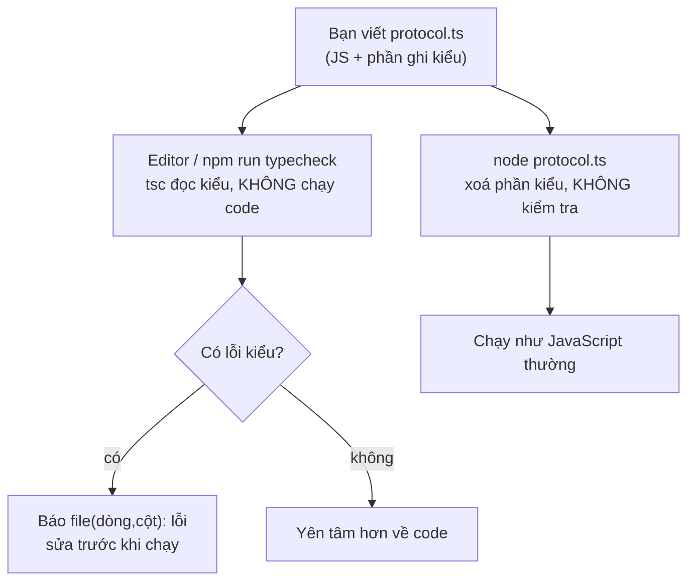

# N10 — TypeScript cho người biết JS

> P3 biến TeamPulse thành sản phẩm thật: API, cơ sở dữ liệu, đăng nhập, Docker, CI. Code lớn dần thì lỗi gõ nhầm tên trường, quên kiểm tra `undefined`, truyền sai kiểu chỉ lộ ra khi người dùng bấm trúng. Bài này viết lại giao thức tin nhắn của N04 bằng **TypeScript** để những lỗi đó bị bắt **trước khi chạy**, và dạy bạn đọc code TypeScript ở công ty.

## 🎯 Mục tiêu

Sau buổi này (khoảng 3,5 giờ với người mới) bạn sẽ:

- Giải thích được **vì sao cần kiểu tĩnh**: cùng một hàm, bản JS chạy ra `NaN` im lặng, bản TS bị `tsc` chỉ đúng dòng sai trước khi chạy.
- Viết và đọc được **annotation**, **`interface` / `type`**, trường không bắt buộc `?`, **union**, **thu hẹp kiểu** (narrowing) và **union phân biệt theo `type`** — đúng cách TeamPulse mô tả tin WebSocket.
- Nhận dữ liệu từ mạng bằng **`unknown`** rồi kiểm tra, không dùng `any`.
- Viết một hàm **generic** nhẹ (`<T>`).
- Biết **Node 22 chạy thẳng file `.ts`** bằng cách xoá kiểu (không kiểm tra gì), còn **`tsc --noEmit`** mới là bước kiểm kiểu; chỉ dùng cú pháp xoá được (không `enum`, `namespace`, parameter properties).
- **Kết quả đo được:** qua hết **6 test**; `npm run typecheck` từ **4 dòng lỗi** xuống **0**; `npm start` in đúng các dòng ở Bước 6.

> 📖 Từ lạ ở trên và trong Đề bài (kiểu tĩnh, annotation, union, narrowing, generic, type stripping, tsc…) được giải nghĩa ở mục *Hiểu trước khi làm*, ngay đầu phần kiến thức nền.

## 📋 Đề bài

**Mở thư mục:** workspace của bài `N10-typescript-co-ban`.

| File | Ai viết | Nội dung |
|---|---|---|
| `types.ts` | Có sẵn — đọc kỹ | Kiểu của giao thức: `ClientMessage`, `ServerMessage`, `ParseResult`, `User`… |
| `protocol.ts` | **Bạn** | 3 hàm bên dưới |
| `report.ts` | Có sẵn, **có 3 lỗi** | Báo cáo tin nhắn; `npm run typecheck` in 4 dòng lỗi (một lỗi báo hai lần), bạn sửa |
| `demo.ts` | Có sẵn | `npm start` chạy thử mọi hàm |
| `tsconfig.json` | Có sẵn | Cấu hình cho `tsc` (strict) |

| Viết | Làm gì |
|---|---|
| `parseClientMessage(raw: string): ParseResult` | Như N04 nhưng có kiểu: `JSON.parse` vào biến `unknown`, kiểm tra, trả union `{ok: true, msg}` / `{ok: false, error}` |
| `describeServerMessage(msg: ServerMessage): string` | Mỗi loại tin server một dòng chữ; `switch` trên `msg.type`, nhánh `default` kiểu `never` |
| `groupBy<T>(items, keyOf): Record<string, T[]>` | Gom phần tử theo khóa, giữ thứ tự, dùng được cho mọi kiểu `T` |
| `report.ts` | Sửa 3 lỗi (4 dòng) `tsc` báo, không tắt `strict`, không `any`, không `@ts-ignore` |

**Xong khi:** `# pass 6`, `npm run typecheck` không in lỗi nào, `npm start` in đúng các dòng ở Bước 6.

## 🤔 Tại sao? (kiến thức nền)

### Hiểu trước khi làm

**Bối cảnh.** Gõ nhầm một chữ trong tên trường, chương trình JavaScript vẫn chạy, chỉ âm thầm ra kết quả sai hoặc sập đúng lúc người dùng bấm vào. Dự án vài file thì còn nhớ được dữ liệu nào có những trường gì; dự án công ty hàng trăm file, nhiều người sửa thì không ai nhớ nổi. **TypeScript** cho bạn ghi rõ hình dạng của dữ liệu, rồi một chương trình đọc toàn bộ code và chỉ ra chỗ sai **trước khi chạy**.

**Ví dụ đời thường.** Mẫu đơn ở ngân hàng. Giấy trắng (JavaScript) thì ai viết gì cũng được; nhân viên chỉ phát hiện thiếu số CMND khi đã xử lý tới bước đó. Mẫu in sẵn ô (TypeScript) ghi rõ "Họ tên: chữ", "Số tiền: số", ô có dấu `*` là bắt buộc; nhân viên quầy **soát mẫu trước khi nhận** (`tsc`). Soát xong, tờ đơn vẫn được xử lý y như giấy trắng — các ô kẻ sẵn không làm việc chuyển tiền nhanh hơn hay chậm hơn.

**Bạn đã gặp nó ở đâu.**
- VS Code gạch đỏ dưới tên biến gõ sai, gợi ý tên trường khi gõ dấu chấm: chính VS Code chạy TypeScript bên dưới, kể cả với file `.js`.
- Mã nguồn VS Code, Slack desktop, Figma, Microsoft Teams viết bằng TypeScript.
- Hầu hết thư viện bạn đã dùng (`ws`, `socket.io`, `express`, `zod`) kèm sẵn mô tả kiểu — vì thế VS Code biết `ws.send` nhận tham số gì.
- Tin tuyển dụng Node.js ở Việt Nam phần lớn ghi "TypeScript" là yêu cầu, không phải điểm cộng.

| Câu hỏi | Trả lời |
|---|---|
| **What** — là gì | JavaScript + phần ghi kiểu (`: string`, `interface`…). Bộ kiểm tra `tsc` đọc phần kiểu để tìm lỗi; khi chạy, phần kiểu bị xoá, còn lại đúng JavaScript. |
| **Why** — vì sao cần | Bắt lỗi gõ nhầm, quên `undefined`, sai kiểu tham số trước khi chạy; editor gợi ý đúng; đọc chữ ký hàm là biết cách dùng. |
| **When** — khi nào dùng | Dự án sống lâu, nhiều người, nhiều file; code nhận dữ liệu từ mạng/DB; thư viện cho người khác dùng. |
| **When not** — khi nào không | Script dùng một lần vài chục dòng; khi kiểu chỉ làm rối mà không bắt thêm lỗi nào. TypeScript **không** kiểm tra dữ liệu lúc chạy — JSON từ mạng vẫn phải tự kiểm tra (bài này và N11). |
| **Where** — ở đâu | Mọi file `.ts` của server TeamPulse từ bài này; `tsc --noEmit` chạy trên máy bạn và trên CI (N16). |
| **How** — chạy thế nào | Bạn viết `.ts` → editor và `tsc` kiểm kiểu, báo lỗi theo dòng → `node file.ts` **xoá phần kiểu** rồi chạy như JS. Hai việc tách rời: chạy được **không** có nghĩa là đúng kiểu. |

> 🧠 **Ghi nhớ:** TypeScript là **kiểm tra lúc viết**, không phải kiểm tra lúc chạy. Kiểu biến mất khi chạy, nên dữ liệu đi vào từ bên ngoài (mạng, file, người dùng) vẫn phải kiểm tra bằng code thật.



**Từ mới trong bài**

| Từ | Nghĩa đời thường |
|---|---|
| **Kiểu** (type) | Loại giá trị: chữ (`string`), số (`number`), đúng/sai (`boolean`), object có những trường nào… |
| **Kiểu tĩnh** · **kiểu động** | Kiểm tra kiểu khi viết, trước khi chạy (TypeScript) · chỉ biết kiểu khi đang chạy (JavaScript, Python) |
| **TypeScript**, **`tsc`**, **`--noEmit`** | Ngôn ngữ JS + kiểu · chương trình kiểm tra kiểu (TypeScript compiler) · cờ "chỉ kiểm tra, không sinh file `.js`" |
| **`tsconfig.json`**, **`strict`** | File cấu hình của `tsc` · bật mọi kiểm tra chặt (vd. bắt buộc xử lý `undefined`) |
| **Annotation** | Phần `: string`, `: number[]` ghi sau tên biến/tham số |
| **Suy luận kiểu** (inference) | TS tự đoán kiểu khi bạn không ghi: `const n = 3` → `number` |
| **`interface`**, **`type`** (type alias) | Hai cách đặt tên cho một "hình dạng" object; `type` còn đặt tên được cho union |
| **Trường không bắt buộc** `?` | `title?: string` — có thể thiếu; đọc ra có thể là `undefined` |
| **Union** `A \| B` | "Một trong các kiểu này", vd. `number \| string`; `'S' \| 'M' \| 'L'` là union các giá trị cụ thể (literal) |
| **Thu hẹp kiểu** (narrowing) | Sau `if (typeof x === 'number')`, trong nhánh đó TS biết `x` là số |
| **Union phân biệt** (discriminated union) | Union mà mọi thành viên có chung một trường hằng (`type`, `kind`) để phân biệt |
| **`never`** | Kiểu "không thể có giá trị nào"; dùng để bắt `switch` thiếu nhánh |
| **`any`** · **`unknown`** | Tắt kiểm tra hoàn toàn · "chưa biết là gì", bắt kiểm tra trước khi dùng |
| **Type guard** | Hàm trả `v is Product`: nếu `true` thì TS coi `v` là `Product` |
| **`as`** (ép kiểu) | "Tin tôi đi, đây là kiểu X" — TS không kiểm tra lại, dùng ít thôi |
| **Generic** `<T>` | Tham số **kiểu**: hàm viết một lần, dùng cho nhiều kiểu, giữ đúng kiểu kết quả |
| **`Record<K, V>`** | Object có khóa kiểu `K`, giá trị kiểu `V`, vd. `Record<string, number>` |
| **`typeof X`**, **`keyof T`** (ở chỗ ghi kiểu) | Lấy kiểu của biến `X` · lấy danh sách tên khóa của kiểu `T` — chỉ cần đọc được |
| **Type stripping** | Cách Node 22 chạy `.ts`: xoá phần kiểu thay bằng khoảng trắng, không kiểm tra |
| **Cú pháp xoá được** (erasable) | Phần TS xoá đi là thành JS hợp lệ; `enum`, `namespace`, parameter properties **không** xoá được |

### Cùng một hàm: JavaScript rồi TypeScript

Hàm tính tiền giỏ hàng, gõ nhầm `prise`:

```js
function totalPrice(cart) {
  let total = 0;
  for (const item of cart) {
    total += item.prise * item.qty;   // gõ nhầm: prise thay vì price
  }
  return total;
}
console.log('Tổng:', totalPrice([{ name: 'Táo', price: 12000, qty: 3 }, { name: 'Cam', price: 8000, qty: 2 }]));
```
```output
Tổng: NaN
```

Không có lỗi nào, chỉ có kết quả sai: `item.prise` là `undefined`, `undefined * 3` là `NaN`. Lỗi kiểu này có thể nằm im vài tuần trước khi ai đó nhìn thấy tổng tiền là `NaN`. Cùng hàm, viết bằng TypeScript — thêm `interface` mô tả một món hàng và ghi kiểu tham số:

```ts
interface CartItem {
  name: string;
  price: number;
  qty: number;
}

function totalPrice(cart: CartItem[]): number {
  let total = 0;
  for (const item of cart) {
    total += item.prise * item.qty;   // vẫn gõ nhầm
  }
  return total;
}
console.log('Tổng:', totalPrice([{ name: 'Táo', price: 12000, qty: 3 }, { name: 'Cam', price: 8000, qty: 2 }]));
totalPrice([{ name: 'Lê', price: '9000', qty: 1 }]);
```

```bash
npx tsc --noEmit -p .     # kiểm kiểu cả thư mục theo tsconfig.json
node cart.ts              # chạy
```
```output
$ npx tsc --noEmit -p .
cart.ts(10,19): error TS2551: Property 'prise' does not exist on type 'CartItem'. Did you mean 'price'?
cart.ts(15,27): error TS2322: Type 'string' is not assignable to type 'number'.
$ node cart.ts
Tổng: NaN
```

Đọc dòng lỗi: `cart.ts(10,19)` = file, dòng 10, cột 19; `TS2551` = mã lỗi (tra Google được); phần sau là lý do, thường kèm gợi ý. `tsc` bắt cả lỗi thứ hai: giá `'9000'` là chuỗi. Và **`node cart.ts` vẫn chạy ra `NaN`** — Node không kiểm tra kiểu. Đó là lý do mọi starter từ bài này có lệnh `npm run typecheck` riêng. Cái giá của TS: viết thêm kiểu và thêm bước `tsc`; tốc độ chạy như nhau; dữ liệu sai **từ mạng** vẫn chỉ lộ ra khi chạy (mục `unknown` bên dưới).

### Node chạy `.ts` thế nào: xoá kiểu, không kiểm

Node 22 (bản 22.18 trở lên, máy này 22.22) chạy thẳng `node file.ts` bằng **type stripping**: thay mọi phần ghi kiểu bằng khoảng trắng, phần còn lại là JavaScript, chạy như thường. Không sinh file, không cần cài thêm gì. Đổi lại, Node chỉ làm được với cú pháp **xoá được** — phần TS bỏ đi mà code còn lại vẫn đúng:

```ts
enum Status { Active, Banned }
console.log(Status.Active);
```
```output
$ node enum.ts
SyntaxError [ERR_UNSUPPORTED_TYPESCRIPT_SYNTAX]: TypeScript enum is not supported in strip-only mode
$ npx tsc --noEmit -p .
enum.ts(1,6): error TS1294: This syntax is not allowed when 'erasableSyntaxOnly' is enabled.
```

`enum` sinh ra một object khi chạy, nên không xoá đi được. Thay bằng object hằng + union — cách các dự án TS mới đều dùng:

```ts
// Thay enum: object hằng + union lấy từ chính object đó
const Status = { Active: 'active', Banned: 'banned' } as const;
type Status = (typeof Status)[keyof typeof Status];   // 'active' | 'banned'

function canChat(s: Status): boolean {
  return s === Status.Active;
}
console.log(canChat(Status.Active), canChat('banned'));
```
```output
true false
```

`as const` = "giữ nguyên giá trị hằng, không nới thành `string`"; `typeof Status` lấy kiểu của object; `keyof` lấy tên các khóa; `[...]` lấy kiểu giá trị — gộp lại là `'active' | 'banned'`. Đọc được dòng này là đủ, không cần tự nghĩ ra.

| Không dùng (không xoá được) | Dùng thay |
|---|---|
| `enum Status { ... }` | Object `as const` + union như trên, hoặc union chuỗi `'active' \| 'banned'` |
| `namespace Utils { ... }` | Một file module riêng, `export` bình thường |
| `constructor(private name: string)` (parameter properties) | Khai báo trường `name: string;` và gán `this.name = name` trong constructor |

**Import kiểu phải ghi `import type`.** Kiểu bị xoá khi chạy, nên file `types.ts` lúc chạy **không có** export nào tên `Fruit`:

```ts
// types.ts
export interface Fruit { name: string; kg: number }
// main.ts
import { Fruit } from './types.ts';
const f: Fruit = { name: 'Táo', kg: 3 };
console.log(f.name);
```
```output
$ node main.ts
SyntaxError: The requested module './types.ts' does not provide an export named 'Fruit'
$ npx tsc --noEmit -p .
main.ts(1,10): error TS1484: 'Fruit' is a type and must be imported using a type-only import when 'verbatimModuleSyntax' is enabled.
```

Sửa: `import type { Fruit } from './types.ts';`. Import giữa các file `.ts` ghi luôn đuôi **`.ts`** (Node tìm đúng file đó, không tự đoán).

`tsconfig.json` của starter, những dòng đáng nhớ:

- `"strict": true` — bật mọi kiểm tra chặt, quan trọng nhất là bắt xử lý `null`/`undefined`. Công ty nào cũng bật.
- `"noUncheckedIndexedAccess": true` — đọc theo chỉ số/khóa (`arr[i]`, `groups[key]`) cho kiểu `... | undefined`, vì phần tử đó có thể không có. `strict` **không** bật cái này; thiếu nó, `groups[key].push(x)` qua `tsc` sạch rồi sập khi chạy.
- `"erasableSyntaxOnly": true`, `"verbatimModuleSyntax": true` — báo lỗi `enum`/`namespace` (TS1294) và import kiểu thiếu `type` (TS1484) như hai ví dụ trên.
- Còn lại: `module`/`moduleResolution` `nodenext` (luật `import` của Node), `target` `es2022`, `allowImportingTsExtensions` + `noEmit` (cho `import './x.ts'`, không sinh `.js`), `types: ["node"]` (kiểu của `process`, `node:fs`).

> 💡 **Mẹo:** ở công ty bạn sẽ gặp cả cách cũ: `tsc` **dịch** `.ts` ra thư mục `dist/*.js` rồi `node dist/index.js`, hoặc chạy bằng `tsx`/`ts-node`. Ý tưởng như nhau — kiểu chỉ dùng lúc viết. Cách "Node xoá kiểu + `tsc --noEmit`" của khóa này ít bước nhất.

### Kiểu cơ bản: annotation, suy luận, `interface`, `?`

```ts
interface Product {
  name: string;
  price: number;
  tags?: string[];          // ? = không bắt buộc: có thể thiếu
}
type Size = 'S' | 'M' | 'L'; // chỉ nhận đúng 3 chuỗi này

const shirt: Product = { name: 'Áo thun', price: 150000 };
let size: Size = 'M';
const discount = 0.1;        // không ghi kiểu: TS tự suy ra number

console.log(shirt.name, size, shirt.price * (1 - discount));
size = 'XL';
shirt.tags.push('mới');
shirt.color = 'đỏ';
```
```output
$ npx tsc --noEmit -p .
shop.ts(13,1): error TS2322: Type '"XL"' is not assignable to type 'Size'.
shop.ts(14,1): error TS18048: 'shirt.tags' is possibly 'undefined'.
shop.ts(15,7): error TS2339: Property 'color' does not exist on type 'Product'.
$ node shop.ts
Áo thun M 135000
TypeError: Cannot read properties of undefined (reading 'push')
```

Ba lỗi, ba loại hay gặp nhất: giá trị ngoài danh sách cho phép; quên rằng trường `?` có thể thiếu (đây là lỗi sập server phổ biến nhất — `strict` bắt nó); thêm trường không có trong mô tả. Khi chạy, chỉ lỗi thứ hai làm sập, hai lỗi kia lặng lẽ cho dữ liệu sai đi tiếp.

`interface` chỉ mô tả object; `type` mô tả được cả union (`type Size = 'S' | 'M'`). Với object hai cách gần như thay thế được cho nhau — `types.ts` của bài dùng `interface` cho từng loại tin và `type` cho union.

### Union và thu hẹp kiểu

Union `number | string` nghĩa là "một trong hai". Muốn dùng phương thức riêng của số hay chuỗi, bạn phải kiểm tra trước — TS theo dõi `if` và **thu hẹp** kiểu trong từng nhánh:

```ts
function formatScore(score: number | string): string {
  if (typeof score === 'number') {
    return score.toFixed(1);       // nhánh này: score là number
  }
  return score.toUpperCase();      // còn lại: score là string
}
console.log(formatScore(8.25), formatScore('vắng'));
console.log(formatScore(true));
```
```output
$ npx tsc --noEmit -p .
narrow.ts(8,25): error TS2345: Argument of type 'boolean' is not assignable to parameter of type 'string | number'.
$ node narrow.ts
8.3 VẮNG
TypeError: score.toUpperCase is not a function
```

**Union phân biệt** là mẫu bạn sẽ gặp ở mọi codebase realtime: các loại object có chung một trường hằng (`kind`, `type`) — kiểm tra trường đó là TS biết object có những trường nào:

```ts
type Payment =
  | { kind: 'cash' }
  | { kind: 'card'; last4: string }
  | { kind: 'momo'; phone: string };

function describePayment(p: Payment): string {
  switch (p.kind) {
    case 'cash':
      return 'Tiền mặt';
    case 'card':
      return `Thẻ ****${p.last4}`;   // ở nhánh này TS biết p có last4
    case 'momo':
      return `MoMo ${p.phone}`;
    default: {
      const unhandled: never = p;    // tới được đây nghĩa là còn loại chưa xử lý
      return unhandled;
    }
  }
}

const payments: Payment[] = [{ kind: 'cash' }, { kind: 'card', last4: '4242' }, { kind: 'momo', phone: '0901' }];
for (const p of payments) console.log(describePayment(p));
```
```output
Tiền mặt
Thẻ ****4242
MoMo 0901
```

Nhánh `default` là chỗ hay nhất: khi đã xử lý đủ mọi loại, ở đó `p` có kiểu `never` (không còn khả năng nào). Thêm loại mới `| { kind: 'bank'; account: string }` vào union mà quên thêm `case`:

```output
$ npx tsc --noEmit -p .
pay.ts(16,13): error TS2322: Type '{ kind: "bank"; account: string; }' is not assignable to type 'never'.
```

Với TeamPulse, đây chính là giao thức của N04: mọi tin WebSocket có `type`, và `types.ts` mô tả nó thành union. Một ngày đội thêm tin `typing` ("An đang gõ…"), `tsc` liệt kê **mọi** `switch` trong server chưa xử lý nó — thay vì chờ người dùng thấy dòng `undefined` trên màn hình.

> ⚠️ **Lỗi hay gặp:** `default: return ''` thay vì gán cho `never`. Code vẫn chạy, nhưng mất lời nhắc khi thêm loại tin mới — lỗi chuyển từ "tsc báo" thành "người dùng báo".

### Dữ liệu từ mạng: `unknown`, không phải `any`

`JSON.parse` trả về kiểu `any` — nghĩa là "tắt kiểm tra". Server khác gửi giá dạng chuỗi:

```ts
// Server kho gửi giá dạng CHUỖI thay vì số — dữ liệu từ mạng không theo ý mình
const body = '{"name":"Táo","price":"12000"}';

const a: any = JSON.parse(body);
console.log('any    :', a.price.toFixed(0));      // tsc không kêu gì
```
```output
$ npx tsc --noEmit -p .
$ node any.ts
TypeError: a.price.toFixed is not a function
```

`tsc` im lặng vì `any` cho phép mọi thứ. Gán vào `unknown` thì ngược lại: TS **không cho dùng** cho tới khi bạn kiểm tra:

```ts
const data: unknown = JSON.parse('{"name":"Táo","price":12000}');
console.log(data.price);
```
```output
$ npx tsc --noEmit -p .
u.ts(2,13): error TS18046: 'data' is of type 'unknown'.
```

Kiểm tra bằng `typeof`, `in` (có trường này không), rồi gói thành **type guard** để dùng lại:

```ts
interface Product {
  name: string;
  price: number;
}

// Hàm "type guard": trả boolean, và báo cho TS biết "nếu true thì v là Product"
function isProduct(v: unknown): v is Product {
  if (typeof v !== 'object' || v === null) return false;
  if (!('name' in v) || typeof v.name !== 'string') return false;
  if (!('price' in v) || typeof v.price !== 'number') return false;
  return true;
}

for (const body of ['{"name":"Táo","price":12000}', '{"name":"Táo","price":"12000"}', 'null']) {
  const data: unknown = JSON.parse(body);
  if (isProduct(data)) {
    console.log('hợp lệ :', data.name, data.price.toFixed(0));
  } else {
    console.log('từ chối:', body);
  }
}
```
```output
hợp lệ : Táo 12000
từ chối: {"name":"Táo","price":"12000"}
từ chối: null
```

`typeof null === 'object'` (bẫy đã gặp ở N00) nên luôn kiểm `v === null`. Viết tay kiểm tra như vậy cho object 10 trường thì dài; N11 dùng thư viện **zod**: khai báo hình dạng một lần, được cả hàm kiểm tra lẫn kiểu TS.

Quy tắc: mọi dữ liệu từ bên ngoài (`JSON.parse`, body request, tin WebSocket, `catch (err)`) nhận bằng `unknown`; `any` gần như không bao giờ.

> 💡 **Mẹo:** `as` (`JSON.parse(s) as Product`) chỉ là lời hứa với TS, không kiểm tra gì — sai thì vẫn sập như `any`. Chỉ dùng `as` **sau khi** đã tự kiểm tra (như `parseClientMessage` có thể làm với `data as Record<string, unknown>` sau khi chắc chắn là object).

### Generic: một hàm, nhiều kiểu

Tìm phần tử "lớn nhất" theo một tiêu chí — trái cây nặng nhất, số lớn nhất. Không muốn viết hai hàm, cũng không muốn trả `any` (mất kiểu). **Generic** `<T>` là tham số **kiểu**: người gọi truyền mảng trái cây thì `T` là kiểu trái cây, kết quả cũng là trái cây.

**Cách 1 — vòng lặp for**

```ts
// Generic: <T> là "kiểu bất kỳ, do người gọi quyết định"; kết quả giữ đúng kiểu T
function findMax<T>(items: readonly T[], score: (item: T) => number): T | undefined {
  let best: T | undefined = undefined;
  let bestScore = -Infinity;
  for (const item of items) {
    const s = score(item);
    if (s > bestScore) {
      best = item;
      bestScore = s;
    }
  }
  return best;
}

const fruits = [{ name: 'Táo', kg: 3 }, { name: 'Xoài', kg: 7 }, { name: 'Cam', kg: 5 }];
const top = findMax(fruits, (f) => f.kg);   // TS suy ra T = { name: string; kg: number }
console.log(top?.name, findMax([4, 9, 2], (n) => n), findMax([], (n: number) => n));
```
```output
Xoài 9 undefined
```

**Cách 2 — `reduce`** (cùng ba lời gọi như Cách 1, in ra đúng `Xoài 9 undefined`)

```ts
function findMax<T>(items: readonly T[], score: (item: T) => number): T | undefined {
  if (items.length === 0) return undefined;
  return items.reduce((best, item) => (score(item) > score(best) ? item : best));
}
```

`reduce(fn)` không có giá trị đầu: lấy phần tử đầu làm `best`, rồi lần lượt so với từng phần tử sau — tương đương vòng `for` ở Cách 1; mảng rỗng thì `reduce` ném lỗi, nên phải kiểm trước.

> ⚖️ **So sánh:** cùng O(n). Cách 1 gọi `score` đúng n lần và dễ đọc; Cách 2 gọn hơn nhưng gọi `score(best)` lại ở mỗi bước (2n lần) và phải nhớ trường hợp mảng rỗng. Với người mới, dùng Cách 1.

`top?.name`: `?.` (optional chaining, từ N03) vì kết quả có thể là `undefined`. `readonly T[]` hứa với người gọi rằng hàm không sửa mảng của họ. Bạn đã dùng generic từ lâu mà không để ý: `Promise<string>`, `Map<string, number>`, `Array<User>`.

### Đọc TypeScript trong code công ty

Phần lớn thời gian bạn **đọc** TS do người khác viết. Bảng tra nhanh:

| Bạn thấy | Đọc là |
|---|---|
| `name: string`, `ids: number[]` | Biến/tham số kiểu chuỗi; mảng số |
| `(text: string) => void` | Kiểu hàm: nhận chuỗi, không trả gì |
| `function f(x: T): Promise<User>` | Hàm async trả về `User` |
| `title?: string`, `user?.name` | Trường có thể thiếu; đọc an toàn khi có thể `undefined` |
| `a ?? b` | Lấy `a`, nếu `a` là `null`/`undefined` thì lấy `b` |
| `user!.name` | "Chắc chắn không `undefined`" — TS tin, không kiểm tra; thấy nhiều là dấu hiệu code ẩu |

`types.ts` của bài là giao thức N04 viết thành kiểu — đọc nó trước khi làm. `ClientMessage` là union `join | chat`, `ServerMessage` là union năm loại tin server. `ParseResult` (`{ ok: true; msg } | { ok: false; error }`) cũng là union phân biệt, trường phân biệt là `ok`: sau `if (result.ok)` TS biết có `result.msg`, ngược lại có `result.error`. `PresenceMessage` có `type: 'joined' | 'left'` — một interface cho hai loại tin cùng hình dạng.

## 🛠️ Làm

### Bước 1 — Chuẩn bị

```bash
cd academy/courses/node-realtime/workspace/N10-typescript-co-ban
npm test             # 6 fail vì TODO và vì report.ts — bình thường
npm run typecheck    # 4 dòng lỗi (3 nguyên nhân), tất cả trong report.ts (Bước 5)
```

Mở `types.ts` trong VS Code, rê chuột lên `ServerMessage`, `ParseResult`: editor hiện kiểu đầy đủ. Lỗi `tsc` cũng hiện gạch đỏ ngay trong editor — không cần chờ chạy lệnh.

Chạy riêng test của hàm đang làm — cờ `--test-name-pattern` phải đứng **trước** đường dẫn file; dùng y hệt trên PowerShell:

```bash
node --test --test-name-pattern="parseClientMessage" "../../curriculum/N10-typescript-co-ban/tests/*.test.js"
```

### Bước 2 — Đọc tin từ mạng → `parseClientMessage`

Cùng luật với N04 (docstring ghi đủ), khác ở chỗ có kiểu: kết quả `JSON.parse` lưu vào biến `let data: unknown`, rồi thu hẹp dần — không phải object thường → `invalid_json`; rồi xét `type`; rồi kiểm tra `name`/`text`. Kiểu trả về `ParseResult` giúp bạn: gõ sai mã lỗi (`'invalid_jsn'`) hay quên trường `msg`, `tsc` báo ngay.

Hai cách đọc trường của một `unknown` đã biết là object: `'type' in data` rồi `data.type` (TS tự thu hẹp), hoặc sau khi đã kiểm tra là object thường thì `const obj = data as Record<string, unknown>` rồi `obj.type`, `obj.name` (mỗi trường vẫn là `unknown`, vẫn phải `typeof`). Cách nào cũng được.

```bash
node --test --test-name-pattern="parseClientMessage" "../../curriculum/N10-typescript-co-ban/tests/*.test.js"
npm run typecheck    # vẫn chỉ còn lỗi của report.ts
```

### Bước 3 — Hiển thị tin server → `describeServerMessage`

`switch (msg.type)`, mỗi `case` một loại tin; trong từng `case`, gõ `msg.` và xem editor gợi ý đúng trường của loại đó. Giờ:phút UTC: `new Date(ts).toISOString()` cho dạng `2026-10-20T09:05:42.000Z` — lấy phần giờ:phút. Nhánh `default` gán cho biến kiểu `never` như ví dụ thanh toán.

Thử ngay khi test đã qua: xoá tạm `case 'error'`, chạy `npm run typecheck` và đọc lỗi `... is not assignable to type 'never'`, rồi trả lại.

```bash
node --test --test-name-pattern="describeServerMessage" "../../curriculum/N10-typescript-co-ban/tests/*.test.js"
```

### Bước 4 — Generic → `groupBy`

Ý tưởng như `findMax`: chữ ký đã có sẵn `<T>`, bạn viết thân. Đi qua từng phần tử, lấy khóa bằng `keyOf(item)`, khóa chưa có thì tạo mảng mới, có rồi thì thêm vào. Vì tsconfig bật `noUncheckedIndexedAccess`, `groups[key]` có kiểu `T[] | undefined` — viết `groups[key].push(item)` thẳng là `tsc` báo `possibly 'undefined'`. Đọc `groups[key]` ra một biến trước rồi kiểm `=== undefined`: TS thu hẹp được biến, còn biểu thức `groups[key]` viết lại lần nữa thì không.

```bash
node --test --test-name-pattern="groupBy" "../../curriculum/N10-typescript-co-ban/tests/*.test.js"
```

### Bước 5 — Sửa code cũ theo `tsc` → `report.ts`

```bash
npm run typecheck
```
```output
report.ts(32,10): error TS2532: Object is possibly 'undefined'.
report.ts(41,33): error TS2551: Property 'txt' does not exist on type 'StoredMessage'. Did you mean 'text'?
report.ts(49,23): error TS2345: Argument of type 'number' is not assignable to parameter of type 'string'.
report.ts(49,51): error TS2345: Argument of type 'number' is not assignable to parameter of type 'string'.
```

4 dòng, 3 nguyên nhân: dòng 49 báo hai lần cho cùng một lỗi (giờ và phút). Mỗi lỗi là một lỗi **thật** sẽ xảy ra khi chạy (test thứ 6 đang sập vì một trong số chúng). Với từng lỗi: mở đúng dòng, hỏi "khi chạy thì giá trị ở đây là gì?", sửa theo docstring của `summarize` (vd. người dùng không còn trong danh sách được tính là `'(không rõ)'`). Sửa đúng nguyên nhân — test kiểm tra `strict` vẫn bật, không có `any`, `@ts-ignore`, `@ts-expect-error` trong file.

> ⚠️ **Lỗi hay gặp:** "sửa" lỗi `possibly 'undefined'` bằng dấu `!` (`users.find(...)!.name`). `tsc` hết kêu, nhưng tin của người đã bị xoá vẫn làm sập — đúng thứ test kiểm tra. Hỏi "nếu không tìm thấy thì sao?" rồi viết nhánh đó.

```bash
node --test --test-name-pattern="report.ts" "../../curriculum/N10-typescript-co-ban/tests/*.test.js"
```

### Bước 6 — Chạy thử

```bash
npm start
```
```output
{"type":"join","name":"  An "}         → {"ok":true,"msg":{"type":"join","name":"An"}}
{"type":"chat","text":"Chào cả nhà"}   → {"ok":true,"msg":{"type":"chat","text":"Chào cả nhà"}}
{"type":"chat"}                        → {"ok":false,"error":"invalid_text"}
[1,2]                                  → {"ok":false,"error":"invalid_json"}
{"type":"typing"}                      → {"ok":false,"error":"unknown_type"}

Chào An! Đang online: An, Binh
+ Chi vào phòng (3 online)
[09:05] An: Build #128 xong
- Binh rời phòng (2 online)
! Lỗi: name_taken

groupBy theo userId: [ '1', '2', '9' ]
summarize: {
  total: 4,
  byUser: { An: 2, Binh: 1, '(không rõ)': 1 },
  longest: { from: '(không rõ)', length: 21 },
  firstAt: '08:05'
}
```

## ✅ Tự kiểm tra

Bấm **Chạy test**, hoặc trong thư mục workspace của bài:

```bash
npm test
npm run typecheck
```

Mục tiêu: `# pass 6` và `npm run typecheck` không in dòng lỗi nào. Test `report.ts` tự chạy `tsc` trên cả workspace, nên lỗi kiểu ở `protocol.ts` cũng làm nó fail.

## 🎤 Câu hỏi phỏng vấn

> 🎯 **Phỏng vấn hay hỏi:** "TypeScript có giúp gì lúc chạy không? Dữ liệu từ API thì sao?" — không: kiểu bị xoá trước khi chạy (Node 22 xoá thẳng khi `node file.ts`; cách cũ là `tsc` dịch ra `.js`), nên TS chỉ bắt lỗi **lúc viết**: gõ nhầm trường, quên `undefined`, sai kiểu tham số, `switch` thiếu nhánh (gán `never` ở `default`). Dữ liệu vào từ mạng/DB/người dùng phải nhận bằng `unknown` và kiểm tra bằng code thật (type guard, hoặc thư viện như zod) — `any` hay `as` chỉ tắt kiểm tra. Ở dự án, `tsc --noEmit` chạy riêng (trên máy và CI) vì "chạy được" không có nghĩa là "đúng kiểu".
