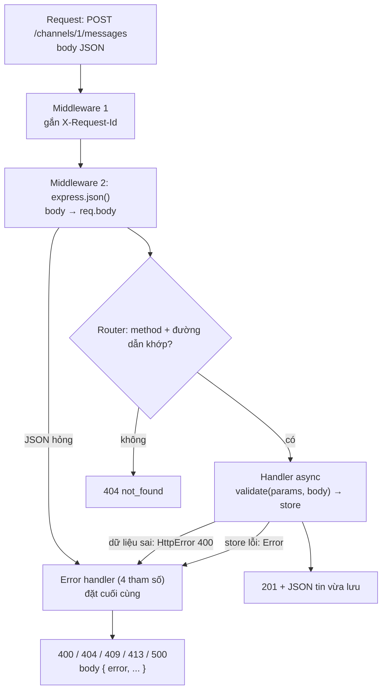

# N11 — REST API với Express + kiểm tra dữ liệu

> WebSocket lo phần "tin mới tới ngay". Nhưng app mobile cần tải lịch sử kênh, bot CI cần gửi tin "build xong", trang quản trị cần tạo kênh — những việc hỏi–đáp đó đi qua **REST API**. Bài này thiết kế API cho kênh và tin nhắn theo chuẩn REST, viết bằng **Express 5** thay cho `if/else` của N02, và kiểm tra mọi dữ liệu vào bằng **zod** để lỗi 400 nói rõ trường nào sai.

## 🎯 Mục tiêu

Sau buổi này (khoảng 4 giờ với người mới) bạn sẽ:

- Thiết kế API theo **REST**: tài nguyên và URL, method (GET/POST/PUT/PATCH/DELETE), status code đúng nghĩa, **idempotency** (gọi lại nhiều lần có an toàn không).
- Phân trang **offset** và **cursor**, biết vì sao chat dùng cursor.
- Viết Express 5: **router**, **chuỗi middleware**, **error handler** 4 tham số, và lỗi của handler `async` tự tới error handler (mới ở Express 5).
- **Kiểm tra dữ liệu ở cửa vào** bằng zod: một schema cho cả kiểm tra lúc chạy lẫn kiểu TypeScript; lỗi 400 có chi tiết từng trường.
- **Kết quả đo được:** qua hết **8 test**; `npm run typecheck` 0 lỗi; `npm run demo` in đúng 12 dòng ở Bước 6 (201 + Location, 409, 400 từng trường, phân trang `nextBefore`, 404).

> 📖 Từ lạ ở trên và trong Đề bài (REST, tài nguyên, idempotency, cursor, middleware, router, zod, schema…) được giải nghĩa ở mục *Hiểu trước khi làm*, ngay đầu phần kiến thức nền.

## 📋 Đề bài

**Mở thư mục:** workspace của bài `N11-rest-api-express`.

| File | Ai viết | Nội dung |
|---|---|---|
| `app.ts` | **Bạn** | Schema zod, `toValidationError`, `validate`, `errorHandler`, `createApp`; bảng route ở đầu file |
| `store.ts` | Có sẵn | Interface `ChatStore` + bản lưu trong bộ nhớ (N12 viết bản PostgreSQL cùng interface) |
| `server.ts`, `demo.ts` | Có sẵn | `npm start` chạy API ở cổng 3110; `npm run demo` gọi thử mọi route |

| Viết | Làm gì |
|---|---|
| `ChannelBody`, `MessageBody`, `ListQuery`, `IdParams` | Schema zod: hình dạng body, query, params; trim, đổi chuỗi query thành số, giá trị mặc định |
| `toValidationError(error, source)` | `ZodError` → `{error: 'validation_failed', in, details: [{field, message}]}` |
| `validate(schema, value, source)` | Hợp lệ → dữ liệu đã chuẩn hoá; sai → ném `HttpError(400, ...)` |
| `errorHandler(err, req, res, next)` | `HttpError` → status của nó; JSON hỏng → 400; quá lớn → 413; còn lại → 500 không lộ chi tiết |
| `createApp(store)` | Middleware `X-Request-Id` → `express.json` → route kênh/tin nhắn → 404 → `errorHandler` |

**Xong khi:** `# pass 8`, `npm run typecheck` không lỗi, `npm run demo` in đúng các dòng ở Bước 6.

## 🤔 Tại sao? (kiến thức nền)

### Hiểu trước khi làm

**Bối cảnh.** Ở N02 bạn tự viết từng đường dẫn của server bằng một nhánh `if`, tự đọc dữ liệu gửi lên, tự trả mã lỗi — ổn khi chỉ có hai đường dẫn. TeamPulse giờ cần hàng chục đường dẫn, và nhiều nơi gọi tới: app điện thoại, bot, trang quản trị, đội khác. Cần một quy ước chung để ai nhìn địa chỉ cũng đoán được nó làm gì, một bộ khung lo phần việc lặp lại, và một chốt kiểm tra ở cửa vào vì dữ liệu từ bên ngoài không bao giờ đáng tin.

Ba thứ đó lần lượt là **REST**, **Express** và **zod** — bảng 5W1H và bảng từ mới bên dưới giải nghĩa từng cái.

**Ví dụ đời thường.** Bưu điện. Mỗi **quầy** phục vụ một loại việc (gửi thư, nhận bưu phẩm, chuyển tiền) — đó là **tài nguyên** và **route**. Bạn nói "gửi", "tra cứu", "huỷ" — đó là **method**. Trước khi tới quầy, bạn qua **bảo vệ** (ghi sổ khách), **bàn hướng dẫn** (phát số thứ tự) — mỗi người làm một việc rồi chuyển bạn đi tiếp: **chuỗi middleware**. Nhân viên quầy soát **tờ khai**: ô nào thiếu, ô nào sai thì khoanh đỏ đúng ô đó và trả lại — **lỗi 400 có chi tiết từng trường**. Sự cố trong phòng máy thì nhân viên chỉ nói "hệ thống đang lỗi, mời quay lại sau", không đọc nhật ký kỹ thuật cho khách — **500 không lộ chi tiết**. Xem sao kê dài thì in **từng trang**, trang sau bắt đầu từ giao dịch cuối của trang trước — **phân trang cursor**.

**Bạn đã gặp nó ở đâu.**
- Zalo, Messenger: kéo lên đầu đoạn chat → "đang tải tin cũ hơn" — phân trang cursor theo tin cũ nhất đang hiện.
- Shopee, Tiki: cuộn xuống cuối danh sách sản phẩm tự tải thêm — mỗi lần là một request GET có `limit`.
- Form đăng ký ở mọi trang web: ô email viền đỏ "Email không hợp lệ", ô mật khẩu "Tối thiểu 8 ký tự" — server/trình duyệt trả lỗi theo từng trường.
- GitHub API (`GET /repos/{owner}/{repo}/issues`), Stripe API (header `Idempotency-Key` để thanh toán không bị trừ tiền hai lần khi mạng chập chờn).
- Trang "404 — Không tìm thấy" và "500 — Có lỗi xảy ra" bạn gặp hằng ngày.

| Câu hỏi | Trả lời |
|---|---|
| **What** — là gì | REST: quy ước thiết kế API quanh **tài nguyên** (URL là danh từ) và **method** HTTP (động từ), trả status code đúng nghĩa. Express: thư viện định tuyến + middleware cho Node. zod: thư viện mô tả hình dạng dữ liệu và kiểm tra nó lúc chạy. |
| **Why** — vì sao cần | Người gọi đoán được API; ít code lặp; dữ liệu sai bị chặn ở cửa với thông báo rõ thay vì làm hỏng dữ liệu hay sập ở chỗ xa. |
| **When** — khi nào dùng | Việc kiểu hỏi–đáp: tải lịch sử, tạo kênh, gửi tin từ bot, cấu hình. |
| **When not** — khi nào không | Đẩy tin realtime cho người đang online — dùng WebSocket (P1). Màn hình cần ghép dữ liệu rất linh hoạt, hay các dịch vụ nội bộ gọi nhau với tốc độ cao — có kiểu API khác (GraphQL, gRPC — chỉ cần biết tên). |
| **Where** — ở đâu | Server TeamPulse: `/channels`, `/channels/:id/messages`; chạy cạnh WebSocket gateway, cùng dùng một store (N12: PostgreSQL). |
| **How** — chạy thế nào | Request → middleware lần lượt (`X-Request-Id`, đọc JSON) → router chọn handler theo method + đường dẫn → handler `validate` dữ liệu rồi gọi store → response JSON. Bất kỳ đâu ném lỗi → nhảy thẳng tới error handler ở cuối. |



**Từ mới trong bài**

| Từ | Nghĩa đời thường |
|---|---|
| **API**, **REST** | "Cửa giao tiếp" của một chương trình cho chương trình khác gọi ·  Quy ước thiết kế API: URL chỉ **thứ** (tài nguyên), method chỉ **việc** |
| **Tài nguyên** (resource), **collection** | Một "thứ" có địa chỉ riêng (`/channels/1`) · tập hợp các thứ đó (`/channels`) |
| **Method** (verb) | GET đọc · POST tạo · PUT thay toàn bộ · PATCH sửa một phần · DELETE xoá |
| **Idempotent** | Gọi 1 lần hay 10 lần, kết quả trên server như nhau (GET, PUT, DELETE; POST thì **không**) |
| **`Idempotency-Key`** | Header mang mã do client tạo để server nhận ra "request này gửi lại", không làm lần hai |
| **Status code** | Số 3 chữ số báo kết quả: 2xx thành công, 4xx lỗi phía người gọi, 5xx lỗi phía server |
| **`Location`** | Header chỉ địa chỉ của tài nguyên vừa tạo (đi kèm 201) |
| **Phân trang** (pagination), **offset**, **cursor** | Trả từng phần · "bỏ qua N bản ghi đầu" · "lấy tiếp sau mốc này" (vd. `before=<id>`) |
| **Query string** | Phần `?limit=2&before=5` của URL; luôn là **chuỗi** |
| **Params** (route params) | Phần thay đổi trong đường dẫn: `/channels/:id` → `req.params.id` |
| **Express**, **app**, **router** | Thư viện web cho Node · đối tượng ứng dụng · nhóm route dùng chung tiền tố |
| **Middleware**, **handler** | Hàm `(req, res, next)` chạy theo thứ tự cho mỗi request, làm xong một việc thì gọi `next()` · hàm cuối cùng xử lý một route |
| **Error handler** | Middleware **4 tham số** `(err, req, res, next)`; Express chỉ gọi khi có lỗi |
| **zod**, **schema** | Thư viện kiểm tra dữ liệu · bản mô tả hình dạng dữ liệu (trường nào, kiểu gì, giới hạn gì) |
| **`parse` / `safeParse`** | Kiểm tra và trả dữ liệu, sai thì ném lỗi · sai thì trả `{success: false, error}` |
| **`z.coerce`** | Đổi kiểu trước khi kiểm tra (chuỗi `"5"` → số `5`) |
| **`z.infer`** | Lấy kiểu TypeScript từ schema — viết một lần, có cả hai |
| **Validation**, **ở cửa vào** (boundary) | Kiểm tra dữ liệu · ngay chỗ dữ liệu từ ngoài đi vào code của mình |
| **`X-Request-Id`**, **UUID** | Mã riêng cho mỗi request, in trong log để lần theo một sự cố · chuỗi ngẫu nhiên 36 ký tự gần như không bao giờ trùng (`randomUUID()` của `node:crypto`) |
| **Dependency injection** | Truyền thứ hàm cần (vd. `store`) từ ngoài vào thay vì hàm tự tạo — test truyền bản giả được |

### REST: tài nguyên, method, status

URL là **danh từ** (thứ gì), method là **động từ** (làm gì). API của TeamPulse:

| Method + URL | Nghĩa | Thành công | Lỗi |
|---|---|---|---|
| `GET /channels` | Danh sách kênh | 200 | |
| `POST /channels` | Tạo kênh | **201** + `Location: /channels/3` | 400 dữ liệu sai · **409** trùng tên |
| `GET /channels/3` | Một kênh | 200 | 400 id sai · 404 không có |
| `GET /channels/3/messages?limit=20&before=812` | Tin của kênh, phân trang | 200 | 400 · 404 |
| `POST /channels/3/messages` | Gửi tin vào kênh | 201 | 400 · 404 |

Không viết `POST /createChannel` hay `GET /getMessages?channel=3` — động từ đã nằm ở method. Tin nhắn **thuộc về** kênh nên URL lồng: `/channels/3/messages`.

| Method | Dùng để | Safe (không đổi dữ liệu) | Idempotent |
|---|---|---|---|
| GET | Đọc | ✔ | ✔ |
| POST | Tạo mới (server cấp id) | | |
| PUT | Thay **toàn bộ** tài nguyên ở URL đã biết | | ✔ |
| PATCH | Sửa **một phần** | | thường không |
| DELETE | Xoá | | ✔ |

| Status | Khi nào |
|---|---|
| 200 OK · 201 Created · 204 No Content | Thành công · đã tạo (kèm `Location`) · thành công, không có body (vd. DELETE) |
| 400 Bad Request | Dữ liệu gửi lên sai: JSON hỏng, thiếu trường, sai kiểu (có nơi dùng 422 cho "đúng JSON nhưng sai nghĩa") |
| 401 · 403 | Chưa đăng nhập · đăng nhập rồi nhưng không có quyền (N07, N14) |
| 404 Not Found | Không có tài nguyên / đường dẫn |
| 409 Conflict | Xung đột với trạng thái hiện tại: tên kênh đã có |
| 413 Payload Too Large | Body quá giới hạn |
| 500 Internal Server Error | Lỗi phía server — **không** gửi chi tiết lỗi cho client, chỉ ghi log |

**Idempotency** quan trọng vì mạng chập chờn: client gửi request, không nhận được trả lời (mất mạng, timeout) — nó không biết server đã làm hay chưa. Gửi lại `GET`, `PUT`, `DELETE` thì an toàn: làm hai lần cũng như một lần. Gửi lại `POST /messages` thì **có thể ra hai tin trùng** — cùng vấn đề "gửi lại và chống trùng" của ack ở N06. Cách chữa giống nhau: client gắn mã riêng cho mỗi lần gửi (header `Idempotency-Key`, hay `client_msg_id` ở N13), server thấy mã đã gặp thì trả lại kết quả cũ thay vì tạo mới.

> 🧠 **Ghi nhớ:** 4xx = người gọi sửa được (gửi lại dữ liệu đúng), 5xx = người gọi không làm được gì (thử lại sau). Trả 500 cho dữ liệu sai, hay 200 kèm `{ "error": ... }`, làm client không biết nên sửa request hay thử lại.

### Phân trang: offset hay cursor

Kênh có 50.000 tin; không ai tải hết một lần. Hai kiểu chia trang, minh hoạ trên một bảng tin (mới nhất trước), trong lúc người dùng đang đọc thì có bài mới:

```ts
interface Post { id: number; title: string }

// Bảng tin, mới nhất trước (id giảm dần)
const posts: Post[] = [];
for (let id = 6; id >= 1; id--) posts.push({ id, title: `Bài ${id}` });

// Cách A — offset: "bỏ qua offset bài đầu, lấy limit bài"
function pageByOffset(list: Post[], offset: number, limit: number): number[] {
  const ids: number[] = [];
  for (let i = offset; i < list.length && ids.length < limit; i++) {
    ids.push(list[i]!.id);
  }
  return ids;
}

// Cách B — cursor: "lấy limit bài có id nhỏ hơn before"
function pageByCursor(list: Post[], before: number | undefined, limit: number): number[] {
  const ids: number[] = [];
  for (const post of list) {
    if (ids.length === limit) break;
    if (before !== undefined && post.id >= before) continue;
    ids.push(post.id);
  }
  return ids;
}

const page1Offset = pageByOffset(posts, 0, 2);
const page1Cursor = pageByCursor(posts, undefined, 2);
console.log('trang 1   offset:', page1Offset, '| cursor:', page1Cursor);

posts.unshift({ id: 7, title: 'Bài 7' });      // trong lúc người dùng đọc trang 1, có bài mới
console.log('(có bài mới id 7)');

console.log('trang 2   offset=2:', pageByOffset(posts, 2, 2), '| before=5:', pageByCursor(posts, 5, 2));
```
```output
trang 1   offset: [ 6, 5 ] | cursor: [ 6, 5 ]
(có bài mới id 7)
trang 2   offset=2: [ 5, 4 ] | before=5: [ 4, 3 ]
```

Offset làm bài 5 **hiện hai lần** (bài mới đẩy mọi thứ xuống một chỗ); xoá bớt bài thì ngược lại — **mất** một bài. Cursor neo vào **id của bài cuối đã thấy** nên không bị ảnh hưởng. `list[i]!`: tsconfig bật `noUncheckedIndexedAccess` (N10) nên `list[i]` có kiểu `Post | undefined`; dấu `!` ở đây an toàn vì vòng lặp đã kiểm `i < list.length` (`for...of` như Cách B thì không cần `!`).

> ⚖️ **So sánh:** trong database, `OFFSET 10000 LIMIT 20` vẫn phải đọc rồi bỏ 10.000 dòng đầu — O(offset + limit), trang càng sâu càng chậm; cursor `WHERE id < 812 ORDER BY id DESC LIMIT 20` dùng chỉ mục (index) nhảy thẳng tới mốc — O(log n + limit), trang nào cũng nhanh như nhau. Đổi lại, cursor không "nhảy tới trang 37" được. Chat, bảng tin, log: cursor. Bảng quản trị có số trang: offset vẫn ổn khi dữ liệu nhỏ.

Làm sao biết còn trang sau? Xin **thừa một** bản ghi: cần 20 thì lấy 21; có đủ 21 nghĩa là còn, trả 20 cái đầu kèm `nextBefore` = id cái thứ 20; không đủ thì `nextBefore: null`. Không cần đếm tổng.

### Express 5: router, middleware, error handler

Express làm ba việc bạn tự làm ở N02: chọn handler theo method + đường dẫn, đọc body JSON, và gom lỗi về một chỗ. Ví dụ cửa hàng trái cây, in thứ tự chạy:

```ts
import express from 'express';
import type { NextFunction, Request, Response } from 'express';

const app = express();
const fruits = [{ id: 1, name: 'Táo' }, { id: 2, name: 'Cam' }];

// Middleware 1: chạy cho MỌI request, ghi log rồi chuyển tiếp bằng next()
app.use((req, res, next) => {
  console.log(`  [1] log      ${req.method} ${req.url}`);
  next();
});
// Middleware 2: đọc body JSON → req.body
app.use(express.json());

const router = express.Router();               // nhóm route của tài nguyên /fruits
router.get('/', (req, res) => {
  console.log('  [2] handler  GET /fruits');
  res.json({ items: fruits });
});
router.get('/:id', async (req, res) => {
  const fruit = fruits.find((f) => f.id === Number(req.params.id));
  if (fruit === undefined) throw new Error(`không có trái cây ${req.params.id}`); // handler async ném lỗi
  res.json(fruit);
});
app.use('/fruits', router);

app.use((req, res) => {                          // không route nào khớp
  console.log('  [3] 404');
  res.status(404).json({ error: 'not_found' });
});
app.use((err: unknown, req: Request, res: Response, next: NextFunction) => {   // 4 tham số = error handler
  console.log('  [4] lỗi     ', err instanceof Error ? err.message : err);
  res.status(500).json({ error: 'internal' });
});

const server = app.listen(0, '127.0.0.1', async () => {
  const base = `http://127.0.0.1:${(server.address() as { port: number }).port}`;
  for (const path of ['/fruits', '/fruits/9', '/vegetables']) {
    const res = await fetch(base + path);
    console.log(`${path.padEnd(12)} → ${res.status} ${await res.text()}`);
  }
  server.close();
});
```
```output
  [1] log      GET /fruits
  [2] handler  GET /fruits
/fruits      → 200 {"items":[{"id":1,"name":"Táo"},{"id":2,"name":"Cam"}]}
  [1] log      GET /fruits/9
  [4] lỗi      không có trái cây 9
/fruits/9    → 500 {"error":"internal"}
  [1] log      GET /vegetables
  [3] 404
/vegetables  → 404 {"error":"not_found"}
```

Bốn điều đọc ra từ kết quả:

| Điều | Vì sao |
|---|---|
| Middleware chạy **theo thứ tự `app.use`** | `[1]` luôn đầu tiên; đặt `express.json()` sau route thì route đọc `req.body` sẽ là `undefined` |
| Middleware 404 đặt **sau mọi route** | Chỉ request không khớp route nào mới rơi xuống tới nó |
| Error handler có **đúng 4 tham số**, đặt **cuối cùng** | Express nhận ra error handler bằng số tham số; thiếu `next` là thành middleware thường |
| Handler `async` ném lỗi → tới thẳng `[4]` | **Express 5** tự bắt Promise bị reject. Express 4 thì không: promise bị reject không ai bắt — Node ≥15 làm **sập cả server** (bản cũ hơn thì request treo), nên code cũ có `try/catch` + `next(err)` ở mọi handler hoặc thư viện `express-async-errors` |

Express không tự trả **405** khi sai method như bạn làm ở N02 — `DELETE /channels` không có route nên ra 404. Muốn 405 thì tự thêm `router.all(...)` ở cuối mỗi đường dẫn; nhiều API công khai cũng chỉ trả 404.

### Kiểm tra dữ liệu ở cửa vào

`req.body` của Express có kiểu **`any`** (N10): `tsc` không kiểm tra gì, và client gửi gì thì handler nhận nấy:

```ts
import express from 'express';

const app = express();
app.use(express.json());
app.post('/orders', (req, res) => {
  const total = req.body.qty * req.body.price;           // req.body có kiểu any: tsc không kiểm tra gì
  res.status(201).json({ total: total.toFixed(0) });
});

const server = app.listen(0, '127.0.0.1', async () => {
  const base = `http://127.0.0.1:${(server.address() as { port: number }).port}/orders`;
  for (const body of ['{"qty":3,"price":12000}', '{"qty":"ba","price":12000}', '{"qty":3}']) {
    const res = await fetch(base, { method: 'POST', headers: { 'content-type': 'application/json' }, body });
    console.log(`${body.padEnd(28)} → ${res.status} ${await res.text()}`);
  }
  server.close();
});
```
```output
{"qty":3,"price":12000}      → 201 {"total":"36000"}
{"qty":"ba","price":12000}   → 201 {"total":"NaN"}
{"qty":3}                    → 201 {"total":"NaN"}
```

`npx tsc --noEmit` không báo lỗi nào, server trả **201 thành công** cho cả đơn hàng hỏng — dữ liệu sai đã đi vào hệ thống. zod mô tả hình dạng dữ liệu **một lần**, được cả hàm kiểm tra lúc chạy lẫn kiểu TypeScript:

```ts
import { z } from 'zod';

z.config(z.locales.vi());                      // thông báo lỗi tiếng Việt

const Order = z.object({
  fruit: z.string().trim().min(1),
  qty: z.number().int().positive(),
  note: z.string().max(100).optional(),
});
type Order = z.infer<typeof Order>;            // kiểu TS sinh từ schema: { fruit: string; qty: number; note?: string }

const ok: Order = Order.parse({ fruit: ' Táo ', qty: 3, extra: true });
console.log('parse    :', ok);

const bad = Order.safeParse({ fruit: '', qty: 'ba' });
if (!bad.success) {
  for (const issue of bad.error.issues) {
    console.log('lỗi      :', issue.path.join('.'), '→', issue.message);
  }
}

const Query = z.object({ page: z.coerce.number().int().min(1).default(1) });
console.log('coerce   :', Query.parse({ page: '3' }), Query.parse({}));
```
```output
parse    : { fruit: 'Táo', qty: 3 }
lỗi      : fruit → Quá nhỏ: mong đợi string có >=1 ký tự
lỗi      : qty → Đầu vào không hợp lệ: mong đợi số, nhận được string
coerce   : { page: 3 } { page: 1 }
```

| zod cho bạn | Ví dụ trên |
|---|---|
| Kiểm tra lúc chạy (thứ TypeScript không làm) | `qty: 'ba'` bị chặn |
| **Báo mọi lỗi một lần**, mỗi lỗi có `path` | Cả `fruit` và `qty` — form hiện đỏ đúng hai ô |
| Chuẩn hoá | `trim()` bỏ khoảng trắng; khóa thừa `extra` bị bỏ |
| Kiểu TS miễn phí | `z.infer<typeof Order>` — sửa schema là kiểu đổi theo |
| Đổi kiểu cho query | Query string luôn là chuỗi: `z.coerce.number()` đổi `'3'` → `3`; `.default(1)` khi thiếu |

`parse` ném `ZodError` khi sai; `safeParse` trả `{ success, data }` hoặc `{ success: false, error }` — dùng khi muốn tự quyết làm gì với lỗi, như `validate` trong bài.

**Kiểm tra ở cửa vào** nghĩa là: ngay đầu handler, trước khi gọi store hay làm gì khác, `validate` params, query, body. Sau dòng đó, mọi biến đều đúng kiểu và đúng giới hạn — phần còn lại của code không phải lo `typeof` nữa. Nhờ `validate` trả `z.infer<S>`, kiểu của `name`, `limit` tự đúng — khác với kiểu `Request<{ id: string }, ...>` hay gặp ở code công ty, chỉ **ghi** kiểu mà không **kiểm tra** gì.

> ⚠️ **Lỗi hay gặp:** kiểm tra bằng tay một vài trường "quan trọng" rồi tin phần còn lại; hoặc kiểm tra ở frontend rồi bỏ qua ở server. Ai cũng gửi được request thẳng tới API bằng `curl` — server phải tự kiểm tra mọi thứ.

## 🛠️ Làm

### Bước 1 — Chuẩn bị

```bash
cd academy/courses/node-realtime/workspace/N11-rest-api-express
npm test             # 8 fail vì TODO — bình thường
npm run typecheck    # 0 lỗi; giữ như vậy sau mỗi bước
```

Đọc bảng route ở đầu `app.ts` và interface `ChatStore` trong `store.ts` — mọi thứ test kiểm tra đều nằm ở docstring. Chạy riêng một nhóm test (dùng y hệt trên PowerShell):

```bash
node --test --test-name-pattern="schemas" "../../curriculum/N11-rest-api-express/tests/*.test.js"
```

### Bước 2 — Hình dạng dữ liệu → `ChannelBody`, `MessageBody`, `ListQuery`, `IdParams`

Bốn `z.object({...})` theo bảng chú thích trong `app.ts`. Thứ tự gọi có ý nghĩa: `z.string().trim().min(1)` trim **rồi** mới đo độ dài (chuỗi toàn khoảng trắng bị từ chối). Tên kênh dùng `.regex(...)`, có thể kèm thông báo của bạn làm tham số thứ hai. Query và params luôn là chuỗi → `z.coerce.number()`.

```bash
node --test --test-name-pattern="schemas" "../../curriculum/N11-rest-api-express/tests/*.test.js"
```

### Bước 3 — Lỗi 400 có chi tiết → `toValidationError`, `validate`

`error.issues` là mảng; mỗi issue có `path` (mảng tên trường, vd. `['meta', 'tag']`) và `message`. Đi qua từng issue bằng vòng `for...of`, đẩy `{ field, message }` vào mảng `details`. `validate` dùng `safeParse` và ném `HttpError` (class có sẵn ở đầu file).

```bash
node --test --test-name-pattern="toValidationError|validate" "../../curriculum/N11-rest-api-express/tests/*.test.js"
```

### Bước 4 — Một chỗ cho mọi lỗi → `errorHandler`

Đủ 4 tham số. `err` có kiểu `unknown`: `instanceof HttpError` thu hẹp được ngay; còn lỗi của `express.json()` là object có trường `type` — kiểm tra bằng `typeof err === 'object' && err !== null && 'type' in err` rồi mới đọc `err.type` (đúng cách thu hẹp kiểu ở N10). Lỗi lạ: `console.error(err)` để người vận hành thấy trong log, client chỉ nhận `{ error: 'internal' }`.

> ⚠️ **Lỗi hay gặp:** trả `res.status(500).json({ error: err.message })`. Message của lỗi DB có thể chứa địa chỉ IP nội bộ, tên bảng, thậm chí dữ liệu người dùng — test kiểm tra điều này.

```bash
node --test --test-name-pattern="errorHandler" "../../curriculum/N11-rest-api-express/tests/*.test.js"
```

### Bước 5 — Ghép lại → `createApp`

Làm theo thứ tự trong docstring, mỗi phần chạy test của nó:

| Phần | Việc | Test |
|---|---|---|
| 5a | Middleware `X-Request-Id` (`req.get('x-request-id')`, `res.set(...)`, `next()`), `express.json({ limit: '16kb' })`, `GET /health`, middleware 404, `app.use(errorHandler)` | `"/health"` |
| 5b | `GET /channels`, `POST /channels` (201, `res.location(...)`, 409), `GET /channels/:id` (400, 404) | `"tạo và đọc kênh"` |
| 5c | `GET` và `POST /channels/:id/messages`, phân trang lấy thừa 1 | `"tin nhắn"` |
| 5d | Không cần code thêm: lỗi của `store` trong handler `async` tự tới `errorHandler` | `"lỗi của store"` |

Ba route có `:id` cùng cần "kiểm `id` rồi tìm kênh, không có thì 404" — viết một hàm `async` nhỏ trong `createApp` dùng chung cho cả ba thay vì chép ba lần. `res.status(201).location(...).json(...)` nối được liên tiếp.

```bash
node --test --test-name-pattern="createApp" "../../curriculum/N11-rest-api-express/tests/*.test.js"
```

### Bước 6 — Chạy thật

```bash
npm run demo
```
```output
POST   /channels                              → 201 (Location: /channels/1) {"id":1,"name":"general","createdAt":"2026-10-20T08:00:00.000Z"}
POST   /channels                              → 409 {"error":"channel_exists"}
POST   /channels                              → 400 {"error":"validation_failed","in":"body","details":[{"field":"name","message":"chỉ gồm a-z, 0-9, -, dài 2–32"}]}
POST   /channels/1/messages                   → 201 {"id":6,"channelId":1,"author":"Binh","text":"Tin 6","createdAt":"2026-10-20T08:00:00.000Z"}
POST   /channels/1/messages                   → 400 {"error":"validation_failed","in":"body","details":[{"field":"author","message":"Quá nhỏ: mong đợi string có >=1 ký tự"},{"field":"text","message":"Đầu vào không hợp lệ: mong đợi string, nhận được số"}]}
POST   /channels/1/messages                   → 400 {"error":"bad_json"}
GET    /channels/1/messages?limit=2           → 200 items: id [6,5], nextBefore: 5
GET    /channels/1/messages?limit=2&before=5  → 200 items: id [4,3], nextBefore: 3
GET    /channels/1/messages?limit=abc         → 400 {"error":"validation_failed","in":"query","details":[{"field":"limit","message":"Đầu vào không hợp lệ: mong đợi số, nhận được NaN"}]}
GET    /channels/99                           → 404 {"error":"channel_not_found"}
GET    /channels/abc                          → 400 {"error":"validation_failed","in":"params","details":[{"field":"id","message":"Đầu vào không hợp lệ: mong đợi số, nhận được NaN"}]}
DELETE /channels/1                            → 404 {"error":"not_found"}
```

(Thông báo của tên kênh là chuỗi bạn tự đặt ở Bước 2, có thể khác.) Rồi chạy server thật và gọi bằng `curl` từ terminal thứ hai:

```bash
npm start                                    # terminal 1 — cổng 3110; bận thì: PORT=3111 npm start
curl -i "http://127.0.0.1:3110/channels/1/messages?limit=2"
curl -i -X POST http://127.0.0.1:3110/channels -H "content-type: application/json" -d '{"name":"ops"}'
```

```powershell
# PowerShell: gọi curl.exe (lệnh "curl" trần là alias của Invoke-WebRequest); cổng bận: $env:PORT=3111; npm start
curl.exe -i "http://127.0.0.1:3110/channels/1/messages?limit=2"
Invoke-RestMethod -Method Post -Uri http://127.0.0.1:3110/channels -ContentType "application/json" -Body '{"name":"ops"}'
```

Kết quả của lệnh POST (đã lược các header `ETag`, `Date`, `Connection`):

```output
HTTP/1.1 201 Created
X-Powered-By: Express
X-Request-Id: cd4cdbef-7c5f-4254-8c95-1fd41592c641
Location: /channels/3
Content-Type: application/json; charset=utf-8

{"id":3,"name":"ops","createdAt":"2026-10-23T01:57:04.265Z"}
```

Dừng server bằng `Ctrl+C`. Dữ liệu nằm trong bộ nhớ nên tắt là mất — N12 thay `createMemoryStore()` bằng PostgreSQL mà `createApp` không phải sửa dòng nào, vì nó chỉ biết interface `ChatStore`.

## ✅ Tự kiểm tra

Bấm **Chạy test**, hoặc trong thư mục workspace của bài:

```bash
npm test
npm run typecheck
```

Mục tiêu: `# pass 8`, typecheck không lỗi. Test mở app thật ở cổng ngẫu nhiên trên `127.0.0.1` và gọi bằng `fetch`, giống hệt client thật.

## 🎤 Câu hỏi phỏng vấn

> 🎯 **Phỏng vấn hay hỏi:** "Bạn thiết kế và bảo vệ một REST API thế nào?" — URL là tài nguyên (`/channels/:id/messages`), method là hành động, status đúng nghĩa (201 + `Location` khi tạo, 400 dữ liệu sai kèm chi tiết từng trường, 404, 409 trùng, 500 không lộ chi tiết). Kiểm tra mọi dữ liệu vào ở đầu handler bằng schema (zod) vì kiểu TypeScript biến mất lúc chạy và `req.body` là `any`. Lỗi gom về một error handler cuối chuỗi middleware (Express 5 tự chuyển lỗi của handler `async` tới đó). Danh sách dài phân trang bằng cursor (`before=<id>`, lấy thừa 1 để biết còn trang) thay vì offset để không trùng/mất bản ghi khi dữ liệu đổi và không chậm dần. POST không idempotent nên gửi lại có thể tạo trùng — dùng `Idempotency-Key`.
