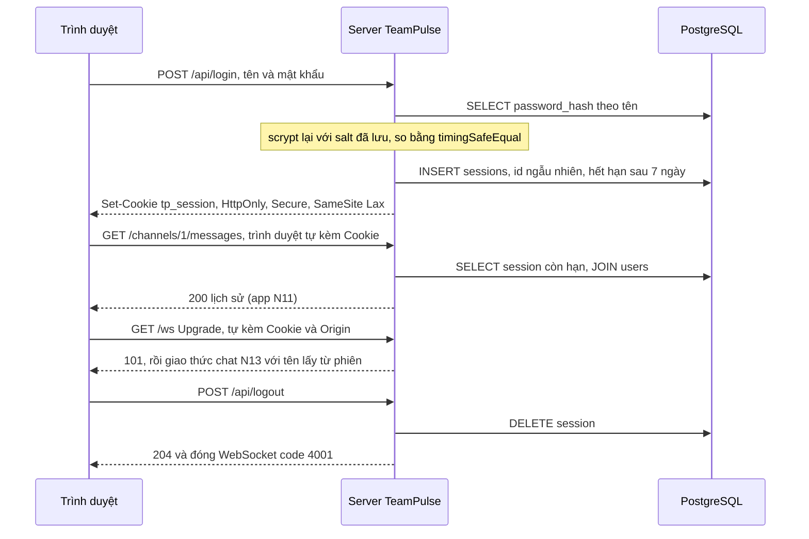
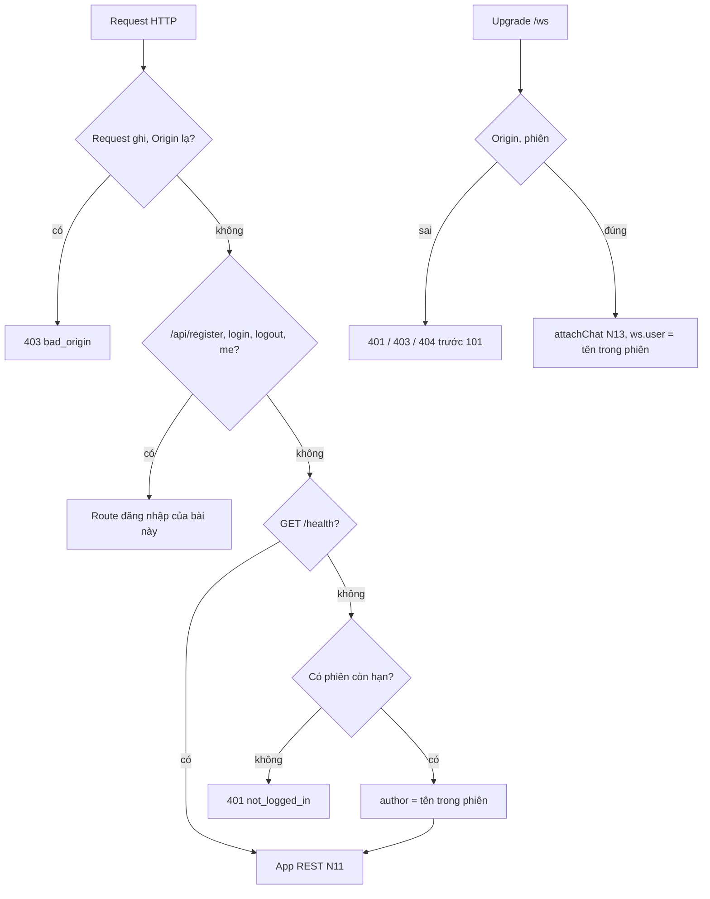

# N14 — Đăng nhập: mật khẩu, session, JWT

> TeamPulse sau N13 đã lưu và đồng bộ tin, nhưng ai cũng tự khai mình là ai: `author` trong body REST, `user` trong `hello` của WebSocket. Bài này thêm phần còn thiếu vào **cùng** app đó: đăng ký và đăng nhập bằng mật khẩu (băm bằng scrypt + salt, không bao giờ lưu mật khẩu gốc), phiên đăng nhập lưu trong PostgreSQL và gửi bằng cookie `HttpOnly`, chặn đoán mật khẩu và CSRF, rồi dùng **cùng phiên đó** cho mọi route REST lẫn handshake WebSocket. Cuối bài là so sánh thẳng thắn session với JWT.

## 🎯 Mục tiêu

Sau buổi này (khoảng 4 giờ với người mới) bạn sẽ:

- Phân biệt **băm** với **mã hoá**, và giải thích vì sao **không bao giờ lưu mật khẩu gốc**.
- Băm mật khẩu bằng **scrypt + salt ngẫu nhiên** của `node:crypto`, so bằng `timingSafeEqual`.
- Viết `register` / `login` / `logout` / `me`; phiên lưu trong bảng `sessions` (migration `004_auth.sql`), id nằm trong cookie **`HttpOnly; Secure; SameSite=Lax`**.
- Giới hạn số lần thử đăng nhập **đúng cả khi request tới song song**, và chống **CSRF** bằng `SameSite` + kiểm tra `Origin`.
- Bắt đăng nhập cho REST của N11 và cho handshake WebSocket của N13 bằng **một** danh tính; đăng xuất là đóng ngay WebSocket đang mở.
- So sánh **session** và **JWT**, biết khi nào chọn cái nào.
- **Kết quả đo được:** `auth.ts` qua **14 test**, `npm run typecheck` sạch; `npm run demo` cho thấy 429 sau 5 lần thử, 10 lần đoán song song chỉ 5 lần được kiểm, cookie đủ thuộc tính, WebSocket 401/403 khi không phiên/Origin lạ, và đăng xuất đóng kết nối với code 4001.

> 📖 Từ lạ ở trên (băm, salt, scrypt, session, cookie `HttpOnly`, CSRF, JWT…) được giải nghĩa ở mục *Hiểu trước khi làm*, ngay đầu phần kiến thức nền.

## 📋 Đề bài

**Mở thư mục:** workspace của bài `N14-dang-nhap-session-jwt`. Đây là app TeamPulse của N13 cộng phần đăng nhập. Đã có sẵn, không cần sửa:

| File | Từ đâu |
|---|---|
| `db.ts`, `migrate.ts`, `types.ts`, `store.ts`, `migrations/001`, `002` | N12 |
| `app.ts` | App REST của N11 (`createApp`, `validate`, `HttpError`, `errorHandler`) |
| `chat-store.ts`, `migrations/003_message_sync.sql` | N13 (`attachChat`, `withBroadcast`) |
| `migrations/004_auth.sql` | **Mới** — cột `users.password_hash`, bảng `sessions` |
| `server.ts` | `prepareDb` + `startServer({db, port})` → `{server, port, url, close()}`; `npm start` |
| Trong `auth.ts` | `scryptAsync`, `readCookie`, `rejectUpgrade`, `DUMMY_HASH`, schema `Credentials` |

> ⚠️ Các file N11–N13 ở đây là lời giải của các bài đó. Làm xong N13 trước khi mở bài này.

| Viết (trong `auth.ts`) | Làm gì |
|---|---|
| `hashPassword(password)` | → `scrypt$16384$8$1$<salt>$<hash>`, salt ngẫu nhiên mỗi lần |
| `verifyPassword(password, stored)` | Băm lại với salt + tham số trong chuỗi, so an toàn; hỏng → `false` |
| `createSession(db, userId, {ttlSec, now})` | Id ngẫu nhiên 32 byte, lưu vào `sessions` có hạn |
| `findSession(db, sessionId, {now})` | Phiên còn hạn + username, hết hạn thì xoá |
| `createLoginLimiter({max, windowMs, now})` | `hit` / `reset`: quá 5 lần thử trong 15 phút → chặn |
| `createAuthServer({db, allowedOrigins, now})` | Đăng ký/đăng nhập/đăng xuất + bắt đăng nhập cho REST N11 và WebSocket N13 |

`now` là đồng hồ giả (như N07): test "tua" 15 phút hay 7 ngày mà không phải chờ.

**Xong khi:** `# pass 14`, `npm run typecheck` không báo lỗi, và `npm run demo` in đúng các dòng ở Bước 8.

## 🤔 Tại sao? (kiến thức nền)

### Hiểu trước khi làm

**Bối cảnh.** Muốn biết ai đang chat, TeamPulse cần cho người dùng đăng nhập: gõ tên và mật khẩu một lần, sau đó mọi request tự mang theo bằng chứng "đã đăng nhập". Database **sẽ** có ngày bị lộ; nếu nó chứa mật khẩu gốc, kẻ trộm vào được cả email, ngân hàng của người dùng vì người ta dùng lại mật khẩu. Và vì trình duyệt **tự gửi** bằng chứng đăng nhập, một trang lạ có thể lợi dụng nó để làm việc thay người dùng.

**Ví dụ đời thường.** Khách sạn. Lễ tân **không chép lại** số CMND của bạn mà chỉ ghi một "dấu vân tay" của nó — kẻ trộm sổ không dùng được để làm giả giấy tờ (băm mật khẩu). Kiểm tra xong, lễ tân đưa bạn **thẻ phòng** có số ngẫu nhiên; sổ ở quầy ghi "thẻ số này thuộc phòng 305, hết hạn trưa thứ Bảy" (session trong database). Thẻ mở được cả cửa phòng lẫn cửa hồ bơi (REST và WebSocket chung một phiên). Bạn trả phòng, lễ tân **xoá thẻ trong sổ** — thẻ hết mở được cửa ngay (đăng xuất). Ai đứng ở quầy thử số phòng quá 5 lần thì bị mời ngồi chờ 15 phút (rate limit). Cách khác là **vé xem phim**: in sẵn ghế và giờ, có dấu mộc, soát vé chỉ nhìn mộc không cần tra sổ — tiện, nhưng mất vé thì không "huỷ" được tới hết giờ chiếu (JWT).

**Bạn đã gặp nó ở đâu.**
- Gmail, Facebook: trang "Thiết bị đang đăng nhập" có nút "Đăng xuất khỏi thiết bị này" — đó là xoá một session trên server.
- Ngân hàng điện tử: nhập sai mật khẩu 5 lần → khóa tạm (rate limit).
- "Quên mật khẩu?" chỉ cho **đặt lại**, không gửi lại mật khẩu cũ: server không biết mật khẩu cũ, chỉ có mã băm.
- Shopee, Lazada: đóng tab mở lại vẫn đăng nhập — cookie phiên còn hạn.

| Câu hỏi | Trả lời |
|---|---|
| **What** — là gì | Đăng nhập = kiểm mật khẩu với mã băm đã lưu, rồi cấp một **phiên** (id ngẫu nhiên lưu trong DB) qua cookie; mọi request sau gửi kèm cookie để server biết bạn là ai. |
| **Why** — vì sao cần | Không có đăng nhập thì ai cũng nhận mình là ai cũng được; lưu mật khẩu gốc thì một vụ lộ DB thành thảm họa cho người dùng ở mọi trang khác. |
| **When** — khi nào dùng | Ứng dụng web có tài khoản riêng: chat, quản trị, thương mại điện tử. |
| **When not** — khi nào không | Công ty đã có hệ thống đăng nhập tập trung (đăng nhập bằng Google/Microsoft, gọi là SSO) → dùng nó, không tự giữ mật khẩu. Cần bảo mật cao hơn mật khẩu (mã một lần gửi qua điện thoại, khóa phần cứng) → dùng thư viện/dịch vụ chuyên dụng. |
| **Where** — ở đâu | `POST /api/login` kiểm mật khẩu và đặt cookie; một middleware trước app N11 và sự kiện `upgrade` của `/ws` đọc cookie → tra bảng `sessions`. |
| **How** — chạy thế nào | Đăng ký: salt ngẫu nhiên + scrypt → lưu chuỗi băm. Đăng nhập: băm lại với salt đó, so bằng `timingSafeEqual` → tạo session → `Set-Cookie`. Đăng xuất: xoá dòng session. |



**Từ mới trong bài** (đã gặp ở N07: xác thực/phân quyền, `timingSafeEqual`, `Origin`, CSWSH, 401/403, token HMAC)

| Từ | Nghĩa đời thường |
|---|---|
| **Mật khẩu gốc** (plaintext) | Mật khẩu đúng như người dùng gõ |
| **Băm** (hash) · **mã hoá** (encryption) | Biến dữ liệu thành "dấu vân tay" một chiều, không đảo ngược được · khóa lại, có khóa thì mở ra được |
| **Salt** | Chuỗi ngẫu nhiên riêng cho từng mật khẩu, trộn vào trước khi băm, lưu cạnh mã băm |
| **Bảng tra sẵn** (rainbow table) | Danh sách "mật khẩu phổ biến → mã băm" tính trước; salt làm nó vô dụng |
| **scrypt** · **N, r, p** | Hàm băm mật khẩu cố ý **chậm và tốn RAM** · các nút chỉnh độ tốn (N lớn = tốn hơn) |
| **bcrypt**, **Argon2** | Hai hàm băm mật khẩu phổ biến khác (cần thư viện ngoài) |
| **Brute force** · **GPU** | Thử lần lượt rất nhiều mật khẩu · card đồ họa, tính hàng tỷ SHA-256 mỗi giây |
| **OWASP** | Tổ chức phi lợi nhuận viết các hướng dẫn bảo mật web được dùng rộng rãi |
| **Session** (phiên) · **session id** | Bản ghi "người này đã đăng nhập, tới lúc nào" trên server · số thẻ ngẫu nhiên trỏ tới bản ghi đó |
| **Cookie**, `Set-Cookie` | Mẩu dữ liệu server nhờ trình duyệt giữ và **tự gửi kèm** mọi request sau tới server đó |
| **`HttpOnly`** · **`Secure`** · **`SameSite`** | JavaScript trên trang không đọc được cookie · chỉ gửi qua HTTPS · có gửi kèm khi request xuất phát từ trang khác site không |
| **`Max-Age`** · **`Path`** | Cookie sống bao nhiêu giây · cookie gửi kèm cho những đường dẫn nào |
| **XSS** | Kẻ gian chèn được JavaScript vào trang của bạn |
| **CSRF** | Trang lạ khiến trình duyệt của nạn nhân gửi request **ghi dữ liệu** tới server của bạn, kèm cookie của nạn nhân |
| **SOP** · **CORS** | Luật trình duyệt: trang lạ không **đọc** được response của site khác · cách server cho phép ngoại lệ |
| **JWT** (JSON Web Token) | Token tự chứa thông tin + chữ ký (như token HMAC ở N07), server kiểm chữ ký mà không cần tra DB |
| **Stateless** · **stateful** | Server không lưu gì về phiên · server lưu phiên (trong DB) |
| **Thu hồi** (revoke) · **denylist** | Làm một phiên/token hết hiệu lực trước hạn · bảng các JWT đã bị thu hồi, phải tra ở mọi request |
| **Rate limit** · **cửa sổ** (window) | Giới hạn số lần thử · khoảng thời gian tính số lần, ở đây 15 phút |
| **`429 Too Many Requests`** · **`Retry-After`** | Mã "thử quá nhiều" · header báo bao nhiêu giây nữa thử lại |
| **Dò tài khoản** (user enumeration) | Đoán xem tên đăng nhập nào có thật, nhờ thông báo lỗi hoặc thời gian trả lời khác nhau |
| **409** | Xung đột (tên đã có người dùng) |

### Vì sao không bao giờ lưu mật khẩu gốc

| Vụ | Đã lưu thế nào | Hậu quả |
|---|---|---|
| **RockYou** (2009) | Mật khẩu gốc | 32 triệu mật khẩu lộ nguyên văn; file `rockyou.txt` thành từ điển đoán mật khẩu phổ biến nhất tới nay |
| **LinkedIn** (2012) | SHA-1, **không salt** | Khoảng 6,5 triệu mã băm bị đăng lên mạng, phần lớn bị đoán ra trong vài ngày |

**Băm hay mã hoá?** Mã hoá đảo ngược được nếu có khóa — và khóa đó nằm đâu đó trên server, lộ cùng database là lộ hết. Băm là một chiều: server cũng **không biết** mật khẩu, kiểm tra bằng cách băm lại rồi so. Đó là lý do nút "Quên mật khẩu" chỉ cho đặt lại. Và đừng log body của request đăng nhập: mật khẩu gốc nằm trong log thì băm cẩn thận ở bảng `users` cũng vô ích.

| | Băm | Mã hoá |
|---|---|---|
| Đảo ngược | Không | Có, nếu có khóa |
| Dùng cho mật khẩu | **Có** (hàm chậm + salt) | Không |
| Dùng cho | Mật khẩu, kiểm toàn vẹn file | Dữ liệu cần đọc lại: số thẻ, tin nhắn bí mật |

### Salt và hàm băm chậm

Băm thôi chưa đủ: mật khẩu người dùng ngắn và trùng nhau nhiều, còn SHA-256 thì **quá nhanh**. Ví dụ miền khác — phòng thi lưu "dấu vân tay" mã phiếu dự thi:

```ts
import { createHash, randomBytes, scryptSync } from 'node:crypto';

// Phòng thi lưu "dấu vân tay" mã phiếu dự thi thay vì mã gốc
const tickets = [
  { room: 'P101', code: '2024-0001' },
  { room: 'P102', code: '2024-0001' },
  { room: 'P103', code: 'Xk7#q-Lam' },
];
const short = (b: Buffer) => b.toString('hex').slice(0, 16);

console.log('SHA-256 không salt:');
for (const t of tickets) {
  const digest = createHash('sha256').update(t.code).digest();
  console.log(`  ${t.room} ${short(digest)}…`);
}

console.log('SHA-256 + salt ngẫu nhiên:');
for (const t of tickets) {
  const salt = randomBytes(8);
  const digest = createHash('sha256').update(salt).update(t.code).digest();
  console.log(`  ${t.room} salt ${salt.toString('hex')} → ${short(digest)}…`);
}

// Kẻ đoán thử 1 mã: mất bao lâu mỗi lần?
let start = performance.now();
for (let i = 0; i < 100_000; i++) createHash('sha256').update(`doan-${i}`).digest();
const shaMs = (performance.now() - start) / 100_000;
start = performance.now();
for (let i = 0; i < 20; i++) scryptSync(`doan-${i}`, 'muoi-co-dinh', 32); // tham số mặc định của Node
const scryptMs = (performance.now() - start) / 20;
console.log(`1 lần đoán: SHA-256 ${(shaMs * 1000).toFixed(2)} µs, scrypt ${scryptMs.toFixed(1)} ms → chậm hơn ~${Math.round(scryptMs / shaMs).toLocaleString('vi-VN')} lần`);
console.log(`Thử 10 triệu mã phổ biến trên 1 lõi CPU: SHA-256 ${(shaMs * 1e7 / 1000).toFixed(0)} giây, scrypt ${(scryptMs * 1e7 / 1000 / 86400).toFixed(1)} ngày — cho MỖI dòng`);
```
```output
SHA-256 không salt:
  P101 b276d1c440f99b3b…
  P102 b276d1c440f99b3b…
  P103 cf9dc7de6ecf1514…
SHA-256 + salt ngẫu nhiên:
  P101 salt 56db95a1ec5453ab → 5878dfe8707a0f84…
  P102 salt 993737c875cd03f7 → d40951ddbc1683fc…
  P103 salt 71a2f1e72571ffea → aead805a6da4911a…
1 lần đoán: SHA-256 0.97 µs, scrypt 23.2 ms → chậm hơn ~23.865 lần
Thử 10 triệu mã phổ biến trên 1 lõi CPU: SHA-256 10 giây, scrypt 2.7 ngày — cho MỖI dòng
```

(Số đo trên máy viết bài; máy bạn sẽ khác, tỷ lệ tương tự.) Đọc output:

- **Không salt**: P101 và P102 cùng mã → cùng dấu vân tay; lộ một là lộ cả hai, và kẻ trộm chỉ cần tra bảng tính sẵn.
- **Có salt**: mỗi dòng một salt → cùng mã ra dấu vân tay khác; bảng tra sẵn vô dụng, kẻ trộm phải đoán **riêng từng dòng**. Salt không bí mật — nó nằm ngay cạnh mã băm.
- **Chậm có chủ đích**: người dùng thật chỉ chờ ~20 ms một lần đăng nhập; kẻ đoán phải trả giá đó cho **mỗi** lần đoán. scrypt còn đòi nhiều RAM mỗi lần băm nên GPU khó chạy song song hàng loạt. Độ tốn chỉnh bằng ba tham số N, r, p; bài này dùng N=16384, r=8, p=1 (ghi trong `SCRYPT_PARAMS`).

| Hàm | Có trong `node:crypto`? | Ghi chú |
|---|---|---|
| SHA-256, SHA-1, MD5 | Có | **Không dùng cho mật khẩu** — quá nhanh |
| **scrypt** (bài này) | Có (`scrypt`, `scryptSync`) | Chậm + tốn RAM; OWASP gợi ý N=2¹⁷ cho hệ thống mới — bài dùng 2¹⁴ (mặc định của Node) để test nhanh |
| bcrypt | Không (thư viện `bcrypt`) | Lâu đời, phổ biến; giới hạn 72 byte mật khẩu |
| Argon2id | Không (thư viện `argon2`) | Lựa chọn đầu tiên OWASP khuyên cho hệ thống mới |

Chuỗi lưu trong DB ghi luôn tham số: `scrypt$16384$8$1$<salt>$<hash>`. Mai kia tăng N, mã băm cũ vẫn kiểm được vì `verifyPassword` đọc N/r/p **từ chuỗi**; người dùng đăng nhập thành công thì băm lại bằng tham số mới.

> 💡 **Mẹo:** trong server dùng `scrypt` bất đồng bộ (có sẵn `scryptAsync` bọc thành Promise), không dùng `scryptSync`. 20 ms `scryptSync` là 20 ms **cả server đứng hình**: mọi WebSocket khác chờ. Bản bất đồng bộ chạy ở thread pool của libuv, event loop vẫn chạy tiếp.

> ⚠️ **Lỗi hay gặp:** so mã băm bằng `===` hoặc `hash.toString() === stored`. Dùng `timingSafeEqual` trên hai `Buffer` cùng độ dài (N07).

### Phiên đăng nhập trong cookie

Đăng nhập đúng, server tạo **session**: một dòng trong bảng `sessions` của `004_auth.sql` (`id` ngẫu nhiên, `user_id`, `expires_at`). Id đó gửi cho trình duyệt trong cookie. Express có sẵn `res.cookie` và `res.clearCookie` — ví dụ với cookie chọn giao diện tối:

```ts
import express from 'express';
import type { AddressInfo } from 'node:net';

const app = express();
app.get('/set-theme', (req, res) => {
  res.cookie('theme', 'dark', { sameSite: 'strict', maxAge: 30 * 24 * 3600 * 1000 });
  res.send('ok');
});
app.get('/clear-theme', (req, res) => {
  res.clearCookie('theme', { sameSite: 'strict' });
  res.send('ok');
});
const server = app.listen(0, '127.0.0.1');
await new Promise((r) => server.once('listening', r));
const base = `http://127.0.0.1:${(server.address() as AddressInfo).port}`;
console.log('Đặt :', (await fetch(`${base}/set-theme`)).headers.get('set-cookie'));
console.log('Xoá :', (await fetch(`${base}/clear-theme`)).headers.get('set-cookie'));
server.close();
```
```output
Đặt : theme=dark; Max-Age=2592000; Path=/; Expires=Sun, 22 Nov 2026 02:55:55 GMT; SameSite=Strict
Xoá : theme=; Path=/; Expires=Thu, 01 Jan 1970 00:00:00 GMT; SameSite=Strict
```

`maxAge` của Express tính bằng **mili giây**, header `Max-Age` bằng **giây**. Xoá cookie = đặt lại cùng tên, hết hạn từ 1970 — phải truyền **cùng** thuộc tính như lúc đặt, nếu không trình duyệt coi là cookie khác. Cookie giao diện ở trên không cần bí mật; cookie phiên thì cần. Chọn thuộc tính cho `tp_session` theo bảng:

| Thuộc tính | Chặn được gì | Không chặn được gì |
|---|---|---|
| `HttpOnly` | Script XSS đọc `document.cookie` rồi gửi đi | Script XSS gửi request **từ chính trang** (cookie vẫn tự đi kèm) |
| `Secure` | Lộ cookie qua Wi-Fi công cộng khi lỡ dùng `http://` | — (Chrome, Firefox coi `http://localhost` là an toàn nên dev vẫn chạy; **Safari thì không** — thử bằng Chrome/Firefox) |
| `SameSite=Lax` | Trang khác site gửi `POST`/`fetch`/mở WebSocket kèm cookie | Trang **cùng site** (subdomain khác — tên miền con như `blog.teampulse.vn` của `teampulse.vn`); điều hướng `GET` cấp cao nhất vẫn kèm cookie |
| `SameSite=Strict` | Như Lax, và cả khi bấm link từ site khác | Bấm link từ email vào TeamPulse sẽ thấy "chưa đăng nhập" — bất tiện, nên phiên dùng Lax |
| `Max-Age` + `expires_at` trong DB | Phiên sống mãi | Hạn ở DB mới là thật; cookie chỉ là gợi ý cho trình duyệt |

> 💡 **Mẹo:** ở production nên lưu **mã băm SHA-256 của session id** trong DB thay vì id gốc (id đã ngẫu nhiên 32 byte nên SHA-256 là đủ). Lộ bảng `sessions` thì kẻ trộm cũng không có cookie dùng được. Bài này lưu id gốc cho dễ đọc.

### CSRF và vì sao vẫn kiểm Origin

Trang `https://evil.example` có thể chứa một form tự gửi `POST https://teampulse.cty.vn/api/logout`. Trình duyệt gửi request đó **kèm cookie của nạn nhân** nếu luật `SameSite` cho phép. Luật SOP không cứu được: nó chỉ ngăn trang lạ **đọc** response, còn tác dụng phụ (đăng xuất, gửi tin) đã xảy ra. Phòng thủ nhiều lớp:

1. **`SameSite=Lax`**: trình duyệt hiện đại không kèm cookie cho `POST` xuất phát từ site khác. Nhưng Lax vẫn kèm cookie khi người dùng **bấm link** (`GET` cấp cao nhất) → không bao giờ để `GET` làm thay đổi dữ liệu. Và trang **cùng site** (một subdomain bị chiếm) không bị chặn.
2. **Kiểm `Origin`** cho mọi request ghi (`POST`, `PUT`, `DELETE`…): có `Origin` mà không nằm trong danh sách → 403. Không có `Origin` (curl, app mobile) → cho qua, vì những client đó không tự mang cookie của người khác.
3. **Chỉ nhận JSON**: `express.json()` chỉ đọc body `Content-Type: application/json`. Form HTML chỉ gửi được kiểu form hoặc text; muốn gửi JSON từ site khác thì trình duyệt phải hỏi trước (preflight CORS) — server không trả lời đồng ý thì request không đi.

Handshake WebSocket là một `GET` đặc biệt — chính là CSWSH ở N07 — nên cũng kiểm `Origin` như vậy.

### Chặn đoán mật khẩu: rate limit

Không giới hạn thì kẻ gian gửi 100 request/giây thử mật khẩu từ từ điển. Giới hạn "5 lần thử / 15 phút / tài khoản" cắt xuống tối đa 480 lần đoán mỗi ngày cho mỗi tài khoản.

Hai cách đếm "trong 60 giây gần đây", ví dụ miền khác — chuông cửa thông minh tối đa 3 lần bấm mỗi phút:

**Cách 1 — cửa sổ trượt, mảng mốc thời gian + vòng for**

```ts
const presses = [0, 10, 20, 30, 70, 75, 80, 85]; // giây
const MAX = 3;
const WINDOW = 60;

const accepted: number[] = [];
const slide: string[] = [];
for (const t of presses) {
  let recent = 0;
  for (const at of accepted) {
    if (t - at < WINDOW) recent += 1;
  }
  if (recent >= MAX) {
    slide.push(`${t}:chờ`);
  } else {
    accepted.push(t);
    slide.push(`${t}:ok`);
  }
}
console.log('Cách 1 (trượt) :', slide.join(' '));
```

**Cách 2 — cửa sổ cố định, một bộ đếm + mốc bắt đầu**

```ts
let count = 0;
let firstAt = -Infinity;
const fixed: string[] = [];
for (const t of presses) {
  if (t - firstAt >= WINDOW) {
    firstAt = t;
    count = 0;
  }
  if (count >= MAX) {
    fixed.push(`${t}:chờ`);
  } else {
    count += 1;
    fixed.push(`${t}:ok`);
  }
}
console.log('Cách 2 (cố định):', fixed.join(' '));
```
```output
Cách 1 (trượt) : 0:ok 10:ok 20:ok 30:chờ 70:ok 75:ok 80:ok 85:chờ
Cách 2 (cố định): 0:ok 10:ok 20:ok 30:chờ 70:ok 75:ok 80:ok 85:chờ
```

> ⚖️ **So sánh:** Cách 1 duyệt mọi mốc đã lưu cho mỗi lần bấm → O(k) thời gian và O(k) bộ nhớ mỗi khóa (k = số mốc trong cửa sổ; muốn gọn phải xoá mốc cũ). Cách 2 là O(1) cả hai. Đổi lại, Cách 2 kém chính xác ở mép cửa sổ: bấm 3 lần cuối cửa sổ này và 3 lần đầu cửa sổ sau là 6 lần trong vài giây. Với đăng nhập (`max` nhỏ, cửa sổ 15 phút), sai lệch đó chấp nhận được — bài dùng cửa sổ cố định tính từ lần thử đầu.

**Đếm trước, kiểm sau.** Kiểm mật khẩu tốn ~20 ms `await`. Nếu route làm "xem còn lượt không → `await` kiểm mật khẩu → sai thì mới tăng đếm", mọi request tới **trong lúc chờ** đều thấy "còn lượt". Ví dụ miền khác — phát 3 suất voucher cho 10 người bấm cùng lúc:

```ts
const sleep = (ms: number) => new Promise((r) => setTimeout(r, ms));
const LIMIT = 3;

// Kiểu A — kiểm số suất, await, RỒI mới tăng đếm
let givenA = 0;
async function claimA() {
  if (givenA >= LIMIT) return 'hết';
  await sleep(20); // trong lúc chờ, 9 request khác cũng đã qua dòng kiểm ở trên
  givenA += 1;
  return 'được';
}

// Kiểu B — giữ suất NGAY (kiểm + tăng trong cùng một bước, không await ở giữa), rồi mới await
let givenB = 0;
async function claimB() {
  if (givenB >= LIMIT) return 'hết';
  givenB += 1;
  await sleep(20);
  return 'được';
}

const tally = (list: string[]) => {
  let ok = 0;
  for (const r of list) if (r === 'được') ok += 1;
  return `${ok} được, ${list.length - ok} hết`;
};
console.log('Kiểu A:', tally(await Promise.all(Array.from({ length: 10 }, claimA))), `(givenA = ${givenA})`);
console.log('Kiểu B:', tally(await Promise.all(Array.from({ length: 10 }, claimB))), `(givenB = ${givenB})`);
```
```output
Kiểu A: 10 được, 0 hết (givenA = 10)
Kiểu B: 3 được, 7 hết (givenB = 3)
```

> ⚠️ **Lỗi hay gặp:** "kiểm rồi mới tăng, mà ở giữa có `await`" là một **race condition** đọc–sửa–ghi. Kẻ gian chỉ cần gửi mật khẩu đoán theo lô song song là vượt mọi giới hạn. Vì vậy limiter của bài có một hàm `hit(key)` vừa kiểm vừa đếm **lần thử** (đúng hay sai đều đếm) trong một bước đồng bộ, gọi trước mọi `await`; đăng nhập đúng thì `reset`. Test có một ca bắn 10 request cùng lúc.

| Đếm theo | Ưu | Nhược |
|---|---|---|
| Username (bài này) | Bảo vệ từng tài khoản dù kẻ gian đổi IP | Kẻ gian cố tình thử 5 lần để **khóa** người khác — giữ cửa sổ ngắn, kèm CAPTCHA (bài đố nhỏ chỉ người làm được, vd. chọn ô có đèn giao thông) thay vì khóa cứng |
| Địa chỉ IP | Chặn một máy thử nhiều tài khoản | Botnet (hàng nghìn máy bị nhiễm mã độc, cùng nghe lệnh kẻ gian) có hàng nghìn IP; cả văn phòng chung một IP |
| Cả hai | Thường dùng ở production | Phức tạp hơn |

Lưu trong bộ nhớ (`Map`) là đủ cho một server; khởi động lại thì mất đếm, nhiều instance (N08) thì mỗi instance đếm riêng, và `Map` không tự dọn khóa của những username ngẫu nhiên kẻ gian thử → production dùng Redis có hạn tự xoá. Bị chặn thì trả `429` + `Retry-After` và **không kiểm mật khẩu** (không tốn 20 ms scrypt cho kẻ tấn công).

> ⚠️ **Lỗi hay gặp:** trả `404 user_not_found` cho tên sai và `401 wrong_password` cho mật khẩu sai — kẻ gian dò được ai có tài khoản. Trả **cùng** `401 bad_credentials`, và khi không tìm thấy user vẫn chạy `verifyPassword(password, DUMMY_HASH)` để thời gian trả lời như nhau. Lưu ý: `POST /api/register` trả 409 cho tên đã có vẫn cho dò tài khoản qua cửa đăng ký — đây là đánh đổi phổ biến (người dùng cần biết tên đã có người dùng); hệ thống chặt hơn xác nhận qua email.

### Một danh tính cho cả app

Sau bài này, `createAuthServer` chính là server TeamPulse. Mọi đường vào đi qua cùng phiên:



`app.ts` (N11) và `chat-store.ts` (N13) không phải sửa một dòng: app N11 nhận `author` đã bị thay bằng tên trong phiên; `attachChat` thấy `ws.user` đã có sẵn nên bỏ qua `user` client tự khai trong `hello`. Ba chỗ bài này cố ý chưa làm, mỗi chỗ một câu: phiên hết hạn trong lúc WebSocket đang mở thì kết nối vẫn sống tới khi đóng (production kiểm lại định kỳ); limiter không tự dọn khóa cũ; người dùng tạo ra từ tin chat ở N13 (cột `password_hash` NULL) giữ tên nhưng không đăng nhập được.

### Session hay JWT

JWT là token tự chứa thông tin + chữ ký (như token HMAC ở N07). Khác biệt cốt lõi — **thu hồi** — thấy ngay với ví dụ thẻ thư viện:

```ts
import { createHmac, timingSafeEqual } from 'node:crypto';

const SECRET = 'khoa-thu-vien';
const sign = (body: string) => createHmac('sha256', SECRET).update(body).digest();

// Cách A — thẻ tự chứa thông tin (kiểu JWT): server không lưu gì
const body = Buffer.from(JSON.stringify({ reader: 'lan', exp: 1_900_000_000 })).toString('base64url');
const card = `${body}.${sign(body).toString('base64url')}`;
function checkCard(c: string): boolean {
  const [b = '', s = ''] = c.split('.');
  const expected = sign(b);
  const got = Buffer.from(s, 'base64url');
  return got.length === expected.length && timingSafeEqual(got, expected); // so chữ ký an toàn (N07)
}

// Cách B — số phiếu tra sổ (session): server lưu, xoá là hết hiệu lực
const sessions = new Map<string, string>([['phieu-7f3a', 'lan']]);
const checkSession = (id: string) => sessions.has(id);

console.log('Trước khi Lan báo mất thẻ → thẻ tự chứa:', checkCard(card), '| số phiếu:', checkSession('phieu-7f3a'));
sessions.delete('phieu-7f3a'); // "đăng xuất" / khóa thẻ
console.log('Sau khi khóa            → thẻ tự chứa:', checkCard(card), '| số phiếu:', checkSession('phieu-7f3a'));
```
```output
Trước khi Lan báo mất thẻ → thẻ tự chứa: true | số phiếu: true
Sau khi khóa            → thẻ tự chứa: true | số phiếu: false
```

| | Session id trong cookie (bài này) | JWT |
|---|---|---|
| Server lưu gì | Một dòng/phiên trong DB (stateful) | Không gì (stateless) |
| Kiểm mỗi request | 1 truy vấn DB theo khóa chính (~1 ms, có thể cache) | Tính lại chữ ký (micro giây), không cần DB |
| Đăng xuất, đổi mật khẩu, mất máy | `DELETE` dòng → hết hiệu lực **ngay**, kể cả WebSocket đang mở | Token vẫn hợp lệ tới `exp`; muốn chặn sớm phải có denylist (tra DB mỗi request — mất luôn ưu điểm stateless) |
| Đổi quyền (bị xoá khỏi nhóm) | Có hiệu lực ngay (đọc quyền từ DB) | Quyền cũ nằm trong token tới khi hết hạn |
| Kích thước gửi đi | ~43 byte | Vài trăm byte – vài KB, gửi kèm mọi request |
| Nhiều dịch vụ, nhiều công ty | Dịch vụ nào cũng phải tra được DB phiên | Ký bất đối xứng (RS256/ES256 — một cặp khóa: **khóa riêng** chỉ server đăng nhập giữ để ký, **khóa công khai** phát cho ai cũng được, chỉ dùng để kiểm): dịch vụ nào có khóa công khai cũng kiểm được — lý do SSO dùng JWT. Ký HMAC (HS256, như N07) thì mọi bên kiểm phải giữ chung **khóa bí mật** |
| Cách dùng hay gặp | Web app một backend: TeamPulse | Access token (vé dùng cho từng request) **ngắn hạn** (5–15 phút) + refresh token (vé dài hạn chỉ dùng để xin access token mới) **có lưu** trên server để thu hồi |

Kết luận thẳng: với một ứng dụng web có một backend như TeamPulse, session trong cookie `HttpOnly` đơn giản và an toàn hơn. JWT hợp khi nhiều dịch vụ độc lập cần kiểm danh tính mà không gọi về một chỗ — và khi đó vẫn cần một nơi có trạng thái để thu hồi. Đặt JWT trong `localStorage` thì script XSS đọc được; nếu dùng JWT ở trình duyệt, vẫn nên đặt trong cookie `HttpOnly`.

## 🛠️ Làm

### Bước 1 — Chuẩn bị

```bash
cd academy/courses/node-realtime/workspace/N14-dang-nhap-session-jwt
npm run typecheck   # sạch ngay từ đầu
npm test            # 14 fail vì TODO — bình thường
npm run migrate     # áp 001→004 vào .pgdata/ (hoặc chỉ 004 nếu DATABASE_URL trỏ DB đã chạy N13)
```

Chạy riêng test của hàm đang làm (dùng y hệt trên PowerShell):

```bash
node --test --test-name-pattern="hashPassword" "../../curriculum/N14-dang-nhap-session-jwt/tests/*.test.js"
```

Mở `migrations/004_auth.sql`: thêm cột `users.password_hash` (cho phép NULL — người dùng có từ N13 chưa có mật khẩu), bảng `sessions` có `user_id` tham chiếu `users(id)` với `ON DELETE CASCADE` (xoá user là xoá luôn mọi phiên). Tên đăng nhập chính là cột `users.name` của N12.

### Bước 2 — Băm → `hashPassword`

Đạt ba điều trong docstring: salt **mới** mỗi lần gọi, băm bằng `scryptAsync` với `KEY_LEN` và `SCRYPT_PARAMS`, ghép thành chuỗi 6 phần ngăn bằng `$` (salt và hash viết base64url). Test tự băm lại bằng `scryptSync` để đối chiếu, và kiểm hai lần băm cùng mật khẩu ra hai chuỗi khác nhau.

```bash
node --test --test-name-pattern="hashPassword" "../../curriculum/N14-dang-nhap-session-jwt/tests/*.test.js"
```

### Bước 3 — Kiểm → `verifyPassword`

Hàm không bao giờ ném lỗi: chuỗi lưu sai dạng ở bất kỳ phần nào → `false`. Băm lại phải dùng salt, N/r/p và độ dài **đọc từ chuỗi**, không dùng hằng số của bài — test có một mã băm "cũ" N=1024, hash 32 byte để chắc điều đó. So kết quả bằng `timingSafeEqual` (nó ném lỗi nếu hai Buffer khác độ dài — xử lý trước). N quá lớn làm scrypt báo lỗi bộ nhớ: lỗi đó cũng phải thành `false`.

```bash
node --test --test-name-pattern="verifyPassword" "../../curriculum/N14-dang-nhap-session-jwt/tests/*.test.js"
```

### Bước 4 — Phiên → `createSession`, `findSession`

`createSession` lưu một dòng vào `sessions` với id không đoán được và hạn tính từ đồng hồ `now()` được truyền vào. `findSession` là chỗ duy nhất trả lời "cookie này là ai": kiểm kiểu đầu vào trước (cookie có thể vắng hoặc rỗng), lấy phiên **kèm tên người dùng** (bảng nào, nối theo cột nào — xem 004 và 001), so hạn bằng `now()` của tham số chứ không bằng `now()` của SQL (để đồng hồ giả hoạt động), hết hạn thì xoá để bảng không phình. `userId` trả về là number.

```bash
node --test --test-name-pattern="Session" "../../curriculum/N14-dang-nhap-session-jwt/tests/*.test.js"
```

### Bước 5 — Giới hạn → `createLoginLimiter`

Một `Map` trong closure (N00), trả object hai hàm. `hit` vừa kiểm vừa đếm trong một bước như Kiểu B ở ví dụ voucher. Test đi từng mốc thời gian: lần thử thứ 4 với `max: 3` → `retryAfterSec: 50`; còn 0,5 giây → `1` (làm tròn **lên**); đúng mốc hết cửa sổ → cửa sổ mới.

```bash
node --test --test-name-pattern="createLoginLimiter" "../../curriculum/N14-dang-nhap-session-jwt/tests/*.test.js"
```

### Bước 6 — REST → `createAuthServer` (phần Express)

Hàm dài nhất bài; làm theo khung chú thích trong starter, thứ tự middleware đúng như docstring. Dùng lại đồ có sẵn của N11: `validate(Credentials, req.body, 'body')` cho lỗi 400 cùng dạng `validation_failed`, `throw new HttpError(status, {error})` cho các lỗi khác, `errorHandler` đặt cuối.

#### Bước 6a — Origin và body JSON

Request ghi có `Origin` lạ dừng ngay với 403, trước khi đọc body. Request không có `Origin` đi tiếp.

#### Bước 6b — `POST /api/register`

Tên đổi về chữ thường; mã băm tính trước khi ghi; một câu INSERT chống trùng theo tên (cùng kỹ thuật N13: không có dòng trả về = đã có). Response không chứa mã băm.

```bash
node --test --test-name-pattern="register" "../../curriculum/N14-dang-nhap-session-jwt/tests/*.test.js"
```

#### Bước 6c — `POST /api/login`

Thứ tự là phần khó, theo đúng docstring: kiểm dạng → `hit` (bị chặn thì trả 429 kèm `Retry-After` và dừng, không kiểm mật khẩu) → tìm user → kiểm mật khẩu (không có user hoặc chưa có mật khẩu thì vẫn kiểm với `DUMMY_HASH`) → sai thì một lỗi duy nhất → đúng thì `reset`, tạo phiên, đặt cookie theo bảng thuộc tính ở trên (nhớ đơn vị của `maxAge`).

```bash
node --test --test-name-pattern="login|429" "../../curriculum/N14-dang-nhap-session-jwt/tests/*.test.js"
node --test --test-name-pattern="SONG SONG" "../../curriculum/N14-dang-nhap-session-jwt/tests/*.test.js"
```

#### Bước 6d — `GET /api/me`, `POST /api/logout`

Cả hai đọc cookie bằng `readCookie`. Đăng xuất xoá phiên trong DB và xoá cookie với **cùng** bộ thuộc tính lúc đặt. Phần đóng WebSocket để Bước 7b.

```bash
node --test --test-name-pattern="api/me|CSRF" "../../curriculum/N14-dang-nhap-session-jwt/tests/*.test.js"
```

#### Bước 6e — Bắt đăng nhập cho app N11

Một middleware đặt sau các route `/api/...`: trừ `GET /health`, không có phiên còn hạn → 401; với `POST /channels/:id/messages` thì thay `author` trong body bằng tên trong phiên. Sau đó gắn app N11 với store đã bọc `withBroadcast` (hub lấy từ `attachChat` ở Bước 7) rồi `errorHandler`. Một app Express gắn được vào app khác như một middleware.

```bash
node --test --test-name-pattern="REST của N11" "../../curriculum/N14-dang-nhap-session-jwt/tests/*.test.js"
```

### Bước 7 — WebSocket bằng cùng phiên → `createAuthServer` (phần `upgrade`)

#### Bước 7a — Chặn trước 101

`WebSocketServer` kiểu `noServer` (như N07) và một handler cho sự kiện `upgrade` của http server, kiểm theo thứ tự: đường dẫn → `Origin` → phiên. Sai thì `rejectUpgrade` với 404 / 403 / 401. Trình duyệt **tự gửi** cookie `tp_session` trong request nâng cấp, nên trang chat chỉ cần `new WebSocket('wss://.../ws')`, không phải tự nhét token.

```bash
node --test --test-name-pattern="WebSocket không phiên" "../../curriculum/N14-dang-nhap-session-jwt/tests/*.test.js"
```

#### Bước 7b — Gắn danh tính, chat N13, đăng xuất đóng kết nối

Sau khi nâng cấp: gắn tên người dùng và id phiên lên kết nối, nhớ kết nối theo id phiên (một phiên có thể mở nhiều tab), quên nó khi kết nối đóng, rồi phát sự kiện `connection` để `attachChat` xử lý. Quay lại `logout`: đóng mọi kết nối của phiên với code 4001, reason `logged_out`. Đây là thứ JWT không làm được nếu không có trạng thái.

```bash
node --test --test-name-pattern="WebSocket bằng cookie" "../../curriculum/N14-dang-nhap-session-jwt/tests/*.test.js"
```

> ⚠️ **Lỗi hay gặp:** `await` tra phiên trong handler `upgrade` mà quên gắn `socket.on('error', ...)` ngay dòng đầu — client cắt ngang trong lúc chờ DB sẽ làm sập server.

### Bước 8 — Chạy kịch bản

```bash
npm run demo
```

```output
Đăng ký An_Le / mat-khau-dai-123   → 201 {"user":{"id":1,"username":"an_le"}}
Đăng ký lại "an_le"                → 409 {"error":"username_taken"}
Cột password_hash trong DB         → scrypt$16384$8$1$SjhiYnOITvu7HBzXrX_mUQ$9kHvdRs5...
Đăng nhập sai mật khẩu             → 401 {"error":"bad_credentials"}
Đăng nhập user không tồn tại       → 401 {"error":"bad_credentials"}
Lần thứ 6 (đúng mật khẩu)          → 429 {"error":"too_many_attempts"}
                                     Retry-After: 900
10 lần đoán binh_tran CÙNG LÚC     → {"401":5,"429":5}
15 phút sau, đúng mật khẩu         → 200 {"user":{"id":1,"username":"an_le"}}
                                     Set-Cookie: tp_session=<43 ký tự>; Max-Age=604800; Path=/; HttpOnly; Secure; SameSite=Lax
Trang lạ POST /api/logout          → 403 {"error":"bad_origin"}
GET /channels không cookie         → 401 {"error":"not_logged_in"}
POST tin, author tự khai giam_doc  → 201 {"id":1,"channelId":1,"author":"an_le","text":"Tăng lương!","createdAt":"2026-10-23T02:51:18.302Z"}
WebSocket không cookie             → HTTP 401 {"error":"not_logged_in"}
WebSocket cookie đúng, Origin lạ   → HTTP 403 {"error":"bad_origin"}
hello tự khai user=giam_doc        ← {"type":"message","id":1,"channelId":1,"author":"an_le","cli | {"type":"synced","lastId":1}
POST /api/logout                   → 204 
WebSocket đang mở                  → đóng 4001 logged_out
GET /api/me bằng cookie cũ         → 401 {"error":"not_logged_in"}
```

Salt trong dòng `password_hash` và giờ trong `createdAt` khác mỗi lần chạy. Dòng `{"401":5,"429":5}` là bằng chứng limiter đếm đúng khi bị bắn song song.

**Chạy server thật.** `npm start` chạy ở cổng 3114 (PGlite `./.pgdata`, hoặc `DATABASE_URL` — cùng database từ N12–N13 thì chỉ áp thêm 004, tin cũ vẫn còn):

```output
DB: PGlite ./.pgdata; migration vừa áp: 001_init.sql, 002_channel_topic.sql, 003_message_sync.sql, 004_auth.sql
TeamPulse: http://127.0.0.1:3114 — POST /api/register, /api/login, /api/logout · GET /api/me · /channels · WebSocket /ws
```

Thử bằng `curl` (bash) — `-c`/`-b` lưu và gửi lại cookie qua file:

```bash
curl -s -X POST http://127.0.0.1:3114/api/register -H "content-type: application/json" -d '{"username":"an_le","password":"mat-khau-dai-123"}'
curl -si -c tp-cookie.txt -X POST http://127.0.0.1:3114/api/login -H "content-type: application/json" -d '{"username":"an_le","password":"mat-khau-dai-123"}'
curl -s -b tp-cookie.txt "http://127.0.0.1:3114/channels/1/messages?limit=5"
```

```output
{"user":{"id":1,"username":"an_le"}}
HTTP/1.1 200 OK
(… vài header khác …)
Set-Cookie: tp_session=msa2B23Gff5yMcC0V2tTlKLPxeL2XJgXm8zH_AytpxE; Max-Age=604800; Path=/; Expires=Fri, 30 Oct 2026 02:59:34 GMT; HttpOnly; Secure; SameSite=Lax
{"user":{"id":1,"username":"an_le"}}
{"items":[],"nextBefore":null}
```

PowerShell không gửi lại cookie `Secure` qua `http://` khi dùng `-WebSession`, nên lấy cookie từ header rồi tự gửi:

```powershell
$base = "http://127.0.0.1:3114"
Invoke-RestMethod -Method Post -Uri "$base/api/register" -ContentType "application/json" -Body '{"username":"an_le","password":"mat-khau-dai-123"}'
$r = Invoke-WebRequest -UseBasicParsing -Method Post -Uri "$base/api/login" -ContentType "application/json" -Body '{"username":"an_le","password":"mat-khau-dai-123"}'
$cookie = (@($r.Headers['Set-Cookie'])[0] -split ';')[0]
Invoke-RestMethod -Uri "$base/api/me" -Headers @{ Cookie = $cookie }
Invoke-RestMethod -Uri "$base/channels/1/messages?limit=5" -Headers @{ Cookie = $cookie }
```

Tắt server (Ctrl+C), `npm start` lại: `curl -s -b tp-cookie.txt http://127.0.0.1:3114/api/me` vẫn trả `{"user":...}` — phiên nằm trong database, không nằm trong bộ nhớ server. Cổng bận → bash `PORT=3014 npm start`, PowerShell `$env:PORT=3014; npm start`.

## ✅ Tự kiểm tra

Bấm **Chạy test**, hoặc trong thư mục workspace của bài:

```bash
npm test
npm run typecheck
```

Mục tiêu: `# pass 14` và typecheck không in lỗi. Test chạy PostgreSQL trong tiến trình (PGlite) với đủ migration 001→004, đồng hồ giả cho hạn phiên và cửa sổ rate limit, và gửi request nâng cấp **thô** qua TCP để thấy đúng dòng `HTTP/1.1 401 ...`.

## 🎤 Câu hỏi phỏng vấn

> 🎯 **Phỏng vấn hay hỏi:** "Bạn lưu mật khẩu và làm đăng nhập thế nào? Session hay JWT?" — Không lưu mật khẩu gốc, không mã hoá: băm bằng hàm chậm, tốn RAM (scrypt/Argon2id/bcrypt) với salt ngẫu nhiên riêng cho từng người, lưu kèm tham số để nâng cấp sau; kiểm bằng cách băm lại và so `timingSafeEqual`. Đăng nhập sai trả cùng một lỗi cho "không có user" và "sai mật khẩu" (vẫn băm với hash giả để thời gian như nhau); giới hạn số lần thử bằng một bước kiểm-và-đếm không có `await` ở giữa, để request song song không lách được (429 + Retry-After). Đúng thì tạo session id ngẫu nhiên lưu trong DB có hạn, gửi bằng cookie `HttpOnly; Secure; SameSite=Lax`; request ghi kiểm thêm `Origin` để chống CSRF. Mọi route REST và handshake WebSocket dùng chính cookie đó, nên đăng xuất xoá session là đóng được cả kết nối đang mở. Session hợp web app một backend: thu hồi ngay, đổi quyền có hiệu lực ngay, tốn một truy vấn mỗi request. JWT hợp nhiều dịch vụ/SSO (ký bất đối xứng), nhưng không thu hồi được trước `exp` nếu không thêm denylist; vì vậy thường dùng access token ngắn hạn + refresh token có lưu.
