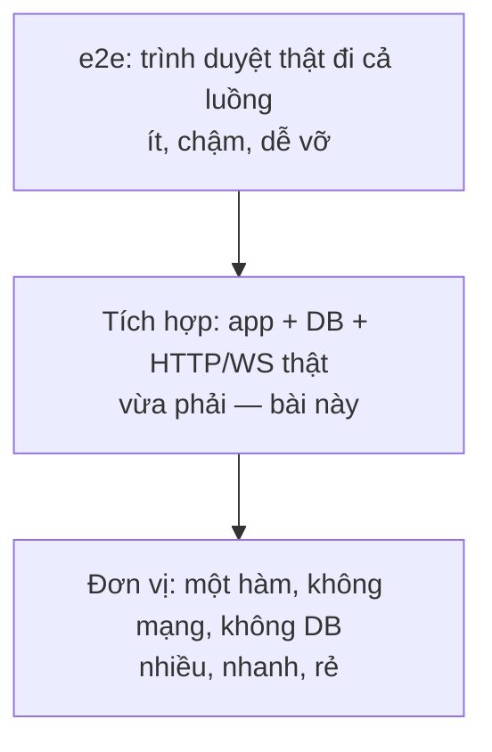

# N15 — Test tích hợp + Docker Compose

> App trong bài này **chính là TeamPulse bạn đã xây ở N11–N14**, chép nguyên vào workspace: REST (`app.ts`, N11), Postgres (`db.ts`, `migrate.ts`, `store.ts`, N12), WebSocket lưu tin và đồng bộ (`chat-store.ts`, N13), đăng nhập (`auth.ts`, `server.ts`, N14). Bài này bạn viết **test tích hợp** chạy cả các phần đó cùng lúc (HTTP thật, WebSocket thật, Postgres nhúng, đăng nhập thật), mỗi test bắt đầu từ dữ liệu sạch như nhau, rồi **đóng gói** app bằng Docker để chạy ở máy nào cũng giống nhau.

## 🎯 Mục tiêu

Sau buổi này (khoảng 4 giờ; có thể chia hai buổi: Bước 1–4 phần test, Bước 5–6 phần Docker) bạn sẽ:

- Phân biệt **test đơn vị / test tích hợp / test e2e** và biết vì sao cần cả ba theo tỉ lệ **kim tự tháp test**.
- Viết **`resetDb`** (đưa DB về **fixture**) và **`startTestApp`** (app thật ở cổng 0, tự dọn) trong `testkit.ts`.
- Tự viết **3 test tích hợp** trong `integration.test.ts`; bài chấm chạy chúng với app đúng và **3 app lỗi** — test của bạn phải bắt được cả ba.
- Đọc hiểu **Dockerfile** từng dòng, chạy TeamPulse + Postgres bằng **Docker Compose** có **healthcheck**, cấu hình qua **biến môi trường**.
- **Kết quả đo được:** chấm bài qua **9 test** (5 cho `testkit.ts`, 4 chạy chính `integration.test.ts` của bạn với 1 app đúng + 3 app lỗi), cả bộ ~4 giây; tuỳ chọn: `docker compose up` chạy app + Postgres 17, tin nhắn **và phiên đăng nhập** còn nguyên sau khi tắt bật lại.

> 📖 Từ lạ ở trên và trong Đề bài (fixture, cổng 0, image, container, healthcheck…) được giải nghĩa ở mục *Hiểu trước khi làm*, ngay đầu phần kiến thức nền.

## 📋 Đề bài

**Mở thư mục:** workspace của bài `N15-test-tich-hop-docker`.

| File | Ai viết | Nội dung |
|---|---|---|
| `testkit.ts` | **Bạn** | `resetDb`, `startTestApp` (có sẵn `waitForMessage`, `api`, `loginAs`, `connectWs`) |
| `integration.test.ts` | **Bạn** | 3 test còn thiếu (đã có 1 test mẫu hoàn chỉnh) |
| `app.ts`, `store.ts`, `types.ts`, `db.ts`, `migrate.ts`, `migrate-cli.ts`, `chat-store.ts`, `auth.ts`, `server.ts`, `demo.ts`, `migrations/001…004` | Có sẵn, đúng, **không sửa** | TeamPulse sau N14, giống hệt bản bạn đã làm. Khác duy nhất: `server.ts` đọc thêm biến `HOST` (Bước 5) |
| `Dockerfile`, `.dockerignore`, `compose.yaml` | Có sẵn | Đóng gói và chạy cùng Postgres (Bước 5–6, tuỳ chọn) |

Những hành vi test của bạn sẽ dựa vào (đều đã học; chi tiết ở đầu `auth.ts` và `chat-store.ts`):

| Đường vào | Hành vi |
|---|---|
| `POST /api/register`, `POST /api/login` `{username, password}` (N14) | Login đúng → `Set-Cookie: tp_session=…`. Mọi route khác (trừ `/api/*`, `GET /health`) cần cookie này, không có → 401 |
| `POST /channels/1/messages` `{text}` (N11) | 201 + tin đã lưu; `author` = tên trong phiên; **đẩy tới mọi WebSocket đang ở kênh 1** (N13 `withBroadcast`) |
| `GET /channels/1/messages` (N11) | `{ items, nextBefore }`, tin **mới nhất trước** |
| WebSocket `/ws` + cookie, gửi `{type:'hello', channelId: 1, lastSeenId: 2}` (N13) | Server gửi bù các tin id > 2 (`{type:'message', …}`, id tăng dần) rồi `{type:'synced', lastId}` |
| WebSocket gửi `{type:'chat', clientMsgId, text}` (N13) | **Lưu DB xong** mới gửi `{type:'ack', clientMsgId, id}` cho người gửi và `{type:'message', …}` cho cả kênh |

| Viết | Làm gì |
|---|---|
| `resetDb(db)` | Xoá sạch `messages`, `sessions`, `users`, `channels`; id đếm lại từ 1; chèn lại `FIXTURE_CHANNELS` |
| `startTestApp(t, db)` | `resetDb` → `startServer({ db, port: 0 })` → `t.after(app.close)` → `{ baseUrl, wsUrl, app }` |
| `integration.test.ts` | 3 test: WS → DB, REST → WS, kết nối lại với `lastSeenId` |

Bài chấm chạy `integration.test.ts` của bạn với app đúng (phải pass hết) và với **3 bản app có lỗi cố ý** (mỗi bản phải làm ít nhất 1 test của bạn fail), giống N09. Bạn không thấy code bản lỗi: test viết theo **hành vi mong muốn** ở bảng trên.

**Xong khi:** `# pass 9` ở `npm test`, `npm run test:mine` pass 4/4, `npm run typecheck` không lỗi.

> ⚠️ Đừng mở workspace N16 trước khi xong bài này: N16 có sẵn một bộ `testkit.ts` và `integration.test.ts` chạy được.

## 🤔 Tại sao? (kiến thức nền)

### Hiểu trước khi làm

**Bối cảnh.** Mỗi mảnh của TeamPulse đã có test riêng và đều xanh, vậy mà vẫn có thể lỗi: tin gửi qua WebSocket không được lưu, tin gửi qua REST không tới người đang mở chat. Lỗi nằm ở **chỗ nối** giữa các mảnh — thứ mà test từng mảnh không nhìn thấy. Song song, app chạy tốt trên máy bạn nhưng trên máy chủ thử nghiệm lại khác phiên bản Node, thiếu Postgres, sai cổng: câu quen thuộc "**chạy trên máy tôi được mà**".

**Ví dụ đời thường.** Sản xuất xe đạp: kiểm từng con ốc, từng bánh xe (test đơn vị — nhanh, rẻ, làm rất nhiều); lắp bánh vào khung rồi quay thử (test tích hợp — chậm hơn, ít hơn); cho người đạp thử một vòng ngoài đường (test e2e — chậm nhất, làm vài lần). Mỗi lần thử phải bắt đầu từ **cùng một chiếc xe chuẩn** (fixture), không phải chiếc người trước vừa làm cong vành. Còn Docker giống **container hàng hoá**: đóng gói sẵn mọi thứ hàng cần, cẩu ở cảng nào cũng nhấc lên đặt xuống theo cùng một cách — không ai phải hỏi bên trong có gì.

**Bạn đã gặp nó ở đâu.**
- Dấu tick xanh cạnh mỗi lần đẩy code trên GitHub: một máy tự chạy hết test (gọi là **CI**, học ở N16).
- Các dịch vụ như Render, Fly.io, Railway nhận một Dockerfile và tự chạy app của bạn.
- Hướng dẫn cài phần mềm mã nguồn mở hay ghi "chỉ cần `docker compose up`".
- Ứng dụng ngân hàng ra bản mới: trước đó đội kiểm thử đã chạy kịch bản e2e "đăng nhập → chuyển tiền → xem số dư".

| Câu hỏi | Trả lời |
|---|---|
| **What** — là gì | Test tích hợp: dựng app thật + DB thật (PGlite), gọi qua HTTP và WebSocket thật. Docker: đóng gói app + Node + thư viện thành một **image**, chạy ra **container**; Compose chạy nhiều container cùng lúc. |
| **Why** — vì sao cần | Bắt lỗi ở chỗ nối giữa REST, WebSocket, DB, đăng nhập; chạy app giống hệt nhau ở máy bạn, máy CI, máy chủ. |
| **When** — khi nào dùng | Test tích hợp: mỗi luồng quan trọng xuyên nhiều phần (gửi tin → lưu → tới người khác). Docker: khi app chạy ở máy khác máy bạn. |
| **When not** — khi nào không | Không dùng test tích hợp cho từng nhánh `if` nhỏ (test đơn vị nhanh hơn). Không bắt test phụ thuộc Docker hay Postgres thật nếu PGlite đủ. |
| **Where** — ở đâu | `integration.test.ts` chạy bằng `node --test` ở máy bạn và máy CI (N16). `Dockerfile`, `compose.yaml` ở gốc dự án. |
| **How** — chạy thế nào | Test: reset DB → app ở cổng 0 → đăng nhập → client gửi → kiểm kết quả ở **phía bên kia** (DB, client khác) → dọn. Docker: `docker build` tạo image → `docker run`/`compose up` tạo container. |



**Từ mới trong bài**

| Từ | Nghĩa đời thường |
|---|---|
| **Test đơn vị** (unit) | Kiểm một hàm riêng lẻ, không mạng, không DB |
| **Test tích hợp** (integration) | Kiểm nhiều phần chạy cùng nhau: app thật + DB + client thật |
| **Test e2e** (end-to-end) | Kiểm cả hệ thống như người dùng thật, thường qua trình duyệt |
| **Kim tự tháp test** | Nhiều test đơn vị, ít test tích hợp hơn, rất ít e2e |
| **CI** | Máy tự cài và chạy test mỗi lần có người đẩy code (N16) |
| **Fixture** | Dữ liệu mẫu cố định mỗi test bắt đầu với (ở bài này: 2 kênh, 0 người dùng, 0 tin) |
| **Cô lập test** (isolation) | Test này không thấy, không phụ thuộc dữ liệu test khác để lại |
| **`TRUNCATE … RESTART IDENTITY`** | Lệnh SQL xoá sạch bảng và cho bộ đếm id chạy lại từ 1 |
| **PGlite** | Postgres thu nhỏ chạy ngay trong tiến trình Node, trong bộ nhớ (đã dùng ở N12) |
| **Cổng 0** | Nhờ hệ điều hành chọn một cổng trống bất kỳ (N09) |
| **Image** | Bản đóng gói chỉ đọc: hệ điều hành tối thiểu + Node + thư viện + code |
| **Container** | Một lần chạy của image, tách biệt với máy chủ; xoá đi tạo lại được |
| **Dockerfile** | Công thức từng bước để tạo image |
| **Lớp** (layer) · **cache** | Mỗi dòng Dockerfile tạo một lớp; dòng không đổi thì dùng lại lớp cũ |
| **`npm ci`** | Cài đúng phiên bản ghi trong `package-lock.json`, không tự nâng |
| **`.dockerignore`** | Danh sách file không chép vào image (node_modules, `.env`, file test…) |
| **Docker Compose** · **service** | Chạy nhiều container theo một file `compose.yaml` · mỗi container trong file |
| **Healthcheck** | Lệnh kiểm tra định kỳ "service đã sẵn sàng chưa" |
| **`depends_on`** | Service này chờ service kia (ở đây: chờ Postgres khoẻ) |
| **Volume** | Ổ đĩa của Docker để dữ liệu sống sót khi container bị xoá |
| **Biến môi trường** (env) | Giá trị đặt bên ngoài code lúc chạy: `PORT=8080 node server.ts` |
| **12-factor app** | Bộ 12 nguyên tắc cho app chạy trên cloud; nguyên tắc 3: cấu hình ở biến môi trường |
| **WSL2** | Lớp Linux chạy bên trong Windows; Docker Desktop trên Windows cần nó |

### Ba tầng test: test đơn vị xanh vẫn có thể có lỗi

Đơn hàng trái cây: hàm tính tiền đúng, nhưng server quên `app.use(express.json())` nên không đọc được body:

```ts
// order.test.ts — đơn hàng trái cây: hàm tính tiền đúng, nhưng route quên express.json()
import { test } from 'node:test';
import assert from 'node:assert/strict';
import http from 'node:http';
import express from 'express';

const PRICES: Record<string, number> = { cam: 12000, xoai: 25000 };

/** Tổng tiền một đơn: [{ fruit, kg }] → đồng. */
export function orderTotal(items: { fruit: string; kg: number }[]): number {
  let total = 0;
  for (const item of items) {
    total += (PRICES[item.fruit] ?? 0) * item.kg;
  }
  return total;
}

function createShop() {
  const app = express();
  // Lỗi: quên app.use(express.json()) → req.body là undefined
  app.post('/orders', (req, res) => {
    res.status(201).json({ total: orderTotal(req.body?.items ?? []) });
  });
  return http.createServer(app);
}

test('unit: orderTotal tính đúng', () => {
  assert.equal(orderTotal([{ fruit: 'cam', kg: 2 }, { fruit: 'xoai', kg: 1 }]), 49000);
});

test('integration: POST /orders trả đúng tổng tiền', async (t) => {
  const server = createShop();
  await new Promise<void>((r) => server.listen(0, '127.0.0.1', r));
  t.after(() => server.close());
  const { port } = server.address() as { port: number };
  const res = await fetch(`http://127.0.0.1:${port}/orders`, {
    method: 'POST',
    headers: { 'content-type': 'application/json' },
    body: JSON.stringify({ items: [{ fruit: 'cam', kg: 2 }, { fruit: 'xoai', kg: 1 }] }),
  });
  assert.equal(res.status, 201);
  assert.equal((await res.json()).total, 49000, 'server phải đọc được body JSON');
});
```
```output
✔ unit: orderTotal tính đúng (0.453359ms)
✖ integration: POST /orders trả đúng tổng tiền (21.265756ms)
ℹ pass 1
ℹ fail 1
  AssertionError [ERR_ASSERTION]: server phải đọc được body JSON
  0 !== 49000
```

| Tầng | Kiểm gì | Tốc độ | Ở TeamPulse |
|---|---|---|---|
| Đơn vị | Một hàm: tính, lọc, kiểm dữ liệu | Vài ms | `splitStatements` (N12), schema zod (N11), `hashPassword`/`verifyPassword` (N14) |
| Tích hợp | App thật + DB + HTTP/WS thật, cùng một máy | Vài chục ms + ~1 giây khởi động DB | Bài này: WS → DB, REST → WS, `lastSeenId` — đều qua đăng nhập thật |
| e2e | Trình duyệt thật, server thật, như người dùng | Vài giây mỗi test | Vài luồng sống còn: đăng nhập → gửi tin → người khác thấy |

> 🧠 **Ghi nhớ:** test tích hợp tốt kiểm kết quả ở **phía bên kia** chỗ nối: gửi qua WebSocket thì đọc lại bằng REST (đã lưu chưa?); gửi qua REST thì nghe ở client WebSocket (đã đẩy chưa?). Chỉ kiểm "trả 201" hay "có ack" là chưa đủ.

### Mỗi test bắt đầu từ cùng một chỗ: fixture và reset

Test chạy lần lượt trên **cùng một DB** để lại dữ liệu cho nhau. Test sau thấy "rác" của test trước, kết quả phụ thuộc thứ tự chạy. Với TeamPulse còn rõ hơn: test trước đã đăng ký `an_le`, test sau đăng ký lại sẽ nhận **409 username_taken**. Demo với bảng trái cây (PGlite):

```ts
import { PGlite } from '@electric-sql/pglite';

const db = new PGlite();
await db.query('CREATE TABLE fruits (id integer GENERATED ALWAYS AS IDENTITY PRIMARY KEY, name text NOT NULL)');

async function addThree() {
  for (const name of ['cam', 'xoài', 'ổi']) {
    await db.query('INSERT INTO fruits (name) VALUES ($1)', [name]);
  }
}

// "test 1" thêm 3 loại quả; "test 2" chạy sau, không dọn gì
await addThree();
const leak = await db.query<{ n: number }>('SELECT count(*)::int AS n FROM fruits');
console.log('test 2 thấy sẵn', leak.rows[0]?.n, 'dòng của test 1');

// Cách 1 — DELETE: xoá dòng, nhưng bộ đếm id chạy tiếp
await db.query('DELETE FROM fruits');
const afterDelete = await db.query<{ id: number }>("INSERT INTO fruits (name) VALUES ('mận') RETURNING id");
console.log('sau DELETE, id kế tiếp =', afterDelete.rows[0]?.id);

// Cách 2 — TRUNCATE ... RESTART IDENTITY: xoá sạch và đếm lại từ 1
await db.query('TRUNCATE fruits RESTART IDENTITY');
const afterTruncate = await db.query<{ id: number }>("INSERT INTO fruits (name) VALUES ('mận') RETURNING id");
console.log('sau TRUNCATE RESTART IDENTITY, id kế tiếp =', afterTruncate.rows[0]?.id);

// Cách 3 — DB mới cho mỗi test: sạch tuyệt đối, nhưng tốn thời gian khởi động
const t0 = performance.now();
const fresh = new PGlite();
await fresh.query('SELECT 1');
console.log(`new PGlite() mất ${Math.round(performance.now() - t0)} ms`);
const t1 = performance.now();
await db.query('TRUNCATE fruits RESTART IDENTITY');
console.log(`TRUNCATE mất ${(performance.now() - t1).toFixed(1)} ms`);
await fresh.close();
await db.close();
```
```output
test 2 thấy sẵn 3 dòng của test 1
sau DELETE, id kế tiếp = 4
sau TRUNCATE RESTART IDENTITY, id kế tiếp = 1
new PGlite() mất 871 ms
TRUNCATE mất 0.9 ms
```

> ⚖️ **So sánh:** cả ba cách đều xoá dữ liệu, khác nhau ở **id** và **thời gian**. Cách 1 (`DELETE`) giữ bộ đếm id nên test không thể assert "tin đầu tiên có id 1" (muốn đếm lại phải thêm `ALTER TABLE … ALTER COLUMN id RESTART` cho từng bảng). Cách 2 (`TRUNCATE … RESTART IDENTITY`) sạch như mới, ~1 ms — dùng cho bài này (một DB cho cả file, reset trước mỗi test). Cách 3 (DB mới mỗi test) cô lập tuyệt đối nhưng chậm hơn hàng trăm lần, và với TeamPulse còn phải chạy lại 4 migration mỗi lần. Bảng có khoá ngoại (`messages` → `channels`, `users`; `sessions` → `users`) phải xoá cùng nhau trong **một** lệnh `TRUNCATE`, hoặc thêm `CASCADE`.

**Fixture** là phần "nạp lại" sau khi xoá: ở TeamPulse, mọi test bắt đầu với đúng hai kênh `general` (id 1), `random` (id 2), chưa có người dùng, tin hay phiên nào. Nhờ vậy test mẫu dám assert `id === 1`, và mỗi test đăng ký lại `an_le` không bị 409.

Bài chấm chạy 4 bản `integration.test.ts` **cùng lúc**, nên app trong test nghe **cổng 0** trên `127.0.0.1` như N09: cổng cố định sẽ đụng nhau (`EADDRINUSE`), cổng 0 thì không.

### Docker: image, container và "chạy trên máy tôi được mà"

App chạy được cần nhiều thứ ngoài code: đúng phiên bản Node (TeamPulse cần ≥ 22.18 để chạy `.ts` trực tiếp), đúng phiên bản thư viện, biến môi trường, một Postgres. Máy bạn có đủ; máy chủ thì chưa chắc. **Image** gói tất cả trừ dữ liệu; **container** là một lần chạy image đó.

| | Cài tay trên máy chủ | Docker |
|---|---|---|
| Phiên bản Node | Máy nào cài bản đó | Ghi trong `FROM node:22-slim` |
| Thư viện | `npm install` lúc đó ra bản nào thì dùng bản đó | `npm ci` theo `package-lock.json`, build một lần, chạy nhiều nơi |
| Postgres | Cài, tạo user, mở cổng bằng tay | Một service trong `compose.yaml` |
| Xoá làm lại | Khó | `docker compose down -v` rồi `up` |

> ⚠️ **Lỗi hay gặp:** container **không phải** máy ảo đầy đủ: nó dùng chung nhân hệ điều hành với máy chủ, khởi động trong vài trăm ms. Dữ liệu ghi trong container **mất** khi container bị xoá — DB phải ghi vào **volume**.

`Dockerfile` của bài, từng dòng:

| Dòng | Ý nghĩa |
|---|---|
| `FROM node:22-slim` | Bắt đầu từ image chính thức có Node 22 trên Debian rút gọn. Tag `22-slim` tự trôi lên bản 22 mới nhất mỗi lần build; production nên ghim bản cụ thể (vd. `node:22.23.4-slim`) hoặc digest (mã băm `sha256:…` của đúng một bản image, không bao giờ trôi) |
| `WORKDIR /app` | Thư mục làm việc trong image; các lệnh sau chạy ở đây |
| `ENV NODE_ENV=production` | Thư viện như Express bật chế độ production (ít log lỗi chi tiết ra ngoài) |
| `COPY package.json package-lock.json ./` | Chép **riêng** hai file khai báo thư viện trước |
| `RUN npm ci --omit=dev` | Cài đúng theo lockfile, bỏ devDependencies (gói chỉ cần lúc phát triển, khai báo riêng trong `package.json`: TypeScript, @types) — không cần khi chạy |
| `COPY . .` | Rồi mới chép code; `.dockerignore` loại `node_modules`, `.pgdata`, `.env`, `.git`, `testkit.ts`, `*.test.ts` |
| `RUN mkdir -p .pgdata && chown node:node .pgdata` | Không có `DATABASE_URL` thì `server.ts` (N14) dùng PGlite ở `./.pgdata`; thư mục phải ghi được bởi user `node` |
| `USER node` | Chạy bằng user thường `node` có sẵn trong image, không phải root |
| `ENV HOST=0.0.0.0 PORT=3115` | Trong container phải nghe `0.0.0.0`: `127.0.0.1` của container chỉ là chính nó, bên ngoài không gọi vào được. `server.ts` ở N14 luôn nghe `127.0.0.1` — đây là chỗ duy nhất bài này thêm vào nó |
| `EXPOSE 3115` | Ghi chú cổng app dùng (không tự mở cổng ra máy chủ — việc đó là `-p` / `ports:`) |
| `CMD ["node", "server.ts"]` | Lệnh chạy khi container khởi động |

Vì sao chép `package*.json` trước? Mỗi dòng là một **lớp** có cache: sửa code mà không đổi thư viện thì Docker dùng lại lớp `npm ci`, chỉ chạy lại từ `COPY . .`. Viết `COPY . .` lên trước thì mỗi lần sửa một dấu chấm phẩy cũng cài lại toàn bộ thư viện.

### Docker Compose: app + Postgres, chờ nhau bằng healthcheck

`compose.yaml` có hai service: `db` (image `postgres:17-alpine`) và `app` (build từ Dockerfile). Những điểm cần hiểu:

| Đoạn | Ý nghĩa |
|---|---|
| `DATABASE_URL: postgres://teampulse:teampulse_dev@db:5432/teampulse` | `openDb()` của N12 thấy biến này → `pg.Pool`. Trong mạng của Compose, tên service `db` là tên máy; `localhost` trong container app là chính container app |
| `healthcheck: pg_isready …` mỗi 2 giây | Postgres khởi động mất vài giây; `pg_isready` trả "sẵn sàng" khi đã nhận kết nối |
| `depends_on: db: condition: service_healthy` | App chỉ chạy khi `db` khoẻ. Chỉ ghi `depends_on: [db]` thì chỉ chờ container **bắt đầu**, app có thể kết nối lúc Postgres chưa sẵn sàng và sập |
| `volumes: pgdata:/var/lib/postgresql/data` | Dữ liệu Postgres (tin, người dùng, **phiên đăng nhập**) sống sót qua `docker compose down`; mất khi `down -v`. Giữ `postgres:17`: bản 18 đổi thư mục lưu dữ liệu, tự nâng tag sẽ không khớp volume này |
| `ALLOWED_ORIGINS: http://localhost:3115,…` | Danh sách trang web được gọi API/WebSocket (chống CSRF/CSWSH của N14) |
| `ports: "3115:3115"` | Cổng máy bạn : cổng trong container |

`prepareDb` của N14 chạy migration mỗi lần app khởi động: Postgres mới tinh nhận cả `001→004`, lần sau chỉ file chưa có trong `schema_migrations`.

### Cấu hình ở biến môi trường (12-factor)

Cùng một image chạy ở máy dev, CI, production; chỉ **cấu hình** khác nhau (cổng, URL database, mật khẩu). Nguyên tắc 3 của 12-factor: cấu hình đặt ở **biến môi trường**, không ghi trong code, không build vào image.

```ts
const port = Number(process.env.PORT ?? 3000);
const mode = process.env.NODE_ENV ?? 'development';
console.log(`cổng ${port}, chế độ ${mode}, có DATABASE_URL: ${process.env.DATABASE_URL ? 'có' : 'không'}`);
```
```bash
node env.ts
PORT=8080 NODE_ENV=production DATABASE_URL=postgres://x node env.ts
```
```powershell
node env.ts
$env:PORT=8080; $env:NODE_ENV='production'; $env:DATABASE_URL='postgres://x'; node env.ts
Remove-Item Env:PORT, Env:NODE_ENV, Env:DATABASE_URL   # PowerShell giữ biến tới khi đóng cửa sổ
```
```output
cổng 3000, chế độ development, có DATABASE_URL: không
cổng 8080, chế độ production, có DATABASE_URL: có
```

`server.ts` (N14) đọc đúng kiểu này: `PORT`, `HOST`, `ALLOWED_ORIGINS`, và `openDb()` (N12) đọc `DATABASE_URL` — có → Postgres thật, không có → PGlite ở `./.pgdata`. Mật khẩu `teampulse_dev` trong `compose.yaml` chỉ dành cho máy dev; production lấy mật khẩu từ **secret** của nền tảng (N16). `.env` nằm trong `.dockerignore` và `.gitignore`.

> 💡 **Mẹo:** `Number(process.env.PORT ?? 3000)` không kiểm tra gì: `PORT=abc` thành `NaN` và app lỗi khó hiểu lúc listen. N16 thay bằng một hàm đọc cấu hình có kiểm tra (zod) để sai là dừng ngay, báo rõ biến nào sai.

## 🛠️ Làm

### Bước 1 — Chuẩn bị

```bash
cd academy/courses/node-realtime/workspace/N15-test-tich-hop-docker
npm test           # 9 fail vì TODO — bình thường
npm run test:mine  # test của bạn: 4 fail (testkit chưa có, 3 test chưa viết)
npm start          # chạy thử đúng app N14: http://127.0.0.1:3114 (Ctrl+C để dừng)
```

Chạy riêng test của hàm đang làm (dùng y hệt trên PowerShell). Đọc dòng `fail` (phải là 0): số `pass` đếm cả nhóm `describe` nên lớn hơn số test (`resetDb` → pass 3 = 2 test + nhóm, `startTestApp` → pass 4):

```bash
node --test --test-name-pattern="resetDb" "../../curriculum/N15-test-tich-hop-docker/tests/*.test.js"
```

### Bước 2 — Đưa DB về fixture → `resetDb`

Đọc docstring trong `testkit.ts`. Ba việc: xoá sạch bốn bảng dữ liệu (một lệnh, vì khoá ngoại), id đếm lại từ 1, chèn lại từng kênh trong `FIXTURE_CHANNELS` **theo thứ tự** bằng **query có tham số** (`$1` như N12 — không nối chuỗi). Xem lại demo trái cây ở phần kiến thức nền. Không đụng `schema_migrations`: migration đã chạy một lần trong `before` của file test.

```bash
node --test --test-name-pattern="resetDb" "../../curriculum/N15-test-tich-hop-docker/tests/*.test.js"
```

### Bước 3 — App thật cho mỗi test → `startTestApp`

Theo thứ tự trong docstring: reset → `startServer({ db, port: 0, host: '127.0.0.1' })` (hàm của `server.ts` N14: đã chờ `listen` xong, trả `port` thật, `url`, `close()`) → `t.after(...)` gọi `close()` → trả hai URL.

Dùng `startServer` lấy từ dòng `await import(process.env.TEAMPULSE_APP ?? …)` ở đầu file — **đừng sửa dòng đó**, đừng `import { startServer } from './server.ts'`: bài chấm đổi app qua dòng đó.

```bash
node --test --test-name-pattern="startTestApp" "../../curriculum/N15-test-tich-hop-docker/tests/*.test.js"
npm run test:mine   # test mẫu "POST tạo tin, GET đọc lại…" phải xanh
```

> ⚠️ **Lỗi hay gặp:** quên `t.after(...)`: server của test trước còn mở, tiến trình `npm run test:mine` không tự thoát; bài chấm `testkit.test.js` báo "phải đăng ký dọn dẹp bằng t.after". Gọi `startServer` trước `resetDb`: vẫn chạy, nhưng thứ tự đó sai ý (app phải thấy DB sạch ngay từ đầu).

### Bước 4 — Tự viết test tích hợp → `integration.test.ts`

Đọc test mẫu: `startTestApp(t, db)` → `loginAs(...)` lấy cookie → hành động qua `api(...)` → assert trên **nội dung** (`id`, `text`, `author`), không chỉ status. Mỗi test còn lại đã có chú thích Arrange – Act – Assert. Helper có sẵn trong `testkit.ts`:

| Helper | Dùng |
|---|---|
| `loginAs(baseUrl, 'an_le')` | Đăng ký + đăng nhập qua route N14 → `'tp_session=…'` |
| `api(baseUrl, path, { method, body, cookie })` | `{ status, body, headers }` — fetch JSON gọn |
| `connectWs(t, wsUrl, { cookie, lastSeenId? })` | Mở WS bằng cookie, gửi `hello`, chờ `synced` → `{ ws, missed, synced }`; tự đóng khi test xong |
| `waitForMessage(ws, predicate)` | Chờ tin thoả điều kiện (N09); **tạo trước** khi gửi |

| Test | Kiểm ở phía bên kia | Bắt được app lỗi nào |
|---|---|---|
| WS → DB | Gửi `chat` qua WS, chờ `ack`, đọc lại bằng `GET` | Tin WS được ack và phát nhưng không lưu |
| REST → WS | `POST`, nghe ở client WS của người khác | Tin REST lưu nhưng không đẩy |
| Kết nối lại | 3 tin; người khác kết nối với `lastSeenId = 2` | `missed` lặp lại tin 2 hoặc thiếu tin 3 |

Ví dụ thứ hai hoàn chỉnh cùng khuôn "gửi một đường, kiểm đường kia", ở miền khác (kho hàng: REST nhập kho, WebSocket báo tồn kho). Chạy được ngay: lưu thành `warehouse.test.ts` trong thư mục bài rồi `node --test warehouse.test.ts` (xoá file sau khi thử).

```ts
// warehouse.test.ts — ví dụ thứ hai: kho hàng. REST nhập kho, WebSocket báo tồn kho cho mọi màn hình.
import { test } from 'node:test';
import assert from 'node:assert/strict';
import http from 'node:http';
import express from 'express';
import { WebSocketServer, WebSocket } from 'ws';
import { api, waitForMessage } from './testkit.ts';

function createWarehouse() {
  const stock = new Map<string, number>();
  const app = express();
  app.use(express.json());
  const server = http.createServer(app);
  const wss = new WebSocketServer({ server, path: '/ws' });
  app.post('/api/stock/:sku', (req, res) => {
    const qty = (stock.get(req.params.sku) ?? 0) + Number(req.body.add);
    stock.set(req.params.sku, qty);
    for (const c of wss.clients) c.send(JSON.stringify({ type: 'stock', sku: req.params.sku, qty }));
    res.status(201).json({ sku: req.params.sku, qty });
  });
  return { server, wss };
}

test('nhập kho qua REST → màn hình kho nhận số mới qua WS', async (t) => {
  // Arrange: app kho thật ở cổng 0, một màn hình đang mở
  const { server, wss } = createWarehouse();
  await new Promise<void>((r) => server.listen(0, '127.0.0.1', r));
  t.after(() => { wss.close(); server.closeAllConnections(); server.close(); });
  const { port } = server.address() as { port: number };
  const screen = new WebSocket(`ws://127.0.0.1:${port}/ws`);
  t.after(() => screen.terminate());
  await new Promise((r) => screen.once('open', r));

  // Act: chờ TRƯỚC, rồi nhập kho qua REST
  const update = waitForMessage(screen, (m) => m.type === 'stock');
  const res = await api(`http://127.0.0.1:${port}`, '/api/stock/CAFE-01', { method: 'POST', body: { add: 5 } });
  const msg = await update;

  // Assert: kiểm cả hai phía của chỗ nối
  assert.equal(res.status, 201, 'nhập kho trả 201');
  assert.equal(msg.sku, 'CAFE-01', 'màn hình nhận đúng mã hàng');
  assert.equal(msg.qty, res.body.qty, 'số tồn trên màn hình khớp số REST trả về');
});
```
```output
✔ nhập kho qua REST → màn hình kho nhận số mới qua WS (27.068607ms)
ℹ tests 1
ℹ pass 1
```

Assert đủ chặt để **phân biệt** đúng/sai: test kết nối lại chỉ kiểm `missed.length > 0` sẽ không bắt được app trả `[2, 3]` thay vì `[3]` — so cả mảng id. Test WS → DB phải chờ `ack` (server chỉ ack **sau khi** lưu xong — N13), rồi mới `GET`; chờ tin `message` cũng được vì N13 phát sau khi lưu. Tự kiểm tra: tạm sửa `chat-store.ts` cho sai một chỗ — trong `withBroadcast`, comment dòng `hub.broadcast({ ...message, clientMsgId: null });` — `npm run test:mine` phải có test REST → WS đỏ; sửa lại như cũ.

Kết quả khi xong:

```output
✔ POST tạo tin, GET đọc lại, author lấy từ phiên đăng nhập (1182.404532ms)
✔ tin gửi qua WebSocket được lưu vào DB (GET thấy) (92.726391ms)
✔ tin POST qua REST tới client WebSocket đang mở (117.078252ms)
✔ kết nối lại với lastSeenId chỉ nhận tin còn thiếu (124.892583ms)
```

Test đầu lâu hơn vì gồm thời gian khởi động PGlite và chạy 4 migration (trong `before`); các test sau ~0,1 giây, phần lớn là scrypt của `loginAs` (N14 cố ý băm chậm).

> 🧠 **Ghi nhớ:** PGlite là Postgres thật (biên dịch sang WASM — WebAssembly, dạng mã máy chạy được trong Node và trình duyệt) nên SQL, kiểu dữ liệu, `ON CONFLICT`, `RESTART IDENTITY` giống production. Nó vẫn khác ở chỗ chỉ một kết nối và không có mạng. N16 thêm một bước CI chạy migration trên Postgres thật để bù chỗ này.

### Bước 5 — Chạy thật: đóng gói bằng Docker (tuỳ chọn)

Test không cần bước này. Cần Docker Engine (Linux) hoặc Docker Desktop (macOS, Windows). Trên Windows: cài Docker Desktop, để nó bật **WSL2** khi được hỏi (khởi động lại máy nếu được yêu cầu), **mở Docker Desktop và chờ biểu tượng báo "running"** trước khi gõ lệnh. Kiểm tra (bash và PowerShell giống nhau) — phải thấy cả phần `Client` lẫn `Server`:

```bash
docker version
```

Build và chạy (app dùng PGlite trong container vì chưa có `DATABASE_URL`):

```bash
docker build -t teampulse .
docker run --rm -p 3115:3115 teampulse
```

Ở terminal khác — đăng ký, đăng nhập, gửi tin như N14, chỉ đổi cổng:

```bash
curl -s -X POST http://127.0.0.1:3115/api/register -H "content-type: application/json" -d '{"username":"an_le","password":"mat-khau-dai-123"}'
curl -s -c tp-cookie.txt -X POST http://127.0.0.1:3115/api/login -H "content-type: application/json" -d '{"username":"an_le","password":"mat-khau-dai-123"}'
curl -s -b tp-cookie.txt -X POST http://127.0.0.1:3115/channels/1/messages -H "content-type: application/json" -d '{"text":"Chào từ container"}'
```
```powershell
$base = "http://127.0.0.1:3115"
Invoke-RestMethod -Method Post -Uri "$base/api/register" -ContentType "application/json" -Body '{"username":"an_le","password":"mat-khau-dai-123"}'
$r = Invoke-WebRequest -UseBasicParsing -Method Post -Uri "$base/api/login" -ContentType "application/json" -Body '{"username":"an_le","password":"mat-khau-dai-123"}'
$cookie = (@($r.Headers['Set-Cookie'])[0] -split ';')[0]
Invoke-RestMethod -Method Post -Uri "$base/channels/1/messages" -Headers @{ Cookie = $cookie } -ContentType "application/json" -Body '{"text":"Chào từ container"}'
```

Kết quả thật trên máy soạn bài (image 285 MB):

```output
$ docker run --rm teampulse sh -c 'node -v; whoami'
v22.23.4
node
--- log container
DB: PGlite ./.pgdata; migration vừa áp: 001_init.sql, 002_channel_topic.sql, 003_message_sync.sql, 004_auth.sql
TeamPulse: http://0.0.0.0:3115 — POST /api/register, /api/login, /api/logout · GET /api/me · /channels · WebSocket /ws
--- curl
{"user":{"id":1,"username":"an_le"}}
{"user":{"id":1,"username":"an_le"}}
{"id":1,"channelId":1,"author":"an_le","text":"Chào từ container","createdAt":"2026-10-23T03:12:30.696Z"}
```

`whoami` in `node`: container không chạy bằng root. Không có `DATABASE_URL` nên app dùng PGlite trong container: xoá container (`--rm`) là mất tin và tài khoản.

### Bước 6 — Chạy thật: app + Postgres bằng Compose (tuỳ chọn)

```bash
docker compose up --build -d     # chạy nền
docker compose ps                # db phải "healthy" trước khi app chạy
docker compose logs app
docker compose down              # dừng, GIỮ dữ liệu (volume)
docker compose down -v           # dừng và xoá cả dữ liệu
```

Các lệnh giống hệt trên PowerShell. Tên container = tên thư mục + tên service (vd. `n15-test-tich-hop-docker-app-1`). Kết quả thật (đăng ký, đăng nhập, gửi một tin bằng `curl` như Bước 5; một client WebSocket gửi `hello` với `lastSeenId: 0`; rồi `down` và `up` lại):

```output
 Container …-db-1  Healthy
 Container …-app-1 Started
app-1  | DB: PostgreSQL db:5432; migration vừa áp: 001_init.sql, 002_channel_topic.sql, 003_message_sync.sql, 004_auth.sql
← {"type":"message","id":1,"channelId":1,"author":"an_le","clientMsgId":null,"text":"Lưu vào Postgres thật",…}
← {"type":"synced","lastId":1}
--- sau docker compose down rồi up -d
app-1  | DB: PostgreSQL db:5432; migration vừa áp: (không có — DB đã đủ)
$ curl -s -b tp-cookie.txt http://127.0.0.1:3115/api/me
{"user":{"id":1,"username":"an_le"}}
```

Ba điều nhìn thấy được: `app` chỉ chạy sau khi `db` **Healthy**; lần chạy thứ hai migration "không có" vì `schema_migrations` đã ghi; tin nhắn **và cookie cũ** vẫn dùng được nhờ volume — phiên đăng nhập của N14 là một dòng trong bảng `sessions`, không nằm trong bộ nhớ app.

Thử dừng app khi client WebSocket vẫn đang mở: `docker compose stop app` trên máy soạn bài mất **0,33 giây**, container `Exited (0)` — `server.ts` của N14 đã bắt SIGTERM và gọi `close()`. Nhưng client nhận mã đóng **1006** (kết nối bị cắt, không lời chào), request nào đang chạy dở cũng bị cắt, và chưa có cách nào để nền tảng hỏi "app đã sẵn sàng nhận người dùng chưa". N16 sửa đúng những chỗ này (graceful shutdown, `/ready`).

| Lỗi | Nguyên nhân |
|---|---|
| `error during connect: … dockerDesktopLinuxEngine …` (Windows) | Docker Desktop chưa chạy: mở nó, chờ "running", chạy lại `docker version` |
| `npm ci` báo thiếu lockfile | Thiếu `package-lock.json` cạnh `package.json` |
| `curl: (56) Recv failure: Connection reset by peer` | App nghe `127.0.0.1` trong container (cần `HOST=0.0.0.0`) hoặc quên `-p 3115:3115` |
| `ECONNREFUSED 127.0.0.1:5432` trong log app | Dùng `localhost` thay cho tên service `db` trong `DATABASE_URL` |
| `{"error":"not_logged_in"}` sau khi login | Quên `-b tp-cookie.txt` (bash) hoặc `-Headers @{ Cookie = $cookie }` (PowerShell) |
| `port is already allocated` | Cổng 3115 trên máy bạn đang bận: đổi vế trái, vd. `"3215:3115"` |

## ✅ Tự kiểm tra

Bấm **Chạy test**, hoặc trong thư mục workspace của bài:

```bash
npm test
npm run test:mine
npm run typecheck
```

Mục tiêu: `# pass 9`. 5 test kiểm tra `testkit.ts` (`resetDb`, `startTestApp`); 4 test chạy `integration.test.ts` của bạn trong tiến trình con với biến môi trường `TEAMPULSE_APP` trỏ tới app đúng hoặc một trong 3 app lỗi. Test "bắt được lỗi …" fail thì đọc tên lỗi: test của bạn chưa kiểm hành vi đó đủ chặt. Chỉ chạy 4 test này: `node --test "../../curriculum/N15-test-tich-hop-docker/tests/mytests.test.js"`.

## 🎤 Câu hỏi phỏng vấn

> 🎯 **Phỏng vấn hay hỏi:** "Bạn test một API có database, đăng nhập và WebSocket thế nào?" — kim tự tháp: nhiều test đơn vị cho logic, một lớp test tích hợp cho các luồng xuyên nhiều phần, vài test e2e. Test tích hợp dựng app thật ở cổng 0 trên 127.0.0.1 với DB thật dạng nhúng (PGlite) hoặc Postgres trong container; mỗi test reset về fixture (`TRUNCATE … RESTART IDENTITY` rồi nạp dữ liệu mẫu) để không phụ thuộc thứ tự; đăng nhập qua chính route login để lấy cookie thật cho cả REST lẫn handshake WebSocket; kiểm ở phía bên kia chỗ nối (gửi WS → đọc REST; POST → client WS nhận; kết nối lại → đúng tin còn thiếu); đóng mọi thứ trong `after`. Docker: image là bản đóng gói chỉ đọc, container là một lần chạy; Dockerfile chép lockfile trước để tận dụng cache, `npm ci --omit=dev`, chạy user không phải root, nghe `0.0.0.0`; Compose dùng healthcheck + `depends_on: condition: service_healthy` vì `depends_on` thường chỉ chờ container bắt đầu; cấu hình và mật khẩu ở biến môi trường/secret, không ở code hay image.
