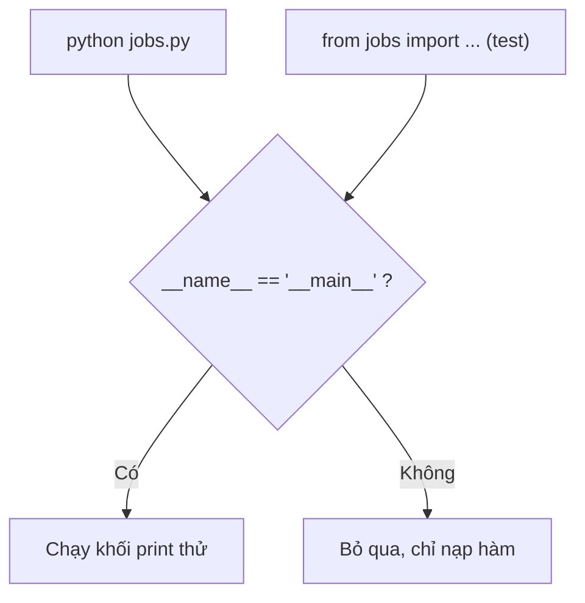
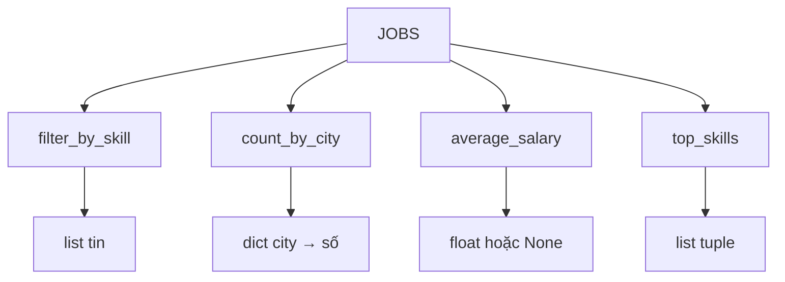
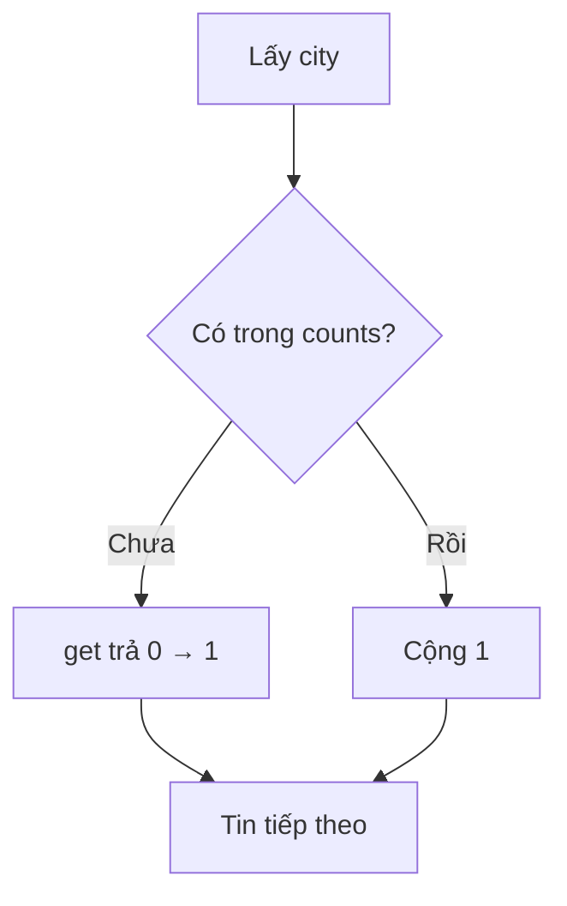

# L01 — Python cơ bản qua dữ liệu tuyển dụng

> Viết 4 hàm Python trả lời 4 câu hỏi cơ bản về 8 tin tuyển dụng mẫu: lọc theo kỹ năng, đếm theo thành phố, lương trung bình, kỹ năng phổ biến.

## 🎯 Mục tiêu

Sau buổi này (khoảng 4 giờ) bạn sẽ:

- Viết được Python cơ bản: biến, hàm, vòng lặp.
- Dùng **list** (dãy có thứ tự) và **dict** (bảng tra key → value).
- Lọc, đếm, sắp xếp bằng vòng lặp **`for` / `if`** cơ bản; đọc được **list comprehension** như cách viết gọn của vòng lặp đó.
- Ước lượng **Big-O**: vì sao đếm bằng dict (O(n)) nhanh hơn gọi `list.count()` trong vòng lặp (O(n²)).
- Xử lý giá trị thiếu **`None`** mà không làm chương trình sập.
- **Kết quả đo được:** 4 hàm trong `jobs.py` qua hết **15 test**.

> 🧠 **Ghi nhớ:** Gần như mọi thư viện AI và Data (pandas, PyTorch, SDK của LLM…) viết cho Python trước tiên. Phỏng vấn AI/Data intern gần như chắc chắn hỏi Python.

## 📋 Đề bài

**Mở file:** `academy/workspace/L01-python-co-ban/jobs.py`.

Trong file có biến `JOBS` — 8 tin tuyển dụng, mỗi tin là một dict. Bạn viết 4 hàm (thay chỗ `raise NotImplementedError`). Docstring dưới mỗi `def` ghi rõ yêu cầu.

| Hàm | Ví dụ với `JOBS` |
|---|---|
| `filter_by_skill(jobs, skill)` | `"llm"` → 2 tin (VNG, Zalo) |
| `count_by_city(jobs)` | `{"Hà Nội": 2, "Hồ Chí Minh": 5, "Đà Nẵng": 1}` |
| `average_salary(jobs)` | `12.0` |
| `top_skills(jobs, n=3)` | `[("python", 6), ("sql", 4), ("llm", 2)]` |

**Xong khi:** bấm **Chạy test** thấy `15 passed`.

## 🤔 Tại sao? (kiến thức nền)

### Python đọc như tiếng Anh

Python ưu tiên code dễ đọc: **thụt lề là cú pháp** và lỗi kiểu dữ liệu được báo ngay chứ không âm thầm sai.

Khối lệnh xác định bằng thụt lề 4 dấu cách, không dùng `{ }`. `"5" + 2` báo `TypeError` — lỗi lộ sớm thì dễ sửa.

| Việc | Cú pháp |
|---|---|
| Gán biến, chuỗi chèn giá trị | `x = 5` · `f"Xin chào {name}"` |
| Rỗng / đúng sai | `None` · `True` / `False` |
| Độ dài, có trong không | `len(x)` · `x in arr` |
| Cắt list | `arr[:3]` · `arr[-1]` |
| Hàm, hàm không tên | `def f(a, b=2):` · `lambda x: x * 2` (xem Bước 6) |
| Vòng lặp | `for x in arr:` · `for i in range(5):` |

### list, dict, tuple

**list** là dãy có thứ tự, **dict** là bảng tra `key → value`, **tuple** là list không sửa được.

Ví dụ: `["Python", "SQL"]` · `{"city": "Hà Nội"}` · `("python", 6)`.

Dict là **hash table**: key được băm thành số chỉ thẳng tới ô nhớ, nên tra cứu gần như tức thì (O(1)) dù có 10 hay 10 triệu key. Vì vậy "đếm theo nhóm" luôn dùng dict.

> ⚠️ **Lỗi hay gặp:** viết `job.city` → `AttributeError: 'dict' object has no attribute 'city'`. Với dict phải viết `job["city"]`.

### None và dữ liệu thiếu

Dữ liệu thật luôn thiếu. Quy tắc vàng: **quyết định rõ ràng** khi gặp `None` — bỏ qua, thay mặc định, hay báo lỗi.

- `10 + None` → `TypeError`: Python dừng lại thay vì cho số sai.
- Bỏ qua `None` thì chia cho số phần tử **còn lại**; không còn gì → trả `None`.

> 💡 **Mẹo:** viết `x is None`, không viết `x == None`. `None` chỉ có một bản duy nhất; `is` so đúng "chính nó".

### Comprehension = vòng lặp viết gọn

Khóa học luôn viết **Cách 1 bằng vòng lặp** trước. Comprehension chỉ là cách viết gọn của đúng vòng lặp đó.

**Cách 1 — vòng lặp for**

```python
nums = [3, -1, 4]
doubled = []
for x in nums:
    if x > 0:
        doubled.append(x * 2)
print(doubled)
```
```output
[6, 8]
```

**Cách 2 — list comprehension**

```python
nums = [3, -1, 4]
doubled = [x * 2 for x in nums if x > 0]
print(doubled)
```
```output
[6, 8]
```

| Phần trong comprehension | Tương ứng trong vòng lặp |
|---|---|
| `[` … `]` | `doubled = []` |
| `x * 2` | `doubled.append(x * 2)` |
| `for x in nums` | `for x in nums:` |
| `if x > 0` | `if x > 0:` |

> ⚖️ **So sánh:** cùng O(n), chỉ gọn hơn. Cả hai đều tạo list mới, **không sửa list gốc**. Comprehension lồng nhau khó đọc → khi đó dùng Cách 1.

### Độ phức tạp Big-O

Big-O cho biết số bước tăng thế nào khi dữ liệu có `n` phần tử tăng lên.

| Big-O | Nghĩa | Ví dụ |
|---|---|---|
| O(1) | Không phụ thuộc n | `d[key]`, `key in d` |
| O(n) | Duyệt một lượt | 1 vòng `for`, `x in list`, `list.count(x)` |
| O(n log n) | Sắp xếp | `sorted(...)` |
| O(n²) | Vòng lặp trong vòng lặp | gọi `list.count(x)` bên trong `for` |

Ví dụ: đếm 20 000 loại quả bằng hai cách.

```python
import random
import time

random.seed(1)
fruits = ["táo", "cam", "xoài", "ổi", "mít"]
items = []
for i in range(20_000):
    items.append(random.choice(fruits))

# Cách A — list.count() trong vòng lặp: O(n²)
t0 = time.perf_counter()
counts_a = {}
for x in items:
    counts_a[x] = items.count(x)   # count() lại duyệt cả 20 000 phần tử
t_a = time.perf_counter() - t0

# Cách B — dict, duyệt một lượt: O(n)
t0 = time.perf_counter()
counts_b = {}
for x in items:
    counts_b[x] = counts_b.get(x, 0) + 1
t_b = time.perf_counter() - t0

print(counts_a == counts_b)
print(f"list.count: {t_a:.2f} s")
print(f"dict:       {t_b:.4f} s")
```
```output
True
list.count: 3.14 s
dict:       0.0012 s
```

Số đo trên máy thử (Python 3.12), máy bạn sẽ khác chút:

| n | Cách A — O(n²) | Cách B — O(n) |
|---|---|---|
| 10 000 | 0,79 s | 0,6 ms |
| 20 000 | 3,14 s | 1,2 ms |
| n tăng ×2 | thời gian **×4** | thời gian ×2 |

> 🧠 **Ghi nhớ:** thấy một hàm tự duyệt list (`count`, `in`, `index`) nằm **trong** vòng `for` → nghĩ ngay tới O(n²) và thay bằng dict hoặc set.

### Module và `__main__`

Mỗi file `.py` là một **module**; khối `if __name__ == "__main__":` chỉ chạy khi bạn gõ trực tiếp `python jobs.py`.

Khi test `import` file, `__name__` là `"jobs"` nên khối đó bị bỏ qua — `print` thử nghiệm không làm ồn lúc chạy test.



## 🛠️ Làm

Toàn cảnh: 4 hàm cùng nhận `JOBS` và trả về 4 kiểu kết quả khác nhau.



### Bước 1 — Chuẩn bị

Kiểm tra `python3 --version` (cần 3.10+; Windows dùng `python --version`). Mở thư mục `academy/workspace/L01-python-co-ban/` bằng VS Code, cài extension **Python** của Microsoft. Chạy `python3 jobs.py` (Windows PowerShell: `python jobs.py`).

> ⚠️ **Lỗi hay gặp:** thấy `NotImplementedError: TODO...` — bình thường! Các hàm chưa được viết.

### Bước 2 — Làm quen với dict

Một tin tuyển dụng là một dict. Thử với dữ liệu khác — một khóa học:

```python
course = {"name": "SQL cơ bản", "tags": ["SQL", "Data"], "price": 300}
print(course["name"])
print(course["tags"][0])
print(course.get("rating", "chưa có"))
```
```output
SQL cơ bản
SQL
chưa có
```

`d["key"]` báo lỗi nếu thiếu key; `d.get("key", mặc_định)` thì không.

### Bước 3 — Lọc danh sách → `filter_by_skill`

Lọc các khóa học có tag `"data"`, không phân biệt hoa thường:

**Cách 1 — hai vòng for lồng nhau**

```python
courses = [
    {"name": "SQL cơ bản", "tags": ["SQL", "Data"]},
    {"name": "Vẽ tranh", "tags": ["Art"]},
    {"name": "Pandas", "tags": ["python", "data"]},
]
picked = []
for c in courses:
    has_data = False
    for tag in c["tags"]:
        if tag.lower() == "data":
            has_data = True
            break          # thấy rồi, khỏi xét các tag còn lại
    if has_data:
        picked.append(c["name"])
print(picked)
```
```output
['SQL cơ bản', 'Pandas']
```

**Cách 2 — list comprehension lồng nhau**

```python
picked = [c["name"] for c in courses if "data" in [t.lower() for t in c["tags"]]]
print(picked)
```
```output
['SQL cơ bản', 'Pandas']
```

> ⚖️ **So sánh:** cùng O(tổng số tag), Cách 2 không nhanh hơn. Cách 1 còn dừng sớm nhờ `break`; Cách 2 tạo thêm một list tag mới cho mỗi khóa. Cách 2 chỉ ngắn hơn nhưng **khó đọc hơn** → khi mới học, dùng Cách 1.

Giờ áp dụng cho `jobs` và `skill`. Nhớ: kết quả là **list các tin** (dict), không phải list tên.

> 💡 **Mẹo:** gọi `.lower()` cho **cả hai vế** — tin của Grab viết `"python"` thường.

### Bước 4 — Đếm bằng dict → `count_by_city`

Mẫu "đếm theo nhóm" dùng `get(key, 0) + 1`:

```python
colors = ["đỏ", "xanh", "đỏ", "vàng", "đỏ"]
counts = {}
for c in colors:
    counts[c] = counts.get(c, 0) + 1
print(counts)
```
```output
{'đỏ': 3, 'xanh': 1, 'vàng': 1}
```



### Bước 5 — Bỏ qua None → `average_salary`

Lọc `None` trước, rồi mới cộng:

**Cách 1 — vòng lặp for, tự cộng dồn**

```python
scores = [8, None, 6, 9, None]
valid = []
total = 0
for s in scores:
    if s is not None:
        valid.append(s)
        total = total + s
print(valid, len(valid))
print(total / len(valid))
print(round(7.666, 1))
```
```output
[8, 6, 9] 3
7.666666666666667
7.7
```

**Cách 2 — list comprehension + `sum()`**

```python
scores = [8, None, 6, 9, None]
valid = [s for s in scores if s is not None]
print(valid, len(valid))
print(sum(valid) / len(valid))
```
```output
[8, 6, 9] 3
7.666666666666667
```

> ⚖️ **So sánh:** cùng O(n), chỉ gọn hơn. `sum()` bên trong cũng là một vòng lặp cộng dồn như Cách 1.

> ⚠️ **Lỗi hay gặp:** list rỗng → `ZeroDivisionError`. Kiểm tra `if not valid:` trước và trả `None`.

### Bước 6 — Đếm lồng nhau và sắp xếp → `top_skills`

Đếm giống Bước 4 nhưng hai vòng `for` lồng nhau (tin → kỹ năng), nhớ `.lower()`. Sau đó xếp hạng: số lần giảm dần, hòa thì tên A→Z.

**Cách 1 — vòng lặp: mỗi lượt chọn phần tử lớn nhất**

```python
counts = {"go": 2, "rust": 5, "c": 2}
remaining = dict(counts)        # bản sao, để xóa dần mà không đụng counts
ranked = []
while remaining:
    best = None
    for name in remaining:
        if best is None:
            best = name
        elif remaining[name] > remaining[best]:
            best = name
        elif remaining[name] == remaining[best] and name < best:
            best = name         # hòa số lần → tên đứng trước A→Z thắng
    ranked.append((best, remaining[best]))
    del remaining[best]
print(ranked)
print(ranked[:2])
```
```output
[('rust', 5), ('c', 2), ('go', 2)]
[('rust', 5), ('c', 2)]
```

**Cách 2 — `sorted()` với `key=`**

```python
counts = {"go": 2, "rust": 5, "c": 2}

def rank_key(kv):               # kv là một cặp, vd. ("rust", 5)
    return (-kv[1], kv[0])      # số lần giảm dần, rồi tên A→Z

print(sorted(counts.items(), key=rank_key))
print(sorted(counts.items(), key=lambda kv: (-kv[1], kv[0])))
```
```output
[('rust', 5), ('c', 2), ('go', 2)]
[('rust', 5), ('c', 2), ('go', 2)]
```

- `sorted` gọi `rank_key` cho từng cặp rồi xếp theo giá trị trả về. Tuple so từng phần: `(-5, "rust")` < `(-2, "c")` < `(-2, "go")`.
- `lambda kv: (-kv[1], kv[0])` là **hàm không tên**: giống hệt `rank_key` nhưng viết trong một dòng.

> ⚖️ **So sánh:** Cách 1 mỗi lượt duyệt hết phần còn lại: lấy k phần tử tốn O(n·k), xếp hết là O(n²). `sorted` là O(n log n). Đo với 5 000 khóa: xếp hết — Cách 1 0,58 s, `sorted` 1,3 ms; chỉ lấy top 3 — Cách 1 0,6 ms, `sorted` 2 ms (Cách 1 nhanh hơn khi k rất nhỏ). Dữ liệu bài này rất nhỏ, chọn cách nào dễ đọc với bạn.

### Bước 7 — Chạy toàn bộ

Chạy `python3 jobs.py` → 4 dòng kết quả khớp bảng Đề bài. Rồi bấm **Chạy test**.

> 💡 **Mẹo:** còn thời gian? Viết thêm `cities_hiring(jobs, skill)` trả về **`set`** các thành phố có tin cần kỹ năng đó.

## ✅ Tự kiểm tra

Bấm **Chạy test**, hoặc từ thư mục `academy/`:

```bash
PYTHONPATH=workspace/L01-python-co-ban python3 -m pytest curriculum/L01-python-co-ban/tests -q
```

> 💡 **Mẹo:** Windows PowerShell: `$env:PYTHONPATH="workspace\L01-python-co-ban"; python -m pytest curriculum\L01-python-co-ban\tests -q`

Mục tiêu: `15 passed`. Test fail → đọc dòng `AssertionError:`, thông báo tiếng Việt gợi ý chỗ sửa.

> 🧠 **Ghi nhớ:** mỗi hàm `test_...` trong pytest là một kịch bản; `assert điều_kiện, "thông báo"` fail khi điều kiện sai. Mở file test ra đọc cũng là cách học tốt.

## 🎤 Câu hỏi phỏng vấn

> 🎯 **Phỏng vấn hay hỏi:** câu 5 — thử chạy `def f(x=[]): x.append(1); return x` rồi gọi `f()` ba lần. Kết quả bất ngờ sẽ giúp bạn nhớ mãi.
