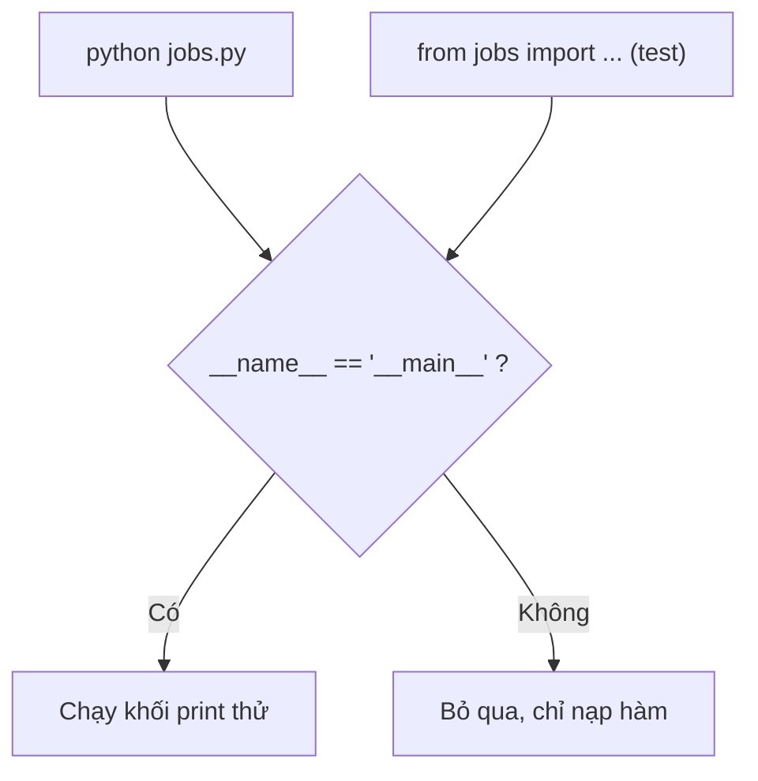
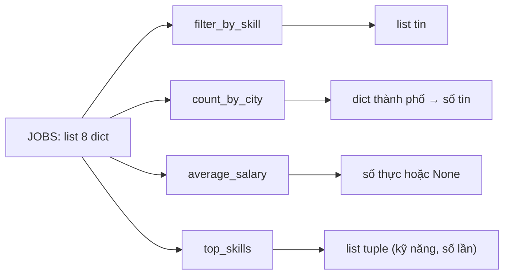
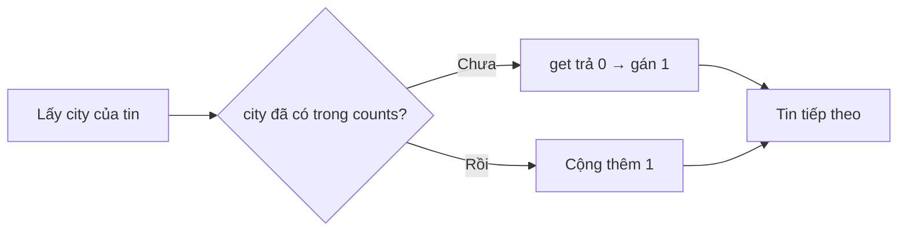

# L01 — Python cơ bản qua dữ liệu tuyển dụng

> Viết 4 hàm Python trả lời 4 câu hỏi cơ bản về 8 tin tuyển dụng mẫu: lọc theo kỹ năng, đếm theo thành phố, lương trung bình, kỹ năng phổ biến.

## 🎯 Mục tiêu

Sau buổi này (khoảng 3 giờ) bạn sẽ:

- Viết được Python cơ bản: biến, hàm, vòng lặp.
- Dùng **list** (dãy có thứ tự) và **dict** (bảng tra key → value).
- Viết **list comprehension** để lọc dữ liệu.
- Xử lý giá trị thiếu **`None`** mà không làm chương trình sập.
- **Kết quả đo được:** 4 hàm trong `jobs.py` qua hết **15 test**.

> 🧠 **Ghi nhớ:** Gần như mọi thư viện AI và Data (pandas, PyTorch, SDK của LLM…) viết cho Python trước tiên. Phỏng vấn AI/Data intern gần như chắc chắn hỏi Python.

## 📋 Đề bài

**Mở file:** `academy/workspace/L01-python-co-ban/jobs.py`.

Trong file có biến `JOBS` — 8 tin tuyển dụng, mỗi tin là một dict. Bạn viết 4 hàm (thay chỗ `raise NotImplementedError`). Docstring dưới mỗi `def` ghi rõ yêu cầu.

| Hàm | Ví dụ với `JOBS` |
|---|---|
| `filter_by_skill(jobs, skill)` | `"llm"` → 2 tin (VNG, Zalo) |
| `count_by_city(jobs)` | `{"Hà Nội": 2, "Hồ Chí Minh": 5, "Đà Nẵng": 1}` |
| `average_salary(jobs)` | `12.0` |
| `top_skills(jobs, n=3)` | `[("python", 6), ("sql", 4), ("llm", 2)]` |

**Xong khi:** bấm **Chạy test** thấy `15 passed`.

## 🤔 Tại sao? (kiến thức nền)

### Python đọc như tiếng Anh

Python ưu tiên code dễ đọc: **thụt lề là cú pháp** và lỗi kiểu dữ liệu được báo ngay chứ không âm thầm sai.

Khối lệnh xác định bằng thụt lề 4 dấu cách, không dùng `{ }`. `"5" + 2` báo `TypeError` — lỗi lộ sớm thì dễ sửa.

| Việc | Cú pháp |
|---|---|
| Gán biến, chuỗi chèn giá trị | `x = 5` · `f"Xin chào {name}"` |
| Rỗng / đúng sai | `None` · `True` / `False` |
| Độ dài, có trong không | `len(x)` · `x in arr` |
| Cắt list | `arr[:3]` · `arr[-1]` |
| Hàm, hàm một dòng | `def f(a, b=2):` · `lambda x: x * 2` |
| Vòng lặp | `for x in arr:` · `for i in range(5):` |

### list, dict, tuple

**list** là dãy có thứ tự, **dict** là bảng tra `key → value`, **tuple** là list không sửa được.

Ví dụ: `["Python", "SQL"]` · `{"city": "Hà Nội"}` · `("python", 6)`.

Dict là **hash table**: key được băm thành số chỉ thẳng tới ô nhớ, nên tra cứu gần như tức thì (O(1)) dù có 10 hay 10 triệu key. Vì vậy "đếm theo nhóm" luôn dùng dict.

> ⚠️ **Lỗi hay gặp:** viết `job.city` → `AttributeError: 'dict' object has no attribute 'city'`. Với dict phải viết `job["city"]`.

### None và dữ liệu thiếu

Dữ liệu thật luôn thiếu. Quy tắc vàng: **quyết định rõ ràng** khi gặp `None` — bỏ qua, thay mặc định, hay báo lỗi.

- `10 + None` → `TypeError`: Python dừng lại thay vì cho số sai.
- Bỏ qua `None` thì chia cho số phần tử **còn lại**; không còn gì → trả `None`.

> 💡 **Mẹo:** viết `x is None`, không viết `x == None`. `None` chỉ có một bản duy nhất; `is` so đúng "chính nó".

### Comprehension

Comprehension là cách viết một dòng để **tạo list mới từ list cũ**, có thể kèm điều kiện lọc.

`[x * 2 for x in nums if x > 0]` đọc là: "lấy `x * 2` với mỗi `x` trong `nums` nếu `x > 0`". Nó **không sửa list gốc** — thói quen quan trọng trong Data Engineering.

### Module và `__main__`

Mỗi file `.py` là một **module**; khối `if __name__ == "__main__":` chỉ chạy khi bạn gõ trực tiếp `python jobs.py`.

Khi test `import` file, `__name__` là `"jobs"` nên khối đó bị bỏ qua — `print` thử nghiệm không làm ồn lúc chạy test.



## 🛠️ Làm

Toàn cảnh: 4 hàm cùng nhận `JOBS` và trả về 4 kiểu kết quả khác nhau.



### Bước 1 — Chuẩn bị

Kiểm tra `python3 --version` (cần 3.10+; Windows dùng `python --version`). Mở thư mục `academy/workspace/L01-python-co-ban/` bằng VS Code, cài extension **Python** của Microsoft. Chạy `python3 jobs.py` (Windows PowerShell: `python jobs.py`).

> ⚠️ **Lỗi hay gặp:** thấy `NotImplementedError: TODO...` — bình thường! Các hàm chưa được viết.

### Bước 2 — Làm quen với dict

Một tin tuyển dụng là một dict. Thử với dữ liệu khác — một khóa học:

```python
course = {"name": "SQL cơ bản", "tags": ["SQL", "Data"], "price": 300}
print(course["name"])
print(course["tags"][0])
print(course.get("rating", "chưa có"))
```
```output
SQL cơ bản
SQL
chưa có
```

`d["key"]` báo lỗi nếu thiếu key; `d.get("key", mặc_định)` thì không.

### Bước 3 — Lọc bằng comprehension → `filter_by_skill`

Lọc các khóa học có tag `"data"`, không phân biệt hoa thường:

```python
courses = [
    {"name": "SQL cơ bản", "tags": ["SQL", "Data"]},
    {"name": "Vẽ tranh", "tags": ["Art"]},
    {"name": "Pandas", "tags": ["python", "data"]},
]
picked = [c["name"] for c in courses if "data" in [t.lower() for t in c["tags"]]]
print(picked)
```
```output
['SQL cơ bản', 'Pandas']
```

Giờ áp dụng cho `jobs` và `skill`. Nhớ: kết quả là **list các tin** (dict), không phải list tên.

> 💡 **Mẹo:** gọi `.lower()` cho **cả hai vế** — tin của Grab viết `"python"` thường.

### Bước 4 — Đếm bằng dict → `count_by_city`

Mẫu "đếm theo nhóm" dùng `get(key, 0) + 1`:

```python
colors = ["đỏ", "xanh", "đỏ", "vàng", "đỏ"]
counts = {}
for c in colors:
    counts[c] = counts.get(c, 0) + 1
print(counts)
```
```output
{'đỏ': 3, 'xanh': 1, 'vàng': 1}
```



### Bước 5 — Bỏ qua None → `average_salary`

Lọc `None` trước, rồi mới cộng:

```python
scores = [8, None, 6, 9, None]
valid = [s for s in scores if s is not None]
print(valid, len(valid))
print(sum(valid) / len(valid))
print(round(7.666, 1))
```
```output
[8, 6, 9] 3
7.666666666666667
7.7
```

> ⚠️ **Lỗi hay gặp:** list rỗng → `ZeroDivisionError`. Kiểm tra `if not valid:` trước và trả `None`.

### Bước 6 — Đếm lồng nhau và sắp xếp → `top_skills`

Đếm giống Bước 4 nhưng hai vòng `for` lồng nhau (tin → kỹ năng), nhớ `.lower()`. Sau đó sắp xếp bằng `key=`:

```python
counts = {"go": 2, "rust": 5, "c": 2}
ranked = sorted(counts.items(), key=lambda kv: (-kv[1], kv[0]))
print(ranked)
print(ranked[:2])
```
```output
[('rust', 5), ('c', 2), ('go', 2)]
[('rust', 5), ('c', 2)]
```

`-kv[1]`: số lần lớn đứng trước. `kv[0]`: hòa thì xếp tên A→Z.

### Bước 7 — Chạy toàn bộ

Chạy `python3 jobs.py` → 4 dòng kết quả khớp bảng Đề bài. Rồi bấm **Chạy test**.

> 💡 **Mẹo:** còn thời gian? Viết thêm `cities_hiring(jobs, skill)` trả về **`set`** các thành phố có tin cần kỹ năng đó.

## ✅ Tự kiểm tra

Bấm **Chạy test**, hoặc từ thư mục `academy/`:

```bash
PYTHONPATH=workspace/L01-python-co-ban python3 -m pytest curriculum/L01-python-co-ban/tests -q
```

> 💡 **Mẹo:** Windows PowerShell: `$env:PYTHONPATH="workspace\L01-python-co-ban"; python -m pytest curriculum\L01-python-co-ban\tests -q`

Mục tiêu: `15 passed`. Test fail → đọc dòng `AssertionError:`, thông báo tiếng Việt gợi ý chỗ sửa.

> 🧠 **Ghi nhớ:** mỗi hàm `test_...` trong pytest là một kịch bản; `assert điều_kiện, "thông báo"` fail khi điều kiện sai. Mở file test ra đọc cũng là cách học tốt.

- [ ] Tôi giải thích được vì sao `job.city` lỗi còn `job["city"]` thì không.
- [ ] Tôi viết được `[x * 2 for x in nums if x > 0]` mà không nhìn tài liệu.
- [ ] Tôi biết khi nào dùng `d["key"]`, khi nào dùng `d.get("key", mặc_định)`.
- [ ] Tôi giải thích được vì sao `average_salary` không chia cho `len(jobs)`.

## 🎤 Câu hỏi phỏng vấn

Tập trả lời thành tiếng, mỗi câu 30–60 giây, rồi luyện ở tab **Phỏng vấn thử**.

1. List và tuple trong Python khác nhau thế nào? Khi nào dùng tuple?
2. List comprehension là gì? Viết một ví dụ lọc các số chẵn và bình phương chúng.
3. Dict trong Python hoạt động thế nào? Vì sao tra cứu theo key lại nhanh (gần O(1))?
4. `is` và `==` khác nhau thế nào? Vì sao nên viết `x is None` thay vì `x == None`?
5. Mutable và immutable là gì? Chuyện gì xảy ra nếu dùng list làm giá trị mặc định của tham số (`def f(x=[])`)?
6. `if __name__ == "__main__":` dùng để làm gì?
7. Khi dữ liệu có giá trị thiếu (`None`), bạn xử lý thế nào? Nêu 3 lựa chọn và khi nào dùng từng cái.

> 🎯 **Phỏng vấn hay hỏi:** câu 5 — thử chạy `def f(x=[]): x.append(1); return x` rồi gọi `f()` ba lần. Kết quả bất ngờ sẽ giúp bạn nhớ mãi.
