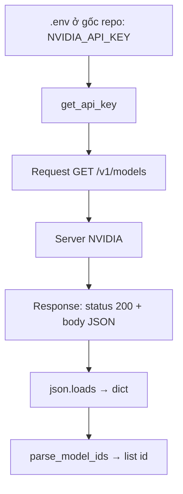
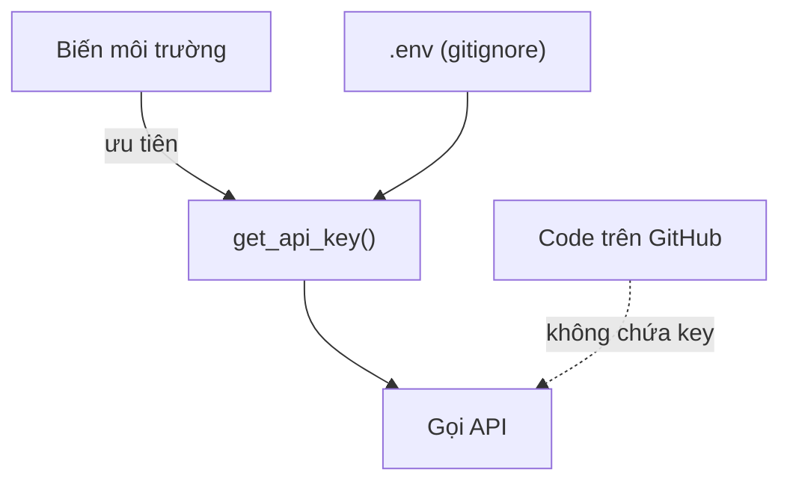
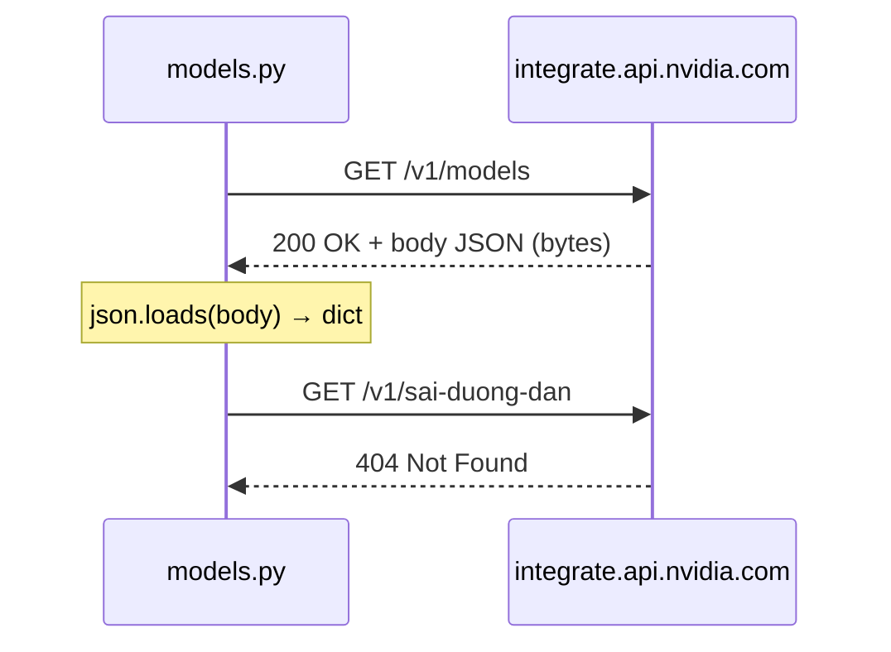
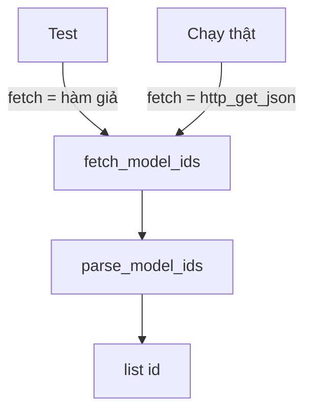

# L02 — HTTP, JSON, venv, .env: gọi API NVIDIA

> Cất API key an toàn trong `.env`, gọi HTTP API của build.nvidia.com và lọc danh sách model JobRadar có thể dùng.

## 🎯 Mục tiêu

Sau buổi này (khoảng 3,5 giờ) bạn sẽ:

- Tạo và dùng **venv** (hộp thư viện riêng cho project), cài thư viện bằng **pip** (công cụ cài thư viện).
- Cất **API key** (mật khẩu riêng để gọi dịch vụ) trong file **`.env`**, không bao giờ để trong code.
- Hiểu **HTTP API** (cách hai chương trình hỏi–đáp qua mạng) và đọc được **JSON** (dữ liệu dạng văn bản).
- Viết code **test được mà không cần mạng** nhờ truyền hàm làm tham số.
- **Kết quả đo được:** `models.py` qua hết **15 test** offline (không cần mạng) và chạy thật in ra danh sách model NVIDIA.

## 📋 Đề bài

**Mở file:** `academy/workspace/L02-http-json-venv-env/models.py`.

Hàm `http_get_json(url)` đã viết sẵn. Bạn viết 6 hàm (thay chỗ `raise NotImplementedError`); docstring ghi rõ yêu cầu. Địa chỉ API (endpoint) công khai, không cần key: `https://integrate.api.nvidia.com/v1/models` — mở bằng trình duyệt trước để xem JSON thật.

| Hàm | Trả về |
|---|---|
| `read_env_file(path)` | dict `{TÊN: giá_trị}` từ file `.env` |
| `get_api_key(env_path, environ)` | `NVIDIA_API_KEY`: biến môi trường trước, `.env` sau |
| `parse_model_ids(payload)` | list id model A→Z; JSON lạ → `ValueError` |
| `fetch_model_ids(fetch, url)` | gọi `fetch(url)` rồi `parse_model_ids` |
| `group_by_publisher(model_ids)` | dict nhóm theo hãng (phần trước `/`) |
| `filter_by_keyword(model_ids, keyword)` | list id chứa từ khóa |

**Xong khi:** bấm **Chạy test** thấy `15 passed`, và `python models.py nemotron` in ra danh sách model.

## 🤔 Tại sao? (kiến thức nền)

### Hiểu trước khi làm

**Bối cảnh.** Chương trình của bạn cần dữ liệu nằm trên máy của người khác — ở bài này là danh sách model AI của NVIDIA. Hai máy cần một cách hỏi–đáp chung qua mạng (**HTTP API**) và một kiểu viết dữ liệu mà bên nào cũng đọc được (**JSON**). Dịch vụ tính tiền thì phải biết ai đang gọi, nên bạn gửi kèm một mật khẩu riêng (**API key**) — thứ tuyệt đối không được lộ. Cuối cùng, mỗi project cần bộ thư viện riêng để không giẫm chân nhau (**venv**).

**Ví dụ đời thường.**
- **HTTP API** giống gọi món ở quầy: bạn đưa phiếu order (request), quầy trả khay đồ ăn (response) kèm câu trả lời ngắn — "có ngay" (200), "không có món này" (404), "đông quá, đợi chút" (429).
- **JSON** là phiếu order in sẵn theo mẫu: ô nào ghi gì đều cố định, ai cầm cũng đọc được.
- **API key** giống thẻ thành viên quẹt khi gọi món: rơi thẻ là người khác tiêu tiền của bạn. File **`.env`** là ngăn kéo có khóa ở nhà để cất thẻ — bạn chia sẻ code, không chia sẻ ngăn kéo.
- **venv** là hộp dụng cụ riêng cho từng công trình: thay ốc vít hộp này không ảnh hưởng hộp kia.

**Bạn đã gặp nó ở đâu.**
- App thời tiết trên điện thoại hỏi một API để lấy nhiệt độ hôm nay.
- Grab, Be hiện bản đồ nhờ gọi API bản đồ, kèm API key của công ty.
- Shop online nhận thanh toán MoMo, VNPay: cửa hàng được cấp mã bí mật để gọi API thanh toán.
- Mở trình duyệt, bấm F12 → tab Network trên Shopee: mỗi dòng là một request, bấm vào thấy response JSON.

| | HTTP API và JSON | API key, `.env`, venv |
|---|---|---|
| **What** — là gì? | HTTP API: server trả dữ liệu thay vì trang web. JSON: văn bản có dạng giống dict/list. | API key: chuỗi bí mật định danh người gọi. `.env`: file chứa secret, nằm ngoài git. venv: thư mục chứa Python và thư viện riêng của một project. |
| **Why** — vì sao cần? | Gần như mọi dịch vụ AI, thanh toán, bản đồ đều mở cửa qua HTTP API và trả JSON. | Key lộ là mất tiền, bị lạm dụng. Thư viện cài chung dễ xung đột phiên bản. |
| **When** — khi nào dùng? | Khi cần dữ liệu hoặc tính năng từ hệ thống khác. | Mọi project có secret hoặc cài thư viện ngoài. |
| **When not** — khi nào không? | Dữ liệu đã có sẵn trên máy (file, DB) thì đọc thẳng, khỏi gọi mạng. Test không nên gọi API thật. | Không dán key vào code, chat, ảnh chụp. Không `pip install` thẳng vào Python hệ thống. |
| **Where** — ở đâu? | `models.py` gọi `https://integrate.api.nvidia.com/v1/models`. | Key trong `.env` ở gốc repo; venv chung ở `.venv` gốc repo. |
| **How** — chạy thế nào? | Gửi request (method, URL, header) → nhận response (status code + body) → `json.loads` thành dict. | Code đọc key từ biến môi trường hoặc `.env` lúc chạy; kích hoạt venv thì `python`, `pip` trỏ vào hộp riêng. |

**Từ mới trong bài**

| Thuật ngữ | Nghĩa đời thường |
|---|---|
| HTTP | Bộ quy tắc trình duyệt và server dùng để hỏi–đáp qua mạng |
| API, endpoint | Cửa giao tiếp giữa hai chương trình; endpoint là một địa chỉ cụ thể của cửa đó |
| server | Máy (hoặc chương trình) nhận request và trả kết quả |
| URL | Địa chỉ đầy đủ, vd. `https://.../v1/models` |
| request / response | Lượt hỏi đi / lượt trả lời về |
| method GET / POST | GET = xin dữ liệu; POST = gửi dữ liệu lên |
| header | Dòng thông tin kèm request, vd. `Authorization: Bearer <key>` |
| body | Phần nội dung chính của request/response |
| status code | Mã 3 chữ số báo kết quả: 200 ổn, 4xx lỗi phía bạn, 5xx lỗi phía server |
| JSON, parse | Văn bản dạng dict/list; parse = đọc văn bản đó thành dict Python (`json.loads`) |
| bytes | Dữ liệu thô từ mạng, chưa phải chuỗi chữ |
| thư viện (package), pip | Code người khác viết sẵn; pip là công cụ tải và cài thư viện |
| venv, kích hoạt (activate) | Hộp Python riêng của project; kích hoạt = bắt đầu dùng hộp đó |
| `requirements.txt` | Danh sách thư viện project cần |
| interpreter | Chương trình Python thực sự chạy code; VS Code cần biết dùng bản nào |
| API key, secret | Mật khẩu riêng để gọi dịch vụ; secret = mọi thông tin phải giấu |
| biến môi trường | Giá trị hệ điều hành cấp cho chương trình lúc chạy, không nằm trong code |
| git, commit, `.gitignore` | git lưu lịch sử code; commit = một lần lưu; `.gitignore` = danh sách file git bỏ qua |
| offline | Chạy không cần mạng |
| dependency injection | Truyền "cách làm" (vd. hàm gọi mạng) vào hàm làm tham số, để test thay bằng bản giả |
| `ValueError`, `RuntimeError` | Hai loại lỗi có sẵn: giá trị sai / không thể chạy tiếp |
| `isinstance(x, list)` | Hỏi "x có phải list không?" |
| generator expression | Vòng lặp viết trong `( )`, đưa từng giá trị cho hàm khác mà không dựng list |
| `tmp_path` | Thư mục tạm pytest tạo cho mỗi test |



### Virtual environment (venv)

venv là một thư mục (thường tên `.venv`) chứa bản Python và thư viện **riêng cho một project**, để các project không phá nhau.

Project A cần `openai` 1.x, project B cần 2.x — cài chung thì cài cho B làm hỏng A. Tệ hơn, Ubuntu có công cụ hệ thống viết bằng Python; cài đè có thể hỏng cả máy. Vì vậy Ubuntu/Debian mới chặn `pip install` ngoài venv bằng lỗi `externally-managed-environment`.

| Việc | Lệnh |
|---|---|
| Tạo venv | `python3 -m venv .venv` |
| Kích hoạt | `source .venv/bin/activate` (Windows: `.venv\Scripts\activate`) |
| Cài từ danh sách | `pip install -r requirements.txt` |

> ⚠️ **Lỗi hay gặp:** quên kích hoạt venv → `python` vẫn là bản hệ thống, `import openai` báo `ModuleNotFoundError`.

### .env và biến môi trường

**Code thì chia sẻ được, secret thì không.** Key nằm trong biến môi trường hoặc file `.env` (đã thêm vào `.gitignore`), không bao giờ trong code.

Bot quét GitHub tìm chuỗi như `nvapi-`, `sk-` liên tục; key lộ có thể bị dùng sau vài phút. Xóa commit **không** cứu được — lịch sử git và bản fork vẫn còn.

Trên server, hệ thống deploy (Docker, cloud) đặt biến môi trường; trên máy dev ta dùng `.env` cho tiện. Vì thế `get_api_key` **ưu tiên biến môi trường** rồi mới tới `.env`: cùng code chạy được ở cả hai nơi.



### HTTP API

Request gồm **method** (GET = lấy, POST = gửi), **URL**, **headers** (ví dụ `Authorization: Bearer <key>`) và **body** (với POST).



| Code | Nghĩa | Nên làm gì |
|---|---|---|
| 200 | OK | Đọc body |
| 400 / 404 | Request sai / sai URL | Sửa request |
| 401 | Thiếu hoặc sai key | Kiểm tra `.env` |
| 429 | Gọi quá nhanh (~40/phút) | Chờ rồi thử lại |
| 500 / 503 | Lỗi phía server | Thử lại sau |

### JSON ↔ dict

- `json.loads(chuỗi)` → dict/list Python; `json.dumps(dict)` → chuỗi.
- `ensure_ascii=False` giữ tiếng Việt có dấu.
- JSON `true/false/null` ↔ Python `True/False/None`.

> ⚠️ **Lỗi hay gặp:** dữ liệu từ mạng là **bytes**. Gọi `body["data"]` trước khi `json.loads` → `TypeError: byte indices must be integers or slices, not str`.

### Dependency injection

Hàm **nhận "cách gọi mạng" làm tham số** thay vì tự gọi, nên test truyền hàm giả vào và chạy không cần mạng.

Test gọi mạng thật thì chậm, mất wifi là fail, dữ liệu thay đổi, và với API trả phí thì tốn tiền. Trong Python hàm cũng là giá trị — truyền hàm như truyền số. `get_api_key(environ=...)` cùng ý tưởng. Bài L03 dùng lại mẹo này để test code gọi LLM mà không tốn token nào.

> 🎯 **Phỏng vấn hay hỏi:** "Làm sao test hàm gọi API bên ngoài?" → inject hàm/client giả, test nhanh, ổn định, không tốn tiền.

## 🛠️ Làm

### Bước 1 — Hiểu và kích hoạt venv

Khi chạy `setup` ở thư mục gốc repo, bạn đã có sẵn một venv dùng chung cho mọi bài tại `.venv` (đã cài `pytest`, `openai`, `pandas`...). Bạn **không cần tạo venv thứ hai**; chỉ cần kích hoạt nó. Từ thư mục gốc repo:

```bash
source .venv/bin/activate
# Windows PowerShell: .venv\Scripts\Activate.ps1
```

Đầu dòng lệnh hiện `(.venv)`. Trong VS Code: `Ctrl+Shift+P` → **Python: Select Interpreter** → chọn `.venv` của repo.

Để hiểu venv được sinh ra thế nào, đây là cách tạo một venv mới ở bất kỳ project nào (chỉ để biết, **đừng chạy lại** ở repo này):

```bash
python3 -m venv .venv            # Windows: python -m venv .venv
pip install -r requirements.txt  # cài theo danh sách; ghi lại bằng: pip freeze > requirements.txt
```

> 💡 **Mẹo:** Windows PowerShell chặn script kích hoạt? Chạy một lần `Set-ExecutionPolicy -Scope CurrentUser RemoteSigned`, rồi mở lại terminal.

Python tự biết mình có đang ở trong venv không:

```python
import sys
print(sys.prefix != sys.base_prefix)
```
```output
False
```

Ngoài venv in `False`; sau khi kích hoạt, chạy lại sẽ in `True`.

Ghi `pytest` và `openai` vào `workspace/L02-http-json-venv-env/requirements.txt` để tập viết danh sách phụ thuộc.

### Bước 2 — Lấy API key, điền `.env` ở gốc repo

1. Vào https://build.nvidia.com → chọn một model → **Get API Key** → copy chuỗi `nvapi-...`.
2. Mở `.env` ở **gốc repo** (setup đã tạo từ `.env.example`; chưa có thì tạo) và thay dòng `NVIDIA_API_KEY=nvapi-...` bằng key thật. Đây là nơi duy nhất chứa key — mọi bài đều đọc file này.
3. Từ gốc repo, xem vì sao git bỏ qua file này:

```bash
git check-ignore -v .env
```
```output
.gitignore:1:.env	.env
```

Nghĩa là: dòng 1 của `.gitignore` (mẫu `.env`) khớp file `.env`. Không in gì → file **chưa** bị bỏ qua, đừng commit.

> ⚠️ **Lỗi hay gặp:** dán key vào chat, ảnh chụp màn hình hay tin nhắn — kể cả cho gia sư AI. Đừng bao giờ.

Muốn kiểm tra key mà không lộ, chỉ in vài ký tự đầu:

```python
key = "nvapi-AbCdEf1234567890"
print(key[:8] + "...", len(key), "ký tự")
```
```output
nvapi-Ab... 22 ký tự
```

### Bước 3 — Tách dòng `TÊN=giá_trị` → `read_env_file`

Kỹ thuật tách chuỗi, thử trên một đoạn text (bạn sẽ đọc từ file thật):

```python
text = """
# cấu hình
MODE = dev
URL="https://x.vn/?a=1"
"""
for line in text.splitlines():
    line = line.strip()
    if not line or line.startswith("#"):
        continue
    name, value = line.split("=", 1)
    print(repr(name.strip()), repr(value.strip().strip('"')))
```
```output
'MODE' 'dev'
'URL' 'https://x.vn/?a=1'
```

`split("=", 1)` chỉ tách ở dấu `=` **đầu tiên**, nên URL chứa `=` vẫn nguyên.

> 💡 **Mẹo:** file không tồn tại → trả `{}`. Kiểm tra bằng `os.path.exists(path)`; mở file bằng `open(path, encoding="utf-8")`.

### Bước 4 — Biến môi trường giả → `get_api_key`

`environ` chỉ là một dict. Test truyền dict giả, chạy thật thì dùng `os.environ`:

```python
fake_environ = {"HOME": "/home/an", "TOKEN": ""}
print(fake_environ.get("TOKEN"))
print(fake_environ.get("NVIDIA_API_KEY"))
print(bool(""), bool("nvapi-x"))
```
```output

None
False True
```

Chuỗi rỗng `""` được coi như "không có". Không tìm thấy key ở đâu → `raise RuntimeError(...)` có chữ `NVIDIA_API_KEY`.

### Bước 5 — Đọc JSON an toàn → `parse_model_ids`

Thử với một JSON khác hình dạng — danh sách sách:

```python
import json
body = b'{"items": [{"name": "Zen"}, {"name": "Atomic"}], "ok": true}'
data = json.loads(body)
print(type(data).__name__, data["ok"])
print(isinstance(data.get("items"), list))
```
```output
dict True
True
```

Lấy tên sách và xếp A→Z:

**Cách 1 — vòng lặp for, rồi `sorted()`**

```python
names = []
for item in data["items"]:
    names.append(item["name"])
print(sorted(names))
```
```output
['Atomic', 'Zen']
```

**Cách 2 — generator expression**

```python
print(sorted(item["name"] for item in data["items"]))
```
```output
['Atomic', 'Zen']
```

`item["name"] for item in ...` đặt trong `sorted(...)` giống list comprehension (L01) nhưng không có `[ ]`: nó đưa từng tên cho `sorted` mà không dựng list `names` riêng.

> ⚖️ **So sánh:** cùng O(n log n) (phần tốn nhất là sắp xếp), chỉ gọn hơn. `sorted` vẫn tạo list kết quả nên không tiết kiệm bộ nhớ đáng kể.

API trả về `{"data": [{"id": ...}, ...]}`. Kiểm tra `isinstance` trước; sai hình dạng → `raise ValueError`.

### Bước 6 — Truyền hàm làm tham số → `fetch_model_ids`

Hàm `count_items` dưới đây không tự gọi mạng; nó gọi **cái hàm được truyền vào**:

```python
def count_items(fetch, url):
    data = fetch(url)
    return len(data["items"])

def fake_fetch(url):
    print("giả gọi", url)
    return {"items": [1, 2, 3]}

print(count_items(fake_fetch, "https://vi-du.vn/api"))
```
```output
giả gọi https://vi-du.vn/api
3
```



> ⚠️ **Lỗi hay gặp:** gọi thẳng `http_get_json(...)` trong hàm thay vì gọi tham số `fetch` → test không kiểm soát được.

### Bước 7 — Nhóm và lọc → `group_by_publisher`, `filter_by_keyword`

`setdefault` nghĩa là "chưa có key thì tạo list rỗng, rồi thêm vào":

```python
fruits = ["cam", "chuối", "bưởi", "chanh"]
groups = {}
for f in fruits:
    groups.setdefault(f[0], []).append(f)
print(groups)
print("meta/llama-3".split("/", 1)[0])
```
```output
{'c': ['cam', 'chuối', 'chanh'], 'b': ['bưởi']}
meta
```

Nhớ: id không có `/` → nhóm `"unknown"`; mỗi nhóm sắp xếp A→Z.

### Bước 8 — Chạy thật

```bash
cd academy/workspace/L02-http-json-venv-env
python models.py nemotron
```

Dòng đầu in 8 ký tự đầu của key đọc từ `.env` gốc repo (qua `get_api_key` của bạn) — thấy `nvapi-...` 9 ký tự là chưa thay key thật. Sau đó là tổng số model, 5 hãng nhiều model nhất và các id chứa "nemotron". Số lượng đổi theo thời gian — chính vì thế test không dựa vào dữ liệu thật.

> 💡 **Mẹo:** còn thời gian? Thêm cờ `--json` in kết quả `group_by_publisher` bằng `json.dumps(..., indent=2, ensure_ascii=False)`.

## ✅ Tự kiểm tra

Bấm **Chạy test**, hoặc từ thư mục `academy/`:

```bash
PYTHONPATH=workspace/L02-http-json-venv-env python3 -m pytest curriculum/L02-http-json-venv-env/tests -q
```

> 💡 **Mẹo:** Windows PowerShell: `$env:PYTHONPATH="workspace\L02-http-json-venv-env"; python -m pytest curriculum\L02-http-json-venv-env\tests -q`

Mục tiêu: `15 passed`. Thử tắt wifi rồi chạy lại — vẫn pass, đó là sức mạnh của dependency injection.

> 🧠 **Ghi nhớ:** test dùng `tmp_path` (thư mục tạm pytest tạo cho mỗi test) để viết `.env` giả, nên không đụng tới `.env` thật của bạn.

## 🎤 Câu hỏi phỏng vấn

> 🎯 **Phỏng vấn hay hỏi:** câu 2 — trả lời tốt có đủ 3 ý: **thu hồi (revoke) key ngay** và tạo key mới; xóa khỏi lịch sử git là chưa đủ vì key đã coi như lộ; phòng ngừa bằng `.gitignore`, biến môi trường, công cụ quét secret trước khi commit.
