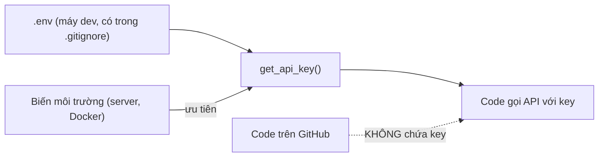
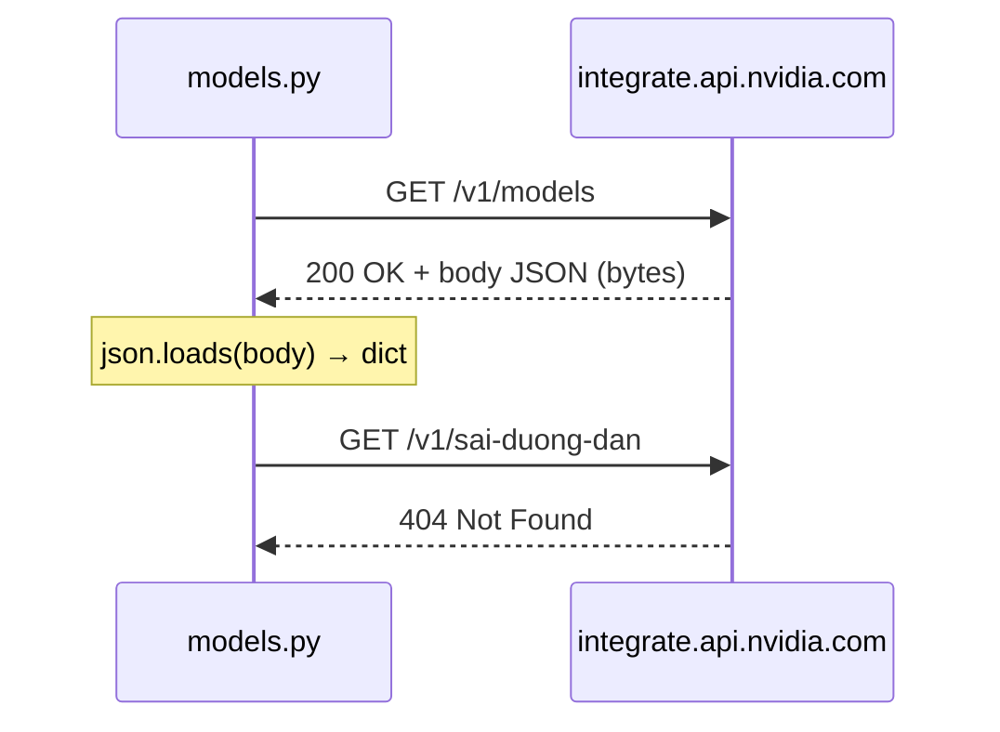
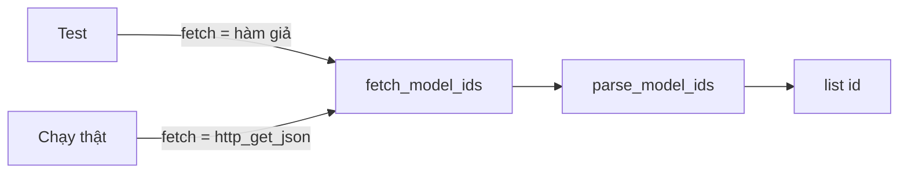

# L02 — HTTP, JSON, venv, .env: gọi API NVIDIA

> Cất API key an toàn trong `.env`, gọi HTTP API của build.nvidia.com và lọc danh sách model JobRadar có thể dùng.

## 🎯 Mục tiêu

Sau buổi này (khoảng 3 giờ) bạn sẽ:

- Tạo và dùng **venv** (hộp thư viện riêng cho project), cài thư viện bằng **pip**.
- Cất **API key** trong file **`.env`**, không bao giờ để trong code.
- Hiểu **HTTP API** (request, response, status code) và đọc được **JSON**.
- Viết code **test được mà không cần mạng** nhờ truyền hàm làm tham số.
- **Kết quả đo được:** `models.py` qua hết **15 test** offline và chạy thật in ra danh sách model NVIDIA.

## 📋 Đề bài

**Mở file:** `academy/workspace/L02-http-json-venv-env/models.py`.

Hàm `http_get_json(url)` đã viết sẵn. Bạn viết 6 hàm (thay chỗ `raise NotImplementedError`); docstring ghi rõ yêu cầu. Endpoint công khai, không cần key: `https://integrate.api.nvidia.com/v1/models` — mở bằng trình duyệt trước để xem JSON thật.

| Hàm | Trả về |
|---|---|
| `read_env_file(path)` | dict `{TÊN: giá_trị}` từ file `.env` |
| `get_api_key(env_path, environ)` | `NVIDIA_API_KEY`: biến môi trường trước, `.env` sau |
| `parse_model_ids(payload)` | list id model A→Z; JSON lạ → `ValueError` |
| `fetch_model_ids(fetch, url)` | gọi `fetch(url)` rồi `parse_model_ids` |
| `group_by_publisher(model_ids)` | dict nhóm theo hãng (phần trước `/`) |
| `filter_by_keyword(model_ids, keyword)` | list id chứa từ khóa |

**Xong khi:** bấm **Chạy test** thấy `15 passed`, và `python models.py nemotron` in ra danh sách model.

## 🤔 Tại sao? (kiến thức nền)

### Virtual environment (venv)

venv là một thư mục (thường tên `.venv`) chứa bản Python và thư viện **riêng cho một project**, để các project không phá nhau.

Project A cần `openai` 1.x, project B cần 2.x — cài chung thì cài cho B làm hỏng A. Tệ hơn, Ubuntu có công cụ hệ thống viết bằng Python; cài đè có thể hỏng cả máy. Vì vậy Ubuntu/Debian mới chặn `pip install` ngoài venv bằng lỗi `externally-managed-environment`.

| Việc | Lệnh |
|---|---|
| Tạo venv | `python3 -m venv .venv` |
| Kích hoạt | `source .venv/bin/activate` (Windows: `.venv\Scripts\activate`) |
| Cài từ danh sách | `pip install -r requirements.txt` |

> ⚠️ **Lỗi hay gặp:** quên kích hoạt venv → `python` vẫn là bản hệ thống, `import openai` báo `ModuleNotFoundError`.

### .env và biến môi trường

**Code thì chia sẻ được, secret thì không.** Key nằm trong biến môi trường hoặc file `.env` (đã thêm vào `.gitignore`), không bao giờ trong code.

Bot quét GitHub tìm chuỗi như `nvapi-`, `sk-` liên tục; key lộ có thể bị dùng sau vài phút. Xóa commit **không** cứu được — lịch sử git và bản fork vẫn còn.

Trên server, hệ thống deploy (Docker, cloud) đặt biến môi trường; trên máy dev ta dùng `.env` cho tiện. Vì thế `get_api_key` **ưu tiên biến môi trường** rồi mới tới `.env`: cùng code chạy được ở cả hai nơi.



### HTTP API

Một **API** qua HTTP là server trả về dữ liệu (thường là JSON) thay vì trang web. Mỗi lần gọi gồm một **request** đi và một **response** về, kèm **status code**.

Request gồm **method** (GET = lấy, POST = gửi), **URL**, **headers** (ví dụ `Authorization: Bearer <key>`) và **body** (với POST).



| Code | Nghĩa | Nên làm gì |
|---|---|---|
| 200 | OK | Đọc body |
| 400 / 404 | Request sai / sai URL | Sửa request |
| 401 | Thiếu hoặc sai key | Kiểm tra `.env` |
| 429 | Gọi quá nhanh (~40/phút) | Chờ rồi thử lại |
| 500 / 503 | Lỗi phía server | Thử lại sau |

### JSON ↔ dict

**JSON** là **chuỗi văn bản** có cú pháp giống dict — ngôn ngữ chung để các chương trình trao đổi dữ liệu.

- `json.loads(chuỗi)` → dict/list Python; `json.dumps(dict)` → chuỗi.
- `ensure_ascii=False` giữ tiếng Việt có dấu.
- JSON `true/false/null` ↔ Python `True/False/None`.

> ⚠️ **Lỗi hay gặp:** dữ liệu từ mạng là **bytes**. Gọi `body["data"]` trước khi `json.loads` → `TypeError: byte indices must be integers or slices, not str`.

### Dependency injection

Hàm **nhận "cách gọi mạng" làm tham số** thay vì tự gọi, nên test truyền hàm giả vào và chạy không cần mạng.

Test gọi mạng thật thì chậm, mất wifi là fail, dữ liệu thay đổi, và với API trả phí thì tốn tiền. Trong Python hàm cũng là giá trị — truyền hàm như truyền số. `get_api_key(environ=...)` cùng ý tưởng. Bài L03 dùng lại mẹo này để test code gọi LLM mà không tốn token nào.

> 🎯 **Phỏng vấn hay hỏi:** "Làm sao test hàm gọi API bên ngoài?" → inject hàm/client giả, test nhanh, ổn định, không tốn tiền.

## 🛠️ Làm

### Bước 1 — Hiểu và kích hoạt venv

Khi chạy `setup` ở thư mục gốc repo, bạn đã có sẵn một venv dùng chung cho mọi bài tại `.venv` (đã cài `pytest`, `openai`, `pandas`...). Bạn **không cần tạo venv thứ hai**; chỉ cần kích hoạt nó. Từ thư mục gốc repo:

```bash
source .venv/bin/activate
# Windows PowerShell: .venv\Scripts\Activate.ps1
```

Đầu dòng lệnh hiện `(.venv)`. Trong VS Code: `Ctrl+Shift+P` → **Python: Select Interpreter** → chọn `.venv` của repo.

Để hiểu venv được sinh ra thế nào, đây là cách tạo một venv mới ở bất kỳ project nào (chỉ để biết, **đừng chạy lại** ở repo này):

```bash
python3 -m venv .venv            # Windows: python -m venv .venv
pip install -r requirements.txt  # cài theo danh sách; ghi lại bằng: pip freeze > requirements.txt
```

> 💡 **Mẹo:** Windows PowerShell chặn script kích hoạt? Chạy một lần `Set-ExecutionPolicy -Scope CurrentUser RemoteSigned`, rồi mở lại terminal.

Python tự biết mình có đang ở trong venv không:

```python
import sys
print(sys.prefix != sys.base_prefix)
```
```output
False
```

Ngoài venv in `False`; sau khi kích hoạt, chạy lại sẽ in `True`.

Ghi `pytest` và `openai` vào `L02-http-json-venv-env/requirements.txt` để tập viết danh sách phụ thuộc.

### Bước 2 — Lấy API key, tạo `.env`

1. Vào https://build.nvidia.com → chọn một model → **Get API Key** → copy chuỗi `nvapi-...`.
2. Trong `workspace/L02-http-json-venv-env/` tạo file `.env` một dòng: `NVIDIA_API_KEY=nvapi-...`
3. Tạo `academy/workspace/.gitignore` gồm 2 dòng: `.venv/` và `.env` (repo gốc đã có `.gitignore` tương tự; tự tay viết để hiểu vì sao cần).

> ⚠️ **Lỗi hay gặp:** dán key vào chat, ảnh chụp màn hình hay tin nhắn — kể cả cho gia sư AI. Đừng bao giờ.

Muốn kiểm tra key mà không lộ, chỉ in vài ký tự đầu:

```python
key = "nvapi-AbCdEf1234567890"
print(key[:8] + "...", len(key), "ký tự")
```
```output
nvapi-Ab... 22 ký tự
```

### Bước 3 — Tách dòng `TÊN=giá_trị` → `read_env_file`

Kỹ thuật tách chuỗi, thử trên một đoạn text (bạn sẽ đọc từ file thật):

```python
text = """
# cấu hình
MODE = dev
URL="https://x.vn/?a=1"
"""
for line in text.splitlines():
    line = line.strip()
    if not line or line.startswith("#"):
        continue
    name, value = line.split("=", 1)
    print(repr(name.strip()), repr(value.strip().strip('"')))
```
```output
'MODE' 'dev'
'URL' 'https://x.vn/?a=1'
```

`split("=", 1)` chỉ tách ở dấu `=` **đầu tiên**, nên URL chứa `=` vẫn nguyên.

> 💡 **Mẹo:** file không tồn tại → trả `{}`. Kiểm tra bằng `os.path.exists(path)`; mở file bằng `open(path, encoding="utf-8")`.

### Bước 4 — Biến môi trường giả → `get_api_key`

`environ` chỉ là một dict. Test truyền dict giả, chạy thật thì dùng `os.environ`:

```python
fake_environ = {"HOME": "/home/an", "TOKEN": ""}
print(fake_environ.get("TOKEN"))
print(fake_environ.get("NVIDIA_API_KEY"))
print(bool(""), bool("nvapi-x"))
```
```output

None
False True
```

Chuỗi rỗng `""` được coi như "không có". Không tìm thấy key ở đâu → `raise RuntimeError(...)` có chữ `NVIDIA_API_KEY`.

### Bước 5 — Đọc JSON an toàn → `parse_model_ids`

Thử với một JSON khác hình dạng — danh sách sách:

```python
import json
body = b'{"items": [{"name": "Zen"}, {"name": "Atomic"}], "ok": true}'
data = json.loads(body)
print(type(data).__name__, data["ok"])
print(isinstance(data.get("items"), list))
print(sorted(item["name"] for item in data["items"]))
```
```output
dict True
True
['Atomic', 'Zen']
```

API trả về `{"data": [{"id": ...}, ...]}`. Kiểm tra `isinstance` trước; sai hình dạng → `raise ValueError`.

### Bước 6 — Truyền hàm làm tham số → `fetch_model_ids`

Hàm `count_items` dưới đây không tự gọi mạng; nó gọi **cái hàm được truyền vào**:

```python
def count_items(fetch, url):
    data = fetch(url)
    return len(data["items"])

def fake_fetch(url):
    print("giả gọi", url)
    return {"items": [1, 2, 3]}

print(count_items(fake_fetch, "https://vi-du.vn/api"))
```
```output
giả gọi https://vi-du.vn/api
3
```



> ⚠️ **Lỗi hay gặp:** gọi thẳng `http_get_json(...)` trong hàm thay vì gọi tham số `fetch` → test không kiểm soát được.

### Bước 7 — Nhóm và lọc → `group_by_publisher`, `filter_by_keyword`

`setdefault` nghĩa là "chưa có key thì tạo list rỗng, rồi thêm vào":

```python
fruits = ["cam", "chuối", "bưởi", "chanh"]
groups = {}
for f in fruits:
    groups.setdefault(f[0], []).append(f)
print(groups)
print("meta/llama-3".split("/", 1)[0])
```
```output
{'c': ['cam', 'chuối', 'chanh'], 'b': ['bưởi']}
meta
```

Nhớ: id không có `/` → nhóm `"unknown"`; mỗi nhóm sắp xếp A→Z.

### Bước 8 — Chạy thật

```bash
cd academy/workspace/L02-http-json-venv-env
python models.py nemotron
```

Bạn thấy tổng số model, 5 hãng nhiều model nhất và các id chứa "nemotron". Số lượng đổi theo thời gian — chính vì thế test không dựa vào dữ liệu thật.

> 💡 **Mẹo:** còn thời gian? Thêm cờ `--json` in kết quả `group_by_publisher` bằng `json.dumps(..., indent=2, ensure_ascii=False)`.

## ✅ Tự kiểm tra

Bấm **Chạy test**, hoặc từ thư mục `academy/`:

```bash
PYTHONPATH=workspace/L02-http-json-venv-env python3 -m pytest curriculum/L02-http-json-venv-env/tests -q
```

> 💡 **Mẹo:** Windows PowerShell: `$env:PYTHONPATH="workspace\L02-http-json-venv-env"; python -m pytest curriculum\L02-http-json-venv-env\tests -q`

Mục tiêu: `15 passed`. Thử tắt wifi rồi chạy lại — vẫn pass, đó là sức mạnh của dependency injection.

> 🧠 **Ghi nhớ:** test dùng `tmp_path` (thư mục tạm pytest tạo cho mỗi test) để viết `.env` giả, nên không đụng tới `.env` thật của bạn.

- [ ] Tôi giải thích được vì sao `pip install` ngoài venv bị chặn.
- [ ] `git status` **không** liệt kê file `.env` của tôi.
- [ ] Tôi nói được 401 và 429 nghĩa là gì và nên làm gì khi gặp.

## 🎤 Câu hỏi phỏng vấn

1. Virtual environment là gì? Vì sao mỗi project Python nên có venv riêng?
2. Bạn quản lý API key và mật khẩu trong project thế nào? Nếu lỡ commit key lên GitHub thì làm gì?
3. Giải thích các status code 200, 400, 401, 404, 429, 500. Gặp 429 thì xử lý thế nào?
4. GET và POST khác nhau thế nào? Thế nào là một REST API?
5. JSON là gì? `json.loads` và `json.dumps` khác nhau ra sao?
6. Làm sao để test một hàm có gọi API bên ngoài mà không gọi mạng thật?
7. `requirements.txt` dùng để làm gì? Vì sao nên ghim (pin) phiên bản thư viện?

> 🎯 **Phỏng vấn hay hỏi:** câu 2 — trả lời tốt có đủ 3 ý: **thu hồi (revoke) key ngay** và tạo key mới; xóa khỏi lịch sử git là chưa đủ vì key đã coi như lộ; phòng ngừa bằng `.gitignore`, biến môi trường, công cụ quét secret trước khi commit.
