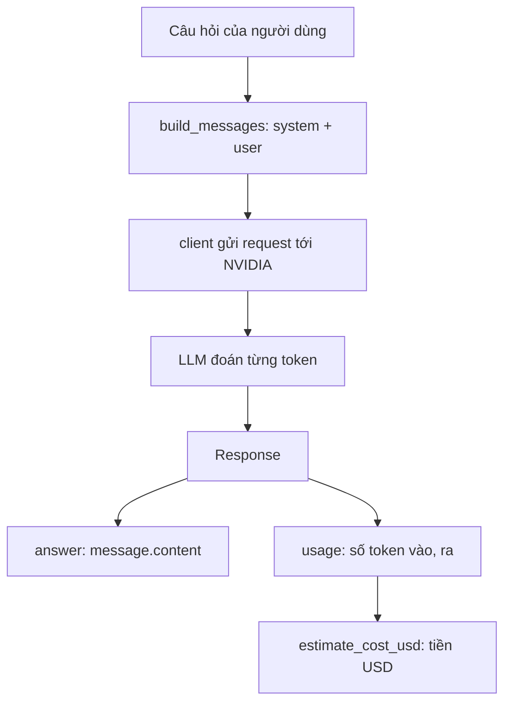
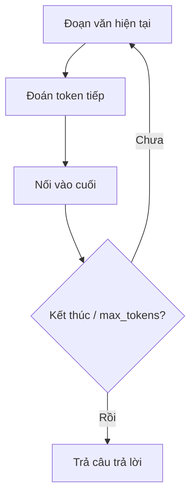
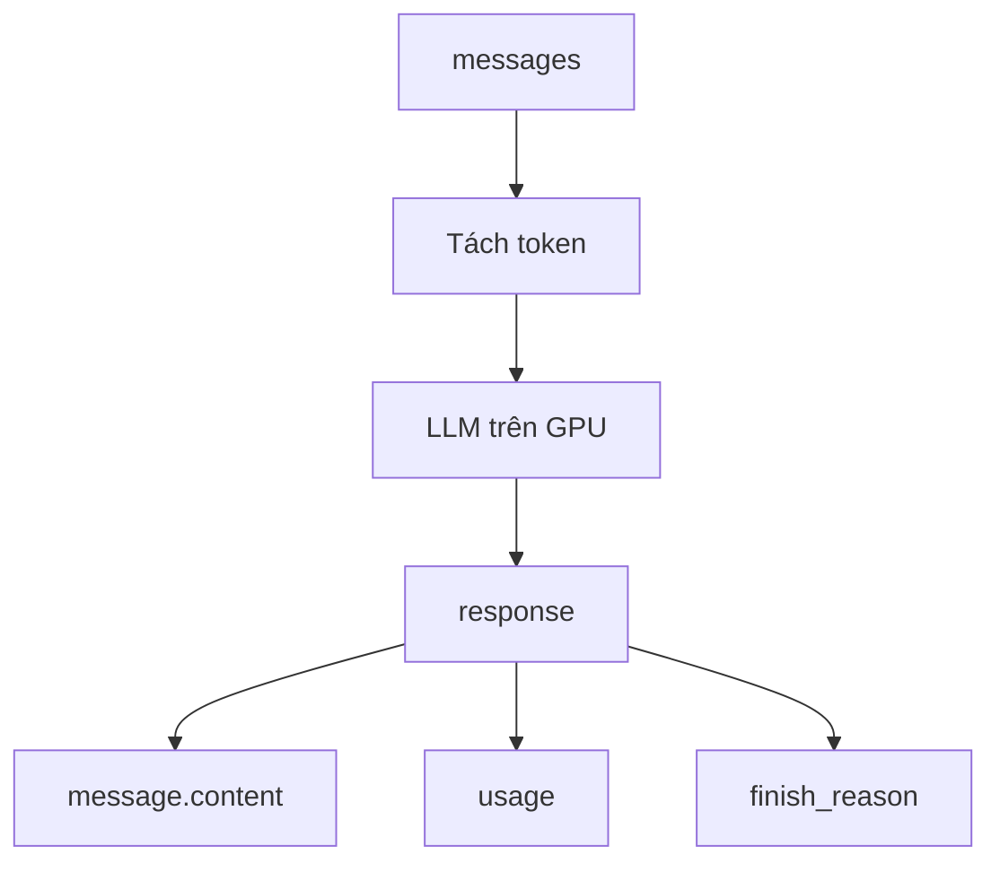

# L03 — Gọi LLM đầu tiên

> Viết hàm `ask()` gửi câu hỏi tới LLM trên build.nvidia.com và nhận câu trả lời **kèm số token đã dùng** — viên gạch nền của chatbot.

## 🎯 Mục tiêu

Sau buổi này (khoảng 3,5 giờ) bạn sẽ:

- Giải thích được **LLM** (mô hình AI sinh văn bản) ở mức trực giác: **dự đoán token (mẩu chữ) tiếp theo**.
- Hiểu **token**, vì sao giá và giới hạn tính theo token, và tự đo: **tiếng Việt tốn token hơn tiếng Anh**.
- Dùng **messages** (danh sách tin nhắn gửi model) với các **role** (ai nói) `system` / `user` / `assistant`.
- Gọi model qua **API tương thích OpenAI** (cùng cách gọi với OpenAI) và đọc trường **`usage`** (số token đã dùng).
- **Kết quả đo được:** `chat.py` qua hết **12 test** (client giả lập, không gọi mạng, không tốn token) và chạy thật trả lời được câu hỏi.

## 📋 Đề bài

**Mở file:** `academy/workspace/L03-goi-llm-dau-tien/chat.py`.

Bạn viết 3 hàm (thay chỗ `raise NotImplementedError`); docstring ghi rõ yêu cầu. Phần tạo client thật (`make_client`) đã viết sẵn. Model mặc định: `nvidia/nemotron-3-super-120b-a12b`.

| Hàm | Trả về |
|---|---|
| `build_messages(system, question)` | list messages: `system` (nếu có nội dung) rồi `user` |
| `ask(question, client, ...)` | dict `answer`, `prompt_tokens`, `completion_tokens` |
| `estimate_cost_usd(p, c, giá_vào, giá_ra)` | chi phí USD, giá tính theo 1 triệu token |

**Xong khi:** bấm **Chạy test** thấy `12 passed` (không cần mạng hay key), rồi `python chat.py "câu hỏi"` chạy thật được.

## 🤔 Tại sao? (kiến thức nền)

### Hiểu trước khi làm

**Bối cảnh.** JobRadar muốn trả lời câu hỏi tự do của người dùng, kiểu "Data Engineer intern cần học gì?". Viết sẵn câu trả lời bằng `if/else` cho mọi câu hỏi là không thể. **LLM** là chương trình đã đọc lượng văn bản khổng lồ nên viết tiếp được câu trả lời nghe tự nhiên. Nó chạy trên máy chủ đắt tiền của nhà cung cấp; ta gửi câu hỏi qua API (như L02) và trả tiền theo lượng chữ, đo bằng **token**.

**Ví dụ đời thường.**
- **LLM** giống tính năng gợi ý từ tiếp theo trên bàn phím điện thoại, nhưng khổng lồ: nhìn cả đoạn văn phía trước, đoán mẩu chữ kế tiếp, rồi lặp lại.
- **Token** giống số km của taxi: đồng hồ tính tiền theo km, LLM tính tiền theo token đọc vào và viết ra.
- **Gọi API chat** giống gửi tin cho tổng đài: bạn gửi cả đoạn hội thoại, ghi rõ dòng nào ai nói (**role**); tổng đài trả lời kèm hóa đơn số token (**usage**).

**Bạn đã gặp nó ở đâu.**
- ChatGPT, Gemini, Copilot: giao diện chat bọc quanh một LLM.
- Chatbot chăm sóc khách hàng của ngân hàng, nhà mạng trên Zalo, Messenger.
- Gmail, Outlook gợi ý viết tiếp hoặc soạn nhanh câu trả lời email.
- Gợi ý từ trên bàn phím Gboard, iPhone — phiên bản rất nhỏ của cùng ý tưởng.

| | LLM | Token | Gọi API chat |
|---|---|---|---|
| **What** — là gì? | Mô hình AI sinh văn bản bằng cách đoán mẩu chữ tiếp theo. | Mẩu chữ model đọc và viết; một từ có thể là 1 hoặc nhiều token. | Gửi list **messages** tới `/v1/chat/completions`, nhận câu trả lời và `usage`. |
| **Why** — vì sao cần? | Trả lời câu hỏi tự do mà luật `if/else` không viết xuể. | Giá tiền và giới hạn độ dài đều tính theo token. | Không cần GPU riêng; đổi model chỉ bằng một tham số. |
| **When** — khi nào dùng? | Viết, tóm tắt, trả lời, phân loại văn bản. | Ước tính chi phí, đặt `max_tokens`. | Mọi lần app cần LLM trả lời. |
| **When not** — khi nào không? | Cần sự thật chắc chắn hoặc phép tính chính xác (LLM có thể bịa); việc `if/else` đơn giản làm được. | — | Trong test: dùng client giả, không gọi thật. |
| **Where** — ở đâu? | Server của NVIDIA tại build.nvidia.com. | Trường `usage` trong response. | Hàm `ask()` trong `chat.py`. |
| **How** — chạy thế nào? | Đoạn văn → đoán token → nối vào → lặp tới khi "hết" hoặc chạm `max_tokens`. | Câu chữ được cắt thành token trước khi vào model. | `client.chat.completions.create(model=..., messages=...)` → đọc `choices[0].message.content`. |

**Từ mới trong bài**

| Thuật ngữ | Nghĩa đời thường |
|---|---|
| LLM (Large Language Model) | Mô hình ngôn ngữ lớn: chương trình AI sinh văn bản |
| model | Một LLM cụ thể, gọi bằng tên, vd. `nvidia/nemotron-3-super-120b-a12b` |
| huấn luyện, training cutoff | Giai đoạn model "đọc" dữ liệu để học; cutoff = mốc ngày dữ liệu dừng |
| mạng nơ-ron | Cấu trúc toán học bên trong model, thay cho "bảng tra" khổng lồ |
| hallucination | Model bịa ra thông tin nghe hợp lý nhưng sai |
| token | Mẩu chữ model đọc/viết; đơn vị tính tiền |
| prompt / completion | Phần gửi vào / phần model viết ra |
| `prompt_tokens`, `completion_tokens` | Số token vào / số token ra của một lần gọi |
| `max_tokens` | Trần độ dài câu trả lời |
| chat template | "Khuôn" model tự bọc quanh messages, tốn thêm vài token |
| context window | Số token tối đa model đọc một lần (học kỹ ở L05) |
| messages, role | List tin nhắn gửi model; role = ai nói: `system` (luật của lập trình viên), `user` (người dùng), `assistant` (model) |
| API tương thích OpenAI | Cùng định dạng gọi với OpenAI, nên một thư viện `openai` gọi được nhiều nhà cung cấp |
| client, `base_url` | Đối tượng giữ kết nối tới nhà cung cấp; `base_url` = địa chỉ gốc của API |
| GPU | Chip tính toán mạnh chạy model, nguồn gốc của chi phí |
| `usage`, `finish_reason` | Hóa đơn token / lý do dừng (`stop` tự xong, `length` bị cắt) |
| `extra_body`, thinking | Trường gửi thêm ngoài tham số chuẩn; thinking = chế độ model "nghĩ nháp" trước khi trả lời |
| đối tượng, thuộc tính | Giá trị có các trường đọc bằng dấu chấm: `response.usage` |
| `**kwargs` | Gom mọi tham số dạng `tên=giá_trị` thành một dict |
| client giả (fake client) | Bản giả có cùng cách gọi, trả kết quả cố định, không tốn token |



### LLM = dự đoán token tiếp theo

LLM nhìn toàn bộ đoạn văn phía trước rồi đoán **token tiếp theo**, lặp lại cho tới khi đoán ra token "kết thúc".



Ba hệ quả bạn sẽ gặp suốt khóa học:

- LLM không "tra cứu" sự thật; nó sinh văn bản **nghe hợp lý** nên có thể bịa (**hallucination**). Bài RAG sẽ xử lý.
- Kiến thức dừng ở thời điểm huấn luyện (training cutoff).
- Model **không nhớ** gì giữa các lần gọi; muốn nó nhớ phải gửi lại lịch sử (bài L05).

> 🎯 **Phỏng vấn hay hỏi:** "LLM có hiểu không?" — trả lời an toàn: nó là mô hình xác suất dự đoán token tiếp theo, học từ rất nhiều văn bản.

### Token

Từ phổ biến là 1 token, từ hiếm bị cắt thành nhiều mẩu.

- Tiếng Anh trung bình 1 token ≈ 4 ký tự ≈ ¾ từ.
- Mỗi token đầu ra là một lần chạy toàn bộ model → token ra đắt hơn token vào.
- `max_tokens` chặn độ dài câu trả lời; **context window** (bài L05) chặn tổng số token đọc một lúc.
- `prompt_tokens` luôn lớn hơn câu hỏi một chút: model bọc messages trong "khuôn" (chat template) ~16 token. Vì vậy "hi" (1 token) báo `prompt_tokens=17`.

**Tiếng Việt tốn token hơn**, vì từ điển token xây chủ yếu từ tiếng Anh. Số đo thật cùng một tin tuyển dụng (`nemotron-3-super`, đã trừ khuôn):

| Bản | Ký tự | Token |
|---|---|---|
| Tiếng Anh | 128 | ≈ 28 |
| Tiếng Việt có dấu | 153 | ≈ 46 |
| Tiếng Việt bỏ dấu | 153 | ≈ 49 |

> 🧠 **Ghi nhớ:** tiếng Việt tốn **~1,6 lần** token → sản phẩm cho người Việt đắt hơn và nhét được ít nội dung vào context hơn. Bỏ dấu không rẻ hơn mà còn mất nghĩa.

### Messages và roles

API chat không nhận một chuỗi mà nhận **danh sách messages**, mỗi cái có `role` cho biết ai nói.

| Role | Ai nói | Dùng để |
|---|---|---|
| `system` | Lập trình viên | Đặt luật chơi: vai trò, giọng văn, ngôn ngữ |
| `user` | Người dùng | Câu hỏi, yêu cầu |
| `assistant` | Model | Câu trả lời trước (khi gửi lại lịch sử) |

Tách vai trò giúp model phân biệt chỉ dẫn của nhà phát triển với nội dung người dùng gõ vào.

### API tương thích OpenAI

Gần như cả ngành (NVIDIA, Groq, vLLM, Ollama…) theo định dạng `POST /v1/chat/completions` của OpenAI, nên một thư viện `openai` gọi được tất cả — chỉ đổi `base_url`, `api_key`, `model`.



- `finish_reason = "stop"`: model tự kết thúc; `"length"`: bị cắt vì chạm `max_tokens`.
- `extra_body` gửi thêm trường mà thư viện không có tham số riêng. Ta dùng nó để tắt chế độ "suy nghĩ" (thinking) cho nhanh và rẻ.
- Xem danh sách model thì miễn phí, nhưng **chạy** model tốn GPU nên cần key — thiếu key nhận HTTP 401.

### Client giả (dependency injection)

`ask()` nhận `client` làm tham số: chạy thật truyền client OpenAI, test truyền **fake client** có cùng "hình dạng" `client.chat.completions.create(...)`.

Test vì thế chạy trong vài mili-giây, không cần mạng, không tốn token và **luôn ra cùng kết quả** — điều không thể có với LLM thật, vốn trả lời khác nhau mỗi lần. Đây đúng là mẹo ở L02.

## 🛠️ Làm

### Bước 1 — Chuẩn bị

Kích hoạt venv gốc của repo (như L02): `source .venv/bin/activate` (Windows: `.venv\Scripts\Activate.ps1`). Kiểm tra `python -c "import openai; print(openai.__version__)"`. Code tự đọc key từ `.env` ở gốc repo — không cần chép.

> ⚠️ **Lỗi hay gặp:** `ModuleNotFoundError: openai` → chưa kích hoạt venv.

### Bước 2 — Mô phỏng "đoán từ tiếp theo"

Một "LLM đồ chơi": bảng tra từ nào hay đi sau từ nào, rồi lặp đoán:

```python
next_word = {"Data": "Engineer", "Engineer": "xây", "xây": "dựng", "dựng": "pipeline", "pipeline": "<hết>"}
text = ["Data"]
while True:
    w = next_word[text[-1]]
    if w == "<hết>":
        break
    text.append(w)
    print(" ".join(text))   # nối các từ trong list, cách nhau một dấu cách
```
```output
Data Engineer
Data Engineer xây
Data Engineer xây dựng
Data Engineer xây dựng pipeline
```

LLM thật làm y hệt, chỉ là "bảng tra" là một mạng nơ-ron khổng lồ nhìn **cả đoạn văn**, không chỉ từ cuối.

### Bước 3 — Messages là list các dict → `build_messages`

Ví dụ messages cho một bot dịch thuật:

```python
messages = [
    {"role": "system", "content": "Dịch sang tiếng Anh."},
    {"role": "user", "content": "Xin chào"},
]
print(len(messages), messages[-1]["role"])
print(bool("   "), bool("   ".strip()))
```
```output
2 user
True False
```

> ⚠️ **Lỗi hay gặp:** `"   "` (toàn khoảng trắng) vẫn là `True`. Phải `.strip()` rồi mới kiểm tra có nội dung hay không.

### Bước 4 — Gọi bằng keyword và đọc response → `ask`

Fake client trong test chỉ nhận **keyword arguments** (`model=..., messages=...`). Tham số `**kwargs` gom mọi `tên=giá_trị` thành một dict, duyệt được như dict thường:

```python
def create(**kwargs):
    print(type(kwargs).__name__)
    for name in kwargs:
        print(name, "=", kwargs[name])

create(model="m", messages=[], max_tokens=5)
```
```output
dict
model = m
messages = []
max_tokens = 5
```

Response là **đối tượng**, đọc bằng dấu chấm, không phải `["..."]`:

```python
from types import SimpleNamespace as NS
response = NS(choices=[NS(message=NS(content="  Chào bạn!  "), finish_reason="stop")],
              usage=NS(prompt_tokens=20, completion_tokens=4))
print(repr(response.choices[0].message.content.strip()))
print(response.usage.prompt_tokens, response.choices[0].finish_reason)
```
```output
'Chào bạn!'
20 stop
```

Thứ tự trong `ask`: kiểm tra câu hỏi rỗng → gọi API **đúng 1 lần** (nhớ `extra_body=EXTRA_BODY`) → lấy content → đọc usage.

> ⚠️ **Lỗi hay gặp:** `content` có thể là `None` → `None.strip()` lỗi. Coi `None` là `""`.

### Bước 5 — Tính tiền theo triệu token → `estimate_cost_usd`

Giá LLM ghi theo **1 triệu token**. Ví dụ 2.000 token với giá $3/1M:

```python
tokens, price_per_m = 2_000, 3.0
print(tokens / 1_000_000 * price_per_m)
print(round(0.1234567, 6))
```
```output
0.006
0.123457
```

Hàm của bạn cộng hai phần: token vào × giá vào + token ra × giá ra, rồi `round(..., 6)`.

### Bước 6 — Chạy thật

```bash
cd academy/workspace/L03-goi-llm-dau-tien
python chat.py "Data Engineer intern cần biết những kỹ năng gì?"
```

Bạn thấy câu trả lời và dòng `[token] prompt=... completion=...`.

| Lỗi | Nghĩa |
|---|---|
| `RuntimeError: Thiếu NVIDIA_API_KEY` / 401 | Điền key thật vào `.env` ở gốc repo |
| HTTP 404 | Sai tên model |
| HTTP 429 | Gọi quá nhanh, đợi một phút |

### Bước 7 — Thí nghiệm token

Đo cùng một tin tuyển dụng bằng hai ngôn ngữ. `base` là số token của "khuôn":

```python
from chat import ask, make_client
client = make_client()
base = ask("hi", client, system=None, max_tokens=1)["prompt_tokens"] - 1
for q in ["We are hiring a Data Engineer intern in Ho Chi Minh City. Requirements: Python, SQL, basic knowledge of ETL pipelines and cloud.",
          "Chúng tôi đang tuyển thực tập sinh Kỹ sư dữ liệu tại Thành phố Hồ Chí Minh. Yêu cầu: Python, SQL, hiểu biết cơ bản về quy trình ETL và điện toán đám mây."]:
    r = ask(q, client, system=None, max_tokens=1)
    print(len(q), "ký tự →", r["prompt_tokens"] - base, "token")
```
```output
128 ký tự → 28 token
153 ký tự → 46 token
```

Thử thêm: số điện thoại, một đoạn code, câu có emoji. Cái nào "đắt" nhất? Rồi so `completion_tokens` khi `system=None` và khi `system="Trả lời trong đúng 1 câu."`.

> 💡 **Mẹo:** system prompt yêu cầu trả lời ngắn cũng là cách tiết kiệm chi phí.

### Bước 8 — Ước tính chi phí sản phẩm

Giá giả định $0,10/1M token vào, $0,40/1M token ra. JobRadar có 1.000 người dùng × 20 câu/ngày × 30 ngày; mỗi câu 300 token vào, 200 token ra. Một tháng tốn bao nhiêu? Dùng `estimate_cost_usd` để tính. Nếu toàn tiếng Việt (×1,6 token) thì sao?

## ✅ Tự kiểm tra

Bấm **Chạy test**, hoặc từ thư mục `academy/`:

```bash
PYTHONPATH=workspace/L03-goi-llm-dau-tien python3 -m pytest curriculum/L03-goi-llm-dau-tien/tests -q
```

> 💡 **Mẹo:** Windows PowerShell: `$env:PYTHONPATH="workspace\L03-goi-llm-dau-tien"; python -m pytest curriculum\L03-goi-llm-dau-tien\tests -q`

Mục tiêu: `12 passed` — **không cần mạng, không cần key**. Sau đó chạy thật một lần (Bước 6).

## 🎤 Câu hỏi phỏng vấn

> 🎯 **Phỏng vấn hay hỏi:** câu 3 là điểm cộng lớn ở Việt Nam. Trả lời bằng **số đo của chính bạn** từ Bước 7 ("em đo thử thì bản tiếng Việt tốn khoảng 1,6 lần token…"). Người phỏng vấn đánh giá cao ứng viên tự đo thay vì nhắc lý thuyết.
