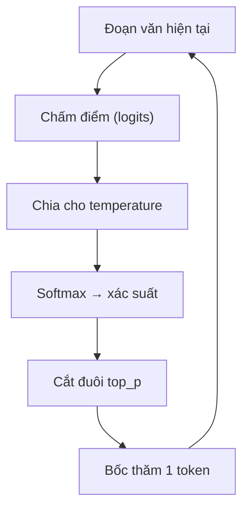
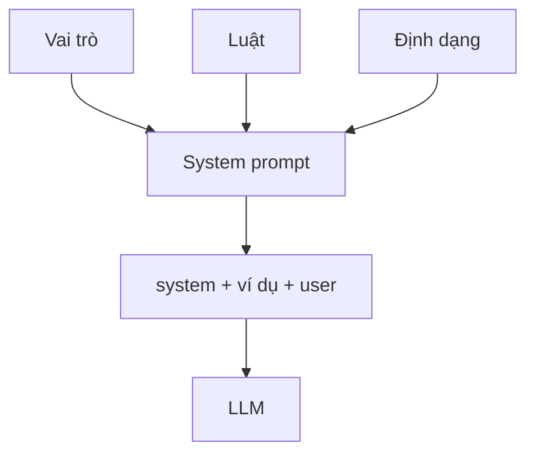
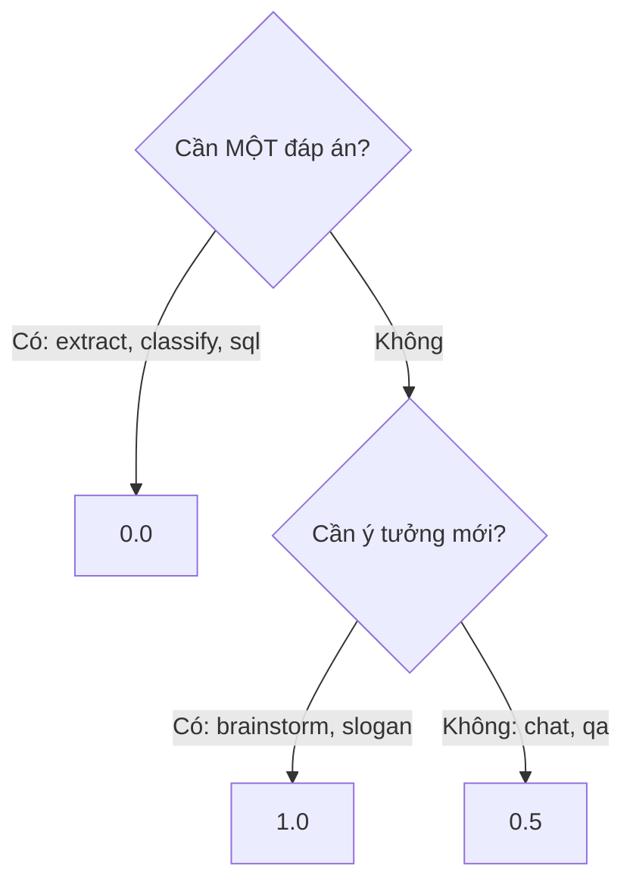

# L04 — Temperature & system prompt

> Dùng **system prompt** và **temperature** để JobRadar trả lời ổn định, đúng giọng — và **đo** độ ổn định bằng số.

## 🎯 Mục tiêu

Sau buổi này (khoảng 3 giờ) bạn sẽ:

- Giải thích được **temperature** và **top_p** ở mức trực giác: model **bốc thăm** token theo xác suất.
- Biết khi nào cần **ổn định** (temperature 0) và khi nào cần **sáng tạo**.
- Viết **system prompt** có cấu trúc: vai trò, luật, định dạng, ví dụ mẫu (**few-shot**).
- **Kết quả đo được:** `prompting.py` qua hết **26 test**, và tự đo số câu trả lời khác nhau qua 5 lần gọi ở các temperature khác nhau.

## 📋 Đề bài

**Mở file:** `academy/workspace/L04-temperature-system-prompt/prompting.py`.

Bạn viết 5 hàm (thay chỗ `raise NotImplementedError`); docstring ghi rõ yêu cầu.

| Hàm | Làm gì |
|---|---|
| `build_system_prompt(persona, rules, output_format)` | Ghép system prompt nhiều dòng |
| `build_few_shot(system, examples, question)` | messages có các cặp hỏi–đáp mẫu |
| `sample_answers(question, client, n, temperature)` | Hỏi cùng một câu n lần |
| `diversity(answers)` | Đếm số câu khác nhau, độ ổn định |
| `choose_temperature(task_type)` | Chọn temperature theo loại việc |

**Xong khi:** `26 passed`, rồi chạy thật `python prompting.py` thấy temperature 0 ổn định hơn hẳn temperature 1.2.

## 🤔 Tại sao? (kiến thức nền)

### Temperature

Ở mỗi bước, model không "chọn chắc chắn" một token mà tính **xác suất** cho mọi token rồi **bốc thăm**. Temperature chỉnh độ "nhọn" của xác suất: thấp → gần như luôn chọn token khả năng cao nhất; cao → token hiếm cũng có cơ hội.



Mô phỏng với 4 token ứng viên cho câu "Ngôn ngữ Data Engineer dùng nhiều nhất là ___":

```python
import math
logits = {"Python": 2.0, "SQL": 1.5, "Scala": 0.5, "Rust": 0.0}

def probs(T):
    e = {w: math.exp(s / T) for w, s in logits.items()}
    total = sum(e.values())
    return {w: round(v / total, 2) for w, v in e.items()}

for T in (0.2, 1.0, 2.0):
    print(T, probs(T))
```
```output
0.2 {'Python': 0.92, 'SQL': 0.08, 'Scala': 0.0, 'Rust': 0.0}
1.0 {'Python': 0.51, 'SQL': 0.31, 'Scala': 0.11, 'Rust': 0.07}
2.0 {'Python': 0.38, 'SQL': 0.3, 'Scala': 0.18, 'Rust': 0.14}
```

| Temperature | Hành vi | Hợp với |
|---|---|---|
| 0 | Gần như luôn chọn token cao điểm nhất | Trích xuất, phân loại, SQL |
| ~0.5 | Tự nhiên nhưng vẫn bám sát | Trò chuyện, hỏi đáp |
| ≥ 1 | Đa dạng, dễ "bay" và sai | Brainstorm, đặt tên, slogan |

> ⚠️ **Lỗi hay gặp:** tưởng temperature 0 là **chắc chắn** giống hệt nhau. Thực tế vẫn có thể lệch nhẹ (do phần cứng GPU, batching). Muốn kết quả lặp lại 100% trong test → dùng **client giả**, như L03.

### top_p

top_p (nucleus sampling) là cách thứ hai để bớt ngẫu nhiên: chỉ giữ **nhóm token nhỏ nhất có tổng xác suất ≥ p**, bỏ phần đuôi hiếm rồi mới bốc thăm.

```python
probs = {"Python": 0.55, "SQL": 0.30, "Scala": 0.10, "Rust": 0.05}
kept, total = [], 0
for word, p in sorted(probs.items(), key=lambda kv: -kv[1]):
    kept.append(word)
    total += p
    if total >= 0.8:
        break
print(kept)
```
```output
['Python', 'SQL']
```

> 💡 **Mẹo:** thường chỉ chỉnh **một** trong hai (temperature **hoặc** top_p), để cái kia mặc định. Chỉnh cả hai cùng lúc khó đoán kết quả.

### Số đo thật: cùng một câu, 5 lần

Hỏi `nemotron-3-super` 5 lần câu "Đặt một tên ngắn cho ứng dụng tìm việc IT" ở 3 mức temperature:

| Temperature | Số tên khác nhau / 5 | Nhận xét |
|---|---|---|
| 0.0 | 1 | Cả 5 lần đều `ITJobFinder` |
| 0.7 | 5 | `TechJob`, `JobIT`, `ITJobHub`… đều dùng được |
| 1.2 | 5 | Bắt đầu lỗi: `TechJobDiUn`, câu bị cắt dở |

> 🧠 **Ghi nhớ:** muốn chatbot **nhất quán** → temperature thấp. Muốn **ý tưởng** → cao vừa phải; quá cao thì ra rác.

### System prompt

System prompt là "bản mô tả công việc" cho model: nó là ai, được làm gì, không được làm gì, trả lời theo khuôn nào. Người dùng không thấy nó, nhưng nó ảnh hưởng **mọi** câu trả lời.



Số đo thật, cùng câu "Kỹ năng nào quan trọng nhất cho Data Engineer intern?", `max_tokens=400`:

| Cấu hình | Token trả lời | finish_reason |
|---|---|---|
| Không system prompt | 400 | `length` (bị cắt dở) |
| System có luật "tối đa 3 gạch đầu dòng" | 44 | `stop` |

Luật rõ ràng → câu trả lời ngắn hơn **9 lần**, đúng khuôn, rẻ hơn.

### Prompt engineering cơ bản

Prompt engineering = viết chỉ dẫn sao cho model làm đúng ý **ngay lần đầu**. Bốn nguyên liệu dùng nhiều nhất:

| Nguyên liệu | Ví dụ cho JobRadar |
|---|---|
| Vai trò (role) | "Bạn là trợ lý thị trường việc làm IT tại Việt Nam" |
| Ràng buộc (constraints) | "Tối đa 3 ý. Không chắc thì nói không chắc." |
| Định dạng (format) | "Trả về JSON có khóa skill, level" |
| Ví dụ mẫu (few-shot) | 2–3 cặp hỏi–đáp mẫu trước câu hỏi thật |

**Few-shot** đặc biệt hiệu quả cho việc phân loại/trích xuất: thay vì mô tả dài dòng, cho model **xem** vài ví dụ đúng — nó bắt chước khuôn đó.

> 🎯 **Phỏng vấn hay hỏi:** "Zero-shot và few-shot khác nhau thế nào?" — zero-shot chỉ có chỉ dẫn; few-shot thêm vài ví dụ hỏi–đáp mẫu vào messages để model bắt chước định dạng và cách phân loại.

## 🛠️ Làm

### Bước 1 — Chuẩn bị

Kích hoạt venv gốc của repo: `source .venv/bin/activate` (Windows: `.venv\Scripts\Activate.ps1`). Code tự đọc key từ `.env` ở gốc repo — không cần chép. Mở `prompting.py`, đọc lướt 5 docstring.

> ⚠️ **Lỗi hay gặp:** `.env` gốc repo còn `nvapi-...` → `RuntimeError: Thiếu NVIDIA_API_KEY` khi chạy thật (test thì vẫn chạy được).

### Bước 2 — Lọc và nối chuỗi → `build_system_prompt`

Ví dụ với một bot review CV (khác đề bài):

```python
parts = ["Bạn là người review CV.", "", "  Chấm thang 10  "]
clean = [p.strip() for p in parts if p.strip()]
print(clean)
print("\n".join(clean))
print(f"- {clean[-1]}")
```
```output
['Bạn là người review CV.', 'Chấm thang 10']
Bạn là người review CV.
Chấm thang 10
- Chấm thang 10
```

Hàm của bạn: persona → (dòng `Luật:` + mỗi luật một dòng `- ...`) → (dòng `Định dạng: ...`). Phần nào rỗng thì bỏ.

> ⚠️ **Lỗi hay gặp:** `None.strip()` lỗi. Kiểm tra `if not persona or not persona.strip()` theo đúng thứ tự đó.

### Bước 3 — Duỗi cặp thành dãy → `build_few_shot`

Mỗi cặp tuple sinh ra **hai** phần tử, giữ thứ tự:

```python
pairs = [("cat", "mèo"), ("dog", "chó")]
flat = []
for en, vi in pairs:
    flat.append(en)
    flat.append(vi)
print(flat)
```
```output
['cat', 'mèo', 'dog', 'chó']
```

Trong `build_few_shot`, "hỏi" thành message `user`, "đáp" thành message `assistant`. Model nhìn thấy như thể chính nó đã trả lời các câu mẫu đó.

### Bước 4 — Hỏi lặp lại → `sample_answers`

Giống `ask` ở L03 nhưng gọi **n lần** và thêm `temperature=temperature`. Tạo messages **một lần** trước vòng lặp, rồi `for _ in range(n):` gọi API và gom câu trả lời vào list.

> ⚠️ **Lỗi hay gặp:** kiểm tra `n < 1` **sau** vòng lặp → lỗi đến muộn. Kiểm tra đầu vào trước khi tốn tiền gọi API.

### Bước 5 — Đếm phiếu → `diversity`

`Counter` đếm số lần xuất hiện, sau khi chuẩn hóa:

```python
from collections import Counter
votes = ["SQL", "sql ", "Python", "SQL"]
c = Counter(v.strip().lower() for v in votes)
print(c)
print(len(c), c.most_common(1))
print(round(2 / 3, 2))
```
```output
Counter({'sql': 3, 'python': 1})
2 [('sql', 3)]
0.67
```

`unique` = có bao nhiêu khóa; `stability` = số phiếu của khóa nhiều nhất chia tổng.

### Bước 6 — Tra bảng và báo lỗi → `choose_temperature`

Dùng dict làm "bảng tra"; khóa lạ thì báo lỗi rõ ràng thay vì đoán bừa:

```python
SIZES = {"s": 1, "m": 2}

def size_of(name):
    key = name.strip().lower()
    if key not in SIZES:
        raise ValueError(f"Không biết size {name!r}")
    return SIZES[key]

print(size_of(" M "))
try:
    size_of("xl")
except ValueError as e:
    print("Lỗi:", e)
```
```output
2
Lỗi: Không biết size 'xl'
```



### Bước 7 — Thí nghiệm thật: temperature

Sau khi qua test, chạy `python prompting.py` hoặc tự viết:

```python
from prompting import diversity, make_client, sample_answers
client = make_client()
q = "Đặt một tên ngắn (tối đa 4 từ) cho một ứng dụng tìm việc IT. Chỉ trả về đúng cái tên."
for t in (0.0, 0.7, 1.2):
    answers = sample_answers(q, client, n=5, temperature=t, system=None, max_tokens=20)
    print(t, diversity(answers), answers)
```
```output
0.0 {'unique': 1, 'stability': 1.0} ['ITJobFinder', 'ITJobFinder', 'ITJobFinder', 'ITJobFinder', 'ITJobFinder']
0.7 {'unique': 5, 'stability': 0.2} ['ITJobFinder', 'TechJob', 'ITWork Finder', 'JobIT', 'ITJobHub']
1.2 {'unique': 5, 'stability': 0.2} ['JobFit IT', 'ITWorks (2 từ)  \n*Hoặc một số gợi ý khác tối đa', 'Công việc ITAppJob IT Liên Việc IT', 'TechJobDiUn', 'JobIT']
```

Kết quả của bạn sẽ khác (đó chính là điểm của bài!). Ghi lại bảng số đo của riêng mình.

> 💡 **Mẹo:** mỗi lần chạy tốn 15 lời gọi. Rate limit ~40 lời gọi/phút — đừng chạy liên tục.

### Bước 8 — Thí nghiệm thật: system prompt

So cùng một câu hỏi, có và không có system prompt:

```python
from prompting import EXTRA_BODY, build_system_prompt, make_client
client = make_client()
system = build_system_prompt("Bạn là JobRadar, trợ lý thị trường việc làm IT tại Việt Nam.",
                             ["Trả lời bằng tiếng Việt.", "Tối đa 3 gạch đầu dòng, mỗi dòng dưới 12 từ.",
                              "Không chắc thì nói 'Mình không chắc'."])
q = "Kỹ năng nào quan trọng nhất cho Data Engineer intern?"
for msgs in ([{"role": "user", "content": q}],
             [{"role": "system", "content": system}, {"role": "user", "content": q}]):
    r = client.chat.completions.create(model="nvidia/nemotron-3-super-120b-a12b", messages=msgs,
                                       temperature=0, max_tokens=400, extra_body=EXTRA_BODY)
    print(r.usage.completion_tokens, r.choices[0].finish_reason, "|", r.choices[0].message.content[:80].replace("\n", " "))
```
```output
400 length | Cảm ơn bạn đã đặt câu hỏi này — đây là một câu hỏi rất thực tế và quan trọng, đặ
44 stop | - SQL và Python là nền tảng cốt lõi   - Hiểu ETL pipeline và làm việc với databa
```

Thử thêm một luật "Trả về JSON có khóa `skills`" rồi xem model có tuân theo không. Bài L11 sẽ học cách **kiểm tra** JSON đó.

## ✅ Tự kiểm tra

Bấm **Chạy test**, hoặc từ thư mục `academy/`:

```bash
PYTHONPATH=workspace/L04-temperature-system-prompt python3 -m pytest curriculum/L04-temperature-system-prompt/tests -q
```

> 💡 **Mẹo:** Windows PowerShell: `$env:PYTHONPATH="workspace\L04-temperature-system-prompt"; python -m pytest curriculum\L04-temperature-system-prompt\tests -q`

Mục tiêu: `26 passed` — không cần mạng, không cần key. Sau đó làm Bước 7–8 với model thật.

## 🎤 Câu hỏi phỏng vấn

> 🎯 **Phỏng vấn hay hỏi:** câu 6 phân biệt người "chỉ chỉnh prompt cho vui" với kỹ sư. Trả lời bằng **số đo của bạn**: "em hỏi cùng một câu 5 lần, ở temperature 0 ra 1 đáp án, ở 1.2 ra 5 đáp án và có câu lỗi…".
