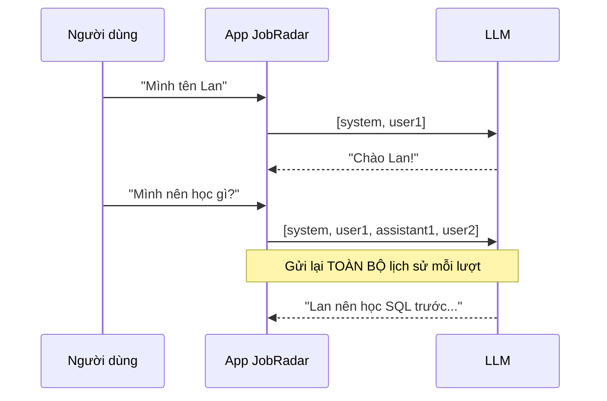
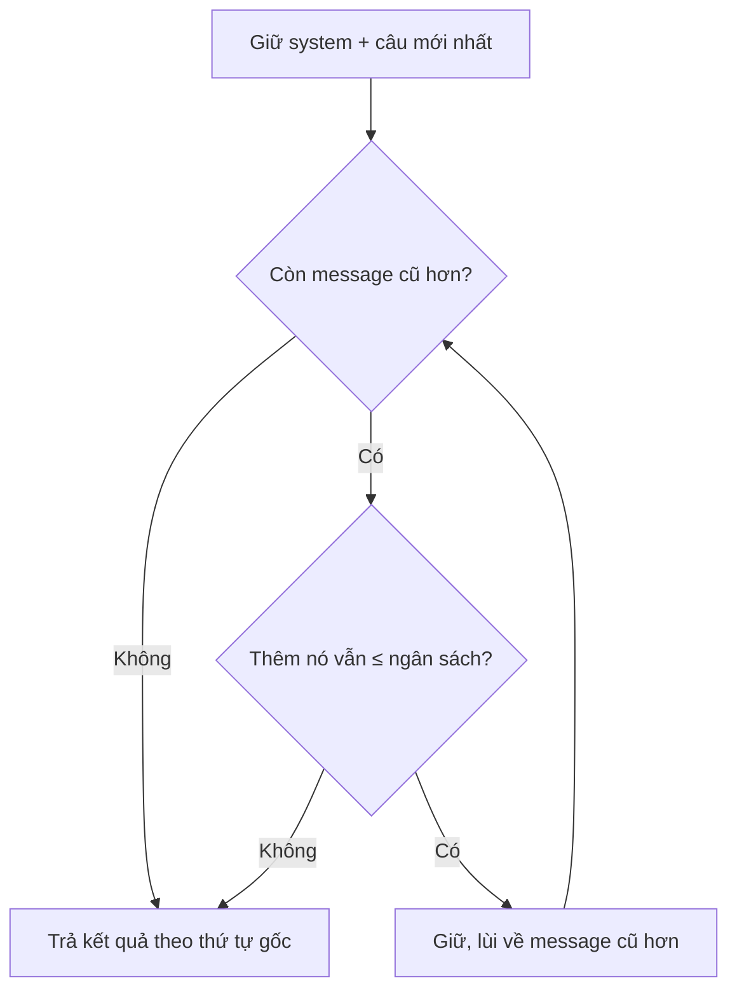
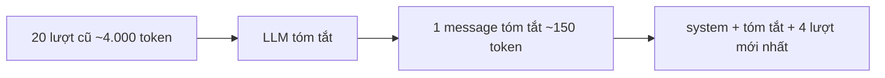
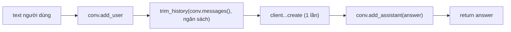

# L05 — Hội thoại nhiều lượt & context window

> Bạn hỏi JobRadar "Mình tên Lan, đang học Data Engineer", rồi hỏi tiếp "Vậy mình nên học gì trước?" — và nó ngơ ngác. Vì **LLM không có trí nhớ**. Hôm nay bạn tự xây "trí nhớ" cho chatbot: giữ lịch sử, gửi lại mỗi lượt, và **tự cắt bớt** khi lịch sử dài quá ngân sách token.

## 🎯 Mục tiêu

Sau buổi này (khoảng 3 giờ) bạn sẽ:

- Giải thích được vì sao LLM là **stateless** (không trạng thái) và chatbot "nhớ" bằng cách nào.
- Hiểu **context window** và vì sao chi phí hội thoại **tăng nhanh** theo số lượt.
- Viết **class** đầu tiên: `Conversation` giữ lịch sử.
- Cắt lịch sử theo **ngân sách token**: giữ system + các lượt mới nhất.
- **Kết quả đo được:** `conversation.py` qua hết **25 test**, và chat nhiều lượt thật trong terminal.

## 📋 Đề bài

**Mở file:** `academy/workspace/L05-hoi-thoai-context-window/conversation.py`.

| Viết | Làm gì |
|---|---|
| `class Conversation` | `add_user`, `add_assistant`, `messages()` |
| `estimate_tokens(text)` | Ước lượng token: 3 ký tự ≈ 1 token |
| `count_message_tokens(messages)` | Tổng token của cả list messages |
| `trim_history(messages, max_tokens)` | Cắt lịch sử cho vừa ngân sách |
| `chat_turn(conv, text, client)` | Một lượt: lưu, cắt, gọi API, lưu trả lời |

**Xong khi:** `25 passed`, rồi `python conversation.py` chat được nhiều lượt và thấy dòng `[lịch sử ... | gửi đi ...]` cắt bớt khi dài.

## 🤔 Tại sao? (kiến thức nền)

### LLM không có trí nhớ

Mỗi lần gọi API là một lần **hoàn toàn mới**: model chỉ thấy đúng những messages bạn gửi lần đó. "Trí nhớ" của chatbot thực ra là **ứng dụng** lưu lịch sử và gửi lại toàn bộ mỗi lượt.

Mô phỏng bằng một "LLM đồ chơi" chỉ biết đọc messages được gửi:

```python
def toy_llm(messages):
    for m in messages:
        if "tên là" in m["content"]:
            return "Bạn tên " + m["content"].split()[-1] + "."
    return "Mình không biết bạn tên gì."

print(toy_llm([{"role": "user", "content": "Mình tên gì?"}]))
history = [{"role": "user", "content": "Mình tên là Minh"},
           {"role": "assistant", "content": "Chào Minh!"},
           {"role": "user", "content": "Mình tên gì?"}]
print(toy_llm(history))
```
```output
Mình không biết bạn tên gì.
Bạn tên Minh.
```



> 🎯 **Phỏng vấn hay hỏi:** "ChatGPT nhớ cuộc trò chuyện bằng cách nào?" — model không nhớ; ứng dụng lưu lịch sử và gửi lại trong mỗi request (có thể cắt hoặc tóm tắt bớt).

### Chi phí tăng theo số lượt

Vì lượt thứ N gửi lại cả N−1 lượt trước, số token **mỗi lượt** tăng dần và **tổng** token tăng gần như bình phương số lượt.

```python
per_turn = 150  # token mỗi lượt (hỏi + đáp)
total = 0
for turn in range(1, 11):
    sent = per_turn * turn  # gửi lại toàn bộ lịch sử
    total += sent
    if turn in (1, 5, 10):
        print(f"lượt {turn}: gửi {sent} token, cộng dồn {total}")
```
```output
lượt 1: gửi 150 token, cộng dồn 150
lượt 5: gửi 750 token, cộng dồn 2250
lượt 10: gửi 1500 token, cộng dồn 8250
```

10 lượt nhưng trả tiền cho 8.250 token, không phải 1.500. Hội thoại càng dài càng đắt.

### Context window

**Context window** là số token tối đa model đọc được trong **một** lần gọi (gồm cả system, lịch sử, câu hỏi và chỗ cho câu trả lời). Vượt quá thì API báo lỗi hoặc phần đầu bị bỏ.

| Thứ chiếm context | Ví dụ JobRadar |
|---|---|
| System prompt | Vai trò, luật (L04) |
| Lịch sử hội thoại | Các lượt hỏi–đáp trước |
| Tài liệu đính kèm | Tin tuyển dụng (bài RAG sau này) |
| Câu trả lời | Tối đa `max_tokens` |

> 🧠 **Ghi nhớ:** context window lớn **không** có nghĩa nên nhét đầy: càng nhiều token càng chậm, càng đắt, và model dễ "lạc" giữa đống chữ. Đặt **ngân sách** nhỏ hơn giới hạn thật.

> ⚠️ **Lỗi hay gặp:** quên rằng tiếng Việt tốn token hơn (L03: ~1,6 lần). Ước lượng 3 ký tự ≈ 1 token là con số an toàn cho tiếng Việt.

### Cắt lịch sử theo ngân sách

Cách đơn giản và phổ biến nhất: **luôn giữ system**, **luôn giữ câu mới nhất**, rồi đi ngược từ mới về cũ, thêm lượt cũ hơn chừng nào còn vừa ngân sách.



Gặp message không vừa thì **dừng hẳn**, không nhảy cóc lấy message cũ hơn — nếu không hội thoại bị thủng một đoạn giữa, model hiểu sai mạch.

### Tóm tắt hội thoại

Cắt thì **mất** thông tin cũ (vd. tên người dùng nói từ lượt 1). Cách nâng cao: khi lịch sử dài, nhờ LLM **tóm tắt** các lượt cũ thành 1 message ngắn, thay cho chúng.



| Cách | Ưu | Nhược |
|---|---|---|
| Cắt lượt cũ | Đơn giản, không tốn thêm lời gọi | Quên chuyện cũ |
| Tóm tắt | Nhớ ý chính lâu dài | Tốn thêm lời gọi, có thể tóm sai |
| Truy xuất (RAG, P4) | Chỉ lấy đoạn liên quan | Phức tạp hơn |

Bài này làm cách **cắt**; tóm tắt là bài tập mở rộng.

## 🛠️ Làm

### Bước 1 — Chuẩn bị

Kích hoạt venv gốc của repo (`source .venv/bin/activate`; Windows: `.venv\Scripts\Activate.ps1`), chép `.env` sang `workspace/L05-hoi-thoai-context-window/.env`, mở `conversation.py`. Đọc docstring của `class Conversation` trước.

### Bước 2 — Class đầu tiên → `Conversation`

**Class** gom dữ liệu (thuộc tính `self.…`) và hàm thao tác trên nó (phương thức). Ví dụ một playlist:

```python
class Playlist:
    def __init__(self, name):
        self.name = name
        self._songs = []

    def add(self, song):
        self._songs.append(song)

    def songs(self):
        return list(self._songs)

p = Playlist("Code")
p.add("Lofi 1")
s = p.songs()
s.append("Chen ngang")
print(p.name, p.songs())
```
```output
Code ['Lofi 1']
```

`__init__` chạy khi tạo đối tượng; `self` là chính đối tượng đó. Dấu `_` đầu tên nghĩa là "dùng nội bộ".

> ⚠️ **Lỗi hay gặp:** trả về chính list bên trong. Gán `b = a` **không** sao chép:

```python
a = [1, 2]
b = a
c = list(a)
a.append(3)
print(b, c)
```
```output
[1, 2, 3] [1, 2]
```

### Bước 3 — Đếm token nhanh → `estimate_tokens`, `count_message_tokens`

Gọi API chỉ để đếm token thì chậm và tốn tiền; ta ước lượng bằng độ dài chuỗi, làm tròn **lên** cho an toàn:

```python
import math
print(7 / 3, math.ceil(7 / 3), math.ceil(0 / 3))
orders = [{"item": "cafe", "price": 30}, {"item": "bánh", "price": 15}]
print(sum(5 + o["price"] for o in orders))
```
```output
2.3333333333333335 3 0
55
```

Mỗi message tốn thêm `MESSAGE_OVERHEAD` token "khung" (nhớ L03: "hi" có `prompt_tokens=17`).

### Bước 4 — Đi ngược danh sách → `trim_history`

Hai công cụ: `reversed()` duyệt từ cuối lên, `insert(0, x)` chèn vào đầu để giữ thứ tự gốc:

```python
nums = [10, 20, 30, 40]
print(list(reversed(nums)))
kept = []
for x in reversed(nums):
    if x < 25:
        break
    kept.insert(0, x)
print(kept)
```
```output
[40, 30, 20, 10]
[30, 40]
```

Thứ tự trong hàm của bạn: tách system (nếu có) → giữ message cuối → đi ngược phần còn lại, cộng dồn token, vượt ngân sách thì `break`.

> ⚠️ **Lỗi hay gặp:** dùng `messages.pop()` hoặc `del` → sửa luôn list của người gọi. Chỉ đọc đầu vào, tạo list mới cho kết quả.

### Bước 5 — Ghép lại → `chat_turn`



Lưu ý: `conv` giữ **đủ** lịch sử; chỉ bản **gửi đi** bị cắt. Nhờ vậy sau này đổi ngân sách hay chuyển sang tóm tắt vẫn còn dữ liệu gốc.

### Bước 6 — Chat thật trong terminal

```bash
cd academy/workspace/L05-hoi-thoai-context-window
python conversation.py
```

Thử: "Mình tên Lan, đang học Data Engineer" → "Mình nên học gì trước?" → "Nhắc lại tên mình?". Quan sát dòng `[lịch sử N message ~X token | gửi đi M message ~Y token]` sau mỗi lượt.

### Bước 7 — Thí nghiệm: ngân sách quá nhỏ

Ngân sách trong `__main__` là `budget = 300`. Chat 5–6 lượt dài, rồi hỏi "Mình tên gì?". Khi lượt đầu bị cắt khỏi bản gửi đi, JobRadar **quên** tên bạn. Đổi `budget = 3000` và thử lại.

> 💡 **Mẹo:** ghi lại lượt thứ mấy thì bắt đầu quên — đó là câu chuyện cụ thể để kể khi phỏng vấn.

## ✅ Tự kiểm tra

Bấm **Chạy test**, hoặc từ thư mục `academy/`:

```bash
PYTHONPATH=workspace/L05-hoi-thoai-context-window python3 -m pytest curriculum/L05-hoi-thoai-context-window/tests -q
```

> 💡 **Mẹo:** Windows PowerShell: `$env:PYTHONPATH="workspace\L05-hoi-thoai-context-window"; python -m pytest curriculum\L05-hoi-thoai-context-window\tests -q`

Mục tiêu: `25 passed` — không cần mạng, không cần key. Sau đó chat thật (Bước 6–7).

- [ ] Tôi giải thích được vì sao chatbot "nhớ" dù LLM stateless.
- [ ] Tôi tính được tổng token của hội thoại 10 lượt khi gửi lại toàn bộ lịch sử.
- [ ] Tôi thấy tận mắt chatbot "quên" khi ngân sách quá nhỏ.

## 🎤 Câu hỏi phỏng vấn

1. LLM có nhớ cuộc trò chuyện không? Chatbot "nhớ" bằng cách nào?
2. Context window là gì? Điều gì xảy ra khi hội thoại vượt context window?
3. Vì sao chi phí một cuộc hội thoại dài tăng nhanh hơn tuyến tính theo số lượt?
4. Bạn cắt lịch sử hội thoại thế nào? Vì sao luôn giữ system prompt và câu mới nhất?
5. So sánh cắt lịch sử và tóm tắt lịch sử. Khi nào dùng cách nào?
6. Làm sao ước lượng số token mà không gọi API? Vì sao nên làm tròn lên?

> 🎯 **Phỏng vấn hay hỏi:** câu 3 — trả lời bằng phép tính: "lượt N gửi lại N lượt, nên tổng là 1+2+…+N ≈ N²/2 lần số token mỗi lượt; 10 lượt × 150 token tốn 8.250 token chứ không phải 1.500".
