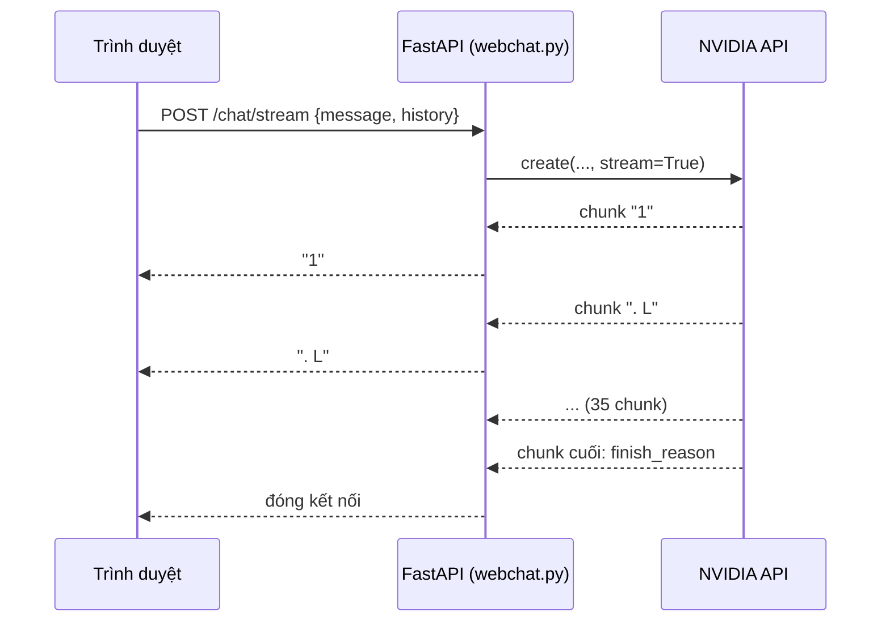
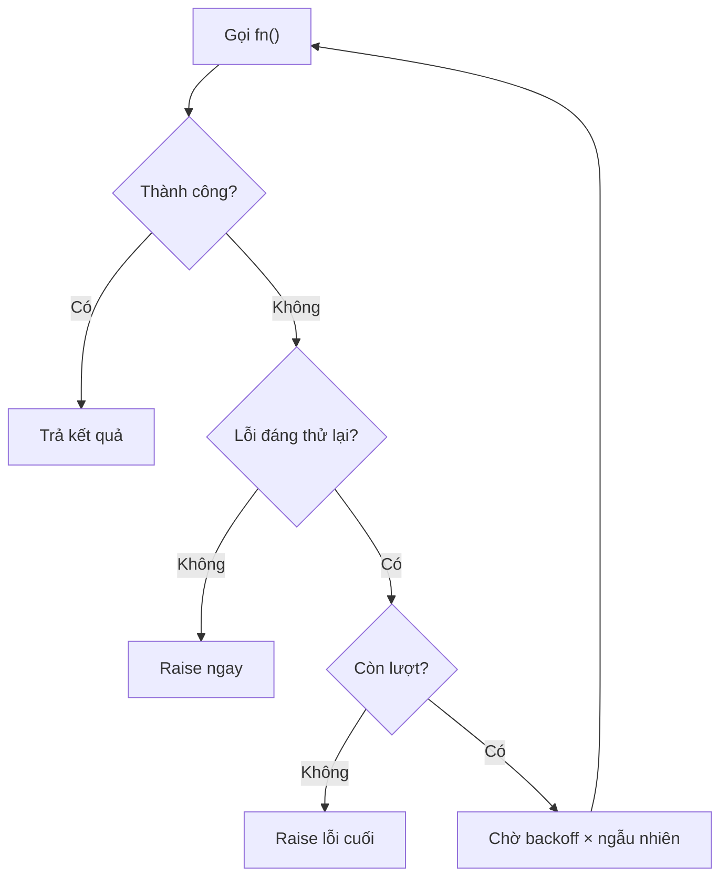
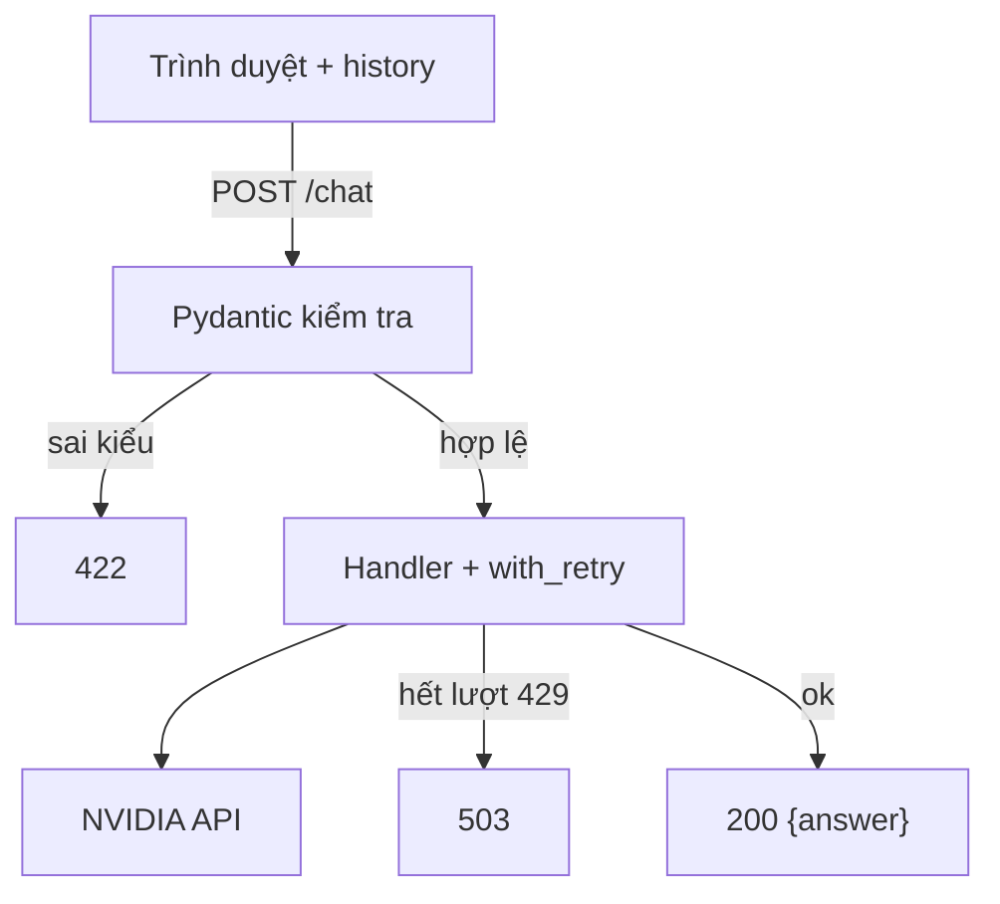

# L06 — Web chat, streaming, lỗi & rate limit

> Đưa JobRadar lên trình duyệt: chữ hiện **từng mẩu** (streaming) và app **tự thử lại** khi gặp 429 thay vì sập.

## 🎯 Mục tiêu

Sau buổi này (khoảng 3,5 giờ) bạn sẽ:

- Giải thích được **streaming** và vì sao nó làm chatbot "cảm giác" nhanh hơn.
- Phân biệt lỗi **đáng thử lại** (429, 5xx, timeout) và lỗi **không đáng** (400, 401, 404).
- Viết **retry** với **exponential backoff + jitter**.
- Dựng API chat bằng **FastAPI** và chạy trang web chat thật.
- **Kết quả đo được:** `webchat.py` qua hết **32 test**, và chat được trên `http://127.0.0.1:8001`.

## 📋 Đề bài

**Mở file:** `academy/workspace/L06-web-chat-streaming-rate-limit/webchat.py`. Trang web (`static/index.html`) và endpoint `/chat/stream` đã viết sẵn.

| Viết | Làm gì |
|---|---|
| `backoff_delays(n, base, cap)` | Thời gian chờ tăng gấp đôi, có trần |
| `is_retryable(error)` | Lỗi này có đáng thử lại? |
| `with_retry(fn, max_tries, ...)` | Gọi lại `fn` khi gặp lỗi tạm thời |
| `stream_text(chunks)` · `collect_stream` | Lấy chữ từ từng chunk của stream |
| Handler `POST /chat` trong `create_app` | Gọi LLM qua `with_retry`, hết lượt → 503 |

**Xong khi:** `32 passed`, rồi `python webchat.py` và chat được trên trình duyệt, chữ hiện dần.

## 🤔 Tại sao? (kiến thức nền)

### Streaming

Không có streaming, người dùng nhìn màn hình trống tới khi model viết **xong** cả câu. Có streaming, server gửi **từng mẩu** ngay khi model sinh ra — tổng thời gian không đổi nhưng chữ đầu tiên đến sớm hơn nhiều.



Số đo thật (`nemotron-3-super`, câu trả lời ~5 dòng):

| Chỉ số | Giá trị |
|---|---|
| Thời gian tới mẩu chữ đầu tiên | 0,63 giây |
| Thời gian tới khi xong | 1,57 giây |
| Số chunk có chữ | 35 |

Không stream, người dùng chờ 1,57 giây; có stream, sau 0,63 giây đã thấy chữ. Câu trả lời càng dài, khác biệt càng lớn.

> 💡 **Mẹo:** API của OpenAI/NVIDIA stream bằng **SSE** (Server-Sent Events): mỗi mẩu là một dòng `data: {...}` trên một kết nối HTTP mở lâu. Thư viện `openai` đã đọc SSE giúp bạn — bạn chỉ cần `for chunk in stream`.

### Rate limit & HTTP 429

Nhà cung cấp giới hạn số lời gọi mỗi phút (build.nvidia.com: khoảng 40/phút mỗi model). Vượt quá → **HTTP 429 Too Many Requests**. Đây là lỗi **tạm thời**: chờ một chút gọi lại là được.

| Lỗi | Nghĩa | Thử lại? |
|---|---|---|
| 429 | Gọi quá nhanh | Có, sau khi chờ |
| 500, 502, 503 | Server bên kia trục trặc | Có |
| Timeout / mất mạng | Mạng chập chờn | Có |
| 400 | Request sai (vd. JSON hỏng) | Không — sửa code |
| 401 | Sai/thiếu API key | Không — sửa key |
| 404 | Sai tên model / đường dẫn | Không — sửa tên |

> ⚠️ **Lỗi hay gặp:** retry **mọi** lỗi. Lỗi 401 thử lại 4 lần vẫn 401, chỉ làm người dùng chờ lâu hơn và tốn lượt gọi.

### Exponential backoff & jitter

**Exponential backoff:** mỗi lần thất bại, chờ **gấp đôi** lần trước (1s, 2s, 4s…) có trần, để server kịp hồi. **Jitter:** nhân thời gian chờ với một số ngẫu nhiên, để nhiều client không cùng thử lại một lúc.



Vì sao cần jitter? 5 client cùng bị 429 lúc 10:00:00. Không jitter, cả 5 cùng chờ 4 giây rồi **cùng** đập vào server lúc 10:00:04 — lại 429. Có jitter, chúng tản ra:

**Cách 1 — vòng lặp for**

```python
import random
random.seed(7)
delay = 4
same = []
for _ in range(5):
    same.append(delay)
spread = []
for _ in range(5):
    spread.append(round(delay * random.random(), 1))   # random() cho số trong [0, 1)
print("không jitter:", same)
print("full jitter: ", spread)
```
```output
không jitter: [4, 4, 4, 4, 4]
full jitter:  [1.3, 0.6, 2.6, 0.3, 2.1]
```

**Cách 2 — `[x] * n` và list comprehension**

```python
import random
random.seed(7)
delay = 4
print("không jitter:", [delay] * 5)
print("full jitter: ", [round(delay * random.random(), 1) for _ in range(5)])
```
```output
không jitter: [4, 4, 4, 4, 4]
full jitter:  [1.3, 0.6, 2.6, 0.3, 2.1]
```

`[delay] * 5` lặp list một phần tử 5 lần; `_` là tên biến cho giá trị không dùng tới.

> ⚖️ **So sánh:** cùng O(n), chỉ gọn hơn.

> 🎯 **Phỏng vấn hay hỏi:** "Vì sao backoff phải có jitter?" — để tránh **thundering herd**: nhiều client thử lại đồng loạt tạo ra đợt quá tải mới.

> ⚠️ **Lỗi hay gặp:** bỏ qua header `Retry-After` của 429 — có thì chờ đúng số giây server báo. Backoff vài giây (1+2+4 ≈ 7s) không cứu được cửa sổ RPM 60 giây; cần thêm bộ giới hạn chủ động (L12).

### Timeout

Mọi lời gọi mạng phải có **giới hạn thời gian chờ**; không có thì một request treo có thể giữ server mãi. `make_client()` đặt `timeout=30` giây.

Thư viện `openai` tự retry sẵn 2 lần. Ta đặt `max_retries=0` để **một** chỗ duy nhất (`with_retry`) quyết định chuyện thử lại — hai lớp retry chồng nhau dễ thành 3 × 4 = 12 lần gọi.

### Web API với FastAPI

FastAPI biến hàm Python thành endpoint HTTP. Bạn khai báo dữ liệu vào bằng class **Pydantic**; FastAPI tự đọc JSON, kiểm tra kiểu, sai thì trả **422** — bạn không phải tự viết.



Server **không lưu** lịch sử: trình duyệt gửi kèm `history` mỗi lần (đúng ý tưởng L05). `Message.role` chỉ nhận `user`/`assistant`, nên người dùng không thể tự chèn message `system` để "bẻ luật" bot.

## 🛠️ Làm

### Bước 1 — Chuẩn bị

Kích hoạt venv gốc của repo (`source .venv/bin/activate`; Windows: `.venv\Scripts\Activate.ps1`). `fastapi` và `uvicorn` đã được cài sẵn bởi bước setup (nếu thiếu: `pip install fastapi uvicorn`). Code tự đọc key từ `.env` ở gốc repo — không cần chép. Mở `webchat.py`: phần dưới đã có `create_app`, endpoint stream và `make_client`.

> ⚠️ **Lỗi hay gặp:** `ModuleNotFoundError: fastapi` → chưa cài vào venv, hoặc chưa kích hoạt venv.

### Bước 2 — Lũy thừa và trần → `backoff_delays`

```python
for i in range(5):
    print(i, 3 ** i, min(20, 3 ** i))
```
```output
0 1 1
1 3 3
2 9 9
3 27 20
4 81 20
```

Hàm của bạn dùng cơ số 2, nhân `base`, và trần là `cap`.

### Bước 3 — Đọc thông tin từ lỗi → `is_retryable`

Lỗi cũng là đối tượng, có thể mang thêm thuộc tính. `getattr(obj, tên, mặc_định)` đọc an toàn khi thuộc tính có thể không tồn tại:

```python
class HTTPError(Exception):
    def __init__(self, status_code):
        super().__init__(f"HTTP {status_code}")
        self.status_code = status_code

for err in (HTTPError(404), KeyError("x"), HTTPError(503)):
    try:
        raise err
    except Exception as e:
        print(type(e).__name__, getattr(e, "status_code", None), isinstance(e, LookupError))
```
```output
HTTPError 404 False
KeyError None True
HTTPError 503 False
```

### Bước 4 — Hàm nhận hàm → `with_retry`

`with_retry` nhận một **hàm** (chưa gọi) để tự gọi lại nhiều lần. `raise` trơn trong `except` ném tiếp lỗi đang bắt.

**Cách 1 — đặt tên hàm bằng `def`**

```python
def safe_div(a, b):
    try:
        return a / b
    except ZeroDivisionError:
        print("chia cho 0 → báo tiếp lên trên")
        raise

def run(fn):
    return fn()            # gọi hàm được truyền vào

def div_6_3():
    return safe_div(6, 3)

def div_1_0():
    return safe_div(1, 0)

print(run(div_6_3))        # truyền div_6_3, KHÔNG phải div_6_3()
try:
    run(div_1_0)
except ZeroDivisionError as e:
    print("bắt được:", e)
```
```output
2.0
chia cho 0 → báo tiếp lên trên
bắt được: division by zero
```

**Cách 2 — `lambda` (hàm không tên)**

```python
# safe_div và run như Cách 1
print(run(lambda: safe_div(6, 3)))
try:
    run(lambda: safe_div(1, 0))
except ZeroDivisionError as e:
    print("bắt được:", e)
```
```output
2.0
chia cho 0 → báo tiếp lên trên
bắt được: division by zero
```

`lambda: safe_div(6, 3)` chính là `def div_6_3(): return safe_div(6, 3)`, chỉ không có tên và viết trong một dòng.

> ⚖️ **So sánh:** chạy như nhau, cùng tốc độ. `lambda` gọn hơn khi hàm chỉ dùng một lần ngay tại chỗ (như trong `with_retry(...)`); hàm dài hoặc dùng lại nhiều nơi → viết `def`.

Vòng `for attempt in range(max_tries)` + `try/except`; trong `except`: lỗi không đáng retry **hoặc** lần cuối → `raise`; còn lại → `sleep(...)` rồi vòng lặp tự thử lại.

> 💡 **Mẹo:** `sleep`, `rand` là tham số để test truyền bản giả, không phải chờ thật (inject như L03).

### Bước 5 — Generator → `stream_text`, `collect_stream`

`yield` biến hàm thành **generator**: trả từng phần tử **khi được hỏi tới**, không đợi tính hết.

```python
def shout(words):
    for w in words:
        if w:
            yield w.upper()

g = shout(["data", "", "ai"])
print(next(g))                      # lấy phần tử kế tiếp
print(list(g))                      # lấy hết phần còn lại vào list
print("-".join(shout(["x", "y"])))  # nối các phần tử, cách nhau dấu "-"
```
```output
DATA
['AI']
X-Y
```

Mỗi chunk của stream có dạng sau. Chunk có thể có `choices` **rỗng** — vd. chunk `usage` cuối, chỉ được gửi khi bật `stream_options={"include_usage": True}` (code bài này không bật):

```python
from types import SimpleNamespace as NS
piece = NS(choices=[NS(delta=NS(content="Xin"))])
last = NS(choices=[], usage=NS(completion_tokens=35))
print(piece.choices[0].delta.content, len(last.choices), bool(last.choices))
```
```output
Xin 0 False
```

> ⚠️ **Lỗi hay gặp:** gom hết vào list rồi `return` → trông vẫn đúng nhưng **mất** streaming: trình duyệt chỉ nhận chữ khi model viết xong.

### Bước 6 — Endpoint → handler `POST /chat`

Một API FastAPI nhỏ (đặt hàng cafe) và cách test bằng `TestClient` — không cần mở server:

```python
from fastapi import FastAPI, HTTPException
from fastapi.testclient import TestClient
from pydantic import BaseModel

class Order(BaseModel):
    item: str
    qty: int = 1

app = FastAPI()

@app.post("/order")
def order(o: Order):
    if o.qty > 10:
        raise HTTPException(status_code=400, detail="Tối đa 10")
    return {"msg": f"{o.qty} x {o.item}"}

c = TestClient(app)
print(c.post("/order", json={"item": "cafe", "qty": 2}).json())
print(c.post("/order", json={"item": "cafe", "qty": 99}).status_code)
print(c.post("/order", json={"qty": 1}).status_code)
```
```output
{'msg': '2 x cafe'}
400
422
```

Handler `/chat` của bạn: `build_messages(req)` → gọi API **bên trong** `with_retry` → bắt lỗi còn sót: đáng retry thì đổi thành `HTTPException(503, BUSY_MESSAGE)` → trả `{"answer": ...}`. Xem endpoint `/chat/stream` viết sẵn ngay bên dưới để tham khảo cấu trúc.

> ⚠️ **Lỗi hay gặp:** tưởng lỗi giữa stream cũng thành 503. `/chat/stream` chỉ retry lời gọi **mở** stream; khi mẩu đầu đã gửi thì header và mã 200 đã đi — lỗi giữa chừng chỉ làm câu trả lời bị cụt.

### Bước 7 — Chạy web chat thật

```bash
cd academy/workspace/L06-web-chat-streaming-rate-limit
python webchat.py
```

Mở `http://127.0.0.1:8001`, hỏi vài câu nối tiếp. Chữ hiện dần, bot nhớ ngữ cảnh vì trình duyệt gửi kèm lịch sử. Trang `/docs` là tài liệu API FastAPI tự sinh — thử `POST /chat` tại đó.

> 💡 **Mẹo:** muốn thấy retry hoạt động, tạm sửa `BASE_URL` thành địa chỉ không có server (vd. `http://127.0.0.1:9/v1`) → lỗi kết nối được thử lại 4 lần rồi trang báo "Model đang bận".

### Bước 8 — Đo streaming thật

```python
import time
from webchat import EXTRA_BODY, make_client
client = make_client()
t0 = time.time()
stream = client.chat.completions.create(
    model="nvidia/nemotron-3-super-120b-a12b", stream=True, max_tokens=200, extra_body=EXTRA_BODY,
    messages=[{"role": "user", "content": "Liệt kê 5 kỹ năng cho Data Engineer intern, mỗi kỹ năng 1 dòng ngắn."}])
pieces = []
for chunk in stream:
    if chunk.choices and chunk.choices[0].delta.content:
        if not pieces:
            print(f"mẩu đầu tiên sau {time.time() - t0:.2f}s")
        pieces.append(chunk.choices[0].delta.content)
print(f"xong sau {time.time() - t0:.2f}s, {len(pieces)} mẩu:", pieces[:6])
```
```output
mẩu đầu tiên sau 0.63s
xong sau 1.57s, 35 mẩu: ['1', '. L', 'ập', ' trình SQL và', ' Python để xử', ' lý dữ']
```

Mẩu chữ **không** trùng với từ hay token — một mẩu có thể chứa vài token. Thử `max_tokens=800` với câu hỏi dài hơn: khoảng cách giữa "mẩu đầu tiên" và "xong" giãn ra bao nhiêu?

## ✅ Tự kiểm tra

Bấm **Chạy test**, hoặc từ thư mục `academy/`:

```bash
PYTHONPATH=workspace/L06-web-chat-streaming-rate-limit python3 -m pytest curriculum/L06-web-chat-streaming-rate-limit/tests -q
```

> 💡 **Mẹo:** Windows PowerShell: `$env:PYTHONPATH="workspace\L06-web-chat-streaming-rate-limit"; python -m pytest curriculum\L06-web-chat-streaming-rate-limit\tests -q`

Mục tiêu: `32 passed` — không cần mạng, không cần key. Sau đó chạy web chat thật (Bước 7).

## 🎤 Câu hỏi phỏng vấn

> 🎯 **Phỏng vấn hay hỏi:** câu 2–4 gần như chắc chắn gặp ở vị trí AI/Data Engineer (gọi API bên ngoài là việc hằng ngày). Trả lời kèm con số: "em retry tối đa 4 lần, chờ 1–2–4 giây có full jitter, chỉ với 429/5xx/timeout; hết lượt thì trả 503 cho client".
