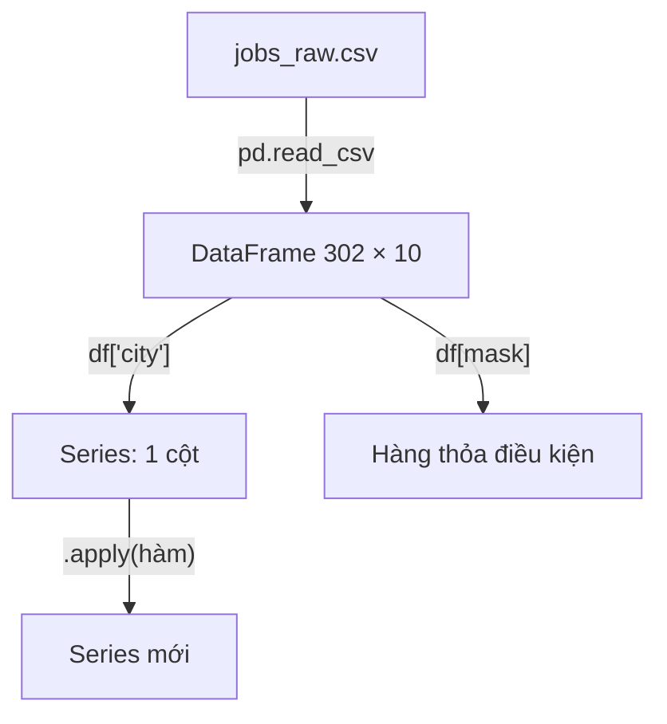
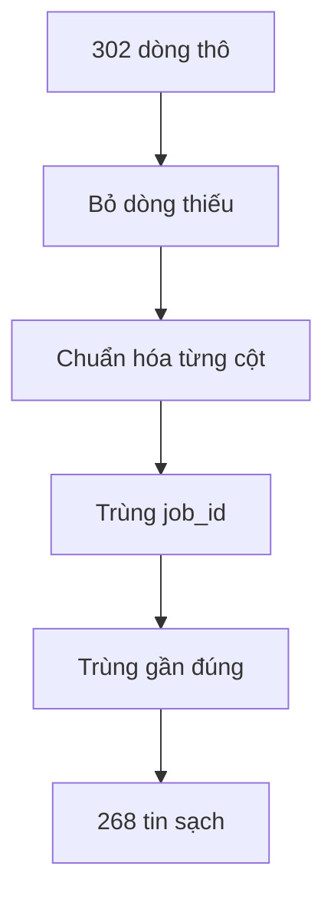
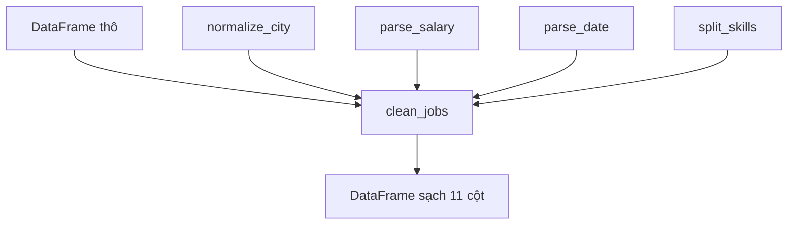
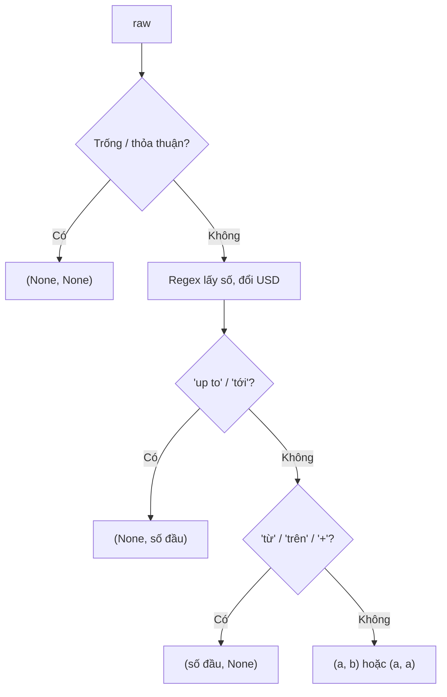

# L07 — Dữ liệu bẩn & pandas

> Làm sạch ~300 tin tuyển dụng giả lập (mô phỏng dữ liệu crawl từ nhiều nguồn) bằng pandas — **làm sạch trước khi tin con số.**

## 🎯 Mục tiêu

Sau buổi này (khoảng 3,5 giờ) bạn sẽ:

- Đọc CSV vào **DataFrame** và khám phá nhanh: `shape`, `dtypes`, `isna()`, `value_counts()`.
- Chuẩn hóa chuỗi bẩn: thành phố, công ty, kỹ năng.
- Đọc lương dạng chữ (`"15-25 triệu"`, `"$1000-1500"`) bằng **regex**.
- Đọc ngày nhiều định dạng, khử bản trùng.
- **Kết quả đo được:** 5 hàm trong `cleaning.py` qua hết **18 test**; 302 dòng thô → 268 tin sạch.

> 🧠 **Ghi nhớ:** "Garbage in, garbage out" — phân tích, dashboard hay model AI đều sai nếu dữ liệu đầu vào bẩn. Data Engineer dành phần lớn thời gian cho khâu này.

## 📋 Đề bài

**Mở file:** `academy/workspace/L07-du-lieu-ban-pandas/cleaning.py`.

Dữ liệu: `academy/datasets/jobs_raw.csv`. Biến `DATA_PATH` trong file đã trỏ sẵn tới đó.

| Hàm | Ví dụ |
|---|---|
| `normalize_city(raw)` | `" TP.HCM "` → `"Hồ Chí Minh"` |
| `parse_salary(raw, usd_rate)` | `"$1000-1500"` → `(25.0, 37.5)` |
| `parse_date(raw)` | `"15/09/2026"` → `"2026-09-15"` |
| `split_skills(raw)` | `" Python, SQL;python"` → `["python", "sql"]` |
| `clean_jobs(df)` | 302 dòng thô → 268 dòng sạch |

Docstring dưới mỗi `def` ghi đủ quy tắc. Bảng `CITY_ALIASES`, `DATE_FORMATS`… đã có sẵn.

**Xong khi:** bấm **Chạy test** thấy `18 passed`.

## 🤔 Tại sao? (kiến thức nền)

### Dữ liệu bẩn đến từ đâu

Dữ liệu bẩn sinh ra khi **nhiều người, nhiều nguồn** cùng ghi một thứ mà không có quy ước chung.

Mỗi nhà tuyển dụng gõ tay: người viết `HCM`, người viết `Sài Gòn`. Crawler lấy một tin 2 lần. Trang A ghi ngày `15/09/2026`, trang B ghi `2026-09-15`. Nếu đếm thẳng, `HCM` và `TP.HCM` thành 2 thành phố khác nhau.

| Loại bẩn | Ví dụ trong JobRadar |
|---|---|
| Nhiều cách viết | `HCM`, `hcm `, `TP.HCM`, `Sài Gòn` |
| Dạng chữ thay vì số | `"15-25 triệu"`, `"Thỏa thuận"` |
| Định dạng lẫn lộn | `15/09/2026`, `2026-09-15` |
| Trùng lặp | cùng tin, khác khoảng trắng/hoa thường |
| Thiếu / sai | ô trống, ngày `31/02/2026` |

### DataFrame và Series

**DataFrame** là bảng (hàng × cột) trong bộ nhớ; mỗi cột là một **Series** — một dãy giá trị cùng kiểu, có nhãn (index).

Nghĩ DataFrame như một sheet Excel mà bạn điều khiển bằng code. `df["city"]` lấy một cột (Series), `df[df["price"] > 10]` lọc hàng bằng **mask** (Series True/False).



### NaN, None và ô trống

pandas đánh dấu ô thiếu là **NaN** ("Not a Number"); ô rỗng trong CSV được đọc thành NaN.

`NaN == NaN` là `False`, nên không so bằng `==` được — dùng `pd.isna(x)` hoặc `df["col"].isna()`. Hàm `is_blank` có sẵn gộp cả 3 trường hợp: `None`, NaN, chuỗi toàn khoảng trắng.

> ⚠️ **Lỗi hay gặp:** gọi `raw.lower()` khi `raw` là NaN → `AttributeError: 'float' object has no attribute 'lower'`. Luôn kiểm tra trống trước.

### Regex: tìm mẫu trong chuỗi

**Regex** (biểu thức chính quy) là ngôn ngữ mô tả mẫu chữ; `re.findall(mẫu, chuỗi)` trả về mọi đoạn khớp.

| Mẫu | Nghĩa |
|---|---|
| `\d+` | một hay nhiều chữ số |
| `(?:\.\d+)?` | phần thập phân, có hoặc không |
| `[,;]` | dấu phẩy **hoặc** chấm phẩy |

Viết mẫu trong chuỗi `r"..."` (raw string) để Python không hiểu `\d` thành ký tự đặc biệt.

### Chuẩn hóa rồi mới khử trùng

Hai dòng chỉ được coi là trùng khi so trên **giá trị đã chuẩn hóa**; so trên dữ liệu thô thì bỏ sót.

`"Data Engineer"` và `"  data  engineer "` khác nhau từng ký tự nhưng là một tin. Thứ tự đúng: chuẩn hóa → tạo khóa so sánh → `drop_duplicates`.



### Giữ nguyên dữ liệu gốc

Không bao giờ sửa file thô; luôn sinh ra **bản sạch mới** từ bản thô.

Nếu quy tắc làm sạch sai, bạn sửa code rồi chạy lại từ bản thô. Sửa thẳng vào bản thô thì mất dấu vết vĩnh viễn. Vì vậy `clean_jobs` bắt đầu bằng `df.copy()`.

> 🎯 **Phỏng vấn hay hỏi:** "Bạn xử lý giá trị thiếu thế nào?" — trả lời theo 3 lựa chọn: bỏ dòng, điền giá trị mặc định, hoặc giữ trống và đánh dấu; chọn theo việc cột đó dùng để làm gì.

## 🛠️ Làm

Toàn cảnh: 4 hàm nhỏ xử lý **từng ô**, `clean_jobs` áp chúng lên **cả bảng**.



### Bước 1 — Chuẩn bị

`pandas` đã được cài sẵn bởi bước setup (nếu thiếu: `pip install pandas`). Mở `academy/workspace/L07-du-lieu-ban-pandas/`, chạy `python cleaning.py` (Linux/WSL: `python3` nếu chưa kích hoạt venv).

> ⚠️ **Lỗi hay gặp:** thấy `NotImplementedError` — bình thường, hàm chưa viết. Thấy `ModuleNotFoundError: No module named 'pandas'` → chưa kích hoạt venv hoặc chưa cài.

### Bước 2 — Khám phá một DataFrame

Thử trên bảng bán hàng nhỏ (không phải dữ liệu bài):

```python
import pandas as pd

sales = pd.DataFrame({
    "product": ["Táo", "táo ", "Cam", "Xoài", None],
    "price": [10, 10, 15, None, 8],
})
print(sales.shape)
print(sales.dtypes)
print(sales.isna().sum())
print(sales["product"].value_counts(dropna=False))
```
```output
(5, 2)
product        str
price      float64
dtype: object
product    1
price      1
dtype: int64
product
Táo     1
táo     1
Cam     1
Xoài    1
NaN     1
Name: count, dtype: int64
```

pandas 2 in `object` thay cho `str` ở dòng `product`.

`value_counts` lộ ngay vấn đề: `Táo` và `táo ` bị đếm riêng. Giờ thử `pd.read_csv(DATA_PATH)` và gọi các lệnh trên với cột `city`, `salary`.

### Bước 3 — Chuẩn hóa chuỗi → `normalize_city`

Mẫu "dọn chuỗi rồi tra bảng", trên tên sản phẩm:

```python
ALIASES = {"táo": "Táo", "apple": "Táo", "cam": "Cam"}

def clean_product(raw):
    text = " ".join(str(raw).split()).lower()
    text = text.removeprefix("quả ")
    return ALIASES.get(text)

for raw in ["  TÁO ", "Quả   cam", "apple", "Mít"]:
    print(repr(raw), "→", clean_product(raw))
```
```output
'  TÁO ' → Táo
'Quả   cam' → Cam
'apple' → Táo
'Mít' → None
```

`" ".join(s.split())` gom mọi khoảng trắng thừa. Với thành phố: nhớ `is_blank` trước, và thử **từng** tiền tố trong `CITY_PREFIXES`.

### Bước 4 — Regex lấy số → `parse_salary`

Đọc điểm thi ghi bằng chữ:

**Cách 1 — vòng lặp for**

```python
import re

for text in ["8.5/10", "từ 7 điểm", "Điểm: 1,000 (thang 1000)", "vắng"]:
    found = re.findall(r"\d+(?:\.\d+)?", text.replace(",", ""))  # list chuỗi số
    nums = []
    for x in found:
        nums.append(float(x))
    print(repr(text), "→", nums, "| có 'từ':", "từ" in text.lower())
```
```output
'8.5/10' → [8.5, 10.0] | có 'từ': False
'từ 7 điểm' → [7.0] | có 'từ': True
'Điểm: 1,000 (thang 1000)' → [1000.0, 1000.0] | có 'từ': False
'vắng' → [] | có 'từ': False
```

**Cách 2 — list comprehension**

```python
for text in ["8.5/10", "từ 7 điểm", "Điểm: 1,000 (thang 1000)", "vắng"]:
    nums = [float(x) for x in re.findall(r"\d+(?:\.\d+)?", text.replace(",", ""))]
    print(repr(text), "→", nums, "| có 'từ':", "từ" in text.lower())
```
```output
'8.5/10' → [8.5, 10.0] | có 'từ': False
'từ 7 điểm' → [7.0] | có 'từ': True
'Điểm: 1,000 (thang 1000)' → [1000.0, 1000.0] | có 'từ': False
'vắng' → [] | có 'từ': False
```

> ⚖️ **So sánh:** `[float(x) for x in found]` đọc là "với mỗi `x` trong `found`, lấy `float(x)`" — đúng bằng 3 dòng `nums = []` / `for` / `append` của Cách 1. Cùng O(n), chỉ gọn hơn.

Với lương, xét theo **đúng thứ tự** trong docstring: trống/thỏa thuận → USD → "up to" → "từ"/"+" → số lượng số.



> 💡 **Mẹo:** `$1000` với tỷ giá 25.000 → `1000 * 25000 / 1_000_000 = 25.0` triệu.

### Bước 5 — Thử lần lượt định dạng → `parse_date`

Đọc giờ ghi nhiều kiểu:

```python
from datetime import datetime

FORMATS = ["%H:%M", "%Hh%M", "%I:%M %p"]

def parse_time(text):
    for fmt in FORMATS:
        try:
            return datetime.strptime(text, fmt).strftime("%H:%M")
        except ValueError:
            continue
    return None

for t in ["14:05", "9h30", "2:05 PM", "25:00"]:
    print(t, "→", parse_time(t))
```
```output
14:05 → 14:05
9h30 → 09:30
2:05 PM → 14:05
25:00 → None
```

`strptime` báo `ValueError` khi sai định dạng **hoặc** giá trị không tồn tại (25 giờ, ngày 31/02) — tận dụng điều đó.

### Bước 6 — Tách chuỗi → `split_skills`

Sở thích ghi lộn xộn:

**Cách 1 — vòng lặp for + if**

```python
import re

raw = "Đọc sách; bơi ,  BƠI,,"
result = []
for p in re.split(r"[,;]", raw):
    p = p.strip().lower()
    if p == "":
        continue              # bỏ mảnh rỗng
    if p not in result:       # chưa có thì mới thêm
        result.append(p)
print(result)
```
```output
['đọc sách', 'bơi']
```

**Cách 2 — comprehension + `dict.fromkeys`**

```python
parts = [p.strip().lower() for p in re.split(r"[,;]", raw)]
print(parts)
print([p for p in parts if p])                  # comprehension có điều kiện if
print(list(dict.fromkeys(p for p in parts if p)))
```
```output
['đọc sách', 'bơi', 'bơi', '', '']
['đọc sách', 'bơi', 'bơi']
['đọc sách', 'bơi']
```

> ⚖️ **So sánh:** `p not in result` duyệt cả list mỗi lần → cả vòng là **O(n²)**. `dict.fromkeys` (hoặc giữ thêm một `set` đã gặp trong Cách 1) tra trùng O(1) → **O(n)**, vẫn **giữ thứ tự** (set đơn thuần thì không). Đo trên 10.000 mục: list 158 ms, `dict.fromkeys` 0,26 ms; 20.000 mục: 823 ms vs 0,6 ms. Vài kỹ năng mỗi tin thì Cách 1 vẫn ổn.

### Bước 7 — Áp lên cả bảng → `clean_jobs`

Các thao tác bảng cần dùng, trên bảng đơn hàng:

```python
import pandas as pd

orders = pd.DataFrame({
    "order_id": [1, 2, 2, 3, 4],
    "shop": ["A", "B", "B", "A", "A"],
    "size": ["30x40", "20x20", "20x20", "", "50x70"],
})
out = orders.drop_duplicates(subset=["order_id"], keep="first").copy()

# Tách "30x40" thành 2 cột — Cách 1: vòng lặp for
widths = []
heights = []
for s in out["size"]:
    if s:
        w, h = s.split("x")
    else:
        w, h = None, None
    widths.append(w)
    heights.append(h)
out["w"] = widths
out["h"] = heights

per_shop = out.groupby("shop")["order_id"].agg("count")
print(per_shop.to_dict())
out["shop_orders"] = out["shop"].map(per_shop)
print(out.reset_index(drop=True))
```
```output
{'A': 3, 'B': 1}
   order_id shop   size    w    h  shop_orders
0         1    A  30x40   30   40            3
1         2    B  20x20   20   20            1
2         3    A         NaN  NaN            3
3         4    A  50x70   50   70            3
```

- `groupby(key).agg(...)`: gom nhóm theo khóa rồi tính 1 giá trị mỗi nhóm; `.map` để gán lại từng dòng.
- `drop_duplicates(subset=..., keep="first")`: bỏ trùng theo vài cột.

Cùng việc tách cột, hai cách khác cho **đúng bảng trên**:

**Cách 2 — `.apply` với `lambda`**

```python
dims = out["size"].apply(lambda s: tuple(s.split("x")) if s else (None, None))
out["w"] = dims.apply(lambda t: t[0])
out["h"] = dims.apply(lambda t: t[1])
```

`.apply(hàm)` chạy hàm trên từng ô. `lambda s: A if s else B` là hàm không tên, tương đương `def f(s):` + `if s: return A` / `else: return B`.

**Cách 3 — pandas vectorized `.str`**

```python
out[["w", "h"]] = out["size"].str.extract(r"(\d+)x(\d+)")   # ô không khớp → NaN
print(out[["size", "w", "h"]].reset_index(drop=True))          # Cách 2 in ra y hệt
```
```output
    size    w    h
0  30x40   30   40
1  20x20   20   20
2         NaN  NaN
3  50x70   50   70
```

> ⚖️ **So sánh:** cả 3 đều O(n). Đo trên 100.000 dòng: tách `size` — vòng lặp 53 ms, `.apply` 37 ms, `.str.extract` 49 ms (regex vẫn tốn, không nhanh hơn). Nhưng `.str.strip().str.lower()` — vòng lặp 55 ms, `.apply` 26 ms, `.str` 3 ms; phép toán số `cột * 25000` — vòng lặp/`.apply` 8 ms, vectorized 0,1 ms. Lợi thế lớn của pandas nằm ở phép toán cột và `.str` đơn giản; logic nhiều nhánh như `parse_salary` thì viết hàm thường rồi `.apply`.

> ⚠️ **Lỗi hay gặp:** `df[df["title"] != ""]` không bỏ được NaN. Dùng mask `~df["title"].apply(is_blank)`.

### Bước 8 — Chạy trên dữ liệu thật

Chạy `python cleaning.py`: thấy `Thô: (302, 10)` và `Sạch: (268, 11)`, `value_counts` của `city` chỉ còn 5 tên chuẩn. Rồi bấm **Chạy test**.

> 💡 **Mẹo:** còn thời gian? Đọc vài ô `description` — nhiều tin ghi lương "thỏa thuận" ở cột `salary` nhưng lộ con số trong mô tả. Ở P3 (L11–L12) bạn dùng LLM trích lương, cấp bậc, kỹ năng từ `description` ra JSON (chưa ghi ngược vào DB).

## ✅ Tự kiểm tra

Bấm **Chạy test**, hoặc từ thư mục `academy/`:

```bash
PYTHONPATH=workspace/L07-du-lieu-ban-pandas python3 -m pytest curriculum/L07-du-lieu-ban-pandas/tests -q
```

> 💡 **Mẹo:** Windows PowerShell: `$env:PYTHONPATH="workspace\L07-du-lieu-ban-pandas"; python -m pytest curriculum\L07-du-lieu-ban-pandas\tests -q`

Mục tiêu: `18 passed`. Test `..._du_lieu_that` chạy trên toàn bộ CSV — nếu chỉ test đó fail, so `value_counts()` từng cột để tìm biến thể bạn bỏ sót.

## 🎤 Câu hỏi phỏng vấn

> 🎯 **Phỏng vấn hay hỏi:** câu 5 — `.apply` gọi hàm Python từng ô (chậm với triệu dòng); `.str.lower()` hay phép toán cột chạy bằng code C bên trong pandas/numpy.
