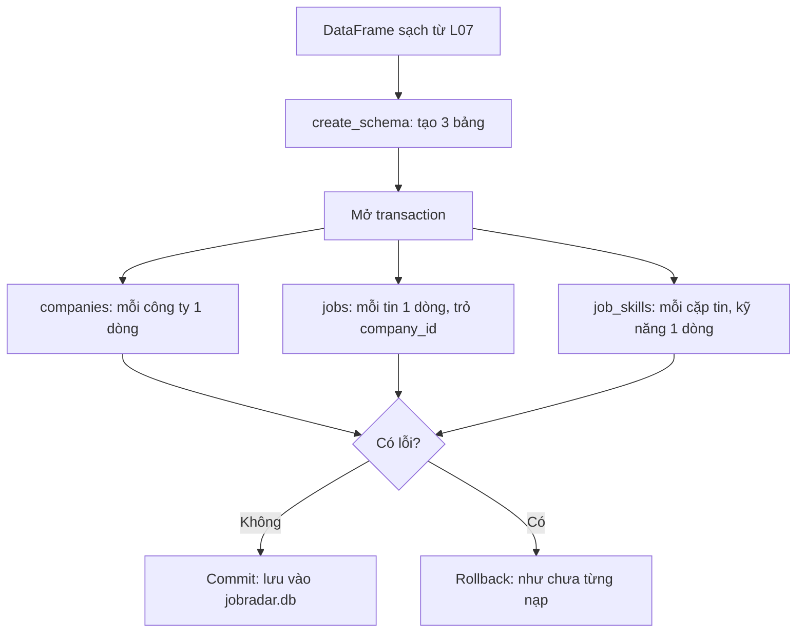
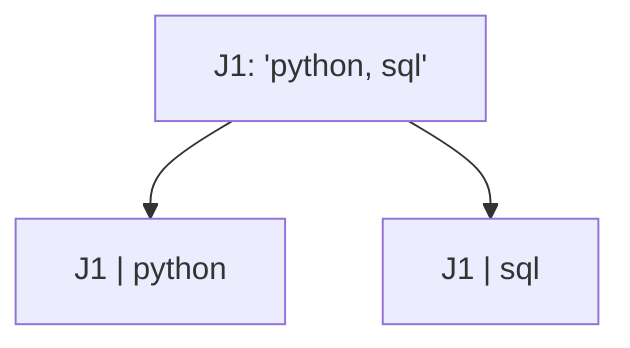
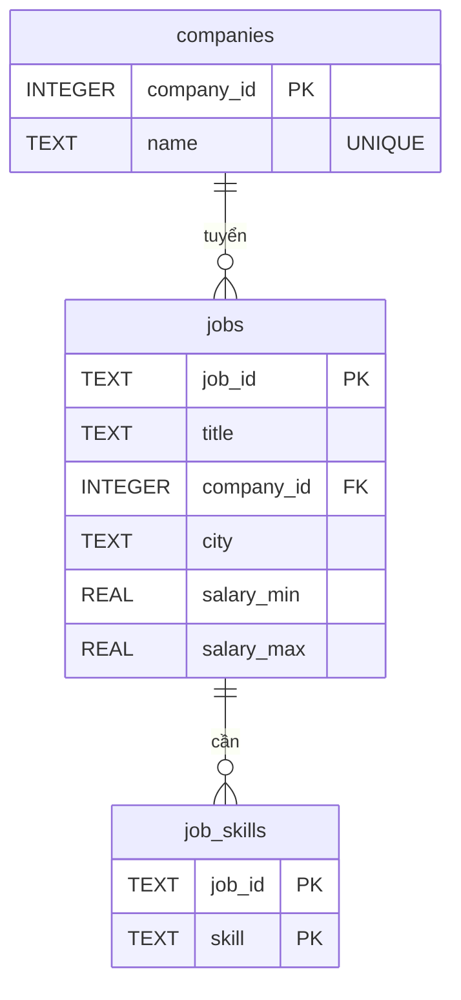
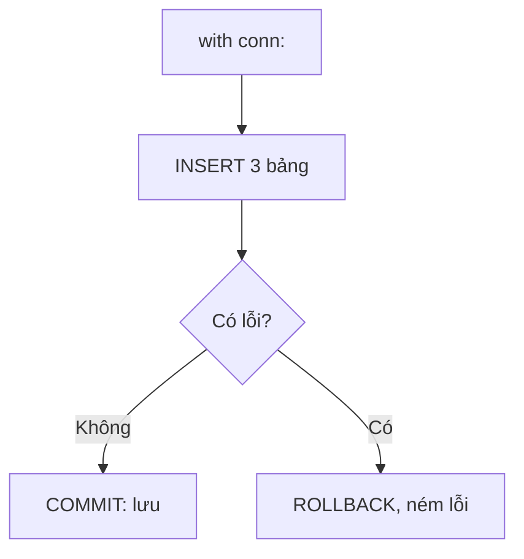
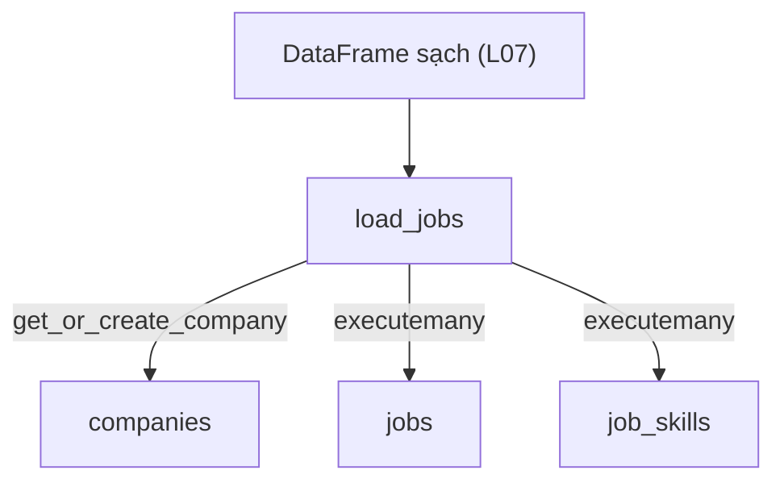

# L08 — Mô hình hóa & nạp SQLite

> Cất DataFrame sạch của L07 vào **cơ sở dữ liệu SQLite** với cấu trúc bảng hợp lý, để L09 và các project sau dùng lại.

## 🎯 Mục tiêu

Sau buổi này (khoảng 3 giờ) bạn sẽ:

- Giải thích được vì sao tách dữ liệu thành nhiều bảng (**chuẩn hóa** — để mỗi thông tin chỉ lưu một lần).
- Dùng **khóa chính** (mã định danh mỗi dòng), **khóa ngoại** (cột trỏ sang bảng khác), bảng nối cho quan hệ **nhiều–nhiều**.
- Viết lệnh tạo bảng (**DDL**) và nạp dữ liệu bằng `sqlite3`: tham số `?`, `executemany`, **transaction** (khối lệnh "tất cả hoặc không gì").
- **Kết quả đo được:** 4 hàm trong `db.py` qua hết **13 test**; file `jobradar.db` có 30 công ty, 268 tin.

> 🧠 **Ghi nhớ:** Phỏng vấn Data Engineer gần như luôn có câu "thiết kế schema cho bài toán X". Bài này là nền cho câu đó.

## 📋 Đề bài

**Mở file:** `academy/workspace/L08-mo-hinh-hoa-sqlite/db.py`.

Schema (bản thiết kế bảng) cần tạo — 3 bảng:

| Bảng | Khóa chính | Liên kết |
|---|---|---|
| `companies` | `company_id` | — |
| `jobs` | `job_id` | `company_id` → `companies` |
| `job_skills` | (`job_id`, `skill`) | `job_id` → `jobs` |

| Hàm | Việc |
|---|---|
| `create_schema(conn)` | tạo 3 bảng, bật khóa ngoại |
| `get_or_create_company(conn, name)` | trả id công ty, chưa có thì thêm |
| `load_jobs(conn, df)` | nạp DataFrame sạch trong 1 transaction |
| `count_rows(conn)` | `{"companies": 30, "jobs": 268, "job_skills": 977}` |

Docstring ghi đủ tên cột và kiểu. `python db.py` dùng `clean_jobs` **của bạn** ở L07.

**Xong khi:** bấm **Chạy test** thấy `13 passed`.

## 🤔 Tại sao? (kiến thức nền)

### Hiểu trước khi làm

**Bối cảnh.** Bảng sạch của L07 chỉ nằm trong bộ nhớ: tắt chương trình là mất, lần sau lại phải làm sạch từ đầu. JobRadar cần một nơi cất **lâu dài**, nhiều chương trình cùng đọc được, và hỏi nhanh bằng câu lệnh — đó là **cơ sở dữ liệu**. Cất thế nào cũng quan trọng: nếu chép tên công ty vào từng tin, đổi tên một lần phải sửa hàng chục chỗ, sót một chỗ là dữ liệu mâu thuẫn. Bản thiết kế "có những bảng nào, cột nào, nối với nhau ra sao" gọi là **schema**.

**Ví dụ đời thường.**
- **Cơ sở dữ liệu** giống tủ hồ sơ nhiều ngăn: mỗi ngăn (**bảng**) chứa một loại phiếu, mẫu phiếu quy định rõ ô nào ghi gì (**schema**).
- **Khóa chính** giống số CCCD: mỗi người một số, không trùng. **Khóa ngoại** giống ghi số CCCD của người bảo lãnh thay vì chép lại toàn bộ thông tin người đó.
- **Transaction** giống chuyển khoản: trừ tiền tài khoản A và cộng tiền tài khoản B phải cùng xảy ra; lỗi giữa chừng thì hủy cả hai.

**Bạn đã gặp nó ở đâu.**
- App ngân hàng: mỗi lần chuyển khoản là một transaction.
- Shopee, Tiki: bảng khách hàng, bảng sản phẩm, bảng đơn hàng nối với nhau bằng mã.
- Chrome, Firefox lưu lịch sử duyệt web trong một file SQLite trên máy bạn.
- Danh bạ Android, tin nhắn WhatsApp trên điện thoại cũng nằm trong SQLite.

| | Cơ sở dữ liệu, SQLite | Schema (thiết kế bảng) |
|---|---|---|
| **What** — là gì? | Phần mềm cất dữ liệu thành bảng, đọc ghi bằng ngôn ngữ **SQL**. SQLite là loại gọn nhất: cả DB nằm trong một file. | Danh sách bảng, cột, kiểu dữ liệu, khóa và quan hệ giữa các bảng. |
| **Why** — vì sao cần? | Dữ liệu còn nguyên sau khi tắt máy; hỏi nhanh; chặn dữ liệu sai bằng luật. | Mỗi thông tin chỉ lưu một lần → sửa một chỗ, không mâu thuẫn. |
| **When** — khi nào dùng? | Dữ liệu cần giữ lâu, cần truy vấn lại nhiều lần. SQLite hợp app nhỏ, máy cá nhân, thử nghiệm. | Trước khi nạp dữ liệu vào DB. |
| **When not** — khi nào không? | Nhiều người ghi cùng lúc, cần phân quyền: dùng PostgreSQL, MySQL. Dữ liệu dùng một lần: file CSV là đủ. | Kho phân tích (data warehouse) có khi cố ý gộp bảng để đọc nhanh hơn. |
| **Where** — ở đâu? | File `jobradar.db`, module `sqlite3` có sẵn trong Python. | Hàm `create_schema` trong `db.py`: 3 bảng `companies`, `jobs`, `job_skills`. |
| **How** — chạy thế nào? | Python mở kết nối (`conn`) → gửi câu SQL → DB đọc ghi file. | `CREATE TABLE` khai báo cột và khóa; DB tự từ chối dòng vi phạm luật. |

**Từ mới trong bài**

| Thuật ngữ | Nghĩa đời thường |
|---|---|
| cơ sở dữ liệu (database, DB) | Phần mềm cất và tra cứu dữ liệu lâu dài |
| SQLite, `sqlite3`, `.db` | DB nằm trong một file / module Python để dùng nó / đuôi file DB |
| SQL | Ngôn ngữ ra lệnh cho DB: tạo bảng, thêm, đọc, sửa dữ liệu |
| bảng, dòng, cột | Một ngăn tủ / một phiếu / một ô trên phiếu |
| schema | Bản thiết kế các bảng và quan hệ |
| chuẩn hóa (normalization), 1NF | Tách bảng để mỗi thông tin lưu một lần; 1NF = mỗi ô chỉ một giá trị |
| khóa chính (PK), khóa ghép | Cột định danh duy nhất mỗi dòng; khóa ghép = nhiều cột cùng làm khóa |
| khóa ngoại (FK) | Cột trỏ tới khóa chính của bảng khác |
| một–nhiều, nhiều–nhiều, bảng nối | Một công ty nhiều tin / một tin nhiều kỹ năng và ngược lại; bảng nối ghi từng cặp |
| DDL, `CREATE TABLE` | Nhóm lệnh tạo cấu trúc bảng |
| `INSERT`, `SELECT`, `COUNT(*)` | Thêm dòng / đọc dữ liệu / đếm số dòng |
| `TEXT`, `INTEGER`, `REAL`, `NULL` | Chữ, số nguyên, số thực, "không có giá trị" |
| `NOT NULL`, `UNIQUE` | Luật: không được bỏ trống / không được trùng |
| `PRAGMA foreign_keys = ON` | Lệnh bật kiểm tra khóa ngoại của SQLite |
| connection (`conn`) | Đường kết nối từ Python tới DB |
| transaction, commit, rollback | Khối lệnh "tất cả hoặc không gì"; commit = lưu, rollback = hủy |
| tham số `?` | Chỗ trống trong câu SQL, DB tự điền giá trị an toàn |
| SQL injection | Kẻ xấu chèn mã SQL qua dữ liệu nhập vào |
| `executemany` | Chạy một câu SQL cho cả danh sách dòng |
| `IntegrityError` | Lỗi khi dữ liệu vi phạm luật của bảng (trùng khóa, sai khóa ngoại) |
| `:memory:` | DB tạm trong RAM, tắt là mất — tiện để thử |
| JOIN | Ghép dòng của hai bảng theo cột chung (học kỹ ở L09) |



### Một bảng to thì có gì sai?

Một bảng phẳng lặp lại thông tin; lặp lại nghĩa là **sửa một chỗ, quên chỗ khác**.

Nếu mỗi tin chứa nguyên tên công ty, đổi tên "Lotus AI" thành "Lotus AI Group" phải sửa 15 dòng; sót 1 dòng là dữ liệu mâu thuẫn. Tách công ty ra bảng riêng: sửa đúng 1 dòng.

### Chuẩn hóa (normalization)

Chuẩn hóa là chia dữ liệu thành các bảng sao cho **mỗi sự thật chỉ lưu một lần** và **mỗi ô chỉ chứa một giá trị**.

Ô `skills = ["python", "sql"]` vi phạm quy tắc "một ô một giá trị" (dạng chuẩn 1, **1NF**): không lọc, không đếm bằng SQL được. Cách sửa: mỗi kỹ năng thành một dòng riêng.



> 💡 **Mẹo:** chuẩn hóa đầy đủ sẽ có thêm bảng `skills(skill_id, name)`. Ở đây giữ thẳng tên kỹ năng trong `job_skills` cho gọn — một **đánh đổi** bạn nên nói được khi phỏng vấn.

### Khóa chính, khóa ngoại

`jobs.company_id` là khóa ngoại → `companies.company_id`. Bật `PRAGMA foreign_keys = ON`, SQLite sẽ chặn tin trỏ tới công ty không tồn tại. Khóa chính có thể **ghép** nhiều cột: `(job_id, skill)` cấm một tin có cùng kỹ năng hai lần.



### Một–nhiều và nhiều–nhiều

Một công ty có nhiều tin (**1–nhiều**: khóa ngoại nằm ở bảng "nhiều"). Một tin cần nhiều kỹ năng và một kỹ năng xuất hiện ở nhiều tin (**nhiều–nhiều**: cần **bảng nối**).

`job_skills` chính là bảng nối: mỗi dòng là một cặp (tin, kỹ năng).

### Transaction: tất cả hoặc không gì cả

**Transaction** gom nhiều lệnh thành một khối: thành công hết thì **commit**, lỗi một lệnh thì **rollback** — như chưa từng chạy.

Nạp 268 tin mà lỗi ở tin thứ 200: không có transaction → DB còn 199 tin "dở dang", chạy lại thì trùng. Trong Python: `with conn:` tự commit khi khối chạy xong, tự rollback khi có exception.



### SQLite

Cú pháp SQL gần giống PostgreSQL/MySQL, nên những gì học ở đây dùng được ở công ty. Khác biệt chính: không có user/quyền, ghi đồng thời hạn chế.

> 🎯 **Phỏng vấn hay hỏi:** "Khi nào KHÔNG nên chuẩn hóa?" — kho dữ liệu phân tích (data warehouse) thường **phi chuẩn hóa** có chủ đích để truy vấn nhanh, ít JOIN.

## 🛠️ Làm

Toàn cảnh: DataFrame sạch từ L07 đi qua `load_jobs`, tách ra 3 bảng.



### Bước 1 — Chuẩn bị

`sqlite3` có sẵn, không cần cài. Hoàn thành L07 trước (file `workspace/L07-du-lieu-ban-pandas/cleaning.py`). Cài thêm extension **SQLite Viewer** cho VS Code để mở file `.db`.

### Bước 2 — DDL → `create_schema`

Thử với lớp học và học sinh:

```python
import sqlite3

conn = sqlite3.connect(":memory:")
conn.executescript("""
    PRAGMA foreign_keys = ON;
    CREATE TABLE IF NOT EXISTS classes (
        class_id INTEGER PRIMARY KEY,
        name     TEXT NOT NULL UNIQUE
    );
    CREATE TABLE IF NOT EXISTS students (
        student_id TEXT PRIMARY KEY,
        full_name  TEXT NOT NULL,
        class_id   INTEGER REFERENCES classes(class_id)
    );
""")
for row in conn.execute("PRAGMA table_info(students)"):
    print(row)
print(conn.execute("PRAGMA foreign_key_list(students)").fetchall())
```
```output
(0, 'student_id', 'TEXT', 0, None, 1)
(1, 'full_name', 'TEXT', 1, None, 0)
(2, 'class_id', 'INTEGER', 0, None, 0)
[(0, 0, 'classes', 'class_id', 'class_id', 'NO ACTION', 'NO ACTION', 'NONE')]
```

`":memory:"` tạo DB trong RAM — tiện để thử. Cột cuối của `table_info` là vị trí trong khóa chính.

> ⚠️ **Lỗi hay gặp:** quên `IF NOT EXISTS` → gọi lần 2 báo `table ... already exists`.

### Bước 3 — Tham số `?` → `get_or_create_company`

Vì sao không ghép chuỗi:

```python
import sqlite3

conn = sqlite3.connect(":memory:")
conn.execute("CREATE TABLE classes (class_id INTEGER PRIMARY KEY, name TEXT UNIQUE)")
name = "Lớp 10A'"
try:
    conn.execute(f"INSERT INTO classes (name) VALUES ('{name}')")
except sqlite3.OperationalError as e:
    print("Ghép chuỗi:", e)
cur = conn.execute("INSERT INTO classes (name) VALUES (?)", (name,))
print("Dùng ?: id mới =", cur.lastrowid)
print(conn.execute("SELECT class_id FROM classes WHERE name = ?", (name,)).fetchone())
```
```output
Ghép chuỗi: unrecognized token: "'Lớp 10A'')"
Dùng ?: id mới = 1
(1,)
```

Dấu `'` trong dữ liệu phá câu SQL — kẻ xấu lợi dụng đúng chỗ này (**SQL injection**). Tham số `?` luôn an toàn. `cur.lastrowid` cho id vừa thêm.

> ⚠️ **Lỗi hay gặp:** `(name)` không phải tuple — phải viết `(name,)` có dấu phẩy.

### Bước 4 — `executemany` và transaction → `load_jobs`

Nạp điểm thi, có một dòng lỗi:

```python
import sqlite3

conn = sqlite3.connect(":memory:")
conn.execute("CREATE TABLE scores (student_id TEXT, subject TEXT, score REAL, PRIMARY KEY (student_id, subject))")
rows = [("S1", "toán", 8.5), ("S1", "văn", 7.0), ("S1", "toán", 9.0)]
try:
    with conn:
        conn.executemany("INSERT INTO scores VALUES (?, ?, ?)", rows)
except sqlite3.IntegrityError as e:
    print("Lỗi:", e)
print("Số dòng sau lỗi:", conn.execute("SELECT COUNT(*) FROM scores").fetchone()[0])
with conn:
    conn.executemany("INSERT INTO scores VALUES (?, ?, ?)", rows[:2])
print("Số dòng sau khi sửa:", conn.execute("SELECT COUNT(*) FROM scores").fetchone()[0])
```
```output
Lỗi: UNIQUE constraint failed: scores.student_id, scores.subject
Số dòng sau lỗi: 0
Số dòng sau khi sửa: 2
```

Dòng thứ 3 lỗi → cả 2 dòng trước cũng bị rollback. Đó là điều bạn muốn.

`executemany(sql, rows)` tương đương vòng lặp `for row in rows: conn.execute(sql, row)` đặt trong cùng `with conn:`.

> ⚖️ **So sánh:** đo 100.000 dòng vào file SQLite, cùng một transaction: vòng lặp `execute` 114 ms, `executemany` 87 ms — cùng O(n), nhanh hơn ~1,3 lần. Chênh lệch thật nằm ở transaction: mỗi dòng một `with conn:` (một lần commit, ghi đĩa) thì 2.000 dòng đã mất 24,9 s. Luôn gom cả lô vào một transaction.

> 💡 **Mẹo:** `df.to_dict("records")` biến DataFrame thành list dict — dễ duyệt từng tin. Đưa mọi giá trị qua `to_db` để NaN thành `NULL`.

### Bước 5 — Bảng nối nhiều–nhiều

Học sinh ↔ câu lạc bộ, rồi JOIN để đọc lại:

```python
import sqlite3

conn = sqlite3.connect(":memory:")
conn.executescript("""
    CREATE TABLE students (student_id TEXT PRIMARY KEY, name TEXT);
    CREATE TABLE student_clubs (student_id TEXT, club TEXT, PRIMARY KEY (student_id, club));
    INSERT INTO students VALUES ('S1', 'An'), ('S2', 'Bình');
""")
clubs = {"S1": ["cờ vua", "bóng đá"], "S2": ["bóng đá"]}

# Cách 1 — hai vòng for lồng nhau
rows = []
for sid, names in clubs.items():       # .items() cho từng cặp (key, value)
    for club in names:
        rows.append((sid, club))
print(rows)
conn.executemany("INSERT INTO student_clubs VALUES (?, ?)", rows)
print(conn.execute("""
    SELECT s.name, c.club FROM students s
    JOIN student_clubs c ON c.student_id = s.student_id
    ORDER BY s.name, c.club
""").fetchall())
```
```output
[('S1', 'cờ vua'), ('S1', 'bóng đá'), ('S2', 'bóng đá')]
[('An', 'bóng đá'), ('An', 'cờ vua'), ('Bình', 'bóng đá')]
```

List lồng nhau → list phẳng các cặp: đúng việc bạn làm với cột `skills`.

**Cách 2 — comprehension lồng**, thay cho 4 dòng `rows = []`… ở trên, cùng kết quả:

```python
rows = [(sid, club) for sid, names in clubs.items() for club in names]
```

> ⚖️ **So sánh:** cùng O(n), chỉ gọn hơn. Hai `for` trong comprehension đọc từ trái sang phải đúng như thứ tự lồng của Cách 1 — dễ đọc nhầm, nên với vòng lồng Cách 1 thường rõ hơn.

### Bước 6 — `count_rows`

Một vòng qua 3 tên bảng, `SELECT COUNT(*) FROM ...`, trả dict.

> ⚠️ **Lỗi hay gặp:** tên bảng **không** truyền bằng `?` được (chỉ giá trị mới được). Ở đây tên bảng lấy từ list cố định trong code nên ghép chuỗi an toàn — không bao giờ ghép tên bảng lấy từ người dùng.

### Bước 7 — Nạp dữ liệu thật

Chạy `python db.py` → in `Đã nạp 268 tin` và `{'companies': 30, 'jobs': 268, 'job_skills': 977}`. Mở `jobradar.db` bằng SQLite Viewer, xem 3 bảng. Rồi bấm **Chạy test**.

> 💡 **Mẹo:** chạy `python db.py` lần 2 — vẫn đúng vì file cũ bị xóa trước. Ở L10 bạn sẽ học cách chạy lại **không cần xóa** (idempotent).

## ✅ Tự kiểm tra

Bấm **Chạy test**, hoặc từ thư mục `academy/`:

```bash
PYTHONPATH=workspace/L08-mo-hinh-hoa-sqlite python3 -m pytest curriculum/L08-mo-hinh-hoa-sqlite/tests -q
```

> 💡 **Mẹo:** Windows PowerShell: `$env:PYTHONPATH="workspace\L08-mo-hinh-hoa-sqlite"; python -m pytest curriculum\L08-mo-hinh-hoa-sqlite\tests -q`

Mục tiêu: `13 passed`. Test dùng DB trong RAM nên không đụng `jobradar.db` của bạn.

## 🎤 Câu hỏi phỏng vấn

> 🎯 **Phỏng vấn hay hỏi:** câu 3 — vẽ 3 bảng, nói rõ khóa ghép `(job_id, skill)` ngăn trùng, và đánh đổi khi không có bảng `skills` riêng.
