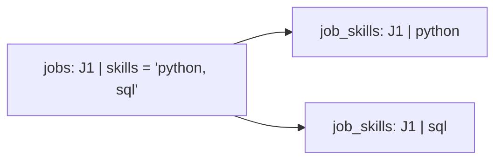
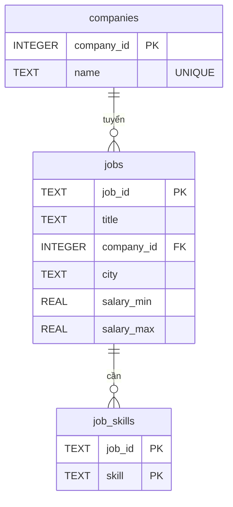
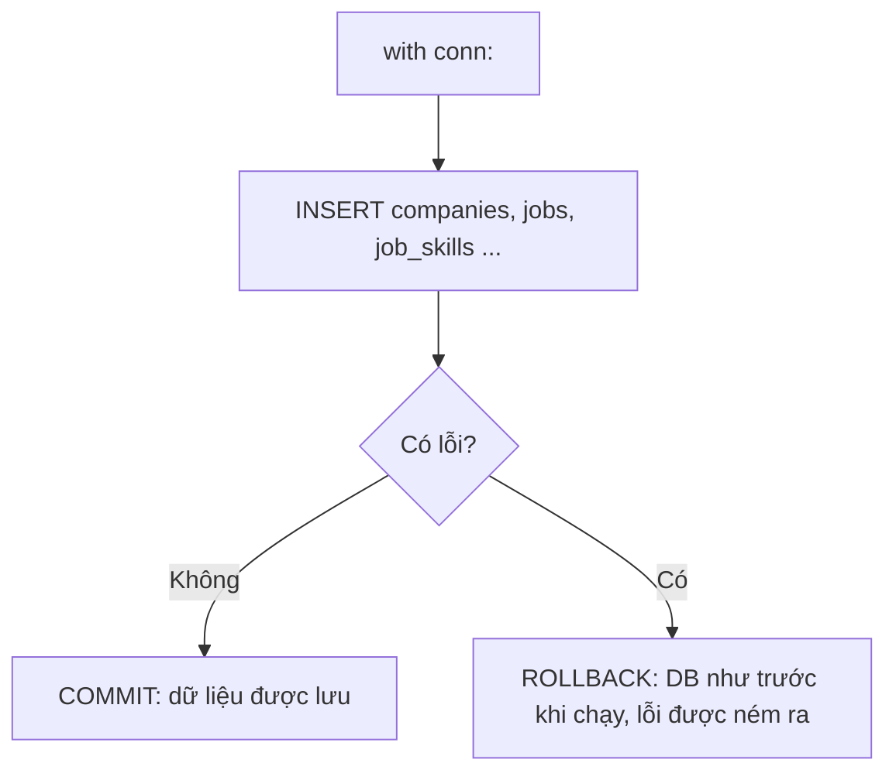
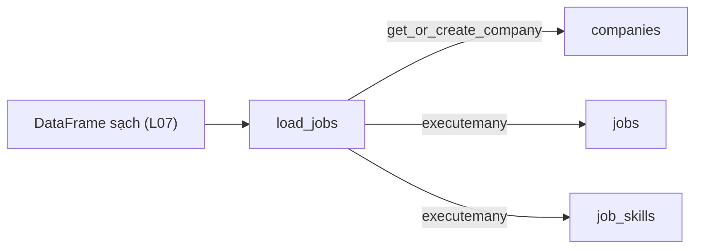

# L08 — Mô hình hóa & nạp SQLite

> Ở L07 bạn có một DataFrame sạch — nhưng nó chỉ sống trong RAM, tắt chương trình là mất. Bài này cất dữ liệu vào **cơ sở dữ liệu** với cấu trúc bảng hợp lý, để L09 truy vấn và các project sau dùng lại.

## 🎯 Mục tiêu

Sau buổi này (khoảng 3 giờ) bạn sẽ:

- Giải thích được vì sao tách dữ liệu thành nhiều bảng (**chuẩn hóa**).
- Dùng **khóa chính**, **khóa ngoại**, bảng nối cho quan hệ **nhiều–nhiều**.
- Viết lệnh tạo bảng (**DDL**) và nạp dữ liệu bằng `sqlite3`: tham số `?`, `executemany`, **transaction**.
- **Kết quả đo được:** 4 hàm trong `db.py` qua hết **13 test**; file `jobradar.db` có 30 công ty, 268 tin.

> 🧠 **Ghi nhớ:** Phỏng vấn Data Engineer gần như luôn có câu "thiết kế schema cho bài toán X". Bài này là nền cho câu đó.

## 📋 Đề bài

**Mở file:** `academy/workspace/L08-mo-hinh-hoa-sqlite/db.py`.

Schema cần tạo — 3 bảng:

| Bảng | Khóa chính | Liên kết |
|---|---|---|
| `companies` | `company_id` | — |
| `jobs` | `job_id` | `company_id` → `companies` |
| `job_skills` | (`job_id`, `skill`) | `job_id` → `jobs` |

| Hàm | Việc |
|---|---|
| `create_schema(conn)` | tạo 3 bảng, bật khóa ngoại |
| `get_or_create_company(conn, name)` | trả id công ty, chưa có thì thêm |
| `load_jobs(conn, df)` | nạp DataFrame sạch trong 1 transaction |
| `count_rows(conn)` | `{"companies": 30, "jobs": 268, "job_skills": 977}` |

Docstring ghi đủ tên cột và kiểu. `python db.py` dùng `clean_jobs` **của bạn** ở L07.

**Xong khi:** bấm **Chạy test** thấy `13 passed`.

## 🤔 Tại sao? (kiến thức nền)

### Một bảng to thì có gì sai?

Một bảng phẳng lặp lại thông tin; lặp lại nghĩa là **sửa một chỗ, quên chỗ khác**.

Nếu mỗi tin chứa nguyên tên công ty, đổi tên "Lotus AI" thành "Lotus AI Group" phải sửa 15 dòng; sót 1 dòng là dữ liệu mâu thuẫn. Tách công ty ra bảng riêng: sửa đúng 1 dòng.

### Chuẩn hóa (normalization)

Chuẩn hóa là chia dữ liệu thành các bảng sao cho **mỗi sự thật chỉ lưu một lần** và **mỗi ô chỉ chứa một giá trị**.

Ô `skills = ["python", "sql"]` vi phạm quy tắc "một ô một giá trị" (dạng chuẩn 1, **1NF**): không lọc, không đếm bằng SQL được. Cách sửa: mỗi kỹ năng thành một dòng riêng.



> 💡 **Mẹo:** chuẩn hóa đầy đủ sẽ có thêm bảng `skills(skill_id, name)`. Ở đây giữ thẳng tên kỹ năng trong `job_skills` cho gọn — một **đánh đổi** bạn nên nói được khi phỏng vấn.

### Khóa chính, khóa ngoại

**Khóa chính** (primary key) định danh duy nhất mỗi dòng; **khóa ngoại** (foreign key) là cột trỏ tới khóa chính của bảng khác.

`jobs.company_id` là khóa ngoại → `companies.company_id`. Bật `PRAGMA foreign_keys = ON`, SQLite sẽ chặn tin trỏ tới công ty không tồn tại. Khóa chính có thể **ghép** nhiều cột: `(job_id, skill)` cấm một tin có cùng kỹ năng hai lần.



### Một–nhiều và nhiều–nhiều

Một công ty có nhiều tin (**1–nhiều**: khóa ngoại nằm ở bảng "nhiều"). Một tin cần nhiều kỹ năng và một kỹ năng xuất hiện ở nhiều tin (**nhiều–nhiều**: cần **bảng nối**).

`job_skills` chính là bảng nối: mỗi dòng là một cặp (tin, kỹ năng).

### Transaction: tất cả hoặc không gì cả

**Transaction** gom nhiều lệnh thành một khối: thành công hết thì **commit**, lỗi một lệnh thì **rollback** — như chưa từng chạy.

Nạp 268 tin mà lỗi ở tin thứ 200: không có transaction → DB còn 199 tin "dở dang", chạy lại thì trùng. Trong Python: `with conn:` tự commit khi khối chạy xong, tự rollback khi có exception.



### SQLite

SQLite là cơ sở dữ liệu **nằm trong một file**, không cần server; module `sqlite3` có sẵn trong Python.

Cú pháp SQL gần giống PostgreSQL/MySQL, nên những gì học ở đây dùng được ở công ty. Khác biệt chính: không có user/quyền, ghi đồng thời hạn chế.

> 🎯 **Phỏng vấn hay hỏi:** "Khi nào KHÔNG nên chuẩn hóa?" — kho dữ liệu phân tích (data warehouse) thường **phi chuẩn hóa** có chủ đích để truy vấn nhanh, ít JOIN.

## 🛠️ Làm

Toàn cảnh: DataFrame sạch từ L07 đi qua `load_jobs`, tách ra 3 bảng.



### Bước 1 — Chuẩn bị

`sqlite3` có sẵn, không cần cài. Hoàn thành L07 trước (file `workspace/L07-du-lieu-ban-pandas/cleaning.py`). Cài thêm extension **SQLite Viewer** cho VS Code để mở file `.db`.

### Bước 2 — DDL → `create_schema`

Thử với lớp học và học sinh:

```python
import sqlite3

conn = sqlite3.connect(":memory:")
conn.executescript("""
    PRAGMA foreign_keys = ON;
    CREATE TABLE IF NOT EXISTS classes (
        class_id INTEGER PRIMARY KEY,
        name     TEXT NOT NULL UNIQUE
    );
    CREATE TABLE IF NOT EXISTS students (
        student_id TEXT PRIMARY KEY,
        full_name  TEXT NOT NULL,
        class_id   INTEGER REFERENCES classes(class_id)
    );
""")
for row in conn.execute("PRAGMA table_info(students)"):
    print(row)
print(conn.execute("PRAGMA foreign_key_list(students)").fetchall())
```
```output
(0, 'student_id', 'TEXT', 0, None, 1)
(1, 'full_name', 'TEXT', 1, None, 0)
(2, 'class_id', 'INTEGER', 0, None, 0)
[(0, 0, 'classes', 'class_id', 'class_id', 'NO ACTION', 'NO ACTION', 'NONE')]
```

`":memory:"` tạo DB trong RAM — tiện để thử. Cột cuối của `table_info` là vị trí trong khóa chính.

> ⚠️ **Lỗi hay gặp:** quên `IF NOT EXISTS` → gọi lần 2 báo `table ... already exists`.

### Bước 3 — Tham số `?` → `get_or_create_company`

Vì sao không ghép chuỗi:

```python
import sqlite3

conn = sqlite3.connect(":memory:")
conn.execute("CREATE TABLE classes (class_id INTEGER PRIMARY KEY, name TEXT UNIQUE)")
name = "Lớp 10A'"
try:
    conn.execute(f"INSERT INTO classes (name) VALUES ('{name}')")
except sqlite3.OperationalError as e:
    print("Ghép chuỗi:", e)
cur = conn.execute("INSERT INTO classes (name) VALUES (?)", (name,))
print("Dùng ?: id mới =", cur.lastrowid)
print(conn.execute("SELECT class_id FROM classes WHERE name = ?", (name,)).fetchone())
```
```output
Ghép chuỗi: unrecognized token: "'Lớp 10A'')"
Dùng ?: id mới = 1
(1,)
```

Dấu `'` trong dữ liệu phá câu SQL — kẻ xấu lợi dụng đúng chỗ này (**SQL injection**). Tham số `?` luôn an toàn. `cur.lastrowid` cho id vừa thêm.

> ⚠️ **Lỗi hay gặp:** `(name)` không phải tuple — phải viết `(name,)` có dấu phẩy.

### Bước 4 — `executemany` và transaction → `load_jobs`

Nạp điểm thi, có một dòng lỗi:

```python
import sqlite3

conn = sqlite3.connect(":memory:")
conn.execute("CREATE TABLE scores (student_id TEXT, subject TEXT, score REAL, PRIMARY KEY (student_id, subject))")
rows = [("S1", "toán", 8.5), ("S1", "văn", 7.0), ("S1", "toán", 9.0)]
try:
    with conn:
        conn.executemany("INSERT INTO scores VALUES (?, ?, ?)", rows)
except sqlite3.IntegrityError as e:
    print("Lỗi:", e)
print("Số dòng sau lỗi:", conn.execute("SELECT COUNT(*) FROM scores").fetchone()[0])
with conn:
    conn.executemany("INSERT INTO scores VALUES (?, ?, ?)", rows[:2])
print("Số dòng sau khi sửa:", conn.execute("SELECT COUNT(*) FROM scores").fetchone()[0])
```
```output
Lỗi: UNIQUE constraint failed: scores.student_id, scores.subject
Số dòng sau lỗi: 0
Số dòng sau khi sửa: 2
```

Dòng thứ 3 lỗi → cả 2 dòng trước cũng bị rollback. Đó là điều bạn muốn.

> 💡 **Mẹo:** `df.to_dict("records")` biến DataFrame thành list dict — dễ duyệt từng tin. Đưa mọi giá trị qua `to_db` để NaN thành `NULL`.

### Bước 5 — Bảng nối nhiều–nhiều

Học sinh ↔ câu lạc bộ, rồi JOIN để đọc lại:

```python
import sqlite3

conn = sqlite3.connect(":memory:")
conn.executescript("""
    CREATE TABLE students (student_id TEXT PRIMARY KEY, name TEXT);
    CREATE TABLE student_clubs (student_id TEXT, club TEXT, PRIMARY KEY (student_id, club));
    INSERT INTO students VALUES ('S1', 'An'), ('S2', 'Bình');
""")
clubs = {"S1": ["cờ vua", "bóng đá"], "S2": ["bóng đá"]}
rows = [(sid, club) for sid, names in clubs.items() for club in names]
print(rows)
conn.executemany("INSERT INTO student_clubs VALUES (?, ?)", rows)
print(conn.execute("""
    SELECT s.name, c.club FROM students s
    JOIN student_clubs c ON c.student_id = s.student_id
    ORDER BY s.name, c.club
""").fetchall())
```
```output
[('S1', 'cờ vua'), ('S1', 'bóng đá'), ('S2', 'bóng đá')]
[('An', 'bóng đá'), ('An', 'cờ vua'), ('Bình', 'bóng đá')]
```

List lồng nhau → list phẳng các cặp: đúng việc bạn làm với cột `skills`.

### Bước 6 — `count_rows`

Một vòng qua 3 tên bảng, `SELECT COUNT(*) FROM ...`, trả dict.

> ⚠️ **Lỗi hay gặp:** tên bảng **không** truyền bằng `?` được (chỉ giá trị mới được). Ở đây tên bảng lấy từ list cố định trong code nên ghép chuỗi an toàn — không bao giờ ghép tên bảng lấy từ người dùng.

### Bước 7 — Nạp dữ liệu thật

Chạy `python db.py` → in `Đã nạp 268 tin` và `{'companies': 30, 'jobs': 268, 'job_skills': 977}`. Mở `jobradar.db` bằng SQLite Viewer, xem 3 bảng. Rồi bấm **Chạy test**.

> 💡 **Mẹo:** chạy `python db.py` lần 2 — vẫn đúng vì file cũ bị xóa trước. Ở L10 bạn sẽ học cách chạy lại **không cần xóa** (idempotent).

## ✅ Tự kiểm tra

Bấm **Chạy test**, hoặc từ thư mục `academy/`:

```bash
PYTHONPATH=workspace/L08-mo-hinh-hoa-sqlite python3 -m pytest curriculum/L08-mo-hinh-hoa-sqlite/tests -q
```

> 💡 **Mẹo:** Windows PowerShell: `$env:PYTHONPATH="workspace\L08-mo-hinh-hoa-sqlite"; python -m pytest curriculum\L08-mo-hinh-hoa-sqlite\tests -q`

Mục tiêu: `13 passed`. Test dùng DB trong RAM nên không đụng `jobradar.db` của bạn.

- [ ] Tôi giải thích được vì sao tách `companies` ra khỏi `jobs`.
- [ ] Tôi vẽ được sơ đồ 3 bảng, chỉ ra khóa chính và khóa ngoại.
- [ ] Tôi giải thích được vì sao luôn dùng `?` thay vì f-string trong SQL.
- [ ] Tôi giải thích được chuyện gì xảy ra khi lỗi giữa chừng trong `with conn:`.

## 🎤 Câu hỏi phỏng vấn

Tập trả lời thành tiếng, mỗi câu 30–60 giây, rồi luyện ở tab **Phỏng vấn thử**.

1. Chuẩn hóa dữ liệu (normalization) là gì? Nêu ví dụ 1NF bị vi phạm.
2. Khóa chính và khóa ngoại khác nhau thế nào? Khóa ghép dùng khi nào?
3. Thiết kế schema cho quan hệ nhiều–nhiều giữa tin tuyển dụng và kỹ năng.
4. Transaction là gì? ACID là gì (giải thích chữ A)?
5. SQL injection là gì và phòng tránh thế nào?
6. Khi nào nên phi chuẩn hóa (denormalize)?
7. Vì sao `executemany` nhanh hơn gọi `execute` trong vòng lặp?

> 🎯 **Phỏng vấn hay hỏi:** câu 3 — vẽ 3 bảng, nói rõ khóa ghép `(job_id, skill)` ngăn trùng, và đánh đổi khi không có bảng `skills` riêng.
