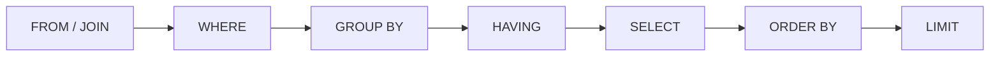
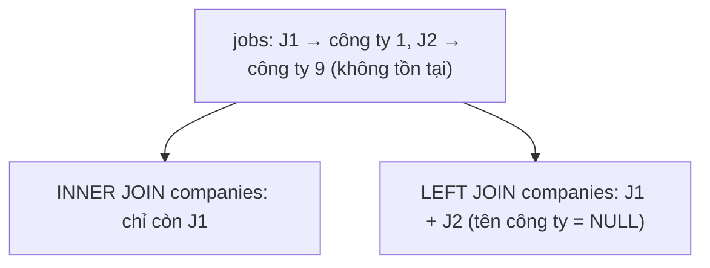
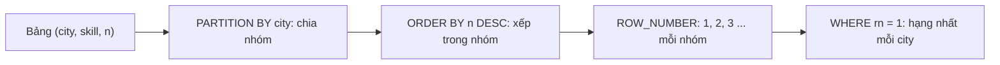
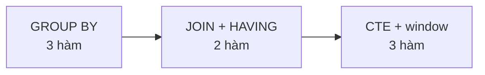

# L09 — SQL phân tích

> Dùng SQL hỏi `jobradar.db` những câu hỏi nghiệp vụ cho bản tin thị trường tuần — kỹ năng bị kiểm tra nhiều nhất khi phỏng vấn Data.

## 🎯 Mục tiêu

Sau buổi này (khoảng 3,5 giờ) bạn sẽ:

- Viết truy vấn với `SELECT`, `WHERE`, `GROUP BY`, `HAVING`, `ORDER BY`, `LIMIT`.
- Nối bảng bằng `JOIN`, phân biệt `INNER JOIN` và `LEFT JOIN`.
- Dùng **CTE** (`WITH`) và **window function**: `ROW_NUMBER`, `RANK`, trung bình trượt.
- **Kết quả đo được:** 8 hàm trong `queries.py` qua hết **11 test**.

> 🧠 **Ghi nhớ:** Vòng phỏng vấn kỹ thuật Data gần như luôn có bài "viết SQL trên giấy". Window function là phần phân loại ứng viên.

## 📋 Đề bài

**Mở file:** `academy/workspace/L09-sql-phan-tich/queries.py`.

Mỗi hàm chạy **một** câu SQL và trả `conn.execute(...).fetchall()`. Docstring ghi rõ cột, thứ tự sắp xếp, làm tròn.

| Nhóm | Hàm |
|---|---|
| Gom nhóm | `jobs_by_city`, `avg_salary_by_level`, `top_skills(n)` |
| Nối bảng | `companies_with_min_jobs(k)`, `jobs_with_skill(skill)` |
| Window | `top_skill_per_city`, `top_paid_per_city(k)`, `monthly_trend` |

Test dùng DB mẫu 10 tin (`FIXTURE_SQL` trong file test) — đáp án biết trước. `python queries.py` chạy trên `jobradar.db` thật của L08.

**Xong khi:** bấm **Chạy test** thấy `11 passed`.

## 🤔 Tại sao? (kiến thức nền)

### SQL: nói "muốn gì", không nói "làm thế nào"

SQL là ngôn ngữ **khai báo**: bạn mô tả kết quả mong muốn, cơ sở dữ liệu tự chọn cách tính nhanh nhất.

Với pandas bạn viết từng bước. Với SQL bạn viết một câu, DB lo phần còn lại (dùng index, thứ tự JOIN…). Cùng một câu SQL chạy được trên SQLite, PostgreSQL, BigQuery — chỉ khác chút cú pháp.

### Thứ tự thực thi một câu SELECT

Câu SQL **viết** từ `SELECT` nhưng DB **chạy** từ `FROM`; hiểu thứ tự này là tránh được nửa số lỗi.



Vì vậy `WHERE` không lọc được theo `COUNT(*)` (lúc đó chưa gom nhóm) — phải dùng `HAVING`. Còn `ORDER BY` thì dùng được tên cột đặt ở `SELECT` (`AS n`).

> ⚠️ **Lỗi hay gặp:** `WHERE COUNT(*) >= 3` → `misuse of aggregate`. Điều kiện trên kết quả gom nhóm phải nằm ở `HAVING`.

### JOIN: ghép hàng của hai bảng

`JOIN ... ON` ghép mỗi hàng bảng trái với các hàng bảng phải thỏa điều kiện; `INNER JOIN` bỏ hàng không có cặp, `LEFT JOIN` giữ lại và điền `NULL`.



### NULL không phải là 0

`NULL` nghĩa là "không biết"; mọi phép so sánh với `NULL` cho ra "không biết", nên `city = NULL` không bao giờ đúng.

| Viết | Kết quả |
|---|---|
| `city = NULL` | không lọc được gì |
| `city IS NULL` / `IS NOT NULL` | đúng cách |
| `COUNT(*)` vs `COUNT(city)` | đếm mọi hàng / bỏ hàng NULL |
| `AVG(x)` | tự bỏ qua NULL |

### Window function: tính trên "cửa sổ" mà không gộp hàng

Window function tính một giá trị cho **mỗi hàng** dựa trên một nhóm hàng liên quan — khác `GROUP BY` là **không gộp** hàng lại.

`ROW_NUMBER() OVER (PARTITION BY city ORDER BY n DESC)`: chia theo `city`, trong mỗi nhóm đánh số 1, 2, 3… theo `n` giảm dần. Lọc `= 1` là ra "đứng đầu mỗi nhóm" — bài toán top-N-per-group kinh điển.



### CTE: đặt tên cho bước trung gian

`WITH tên AS (SELECT ...)` tạo một bảng tạm có tên, dùng ngay trong câu tiếp theo — chia câu SQL dài thành từng bước dễ đọc.

Window function không đặt được trong `WHERE` (nó chạy sau `WHERE`). Cách chuẩn: tính trong CTE, lọc ở câu ngoài.

> 🎯 **Phỏng vấn hay hỏi:** "Khác nhau giữa `ROW_NUMBER`, `RANK`, `DENSE_RANK`?" — khi bằng nhau: 1,2,3 / 1,2,2,4 / 1,2,2,3. Xem demo ở Bước 5.

## 🛠️ Làm

Toàn cảnh: 8 hàm, độ khó tăng dần, mỗi hàm một câu SQL.



Các demo dùng bảng bán hàng `sales` (vùng, sản phẩm, tiền, ngày) — không phải dữ liệu bài.

### Bước 1 — Chuẩn bị

Cần `jobradar.db` từ L08 (chạy `python db.py` ở L08 nếu chưa có). Mở nó bằng **SQLite Viewer**. Quy trình mỗi hàm: viết SQL → thử trong viewer → đúng thì dán vào hàm → chạy test.

> 💡 **Mẹo:** viết SQL trong chuỗi `"""..."""` nhiều dòng, mỗi mệnh đề một dòng — dễ đọc, dễ sửa.

### Bước 2 — GROUP BY → 3 hàm đầu

```python
import sqlite3

conn = sqlite3.connect(":memory:")
conn.executescript("""
    CREATE TABLE sales (region TEXT, product TEXT, amount REAL, day TEXT);
    INSERT INTO sales VALUES ('Bắc','trà',10,'2026-01-01'), ('Bắc','cà phê',30,'2026-01-02'),
      ('Nam','trà',20,'2026-01-02'), ('Nam','trà',25,'2026-01-03'), (NULL,'nước',5,'2026-01-03');
""")
rows = conn.execute("""
    SELECT region, COUNT(*) AS n, ROUND(AVG(amount), 1) AS avg_amount
    FROM sales
    WHERE region IS NOT NULL
    GROUP BY region
    ORDER BY avg_amount DESC
    LIMIT ?
""", (5,)).fetchall()
print(rows)
```
```output
[('Nam', 2, 22.5), ('Bắc', 2, 20.0)]
```

Với `avg_salary_by_level`: tính `(salary_min + salary_max) / 2` **bên trong** `AVG(...)`.

### Bước 3 — JOIN + HAVING → `companies_with_min_jobs`, `jobs_with_skill`

```python
import sqlite3

conn = sqlite3.connect(":memory:")
conn.executescript("""
    CREATE TABLE shops (shop_id INTEGER PRIMARY KEY, name TEXT);
    CREATE TABLE orders (order_id TEXT, shop_id INTEGER, amount REAL);
    INSERT INTO shops VALUES (1, 'Cửa hàng A'), (2, 'Cửa hàng B'), (3, 'Cửa hàng C');
    INSERT INTO orders VALUES ('O1', 1, 50), ('O2', 1, 20), ('O3', 2, 70), ('O4', 1, 10);
""")
print(conn.execute("""
    SELECT s.name, COUNT(*) AS n FROM orders o
    JOIN shops s ON s.shop_id = o.shop_id
    GROUP BY s.shop_id, s.name
    HAVING COUNT(*) >= ?
""", (2,)).fetchall())
print(conn.execute("""
    SELECT s.name, COUNT(o.order_id) FROM shops s
    LEFT JOIN orders o ON o.shop_id = s.shop_id
    GROUP BY s.shop_id, s.name ORDER BY s.name
""").fetchall())
```
```output
[('Cửa hàng A', 3)]
[('Cửa hàng A', 3), ('Cửa hàng B', 1), ('Cửa hàng C', 0)]
```

`LEFT JOIN` giữ cả cửa hàng C dù không có đơn. `jobs_with_skill` cần nối **3** bảng: viết thêm một dòng `JOIN` nữa.

> ⚠️ **Lỗi hay gặp:** quên `.lower()` tham số `skill` — test truyền `"Spark"` nhưng DB lưu `"spark"`.

### Bước 4 — CTE + ROW_NUMBER → `top_skill_per_city`

Sản phẩm bán nhiều tiền nhất mỗi vùng:

```python
import sqlite3

conn = sqlite3.connect(":memory:")
conn.executescript("""
    CREATE TABLE sales (region TEXT, product TEXT, amount REAL);
    INSERT INTO sales VALUES ('Bắc','trà',10), ('Bắc','cà phê',30), ('Bắc','trà',20),
      ('Nam','trà',20), ('Nam','nước',20), ('Nam','cà phê',5);
""")
print(conn.execute("""
    WITH totals AS (
        SELECT region, product, SUM(amount) AS total FROM sales GROUP BY region, product
    ),
    ranked AS (
        SELECT region, product, total,
               ROW_NUMBER() OVER (PARTITION BY region ORDER BY total DESC, product) AS rn
        FROM totals
    )
    SELECT region, product, total FROM ranked WHERE rn = 1 ORDER BY region
""").fetchall())
```
```output
[('Bắc', 'cà phê', 30.0), ('Nam', 'nước', 20.0)]
```

Bắc: trà = cà phê = 30 → `ORDER BY ..., product` chọn `cà phê` (A→Z). Nam: nước = trà = 20 → `nước`.

### Bước 5 — RANK vs ROW_NUMBER → `top_paid_per_city`

```python
import sqlite3

conn = sqlite3.connect(":memory:")
conn.executescript("""
    CREATE TABLE scores (name TEXT, score INTEGER);
    INSERT INTO scores VALUES ('An', 9), ('Bình', 8), ('Chi', 8), ('Dũng', 7);
""")
for row in conn.execute("""
    SELECT name, score,
           ROW_NUMBER() OVER (ORDER BY score DESC) AS row_number,
           RANK()       OVER (ORDER BY score DESC) AS rank,
           DENSE_RANK() OVER (ORDER BY score DESC) AS dense_rank
    FROM scores
"""):
    print(row)
```
```output
('An', 9, 1, 1, 1)
('Bình', 8, 2, 2, 2)
('Chi', 8, 3, 2, 2)
('Dũng', 7, 4, 4, 3)
```

`top_paid_per_city` dùng `RANK` để hai tin cùng lương **cùng** hạng — test có đúng tình huống này. Thêm `PARTITION BY city` và lọc `<= k` ở câu ngoài CTE.

### Bước 6 — Trung bình trượt → `monthly_trend`

```python
import sqlite3

conn = sqlite3.connect(":memory:")
conn.executescript("""
    CREATE TABLE sales (day TEXT, amount REAL);
    INSERT INTO sales VALUES ('2026-01-01',10), ('2026-01-01',20), ('2026-01-02',60),
      ('2026-01-03',30), ('2026-01-04',90);
""")
for row in conn.execute("""
    WITH daily AS (SELECT day, SUM(amount) AS total FROM sales GROUP BY day)
    SELECT day, total,
           ROUND(AVG(total) OVER (ORDER BY day ROWS BETWEEN 1 PRECEDING AND CURRENT ROW), 2) AS avg2,
           ROUND(AVG(total) OVER (ORDER BY day), 2) AS cumulative
    FROM daily
"""):
    print(row)
```
```output
('2026-01-01', 30.0, 30.0, 30.0)
('2026-01-02', 60.0, 45.0, 45.0)
('2026-01-03', 30.0, 45.0, 40.0)
('2026-01-04', 90.0, 60.0, 52.5)
```

`ROWS BETWEEN 1 PRECEDING AND CURRENT ROW` = cửa sổ 2 hàng; bỏ đi thì thành trung bình cộng dồn. Bài cần cửa sổ **3 tháng**. Lấy tháng: `substr(posted_date, 1, 7)` → `"2026-09"`.

### Bước 7 — Hỏi dữ liệu thật

Chạy `python queries.py`. Đọc kết quả như một analyst — và để ý điểm lạ:

- Lương tối đa cao nhất Hà Nội là **800 triệu**?
- Có tháng **2027-03** — trong tương lai?

Dữ liệu sạch về **định dạng** chưa chắc đúng về **nội dung**. L10 sẽ dựng hàng rào chặn những bản ghi này. Giờ bấm **Chạy test**.

> 💡 **Mẹo:** còn thời gian? Viết câu SQL tìm "kỹ năng nào xuất hiện cùng `python` nhiều nhất" (self-join `job_skills`) — câu hỏi phỏng vấn rất hay gặp.

## ✅ Tự kiểm tra

Bấm **Chạy test**, hoặc từ thư mục `academy/`:

```bash
PYTHONPATH=workspace/L09-sql-phan-tich python3 -m pytest curriculum/L09-sql-phan-tich/tests -q
```

> 💡 **Mẹo:** Windows PowerShell: `$env:PYTHONPATH="workspace\L09-sql-phan-tich"; python -m pytest curriculum\L09-sql-phan-tich\tests -q`

Mục tiêu: `11 passed`. Test fail → so kết quả của bạn với dòng `assert` (thường lệch thứ tự sắp xếp hoặc làm tròn).

- [ ] Tôi kể được thứ tự thực thi: FROM → WHERE → GROUP BY → HAVING → SELECT → ORDER BY → LIMIT.
- [ ] Tôi giải thích được khi nào dùng `WHERE`, khi nào dùng `HAVING`.
- [ ] Tôi phân biệt được `INNER JOIN` và `LEFT JOIN` bằng ví dụ.
- [ ] Tôi viết được truy vấn top-1 mỗi nhóm bằng `ROW_NUMBER` mà không nhìn tài liệu.

## 🎤 Câu hỏi phỏng vấn

Tập trả lời thành tiếng, mỗi câu 30–60 giây, rồi luyện ở tab **Phỏng vấn thử**.

1. `WHERE` và `HAVING` khác nhau thế nào? Vì sao `WHERE COUNT(*) > 1` lỗi?
2. `INNER JOIN` và `LEFT JOIN` khác nhau thế nào? Cho ví dụ cần `LEFT JOIN`.
3. `ROW_NUMBER`, `RANK`, `DENSE_RANK` khác nhau thế nào khi có giá trị bằng nhau?
4. Viết SQL lấy 2 tin lương cao nhất mỗi thành phố.
5. Window function khác `GROUP BY` ở điểm nào?
6. `COUNT(*)` và `COUNT(cột)` khác nhau thế nào? `NULL = NULL` trả về gì?
7. CTE (`WITH`) là gì? Khi nào dùng thay cho subquery?
8. Tính trung bình trượt 7 ngày bằng SQL thế nào?

> 🎯 **Phỏng vấn hay hỏi:** câu 4 là dạng "top-N mỗi nhóm" — gần như công ty nào cũng hỏi. Trả lời: CTE + `ROW_NUMBER()`/`RANK() OVER (PARTITION BY ...)` rồi lọc ở câu ngoài, và nói rõ chọn hàm nào khi có bằng nhau.
