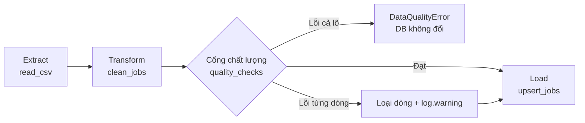
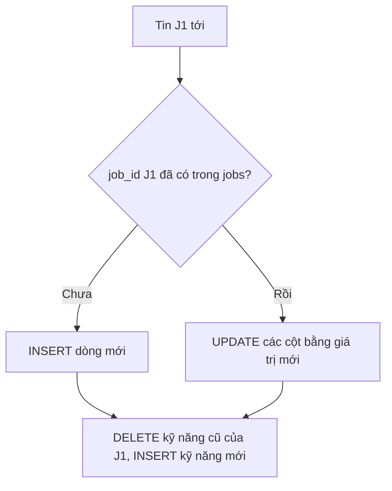
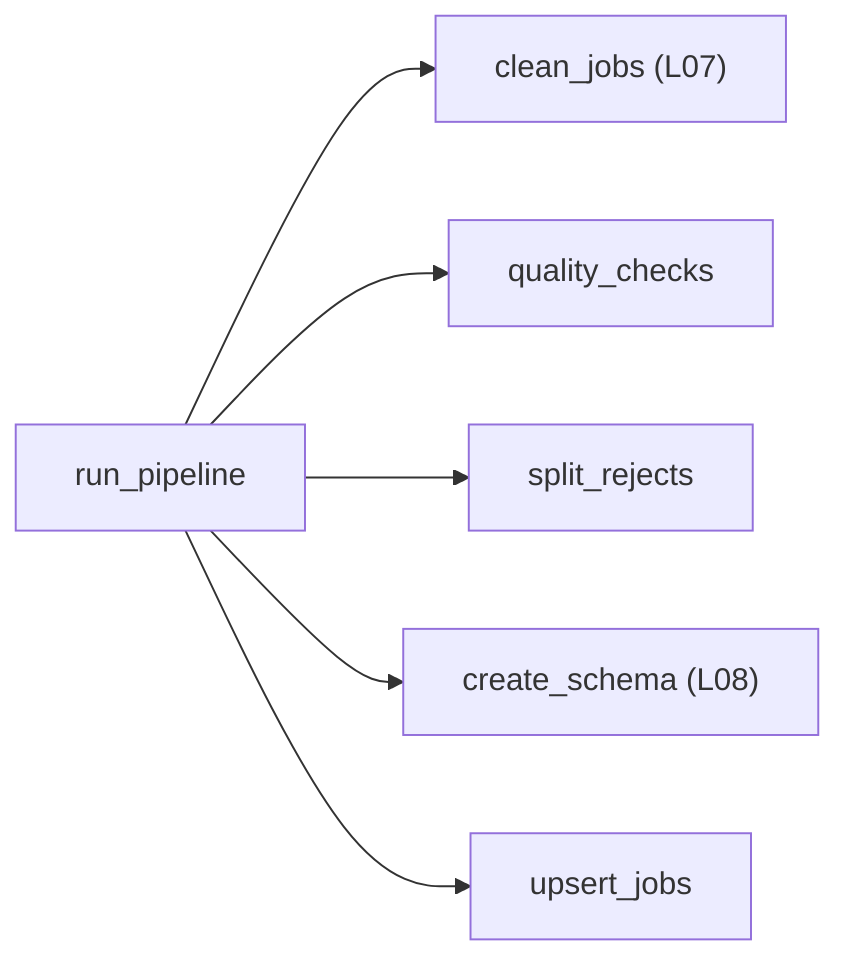

# L10 — ETL lặp lại được & chất lượng dữ liệu

> Ghép mọi thứ thành **một pipeline** chạy bằng một lệnh: tự chặn dữ liệu sai, và chạy lại bao nhiêu lần cũng ra cùng kết quả.

## 🎯 Mục tiêu

Sau buổi này (khoảng 3,5 giờ) bạn sẽ:

- Tổ chức code thành **ETL**: Extract → Transform → Load.
- Viết **kiểm tra chất lượng dữ liệu**: không trống, trong khoảng, duy nhất, số dòng tối thiểu.
- Làm pipeline **idempotent**: upsert (`ON CONFLICT DO UPDATE`) và delete-insert.
- Dùng `logging` thay `print`; **dừng to** (raise) khi dữ liệu hỏng cả lô.
- **Kết quả đo được:** 4 hàm trong `pipeline.py` qua hết **14 test**; chạy 2 lần trên dữ liệu thật đều ra `{"raw": 302, "clean": 268, "rejected": 4, "loaded": 264}`.

> 🧠 **Ghi nhớ:** Pipeline ở công ty chạy tự động mỗi đêm, không ai ngồi nhìn. Nó phải tự kiểm tra, tự ghi log, và chạy lại an toàn khi lỗi giữa chừng.

## 📋 Đề bài

**Mở file:** `academy/workspace/L10-etl-chat-luong-du-lieu/pipeline.py`.

**Trước tiên:** copy `cleaning.py` (L07) và `db.py` (L08) **của bạn** vào thư mục bài này — xem Bước 1.

| Hàm | Việc |
|---|---|
| `quality_checks(df, as_of, min_rows)` | trả list lỗi `(tên_kiểm_tra, job_id)` |
| `split_rejects(df, issues)` | tách `(hợp_lệ, bị_loại)` |
| `upsert_jobs(conn, df)` | nạp idempotent: thêm hoặc cập nhật |
| `run_pipeline(csv_path, db_path, ...)` | ghép tất cả, trả dict tóm tắt |

Tên 7 kiểm tra và quy tắc nằm trong docstring `quality_checks`.

**Xong khi:** bấm **Chạy test** thấy `14 passed`.

## 🤔 Tại sao? (kiến thức nền)

### ETL

**ETL** = Extract (lấy dữ liệu từ nguồn) → Transform (làm sạch, chuẩn hóa) → Load (nạp vào nơi lưu). Mỗi khâu là một hàm riêng, test riêng.

Bạn đã có T (L07) và L (L08). Bài này thêm **cổng chất lượng** giữa T và L, và đóng gói thành một lệnh.



> 💡 **Mẹo:** **ELT** là biến thể: nạp dữ liệu thô vào kho trước, rồi transform bằng SQL trong kho (kiểu dbt). Phổ biến khi kho dữ liệu mạnh (BigQuery, Snowflake).

### Idempotent: chạy N lần = chạy 1 lần

Một thao tác **idempotent** khi chạy lặp lại không làm thay đổi kết quả sau lần đầu.

Pipeline sẽ bị chạy lại: lỗi mạng giữa chừng, scheduler retry, người vận hành bấm nhầm. Nếu mỗi lần chạy lại thêm một bản sao, báo cáo sẽ đếm gấp đôi — lỗi rất khó phát hiện.

| Cách nạp | Ý tưởng | Đánh đổi |
|---|---|---|
| Full refresh | xóa sạch, nạp lại tất cả | đơn giản; chậm khi dữ liệu lớn |
| Delete-insert theo lô | xóa đúng phần sắp nạp, nạp lại | hợp với dữ liệu theo ngày/lô |
| Upsert theo khóa | có rồi thì cập nhật, chưa có thì thêm | cần khóa tự nhiên ổn định |

Bài này: **upsert** cho `jobs` (khóa `job_id`), **delete-insert** kỹ năng của từng tin.



### Chất lượng dữ liệu

Kiểm tra chất lượng là các **khẳng định** về dữ liệu, chạy tự động mỗi lần pipeline chạy — như unit test, nhưng cho dữ liệu.

| Khía cạnh | Kiểm tra trong bài |
|---|---|
| Đầy đủ (completeness) | `title_null`, `company_null` |
| Hợp lệ (validity) | `salary_min_gt_max`, `salary_out_of_range` |
| Duy nhất (uniqueness) | `job_id_duplicate` |
| Kịp thời (timeliness) | `date_in_future` |
| Khối lượng (volume) | `row_count` |

### Dừng to, đừng im lặng

Có hai loại lỗi: **lỗi từng dòng** (loại dòng đó, ghi log, chạy tiếp) và **lỗi cả lô** (dừng ngay, không ghi gì).

Nguồn trả về 0 dòng, hay một nửa số dòng bị loại — đó là dấu hiệu nguồn hỏng, không phải "vài dòng xấu". Nạp tiếp thì dashboard sáng mai sai mà không ai biết. Pipeline phải `raise` để người vận hành nhận cảnh báo.

> ⚠️ **Lỗi hay gặp:** bọc cả pipeline trong `try: ... except Exception: pass`. Lỗi biến mất, dữ liệu sai vẫn được nạp — tệ hơn là sập.

### logging thay vì print

`logging` ghi thông điệp kèm **mức độ** (INFO, WARNING, ERROR) và **nguồn** (tên logger); cấu hình một chỗ để in ra màn hình, ghi file hoặc gửi đi.

Khi pipeline chạy lúc 2 giờ sáng, log là thứ duy nhất kể lại chuyện gì đã xảy ra. `print` không có mức độ, không tắt bớt được, không biết từ module nào.

> 🎯 **Phỏng vấn hay hỏi:** "Pipeline của bạn chạy lại có an toàn không?" — trả lời bằng idempotency: khóa nào, upsert hay delete-insert, và bằng chứng (test chạy 2 lần so DB).

## 🛠️ Làm

Toàn cảnh: `run_pipeline` gọi 2 hàm bạn đã có và 3 hàm viết mới.



Các demo dùng bảng điểm học sinh và sản phẩm — không phải dữ liệu bài.

### Bước 1 — Chuẩn bị: copy code cũ

Từ thư mục `academy/workspace/`:

```bash
cp L07-du-lieu-ban-pandas/cleaning.py L10-etl-chat-luong-du-lieu/
cp L08-mo-hinh-hoa-sqlite/db.py L10-etl-chat-luong-du-lieu/
```

> 💡 **Mẹo:** Windows PowerShell: `Copy-Item L07-du-lieu-ban-pandas\cleaning.py L10-etl-chat-luong-du-lieu\` và tương tự cho `db.py`.

Đây là bước "đóng gói": pipeline dùng lại code đã qua test, không viết lại.

> ⚠️ **Lỗi hay gặp:** quên copy → `ModuleNotFoundError: No module named 'cleaning'` ở test `upsert_jobs`/`run_pipeline`. Test `quality_checks` vẫn chạy được.

### Bước 2 — Kiểm tra chất lượng → `quality_checks`

Kiểm tra bảng điểm:

```python
import pandas as pd

df = pd.DataFrame({
    "student_id": ["S1", "S2", "S2", "S3"],
    "name": ["An", "Bình", "Bình", None],
    "score": [8.5, 11.0, 11.0, None],
})
issues = []
for sid in df.loc[df["student_id"].duplicated(), "student_id"].unique():
    issues.append(("id_duplicate", sid))
for row in df.to_dict("records"):
    if pd.isna(row["name"]):
        issues.append(("name_null", row["student_id"]))
    if pd.notna(row["score"]) and not (0 <= row["score"] <= 10):
        issues.append(("score_out_of_range", row["student_id"]))
print(issues)
```
```output
[('id_duplicate', 'S2'), ('score_out_of_range', 'S2'), ('score_out_of_range', 'S2'), ('name_null', 'S3')]
```

Ô điểm trống của S3 **không** phải lỗi khoảng — chỉ xét giá trị có mặt (`pd.notna`). Lương cũng vậy: thiếu lương là bình thường.

> 💡 **Mẹo:** ngày dạng `"YYYY-MM-DD"` so sánh chuỗi được luôn: `"2027-03-01" > "2026-10-13"` là `True`.

### Bước 3 — Tách dòng lỗi → `split_rejects`

Gom lý do theo id, rồi lọc bằng mask:

```python
import pandas as pd

df = pd.DataFrame({"student_id": ["S1", "S2", "S3"], "score": [8, 11, -1]})
issues = [("score_out_of_range", "S2"), ("score_negative", "S3"), ("score_out_of_range", "S3")]
reasons = {}
for check, sid in issues:
    reasons.setdefault(sid, set()).add(check)
print(reasons["S3"] == {"score_negative", "score_out_of_range"})
mask = df["student_id"].isin(reasons)
print(df[~mask].reset_index(drop=True))
print([(sid, ", ".join(sorted(reasons[sid]))) for sid in df.loc[mask, "student_id"]])
```
```output
True
  student_id  score
0         S1      8
[('S2', 'score_out_of_range'), ('S3', 'score_negative, score_out_of_range')]
```

`setdefault(k, set())` tạo set rỗng nếu chưa có key — gom nhiều lý do cho một id.

### Bước 4 — Upsert → `upsert_jobs` (phần `jobs`)

Bảng giá sản phẩm, nạp 2 lần:

```python
import sqlite3

conn = sqlite3.connect(":memory:")
conn.execute("CREATE TABLE products (sku TEXT PRIMARY KEY, name TEXT, price REAL)")
sql = """INSERT INTO products (sku, name, price) VALUES (?, ?, ?)
         ON CONFLICT(sku) DO UPDATE SET name = excluded.name, price = excluded.price"""
batch = [("P1", "Bút", 5.0), ("P2", "Vở", 12.0)]
for run in range(2):
    with conn:
        conn.executemany(sql, batch)
    print("Lần", run + 1, "→", conn.execute("SELECT COUNT(*) FROM products").fetchone()[0], "sản phẩm")
with conn:
    conn.execute(sql, ("P1", "Bút bi", 6.0))
print(conn.execute("SELECT * FROM products ORDER BY sku").fetchall())
```
```output
Lần 1 → 2 sản phẩm
Lần 2 → 2 sản phẩm
[('P1', 'Bút bi', 6.0), ('P2', 'Vở', 12.0)]
```

Lần 2 vẫn **2** sản phẩm, và `P1` được cập nhật tên, giá. `excluded.cột` là giá trị **vừa định chèn**.

> ⚠️ **Lỗi hay gặp:** `INSERT OR REPLACE` trông giống upsert nhưng thực ra **xóa** dòng cũ rồi chèn mới — với khóa ngoại, các dòng con có thể bị ảnh hưởng. Dùng `ON CONFLICT ... DO UPDATE`.

### Bước 5 — Delete-insert → `upsert_jobs` (phần `job_skills`)

Nhãn của sản phẩm thay đổi giữa 2 lần nạp:

```python
import sqlite3

conn = sqlite3.connect(":memory:")
conn.execute("CREATE TABLE product_tags (sku TEXT, tag TEXT, PRIMARY KEY (sku, tag))")

def load_tags(sku, tags):
    with conn:
        conn.execute("DELETE FROM product_tags WHERE sku = ?", (sku,))
        conn.executemany("INSERT INTO product_tags VALUES (?, ?)", [(sku, t) for t in tags])

load_tags("P1", ["văn phòng", "rẻ"])
load_tags("P1", ["văn phòng", "cao cấp"])
load_tags("P1", ["văn phòng", "cao cấp"])
print(conn.execute("SELECT tag FROM product_tags ORDER BY tag").fetchall())
```
```output
[('cao cấp',), ('văn phòng',)]
```

Nhãn `rẻ` cũ biến mất, chạy lặp không trùng. Upsert từng nhãn thì **không** xóa được nhãn cũ.

### Bước 6 — Logging + dừng to → `run_pipeline`

```python
import logging
import sys

logging.basicConfig(level=logging.INFO, stream=sys.stdout, format="%(levelname)s %(name)s: %(message)s")
log = logging.getLogger("school.etl")

class BadBatchError(Exception):
    pass

def load_scores(rows, min_rows=3):
    log.info("extract: %d dòng", len(rows))
    if len(rows) < min_rows:
        raise BadBatchError(f"Chỉ có {len(rows)} dòng, cần ít nhất {min_rows}")
    log.warning("reject %s: %s", "S2", "score_out_of_range")
    log.info("load: xong")

load_scores([1, 2, 3])
try:
    load_scores([1, 2])
except BadBatchError as e:
    log.error("pipeline dừng: %s", e)
```
```output
INFO school.etl: extract: 3 dòng
WARNING school.etl: reject S2: score_out_of_range
INFO school.etl: load: xong
INFO school.etl: extract: 2 dòng
ERROR school.etl: pipeline dừng: Chỉ có 2 dòng, cần ít nhất 3
```

Thứ tự trong `run_pipeline`: kiểm tra và `raise` **trước** khi `sqlite3.connect` — lỗi thì DB không bị đụng. Logger của bài tên `"jobradar.pipeline"` (đã khai báo sẵn: `log`).

### Bước 7 — Chạy thật, 2 lần

Chạy `python pipeline.py` hai lần. Cả hai lần in `{'raw': 302, 'clean': 268, 'rejected': 4, 'loaded': 264}`, và 4 dòng `WARNING reject ...` chỉ đúng tin 800 triệu, tin năm 2027… Rồi bấm **Chạy test**.

> 💡 **Mẹo:** còn thời gian? Sửa lương một tin trong bản copy của CSV, chạy lại, rồi `SELECT` tin đó — giá trị mới đã vào, số dòng không đổi. Đó là upsert hoạt động.

## ✅ Tự kiểm tra

Bấm **Chạy test**, hoặc từ thư mục `academy/`:

```bash
PYTHONPATH=workspace/L10-etl-chat-luong-du-lieu python3 -m pytest curriculum/L10-etl-chat-luong-du-lieu/tests -q
```

> 💡 **Mẹo:** Windows PowerShell: `$env:PYTHONPATH="workspace\L10-etl-chat-luong-du-lieu"; python -m pytest curriculum\L10-etl-chat-luong-du-lieu\tests -q`

Mục tiêu: `14 passed`. Test `..._idempotent` chụp toàn bộ DB sau lần 1, chạy lần 2 rồi so từng dòng.

- [ ] Tôi định nghĩa được idempotent và nêu 3 cách nạp lại an toàn.
- [ ] Tôi phân biệt được lỗi từng dòng (loại) và lỗi cả lô (dừng).
- [ ] Tôi giải thích được `ON CONFLICT ... DO UPDATE` và `excluded`.
- [ ] Tôi biết vì sao pipeline dùng `logging` chứ không `print`.

## 🎤 Câu hỏi phỏng vấn

Tập trả lời thành tiếng, mỗi câu 30–60 giây, rồi luyện ở tab **Phỏng vấn thử**.

1. ETL và ELT khác nhau thế nào? Khi nào chọn ELT?
2. Idempotent là gì? Vì sao pipeline dữ liệu cần idempotent?
3. So sánh full refresh, delete-insert theo lô và upsert.
4. Bạn kiểm tra chất lượng dữ liệu những gì? Kể theo các khía cạnh.
5. Khi kiểm tra chất lượng thất bại, pipeline nên làm gì? Khi nào loại dòng, khi nào dừng cả lô?
6. `INSERT OR REPLACE` khác `ON CONFLICT DO UPDATE` thế nào?
7. Vì sao dùng `logging` thay vì `print` trong pipeline?
8. Kể lại pipeline JobRadar của bạn từ CSV thô tới bảng SQLite trong 1 phút.

> 🎯 **Phỏng vấn hay hỏi:** câu 8 — đây là câu chuyện project của bạn. Nêu con số: 302 dòng thô, 268 sau làm sạch, 4 bị chặn bởi kiểm tra chất lượng, chạy lại 2 lần ra cùng kết quả.
