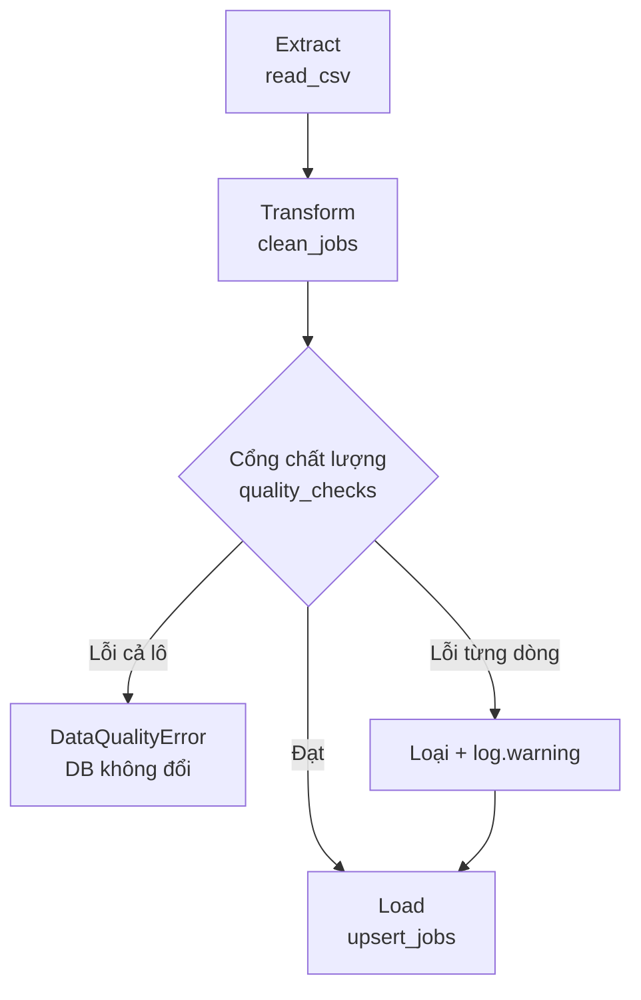
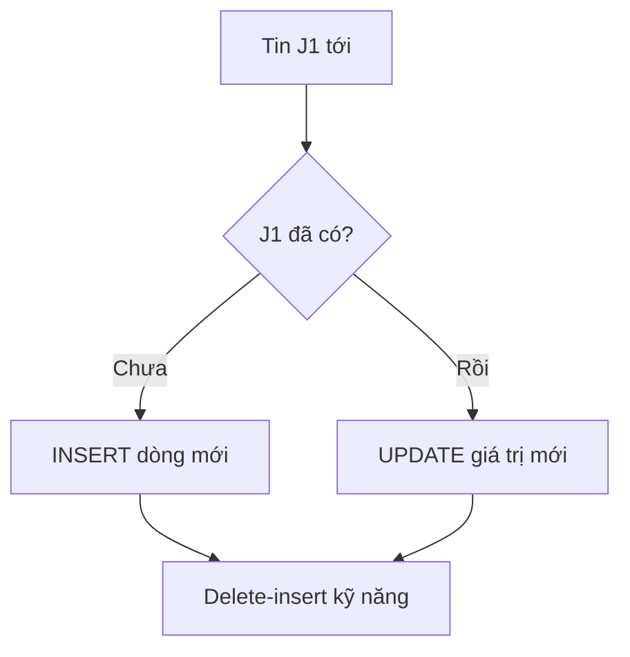
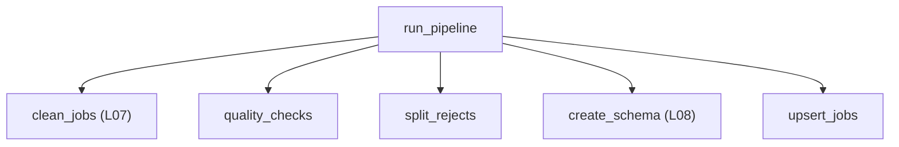

# L10 — ETL lặp lại được & chất lượng dữ liệu

> Ghép mọi thứ thành **một pipeline** chạy bằng một lệnh: tự chặn dữ liệu sai, và chạy lại bao nhiêu lần cũng ra cùng kết quả.

## 🎯 Mục tiêu

Sau buổi này (khoảng 3 giờ 45 phút) bạn sẽ:

- Tổ chức code thành **ETL**: Extract (lấy dữ liệu) → Transform (làm sạch) → Load (nạp vào DB).
- Viết **kiểm tra chất lượng dữ liệu** (luật tự động bắt dữ liệu vô lý): không trống, trong khoảng, duy nhất, số dòng tối thiểu.
- Làm pipeline **idempotent** (chạy lại bao nhiêu lần cũng ra cùng kết quả) bằng upsert và delete-insert.
- Dùng `logging` (ghi nhật ký có mức độ) thay `print`; **dừng to** (raise lỗi) khi dữ liệu hỏng cả lô.
- **Kết quả đo được:** 4 hàm trong `pipeline.py` qua hết **14 test**; chạy 2 lần trên dữ liệu thật đều ra `{"raw": 302, "clean": 268, "rejected": 4, "loaded": 264}`.

> 🧠 **Ghi nhớ:** Pipeline ở công ty chạy tự động mỗi đêm, không ai ngồi nhìn. Nó phải tự kiểm tra, tự ghi log, và chạy lại an toàn khi lỗi giữa chừng.

## 📋 Đề bài

**Mở file:** `academy/workspace/L10-etl-chat-luong-du-lieu/pipeline.py`.

**Trước tiên:** copy `cleaning.py` (L07) và `db.py` (L08) **của bạn** vào thư mục bài này — xem Bước 1.

| Hàm | Việc |
|---|---|
| `quality_checks(df, as_of, min_rows)` | trả list lỗi `(tên_kiểm_tra, job_id)` |
| `split_rejects(df, issues)` | tách `(hợp_lệ, bị_loại)` |
| `upsert_jobs(conn, df)` | nạp idempotent: thêm hoặc cập nhật |
| `run_pipeline(csv_path, db_path, ...)` | ghép tất cả, trả dict tóm tắt |

Tên 7 kiểm tra và quy tắc nằm trong docstring `quality_checks`.

**Xong khi:** bấm **Chạy test** thấy `14 passed`.

## 🤔 Tại sao? (kiến thức nền)

### Hiểu trước khi làm

**Bối cảnh.** Mỗi đêm hệ thống phải lấy tin tuyển dụng mới, làm sạch rồi cất vào cơ sở dữ liệu để sáng ra báo cáo có số. Không ai ngồi canh lúc 2 giờ sáng. Nếu máy lỗi giữa chừng và chạy lại, tin không được nhân đôi; nếu nguồn gửi về thứ vô lý (lương 800 triệu, tin đăng năm 2027), nó phải bị chặn trước khi vào báo cáo.

**Ví dụ đời thường.** Bếp nhà hàng nhận rau mỗi sáng: nhận hàng → nhặt, rửa → cất vào tủ theo ngăn. Người nhận kiểm từng thùng: thùng dập thì để riêng và ghi sổ; cả xe hàng hỏng thì trả lại, không cất gì. Nhà cung cấp lỡ giao lặp một chuyến thì tủ vẫn chỉ có một ngăn cà chua, không thành hai.

**Bạn đã gặp nó ở đâu.**
- Ngân hàng: sao kê cuối ngày được tổng hợp tự động mỗi đêm từ mọi giao dịch.
- Shopee, Tiki: báo cáo doanh thu cho người bán cập nhật mỗi sáng.
- Bấm "Thanh toán" hai lần vì mạng chậm, ví MoMo / VNPay không trừ tiền hai lần.
- Form đăng ký báo "email không hợp lệ", Google Sheets có nút "Xóa dữ liệu trùng lặp".

| Câu hỏi | Trả lời |
|---|---|
| **What** — là gì? | **Pipeline ETL**: chuỗi bước Extract (lấy) → Transform (làm sạch) → Load (nạp), chạy bằng một lệnh. **Idempotent**: chạy N lần cho kết quả như chạy 1 lần. **Kiểm tra chất lượng**: các luật về dữ liệu chạy tự động mỗi lần — như unit test, nhưng cho dữ liệu. |
| **Why** — vì sao cần? | Pipeline chắc chắn sẽ bị chạy lại (lỗi mạng, lịch tự thử lại, người bấm nhầm). Không idempotent thì số liệu bị đếm gấp đôi; không kiểm chất lượng thì dữ liệu sai lặng lẽ vào báo cáo. |
| **When** — khi nào dùng? | Dữ liệu cần cập nhật định kỳ (hằng giờ, hằng đêm) từ một nguồn bạn không kiểm soát. |
| **When not** — khi nào không? | Phân tích một lần trên notebook rồi bỏ: làm tay là đủ, đóng gói thành pipeline là thừa. |
| **Where** — nằm ở đâu? | Giữa nguồn dữ liệu (CSV, API, web) và nơi dùng dữ liệu (DB, dashboard, mô hình AI ở các bài sau). |
| **How** — chạy thế nào? | Đọc CSV → làm sạch (L07) → **cổng chất lượng** → nạp vào SQLite (L08) bằng lệnh "có rồi thì cập nhật, chưa có thì thêm". |



**Từ mới trong bài**

| Từ | Nghĩa đời thường |
|---|---|
| pipeline | dây chuyền: đầu ra bước trước là đầu vào bước sau, chạy một lệnh là xong cả chuỗi |
| ETL / ELT | Extract → Transform → Load; ELT là nạp dữ liệu thô vào kho trước rồi mới làm sạch bằng SQL trong kho (BigQuery, Snowflake, công cụ dbt) |
| lô (batch) | một mẻ dữ liệu xử lý cùng lúc, vd. toàn bộ CSV của một đêm |
| idempotent | làm lại bao nhiêu lần cũng như làm một lần — như bấm nút gọi thang máy nhiều lần |
| upsert | update + insert: có rồi thì cập nhật, chưa có thì thêm |
| delete-insert | xóa đúng phần sắp nạp rồi nạp lại phần đó |
| full refresh | xóa sạch bảng rồi nạp lại tất cả |
| khóa tự nhiên | mã có sẵn trong dữ liệu, định danh duy nhất một bản ghi (ở đây là `job_id`) |
| `ON CONFLICT ... DO UPDATE` | câu SQL upsert: "nếu trùng khóa thì cập nhật thay vì báo lỗi" |
| `excluded` | trong câu upsert, là dòng **vừa định chèn** (giá trị mới) |
| soft delete | không xóa hẳn, chỉ đánh dấu (vd. cột `is_active = 0`) |
| lỗi từng dòng / lỗi cả lô (blocking) | một vài dòng xấu → loại riêng, chạy tiếp; cả mẻ hỏng → dừng, không ghi gì |
| raise / exception | "ném lỗi": dừng chương trình kèm thông báo để người hoặc code phía trên xử lý |
| `DataQualityError` | loại lỗi riêng của bài, ném ra khi dữ liệu không đạt — đặt tên riêng để dễ bắt và dễ đọc log |
| logging, logger | ghi nhật ký có **mức độ** (INFO thông tin, WARNING cảnh báo, ERROR lỗi) và tên nguồn; logger là "cây bút" mang tên module |
| scheduler | bộ hẹn giờ chạy việc tự động (vd. cron chạy 2 giờ sáng mỗi đêm) |
| `as_of` | ngày "hôm nay" truyền vào hàm, để test chạy hôm nào cũng ra cùng kết quả |

### Idempotent: chạy N lần = chạy 1 lần

Ba cách nạp lại an toàn:

| Cách nạp | Ý tưởng | Đánh đổi |
|---|---|---|
| Full refresh | xóa sạch, nạp lại tất cả | đơn giản; chậm khi dữ liệu lớn |
| Delete-insert theo lô | xóa đúng phần sắp nạp, nạp lại | hợp với dữ liệu theo ngày/lô |
| Upsert theo khóa | có rồi thì cập nhật, chưa có thì thêm | cần khóa tự nhiên ổn định |

Bài này: **upsert** cho `jobs` (khóa `job_id`), **delete-insert** kỹ năng của từng tin.



> ⚠️ **Lỗi hay gặp:** upsert không xóa tin đã bị gỡ hoặc bị loại ở nguồn trong các lần chạy sau — tin cũ nằm lại trong DB. Cách xử lý: soft delete (cột `is_active`, tin vắng trong lô thì đặt 0), hoặc full refresh / delete-insert theo lô.

### Chất lượng dữ liệu

Năm khía cạnh thường kiểm, ứng với 7 kiểm tra của bài:

| Khía cạnh | Kiểm tra trong bài |
|---|---|
| Đầy đủ (completeness) | `title_null`, `company_null` |
| Hợp lệ (validity) | `salary_min_gt_max`, `salary_out_of_range` |
| Duy nhất (uniqueness) | `job_id_duplicate` |
| Kịp thời (timeliness) | `date_in_future` |
| Khối lượng (volume) | `row_count` |

### Dừng to, đừng im lặng

Có hai loại lỗi: **lỗi từng dòng** (loại dòng đó, ghi log, chạy tiếp) và **lỗi cả lô** (dừng ngay, không ghi gì).

Nguồn trả về 0 dòng, hay một nửa số dòng bị loại — đó là dấu hiệu nguồn hỏng, không phải "vài dòng xấu". Nạp tiếp thì dashboard sáng mai sai mà không ai biết. Pipeline phải `raise` để người vận hành nhận cảnh báo.

> ⚠️ **Lỗi hay gặp:** bọc cả pipeline trong `try: ... except Exception: pass`. Lỗi biến mất, dữ liệu sai vẫn được nạp — tệ hơn là sập.

### logging thay vì print

`logging` cấu hình một chỗ để in ra màn hình, ghi file hoặc gửi đi. Khi pipeline chạy lúc 2 giờ sáng, log là thứ duy nhất kể lại chuyện gì đã xảy ra. `print` không có mức độ, không tắt bớt được, không biết từ module nào.

> 🎯 **Phỏng vấn hay hỏi:** "Pipeline của bạn chạy lại có an toàn không?" — trả lời bằng idempotency: khóa nào, upsert hay delete-insert, và bằng chứng (test chạy 2 lần so DB).

## 🛠️ Làm

Toàn cảnh: `run_pipeline` gọi 2 hàm bạn đã có và 3 hàm viết mới.



Các demo dùng dữ liệu cảm biến, học sinh và sản phẩm — không phải dữ liệu bài.

### Bước 1 — Chuẩn bị: copy code cũ

Từ thư mục `academy/workspace/`:

```bash
cp L07-du-lieu-ban-pandas/cleaning.py L10-etl-chat-luong-du-lieu/
cp L08-mo-hinh-hoa-sqlite/db.py L10-etl-chat-luong-du-lieu/
```

> 💡 **Mẹo:** Windows PowerShell: `Copy-Item L07-du-lieu-ban-pandas\cleaning.py L10-etl-chat-luong-du-lieu\` và tương tự cho `db.py`.

Đây là bước "đóng gói": pipeline dùng lại code đã qua test, không viết lại.

> ⚠️ **Lỗi hay gặp:** quên copy → `ModuleNotFoundError: No module named 'cleaning'` ở test `upsert_jobs`/`run_pipeline`. Test `quality_checks` vẫn chạy được.

### Bước 2 — Kiểm tra chất lượng → `quality_checks`

Các công cụ cần dùng, trên số đo cảm biến:

```python
import pandas as pd

readings = pd.DataFrame({
    "sensor": ["T1", "T2", "T2", "T2", "T3"],
    "temp_c": [21.5, 95.0, 95.0, 95.0, None],
})
dup = readings["sensor"].duplicated()
print(readings.loc[dup, "sensor"].tolist())
print(readings.loc[dup, "sensor"].unique().tolist())
too_hot = readings["temp_c"].notna() & (readings["temp_c"] > 60)
print(too_hot.tolist())
print(readings["temp_c"].isna().tolist())
```
```output
['T2', 'T2']
['T2']
[False, True, True, True, False]
[False, False, False, False, True]
```

- `duplicated()` đánh dấu từ lần xuất hiện thứ 2; `.unique()` để mỗi id chỉ báo một lần.
- Ô trống của T3 **không** phải lỗi khoảng — chỉ xét giá trị có mặt (`notna`). Lương cũng vậy: thiếu lương là bình thường.

> 💡 **Mẹo:** ngày dạng `"YYYY-MM-DD"` so sánh chuỗi được luôn: `"2027-03-01" > "2026-10-13"` là `True`.

### Bước 3 — Tách dòng lỗi → `split_rejects`

Gom lý do theo id, rồi lọc bằng mask:

**Cách 1 — vòng lặp for + if**

```python
import pandas as pd

df = pd.DataFrame({"student_id": ["S1", "S2", "S3"], "score": [8, 11, -1]})
issues = [("score_out_of_range", "S2"), ("score_negative", "S3"), ("score_out_of_range", "S3")]
reasons = {}
for check, sid in issues:
    if sid not in reasons:
        reasons[sid] = set()      # lần đầu gặp id: tạo set rỗng
    reasons[sid].add(check)
print(reasons["S3"] == {"score_negative", "score_out_of_range"})
mask = df["student_id"].isin(reasons)    # True nếu id là key của reasons
print(df[~mask].reset_index(drop=True))
rejected = []
for sid in df.loc[mask, "student_id"]:
    rejected.append((sid, ", ".join(sorted(reasons[sid]))))
print(rejected)
```
```output
True
  student_id  score
0         S1      8
[('S2', 'score_out_of_range'), ('S3', 'score_negative, score_out_of_range')]
```

**Cách 2 — `setdefault` + list comprehension** (thay 2 vòng for ở trên, cùng kết quả):

```python
reasons = {}
for check, sid in issues:
    reasons.setdefault(sid, set()).add(check)
rejected = [(sid, ", ".join(sorted(reasons[sid]))) for sid in df.loc[mask, "student_id"]]
```

> ⚖️ **So sánh:** cùng O(n), chỉ gọn hơn. `setdefault(k, set())` = "chưa có key thì gán set rỗng, rồi trả giá trị của key" — đúng 3 dòng `if`/gán/`add` của Cách 1.

### Bước 4 — Upsert → `upsert_jobs` (phần `jobs`)

Bảng giá sản phẩm, nạp 2 lần:

```python
import sqlite3

conn = sqlite3.connect(":memory:")
conn.execute("CREATE TABLE products (sku TEXT PRIMARY KEY, name TEXT, price REAL)")
sql = """INSERT INTO products (sku, name, price) VALUES (?, ?, ?)
         ON CONFLICT(sku) DO UPDATE SET name = excluded.name, price = excluded.price"""
batch = [("P1", "Bút", 5.0), ("P2", "Vở", 12.0)]
for run in range(2):
    with conn:
        conn.executemany(sql, batch)
    print("Lần", run + 1, "→", conn.execute("SELECT COUNT(*) FROM products").fetchone()[0], "sản phẩm")
with conn:
    conn.execute(sql, ("P1", "Bút bi", 6.0))
print(conn.execute("SELECT * FROM products ORDER BY sku").fetchall())
```
```output
Lần 1 → 2 sản phẩm
Lần 2 → 2 sản phẩm
[('P1', 'Bút bi', 6.0), ('P2', 'Vở', 12.0)]
```

Lần 2 vẫn **2** sản phẩm, và `P1` được cập nhật tên, giá. `excluded.cột` là giá trị **vừa định chèn**.

> ⚠️ **Lỗi hay gặp:** `INSERT OR REPLACE` trông giống upsert nhưng thực ra **xóa** dòng cũ rồi chèn mới — với khóa ngoại, các dòng con có thể bị ảnh hưởng. Dùng `ON CONFLICT ... DO UPDATE`.

### Bước 5 — Delete-insert → `upsert_jobs` (phần `job_skills`)

Nhãn của sản phẩm thay đổi giữa 2 lần nạp:

```python
import sqlite3

conn = sqlite3.connect(":memory:")
conn.execute("CREATE TABLE product_tags (sku TEXT, tag TEXT, PRIMARY KEY (sku, tag))")

def load_tags(sku, tags):
    rows = []
    for tag in tags:
        rows.append((sku, tag))       # hoặc gọn: [(sku, t) for t in tags]
    with conn:
        conn.execute("DELETE FROM product_tags WHERE sku = ?", (sku,))
        conn.executemany("INSERT INTO product_tags VALUES (?, ?)", rows)

load_tags("P1", ["văn phòng", "rẻ"])
load_tags("P1", ["văn phòng", "cao cấp"])
load_tags("P1", ["văn phòng", "cao cấp"])
print(conn.execute("SELECT tag FROM product_tags ORDER BY tag").fetchall())
```
```output
[('cao cấp',), ('văn phòng',)]
```

Nhãn `rẻ` cũ biến mất, chạy lặp không trùng. Upsert từng nhãn thì **không** xóa được nhãn cũ.

### Bước 6 — Logging + dừng to → `run_pipeline`

```python
import logging
import sys

logging.basicConfig(level=logging.INFO, stream=sys.stdout, format="%(levelname)s %(name)s: %(message)s")
log = logging.getLogger("school.etl")

class BadBatchError(Exception):
    pass

def load_scores(rows, min_rows=3):
    log.info("extract: %d dòng", len(rows))
    if len(rows) < min_rows:
        raise BadBatchError(f"Chỉ có {len(rows)} dòng, cần ít nhất {min_rows}")
    log.warning("reject %s: %s", "S2", "score_out_of_range")
    log.info("load: xong")

load_scores([1, 2, 3])
try:
    load_scores([1, 2])
except BadBatchError as e:
    log.error("pipeline dừng: %s", e)
```
```output
INFO school.etl: extract: 3 dòng
WARNING school.etl: reject S2: score_out_of_range
INFO school.etl: load: xong
INFO school.etl: extract: 2 dòng
ERROR school.etl: pipeline dừng: Chỉ có 2 dòng, cần ít nhất 3
```

Thứ tự trong `run_pipeline`: kiểm tra và `raise` **trước** khi `sqlite3.connect` — lỗi thì DB không bị đụng. Logger của bài tên `"jobradar.pipeline"` (đã khai báo sẵn: `log`).

### Bước 7 — Chạy thật, 2 lần

Chạy `python pipeline.py` hai lần. Cả hai lần in `{'raw': 302, 'clean': 268, 'rejected': 4, 'loaded': 264}`, và 4 dòng `WARNING reject ...` chỉ đúng tin 800 triệu, tin năm 2027… Rồi bấm **Chạy test**.

> 💡 **Mẹo:** còn thời gian? Sửa lương một tin trong bản copy của CSV, chạy lại, rồi `SELECT` tin đó — giá trị mới đã vào, số dòng không đổi. Đó là upsert hoạt động.

## ✅ Tự kiểm tra

Bấm **Chạy test**, hoặc từ thư mục `academy/`:

```bash
PYTHONPATH=workspace/L10-etl-chat-luong-du-lieu python3 -m pytest curriculum/L10-etl-chat-luong-du-lieu/tests -q
```

> 💡 **Mẹo:** Windows PowerShell: `$env:PYTHONPATH="workspace\L10-etl-chat-luong-du-lieu"; python -m pytest curriculum\L10-etl-chat-luong-du-lieu\tests -q`

Mục tiêu: `14 passed`. Test `..._idempotent` chụp toàn bộ DB sau lần 1, chạy lần 2 rồi so từng dòng.

## 🎤 Câu hỏi phỏng vấn

> 🎯 **Phỏng vấn hay hỏi:** câu 8 — đây là câu chuyện project của bạn. Nêu con số: 302 dòng thô, 268 sau làm sạch, 4 bị chặn bởi kiểm tra chất lượng, chạy lại 2 lần ra cùng kết quả.
