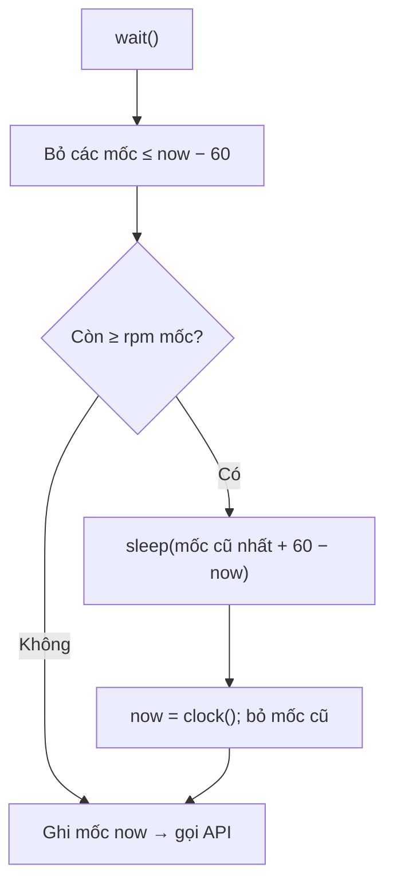
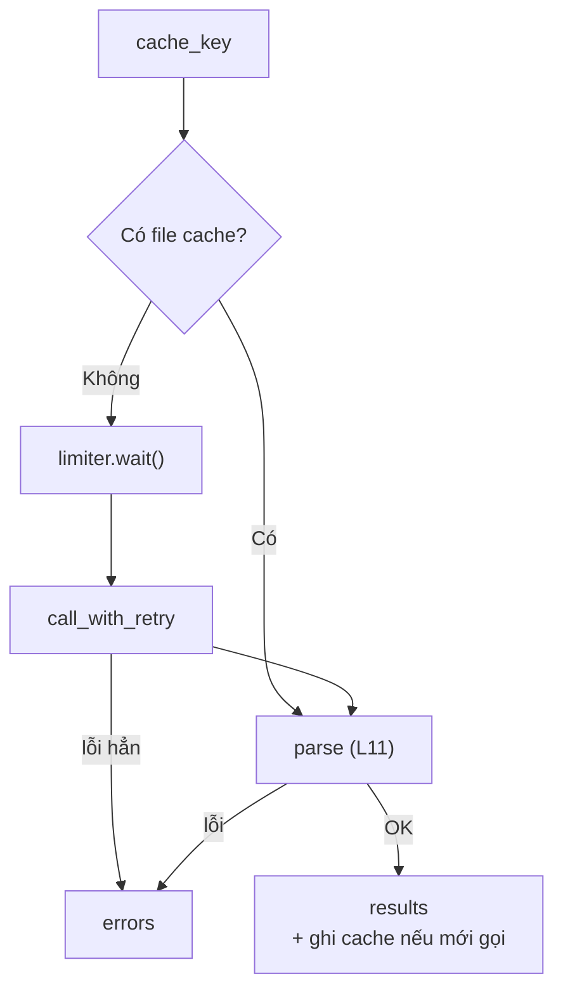

# L12 — Batch: rate limit, cache, retry, chi phí

> Chạy bộ trích xuất của L11 cho cả bộ dữ liệu: không bị chặn vì gọi quá nhanh, không trả tiền hai lần cho cùng một câu hỏi, và biết trước hóa đơn.

## 🎯 Mục tiêu

Sau buổi này (khoảng 3,5 giờ) bạn sẽ:

- Giới hạn tốc độ **chủ động** bằng **rate limiter** cửa sổ trượt (L06 đã xử lý 429 **bị động** bằng retry).
- **Cache** kết quả LLM ra đĩa: khóa đúng, chỉ cache kết quả tốt, ghi file an toàn.
- Viết batch job **bền bỉ**: một tin lỗi không làm dừng cả lô; chạy lại không gọi lại phần đã xong.
- **Ước tính chi phí** cho quy mô lớn từ một lần chạy thử.
- **Kết quả đo được:** 4 phần trong `batch.py` qua hết **13 test**; chạy thật 264 tin, lần 2 chạy lại: `api_calls = 0`.

> 🧠 **Ghi nhớ:** Gọi LLM 1 lần là bài toán prompt. Gọi 100.000 lần là bài toán **hệ thống**: tốc độ, lỗi, tiền.

## 📋 Đề bài

**Mở file:** `academy/workspace/L12-batch-rate-limit-cache/batch.py`.

**Trước tiên:** copy `extract.py` (L11) **của bạn** vào thư mục bài này — xem Bước 1.

| Phần | Việc |
|---|---|
| `cache_key(model, messages, params)` | khóa SHA-256 cho một request |
| `RateLimiter(rpm, clock, sleep).wait()` | chờ nếu đã đủ `rpm` lần gọi trong 60 giây |
| `run_batch(jobs, client, ...)` | cache → limiter → gọi (có retry) → parse → ghi cache, thống kê |
| `estimate_cost(...)` | chạy thử n tin → ước tính cho N tin |

`call_with_retry` và `is_retryable` đã viết sẵn ở cuối file. Khác `with_retry` của L06: L06 `max_tries` = **tổng** số lần thử, có jitter; L12 `max_retries` = số lần thử **thêm** (tổng `max_retries + 1`), không jitter để kết quả xác định.

Bản này không đọc header `Retry-After`; production nên chờ đúng số giây server gửi trong header đó khi có.

**Xong khi:** bấm **Chạy test** thấy `13 passed`.

## 🤔 Tại sao? (kiến thức nền)

### Vòng for gọi API — chuyện gì xảy ra

Khi chuẩn bị bài này, gọi `extract_job` 60 lần liên tục (2 lượt × 30 tin) trên build.nvidia.com: **10 lần vẫn nhận 429 Too Many Requests**, dù thư viện `openai` đã tự thử lại 2 lần cho mỗi request. Giới hạn ở đây là khoảng 40 request/phút cho mỗi model.

L06 dạy cách **phản ứng** khi gặp 429: chờ rồi thử lại. Với một batch, cách đó vẫn lãng phí: cứ chạy hết tốc độ, bị chặn, chờ, lại bị chặn. **Rate limiter** giữ tốc độ dưới giới hạn ngay từ đầu, retry chỉ còn là lưới an toàn.

| | Retry (L06) | Rate limiter (bài này) |
|---|---|---|
| Khi nào hành động | **sau** khi bị 429 | **trước** mỗi request |
| Biết gì | chỉ biết vừa bị từ chối | biết mình đã gọi bao nhiêu lần gần đây |
| Vai trò | lưới an toàn | kiểm soát chính |

### Cửa sổ trượt 60 giây

Giới hạn "35 request/phút" nghĩa là: trong **bất kỳ** 60 giây liên tiếp nào, không quá 35 lần gọi. Cách làm: nhớ thời điểm các lần gọi gần đây; trước mỗi lần gọi, bỏ các mốc cũ hơn 60 giây; còn đủ 35 mốc thì chờ tới khi mốc cũ nhất hết hạn.



> 💡 **Mẹo:** `sleep(60/35)` giữa mọi lần gọi cũng không vượt giới hạn, nhưng chậm cả khi không cần (ví dụ phần lớn tin lấy từ cache). Cửa sổ trượt chỉ chờ khi thật sự cần.

### Cache: không trả tiền hai lần

Cùng model, cùng prompt, cùng tham số (temperature 0) → câu trả lời gần như giống nhau, đủ để tái dùng (L04: không bảo đảm giống hệt). Lưu câu trả lời ra đĩa, lần sau đọc lại thay vì gọi — cache chốt kết quả để lần chạy sau lặp lại được.

Ba quy tắc:

1. **Khóa gồm mọi thứ quyết định câu trả lời**: model + messages + tham số. Đổi prompt ở L11 → khóa đổi → không dùng nhầm kết quả cũ.
2. **Chỉ cache kết quả tốt**. Output hỏng mà cache lại thì lần chạy sau đọc lại đúng cái hỏng đó, mãi mãi.
3. **Ghi an toàn**: ghi ra `<key>.json.tmp` rồi `os.replace` sang `<key>.json`. Chương trình chết giữa lúc ghi thì chỉ còn file `.tmp` dở dang; file cache thật hoặc có đủ, hoặc không có.

Cache cũng là cơ chế **chạy tiếp**: batch chết ở tin thứ 200 → chạy lại, 199 tin đầu lấy từ cache trong chưa tới 1 giây.

> ⚠️ **Lỗi hay gặp:** dùng `hash(...)` của Python làm khóa. Với chuỗi, `hash()` đổi giữa các lần chạy chương trình (hash randomization) → cache không bao giờ trúng. Dùng `hashlib.sha256`.

### Một tin lỗi không được dừng cả lô

264 tin, tin số 150 mô tả lạ khiến model trả output hỏng. Dừng cả lô thì 114 tin còn lại không chạy, sáng mai chạy lại từ đầu. Đúng cách: ghi tin lỗi vào `errors` kèm lý do, chạy tiếp, cuối cùng báo `ok`/`failed`.

So với L10: ở đó lỗi **cả lô** (nguồn hỏng) thì phải dừng. Ở đây lỗi **từng tin** thì ghi lại và đi tiếp. Hai loại lỗi, hai cách xử lý.

### Chi phí tính theo token

Hóa đơn = token vào × giá vào + token ra × giá ra. Số liệu thật của bài (264 tin, `nemotron-3-super`):

| | Tổng | Mỗi tin |
|---|---|---|
| Token vào | 251.521 | ~953 |
| Token ra | 12.555 | ~48 |

**95% token là phần vào**, và phần lớn trong đó là system prompt + schema + ví dụ, **lặp lại y nguyên ở mọi tin**. Muốn giảm chi phí thì nhìn vào đó trước: prompt gọn hơn, hoặc dùng prompt caching của nhà cung cấp.

> 🎯 **Phỏng vấn hay hỏi:** "Gọi LLM cho 100.000 bản ghi, bạn làm thế nào?" — chạy thử 50–300 bản ghi; đo token, tỉ lệ lỗi, thời gian; ước tính chi phí và thời gian cho 100.000; rồi mới chạy thật với rate limiter, cache, retry, ghi lỗi từng bản ghi, và cách chạy tiếp khi đứt giữa chừng.

## 🛠️ Làm

Toàn cảnh: `run_batch` xử lý từng tin như sau.



Các demo dùng thời tiết, tỷ giá, bài viết — không phải dữ liệu bài.

### Bước 1 — Chuẩn bị: copy extract.py

Từ thư mục `academy/workspace/`:

```bash
cp L11-structured-output/extract.py L12-batch-rate-limit-cache/
```

> 💡 **Mẹo:** Windows PowerShell: `Copy-Item L11-structured-output\extract.py L12-batch-rate-limit-cache\`

Tin đọc từ CSDL sạch của L10 (`jobradar.db`) — cần đã chạy `python pipeline.py` ở L10. Trích từ dữ liệu sạch để không trả tiền gọi LLM cho tin trùng hoặc tin bị loại.

Test của bài **không** cần `extract.py` (test truyền `build_messages`, `parse` giả). Chạy thật thì cần — `run_batch` tự import `build_extraction_messages`, `parse_json_reply`, `JobInfo` từ đó.

### Bước 2 — Khóa cache → `cache_key`

```python
import hashlib
import json

a = {"city": "Hà Nội", "days": 3}
b = {"days": 3, "city": "Hà Nội"}
print(json.dumps(a) == json.dumps(b))
print(json.dumps(a, sort_keys=True) == json.dumps(b, sort_keys=True))
text = json.dumps(a, sort_keys=True, ensure_ascii=False)
key = hashlib.sha256(text.encode("utf-8")).hexdigest()
print(len(key), key[:16])
```
```output
False
True
64 8cb46feec441c1f2
```

Hai dict bằng nhau nhưng `json.dumps` khác nhau nếu thứ tự key khác. `sort_keys=True` sửa điều đó. SHA-256 cho chuỗi 64 ký tự hex dùng được làm tên file.

### Bước 3 — Cửa sổ trượt → `RateLimiter.wait`

Hai thao tác cốt lõi trên hàng đợi mốc thời gian:

```python
from collections import deque

calls = deque([0.0, 1.0, 2.0, 30.0])   # thời điểm các lần gọi trước (giây)
now = 61.5
while calls and calls[0] <= now - 60:
    calls.popleft()
print(list(calls), "→", len(calls), "lần trong 60 giây gần nhất")
print("mốc cũ nhất hết hạn sau:", calls[0] + 60 - now, "giây")
```
```output
[2.0, 30.0] → 2 lần trong 60 giây gần nhất
mốc cũ nhất hết hạn sau: 0.5 giây
```

Ghép hai thao tác đó theo đúng 3 bước trong docstring của `wait()`. Tự kiểm tra bằng tay: `rpm=3`, gọi ở giây 0, 10, 10, rồi 15 → lần thứ 4 phải chờ 45 giây (đúng như test).

`deque` có `popleft()` lấy phần tử đầu trong O(1) — hợp với hàng đợi mốc thời gian. `clock` và `sleep` là **tham số** (như `client` ở L03): test truyền đồng hồ giả, chạy trong mili giây.

> ⚠️ **Lỗi hay gặp:** ghi mốc `now` **trước** khi chờ. Mốc phải là thời điểm gọi thật — sau khi chờ xong.

### Bước 4 — Cache đĩa, ghi an toàn → `run_batch` (phần cache)

```python
import json
import os
import tempfile
from pathlib import Path

cache = Path(tempfile.mkdtemp()) / "cache"
cache.mkdir(parents=True, exist_ok=True)

def get_rate(currency, fetch):
    path = cache / f"{currency}.json"
    if path.exists():
        return json.loads(path.read_text(encoding="utf-8")), "cache"
    value = fetch(currency)
    tmp = path.with_name(path.name + ".tmp")
    tmp.write_text(json.dumps(value), encoding="utf-8")
    os.replace(tmp, path)
    return value, "API"

fetch = lambda c: {"USD": 25000, "EUR": 27000}[c]
for c in ["USD", "EUR", "USD", "USD"]:
    print(c, *get_rate(c, fetch))
print(sorted(p.name for p in cache.iterdir()))
```
```output
USD 25000 API
EUR 27000 API
USD 25000 cache
USD 25000 cache
['EUR.json', 'USD.json']
```

Trong bài, file cache lưu `{"content", "prompt_tokens", "completion_tokens"}` — lưu **nội dung thô** của model, parse lại mỗi lần đọc. Ghi cache **sau** khi parse thành công.

### Bước 5 — Ghép cả lô → `run_batch`

Đi theo đúng 5 bước trong docstring. Ba điểm hay sai:

- `limiter.wait()` chỉ gọi khi **thật sự** gọi API (cache hit thì không).
- Gọi API qua `call_with_retry(lambda: client.chat.completions.create(...), sleep=sleep)` — truyền `sleep` để test không chờ thật.
- Token và chi phí chỉ cộng cho lần gọi **thật**. Cache hit = 0 đồng.

> 💡 **Mẹo:** `lambda: client.chat.completions.create(model=model, messages=messages, **PARAMS)` là "hàm chưa gọi" — `call_with_retry` quyết định gọi mấy lần. `**PARAMS` bung dict thành các tham số `temperature=0, max_tokens=400, extra_body=...`.

### Bước 6 — Ước tính chi phí → `estimate_cost`

```python
articles_sampled = 50
tokens_in, tokens_out = 61_000, 24_500        # đo được khi dịch thử 50 bài
price_in, price_out = 0.30, 0.90              # USD / 1 triệu token
per_article = (tokens_in / 1e6 * price_in + tokens_out / 1e6 * price_out) / articles_sampled
print(f"1 bài ≈ ${per_article:.6f}")
print(f"20.000 bài ≈ ${per_article * 20_000:,.2f}")
print(f"làm tròn trước rồi nhân: ${round(per_article, 4) * 20_000:,.2f}")
```
```output
1 bài ≈ $0.000807
20.000 bài ≈ $16.14
làm tròn trước rồi nhân: $16.00
```

Làm tròn **trước** khi nhân thì sai số bị nhân lên theo quy mô. Chỉ làm tròn ở bước cuối.

Ước tính cả **thời gian**: 100.000 tin ở 35 request/phút ≈ 48 giờ. Muốn nhanh hơn: chạy song song (concurrency) trong giới hạn, chia tải sang nhiều model/key, hoặc dùng Batch API của nhà cung cấp.

> 💡 **Mẹo:** build.nvidia.com miễn phí cho dev. `PRICE_PER_M` trong bài là giá giả định để tập ước tính — khi lên production với nhà cung cấp trả phí, chỉ cần đổi bảng giá.

### Bước 7 — Chạy thật, 2 lần

```bash
python batch.py 40
python batch.py 40
```

Chạy thử 40 tin trước. Lần 1 mất khoảng 70 giây (35 request/phút), lần 2 dưới 1 giây với `"api_calls": 0`. Ổn rồi thì chạy cả bộ: `python batch.py`.

Kết quả chạy cả bộ khi chuẩn bị bài (14/10/2026):

```output
{"total": 264, "ok": 264, "failed": 0, "cache_hits": 0, "api_calls": 264, "prompt_tokens": 251521, "completion_tokens": 12555, "cost_usd": 0.086756}
Ước tính 100.000 tin: {'prompt_tokens_per_job': 952.7, 'completion_tokens_per_job': 47.6, 'per_job_usd': 0.000329, 'total_usd': 32.86}
Thời gian: 482.9s · lỗi: {}
```

Lần 2: `"cache_hits": 264, "api_calls": 0, "cost_usd": 0.0`, 0,4 giây. Kết quả nằm ở `extracted.json`.

264 tin trong 483 giây, không một lỗi 429 — so với 10 lỗi 429 trên 60 lần gọi khi chưa có limiter.

> 💡 **Mẹo:** thử bấm `Ctrl+C` giữa chừng lần chạy đầu, rồi chạy lại. Những tin đã xong lấy từ cache; chỉ phần còn lại gọi API.

## ✅ Tự kiểm tra

Bấm **Chạy test**, hoặc từ thư mục `academy/`:

```bash
PYTHONPATH=workspace/L12-batch-rate-limit-cache python3 -m pytest curriculum/L12-batch-rate-limit-cache/tests -q
```

> 💡 **Mẹo:** Windows PowerShell: `$env:PYTHONPATH="workspace\L12-batch-rate-limit-cache"; python -m pytest curriculum\L12-batch-rate-limit-cache\tests -q`

Mục tiêu: `13 passed`. Test dùng đồng hồ giả: kiểm tra limiter chờ **đúng** 45 giây, không chờ thật giây nào.

## 🎤 Câu hỏi phỏng vấn

> 🎯 **Phỏng vấn hay hỏi:** câu 8 — dựa trên số liệu: 95% token là phần vào lặp lại → rút gọn system prompt/schema, prompt caching của nhà cung cấp, model nhỏ hơn cho tác vụ dễ, Batch API (rẻ hơn, trả kết quả chậm).
