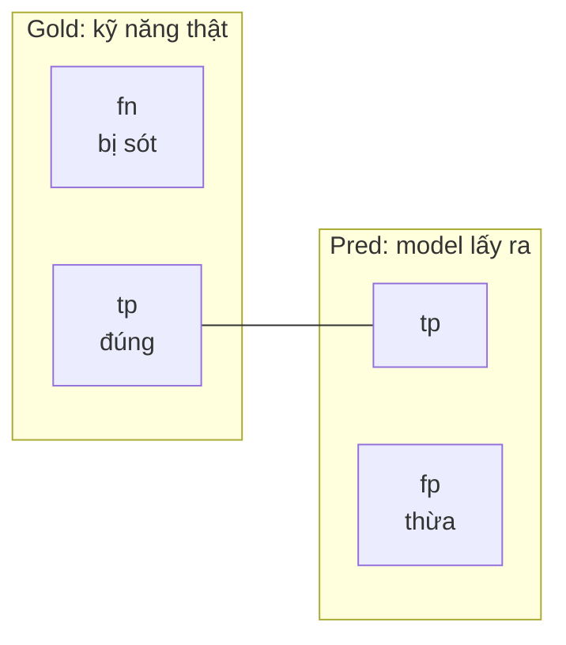
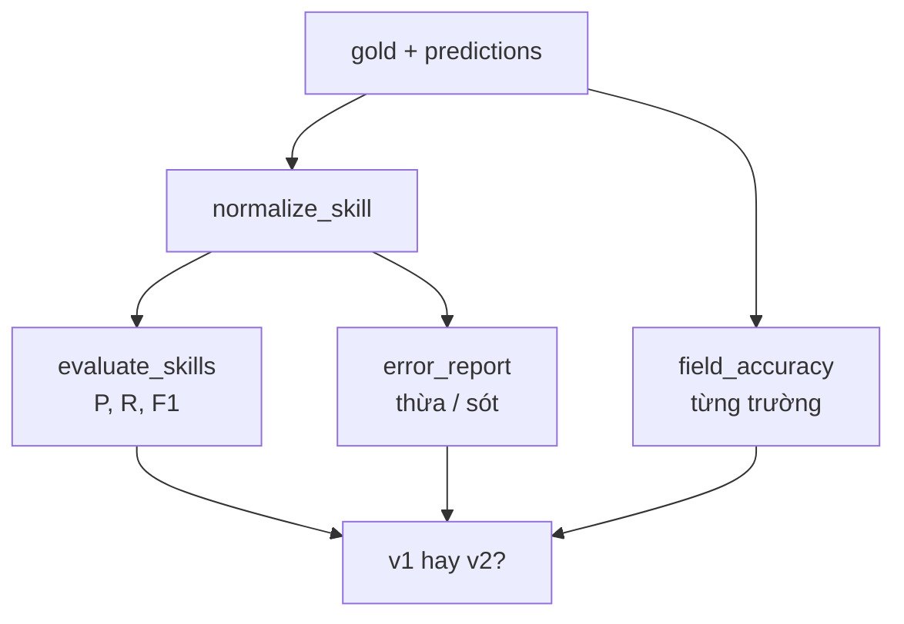

# L13 — Đánh giá: tập nhãn, precision/recall

> Trả lời câu hỏi "bộ trích xuất đúng bao nhiêu?" bằng con số, và dùng con số đó để chọn giữa hai prompt.

## 🎯 Mục tiêu

Sau buổi này (khoảng 3 giờ) bạn sẽ:

- Hiểu **tập nhãn** (golden set) và **hướng dẫn gán nhãn**: thước đo phải có trước khi đo.
- Tính **precision, recall, F1** cho đầu ra dạng tập hợp (kỹ năng), và **accuracy** cho trường đơn (cấp bậc, lương).
- Phân biệt **micro** và **macro** average.
- Làm **phân tích lỗi**: từ con số đi tới nguyên nhân cụ thể, rồi tới cách sửa.
- **Kết quả đo được:** 4 hàm trong `evaluate.py` qua hết **17 test**; `python evaluate.py` in bảng so sánh prompt v1 và v2 trên 30 tin.

> 🧠 **Ghi nhớ:** "Chạy thử vài tin thấy ổn" không phải đánh giá. Đánh giá là: tập cố định, nhãn có quy tắc, chỉ số định nghĩa rõ, chạy lại được.

## 📋 Đề bài

**Mở file:** `academy/workspace/L13-danh-gia-precision-recall/evaluate.py`. Cùng thư mục có sẵn:

| File | Nội dung |
|---|---|
| `gold_30.json` | 30 tin viết theo kiểu tin thật + nhãn đúng, gán theo hướng dẫn bên dưới |
| `predictions_v1.json` | output **thật** của `extract.py` (L11) với prompt v1 |
| `predictions_v2.json` | output **thật** với prompt v2 (nội dung trong `prompt_v2.txt`) |

| Hàm | Việc |
|---|---|
| `normalize_skill(skill)` | `"  Postgres "` → `"postgresql"` |
| `evaluate_skills(gold, pred)` | precision, recall, F1 (micro) cho kỹ năng |
| `field_accuracy(gold, pred, field)` | accuracy một trường + bảng nhầm lẫn |
| `error_report(gold, pred, top)` | kỹ năng hay bị thừa / bị sót nhất |

**Xong khi:** bấm **Chạy test** thấy `17 passed`, và viết được kết luận chọn v1 hay v2 kèm số liệu.

## 🤔 Tại sao? (kiến thức nền)

### Tập nhãn và hướng dẫn gán nhãn

**Tập nhãn** (golden set) là một bộ mẫu cố định kèm đáp án đúng do người xác định. Mọi phiên bản prompt/model đều chấm trên cùng bộ này để so được với nhau.

Đáp án đúng cần **quy tắc viết ra giấy**. Tin ghi "2+ năm kinh nghiệm" thì cấp bậc là gì? Không có quy tắc, hai người gán hai kiểu, và con số đo được không có nghĩa.

Hướng dẫn gán nhãn của `gold_30.json`:

| Trường | Quy tắc |
|---|---|
| `skills` | công nghệ, ngôn ngữ, công cụ ứng viên cần biết, kể cả "lợi thế". **Không** lấy kỹ năng mềm, ngoại ngữ, công nghệ bị phủ định ("không yêu cầu Java"). |
| `level` | chỉ khi tiêu đề/mô tả **ghi rõ** ("Thực tập sinh" = intern, "mới tốt nghiệp" = fresher, "Mid-level" = middle). **Không** suy từ số năm kinh nghiệm. |
| `salary_*` | triệu VND/tháng; USD × 25.000; "từ X", "X+" → chỉ có min; "lên tới X" → chỉ có max; một con số duy nhất → min = max; "thỏa thuận", "cạnh tranh" → null. |
| `work_mode` | remote / hybrid / onsite khi tin nói rõ; "full remote", "remote-first", "làm từ xa" = remote. |

> 💡 **Mẹo:** Trước khi code, tự gán nhãn lại 5 tin trong `gold_30.json` rồi so với nhãn có sẵn. Chỗ bạn khác nhãn chính là chỗ quy tắc còn mơ hồ — và cũng là chỗ model dễ sai.

### Precision, recall, F1

Với đầu ra là **tập hợp** (kỹ năng của một tin), so tập dự đoán P với tập đúng G:

| | Nghĩa | Công thức |
|---|---|---|
| tp | lấy ra và đúng | `len(G ∩ P)` |
| fp | lấy ra nhưng sai (thừa) | `len(P − G)` |
| fn | đúng nhưng bị sót | `len(G − P)` |
| **precision** | trong những cái lấy ra, bao nhiêu phần đúng | `tp / (tp + fp)` |
| **recall** | trong những cái đúng, lấy được bao nhiêu phần | `tp / (tp + fn)` |
| **F1** | trung bình điều hòa của hai cái trên | `2PR / (P + R)` |



Hai chỉ số kéo nhau: lấy thật nhiều → recall cao, precision thấp; chỉ lấy khi rất chắc → ngược lại. Ưu tiên cái nào tùy hậu quả: **tìm việc theo kỹ năng** mà sót kỹ năng (recall thấp) thì ứng viên không thấy tin phù hợp; gắn **nhầm** kỹ năng (precision thấp) thì ứng viên thấy tin không liên quan.

> 🎯 **Phỏng vấn hay hỏi:** "Vì sao F1 dùng trung bình điều hòa?" — trung bình cộng của P = 1.0 và R = 0.02 là 0.51, trông ổn dù hệ thống gần như vô dụng; trung bình điều hòa cho 0.04. F1 chỉ cao khi **cả hai** cùng cao.

### Micro và macro average

- **Micro:** cộng dồn tp, fp, fn của mọi tin rồi mới chia một lần. Kỹ năng phổ biến (SQL, Python) chiếm phần lớn điểm.
- **Macro:** tính precision/recall cho **từng lớp** (ở đây: từng kỹ năng) rồi lấy trung bình. Kỹ năng hiếm (Snowflake) nặng ngang SQL — lộ ra lỗi ở nhóm hiếm mà micro che mất.
- **Trung bình theo mẫu** (samples): tính cho từng tin rồi lấy trung bình. Mỗi tin nặng như nhau.

Bài này dùng **micro** cho kỹ năng. Báo cáo con số nào cũng phải nói rõ là micro hay macro.

### Accuracy và bảng nhầm lẫn

Trường đơn (`level`, `work_mode`, lương) đúng hoặc sai, nên dùng **accuracy** = số tin đúng / tổng số tin. `None == None` là **đúng**: tin không nói, model cũng không bịa.

Riêng accuracy không đủ để biết sửa gì. **Bảng nhầm lẫn** đếm từng cặp `(đúng, dự_đoán)` khi sai, ví dụ `(None, "middle"): 1` nghĩa là "tin không ghi cấp bậc nhưng model điền middle". Đó là manh mối để sửa prompt.

### Phân tích lỗi và bẫy "tối ưu trên đề thi"

**Phân tích lỗi** (error analysis) là đọc từng lỗi, gom theo nguyên nhân, sửa nguyên nhân lớn nhất trước. Prompt v2 trong bài sinh ra đúng theo cách đó: đọc lỗi của v1 → thêm quy tắc.

Bẫy: v2 được sửa **dựa trên chính 30 tin này**, nên điểm của v2 trên 30 tin này là **lạc quan**. Như ôn đúng đề rồi thi lại đúng đề đó. Ở công ty, người ta tách **tập phát triển** (dùng để sửa) và **tập kiểm tra** (chỉ dùng để báo cáo, không nhìn vào khi sửa).

> ⚠️ **Lỗi hay gặp:** sửa prompt, chạy lại trên vài tin vừa sai, thấy hết sai là xong. Mỗi lần sửa phải chạy lại **toàn bộ** tập: sửa một lỗi có thể làm hỏng chỗ khác (regression).

## 🛠️ Làm

Toàn cảnh: chuẩn hóa trước, chấm sau, đọc lỗi cuối cùng.



Các demo dùng giỏ trái cây và tài liệu — không phải dữ liệu bài.

### Bước 1 — Chuẩn bị

Không cần API key, không cần mạng: dự đoán đã được chạy sẵn và lưu trong `predictions_v1.json`, `predictions_v2.json`. Bài chỉ dùng thư viện chuẩn.

Mở `gold_30.json`, đọc 3–4 tin và nhãn của chúng, đối chiếu với bảng hướng dẫn gán nhãn (tab **Kiến thức nền**).

### Bước 2 — So sánh công bằng → `normalize_skill`

`"Postgres"`, `"PostgreSQL"`, `"postgresql "` là một kỹ năng. Không chuẩn hóa thì model bị chấm sai oan, điểm thấp hơn thực tế.

Thứ tự: `strip` → `lower` → gộp khoảng trắng (`" ".join(s.split())`) → tra `SKILL_ALIASES` (bảng đã có sẵn, key là chữ thường).

> 💡 **Mẹo:** chuẩn hóa áp dụng cho **cả gold lẫn pred**. Quên một bên là lỗi khó thấy.

### Bước 3 — Precision, recall, F1 → `evaluate_skills`

```python
gold = {"táo", "cam", "chuối", "xoài"}      # trái cây thật sự có trong giỏ
pred = {"táo", "cam", "lê"}                  # hệ thống nhận diện được
tp, fp, fn = len(gold & pred), len(pred - gold), len(gold - pred)
precision, recall = tp / (tp + fp), tp / (tp + fn)
f1 = 2 * precision * recall / (precision + recall)
print(f"tp={tp} fp={fp} fn={fn}")
print(f"precision={precision:.4f} recall={recall:.4f} f1={f1:.4f}")
```
```output
tp=2 fp=1 fn=2
precision=0.6667 recall=0.5000 f1=0.5714
```

Cộng dồn hay lấy trung bình từng mẫu cho kết quả khác hẳn nhau:

```python
baskets = {
    "B1": ({"táo", "cam"}, {"táo", "cam"}),
    "B2": ({"chuối"}, set()),
    "B3": ({"táo", "cam", "lê", "nho", "mận", "dưa", "ổi", "na"}, {"táo", "cam", "lê", "nho", "mận", "dưa", "ổi", "na"}),
}
tp = fn = 0
per_basket = []
for gold, pred in baskets.values():
    tp += len(gold & pred)
    fn += len(gold - pred)
    per_basket.append(len(gold & pred) / len(gold))
print("micro recall:", round(tp / (tp + fn), 4))
print("trung bình theo giỏ:", round(sum(per_basket) / len(per_basket), 4))
```
```output
micro recall: 0.9091
trung bình theo giỏ: 0.6667
```

Giỏ B2 sót trọn: trung bình theo giỏ phạt nặng (1/3 số giỏ hỏng), micro phạt nhẹ (1/11 số quả). Bài này dùng **micro**: cộng dồn rồi mới chia.

> ⚠️ **Lỗi hay gặp:** (1) dùng list thay set, `"SQL"` lặp 2 lần bị đếm 2 lần; (2) chia cho 0 khi model không trả gì (`tp + fp == 0` → precision = 0.0); (3) tin không có dự đoán bị **bỏ qua** thay vì tính là sót hết — điểm bị thổi phồng đúng ở chỗ model lỗi nặng nhất.

### Bước 4 — Từng trường → `field_accuracy`

```python
from collections import Counter

gold = {"D1": "loại A", "D2": "loại A", "D3": "loại B", "D4": "loại B"}
pred = {"D1": "loại A", "D2": "loại B", "D3": "loại B", "D4": "loại A"}
pairs = Counter((gold[k], pred[k]) for k in gold)
print(pairs)
print("đúng:", sum(n for (g, p), n in pairs.items() if g == p), "/", len(gold))
```
```output
Counter({('loại A', 'loại A'): 1, ('loại A', 'loại B'): 1, ('loại B', 'loại B'): 1, ('loại B', 'loại A'): 1})
đúng: 2 / 4
```

Đếm theo cặp `(đúng, dự_đoán)` cho thấy model nhầm theo hướng nào, không chỉ "sai 2 tin". Trong bài còn hai trường hợp demo không có: tin **thiếu** trong pred và giá trị `None` — quy tắc ở docstring `field_accuracy`.

### Bước 5 — Xếp hạng lỗi → `error_report`

```python
from collections import Counter

misses = Counter()
for gold, pred in [({"táo", "lê"}, {"táo"}), ({"lê", "nho"}, {"lê"}), ({"mận", "lê"}, set())]:
    misses.update(gold - pred)
print(sorted(misses.items(), key=lambda kv: (-kv[1], kv[0])))
```
```output
[('lê', 2), ('mận', 1), ('nho', 1)]
```

`-kv[1]`: count giảm dần; `kv[0]`: bằng count thì A→Z. Sắp **tường minh** để báo cáo ra cùng thứ tự mọi lần chạy (thứ tự duyệt `set` thay đổi giữa các lần chạy Python).

### Bước 6 — Chạy thật và kết luận

```bash
python evaluate.py
```

Kết quả với dữ liệu đi kèm (dự đoán của `nemotron-3-super`, 14/10/2026):

```output
[v1] level sai (gold, pred): {(None, 'middle'): 1}
[v1] lỗi kỹ năng: {'false_positives': [], 'false_negatives': [('llm', 1), ('rag', 1)]}
[v2] level sai (gold, pred): {}
[v2] lỗi kỹ năng: {'false_positives': [], 'false_negatives': [('llm', 1), ('rag', 1)]}

   version |    skill_P |    skill_R |   skill_F1 |      level |  work_mode | salary_min | salary_max
        v1 |        1.0 |     0.9821 |      0.991 |     0.9667 |        1.0 |        0.8 |     0.8333
        v2 |        1.0 |     0.9821 |      0.991 |        1.0 |        1.0 |        1.0 |        1.0
```

Đọc kết quả như một engineer:

1. **Lương là lỗi lớn nhất của v1**: 6 tin ghi lương bằng USD, v1 để `null` cả 6 (prompt v1 chỉ nói "triệu VND", không nói cách quy đổi). Model không bịa số — nó bỏ trống. `salary_max` chỉ sai 5 vì HX-029 ("$3,000+") vốn không có mức trần. v2 thêm quy tắc quy đổi → đúng cả 6.
2. **Cấp bậc**: v1 điền `middle` cho tin "Data Engineer (2+ năm)". Theo hướng dẫn gán nhãn, đây là suy diễn. v2 cấm suy từ số năm.
3. **Kỹ năng**: precision 1.0 — không có kỹ năng thừa, kể cả với "không yêu cầu Java" và kỹ năng mềm. Recall sót đúng một tin (HX-002: "xây trợ lý nội bộ dựa trên LLM và RAG"). Model coi đó là mô tả sản phẩm, không phải yêu cầu. Model sai hay nhãn sai? Đó là câu hỏi cho hướng dẫn gán nhãn, không phải cho prompt.
4. **Kết luận:** chọn v2, kèm cảnh báo: điểm 1.0 của v2 đo trên chính tập đã dùng để sửa nó. Bước tiếp theo là gán nhãn một tập kiểm tra mới chưa từng nhìn vào.

> 🎯 **Phỏng vấn hay hỏi:** "Kể một lần bạn cải thiện hệ thống bằng số liệu." — trình bày đúng quy trình đã làm trong bài: đo trên 30 tin, phát hiện lương USD bị bỏ trống (accuracy 0.80), thêm quy tắc quy đổi, lên 1.00; và biết vì sao con số đó còn lạc quan.

### Bước 7 — (tùy chọn, cần key) Đưa prompt v2 vào pipeline

Copy phần quy tắc trong `prompt_v2.txt` vào `SYSTEM_RULES` của `extract.py` trong thư mục L12, rồi chạy lại `python batch.py`. Mọi tin lại thành lần gọi API (`cache_hits = 0`, `api_calls` = tổng số tin): khóa cache gồm cả prompt, nên prompt mới không dùng nhầm kết quả của prompt cũ — đúng lý do khóa phải chứa prompt.

Muốn đo chính bộ trích xuất của bạn: copy `extract.py` đó vào thư mục bài này, chạy `extract_job` cho 30 tin trong `gold_30.json`, ghi `predictions_mine.json` cùng định dạng `predictions_v1.json`:

```python
import json
from extract import ExtractionError, extract_job, make_client
client = make_client()
pred = {}
for g in json.load(open("gold_30.json", encoding="utf-8")):
    try:
        pred[g["job_id"]] = extract_job(g["title"], g["description"], client).model_dump()
    except ExtractionError as e:  # tin hỏng → thiếu trong pred, evaluate tính là sai
        print(g["job_id"], e)
json.dump(pred, open("predictions_mine.json", "w", encoding="utf-8"), ensure_ascii=False, indent=1)
```

`python evaluate.py` sẽ thêm dòng `mine` vào bảng.

## ✅ Tự kiểm tra

Bấm **Chạy test**, hoặc từ thư mục `academy/`:

```bash
PYTHONPATH=workspace/L13-danh-gia-precision-recall python3 -m pytest curriculum/L13-danh-gia-precision-recall/tests -q
```

> 💡 **Mẹo:** Windows PowerShell: `$env:PYTHONPATH="workspace\L13-danh-gia-precision-recall"; python -m pytest curriculum\L13-danh-gia-precision-recall\tests -q`

Mục tiêu: `17 passed`. Dữ liệu trong test đủ nhỏ để tính tay (tp=6, fp=3, fn=1) — tính tay trước rồi mới code.

## 🎤 Câu hỏi phỏng vấn

> 🎯 **Phỏng vấn hay hỏi:** câu 8 — trả lời bằng **regression eval**: giữ tập nhãn cố định, mỗi lần đổi prompt/model chạy lại toàn bộ và so bảng với bản trước; con số giảm thì không ship.
