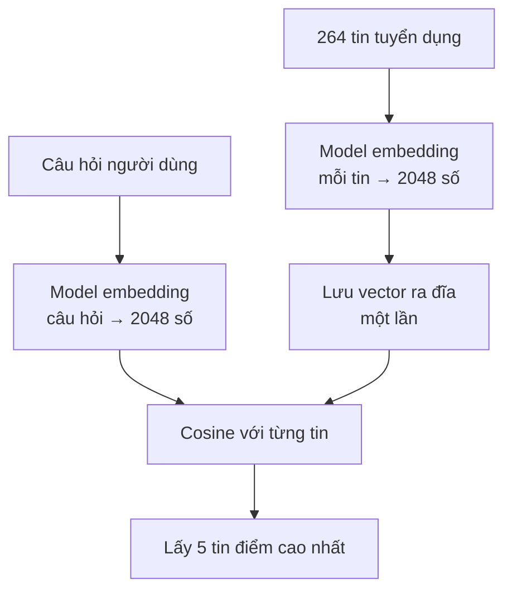
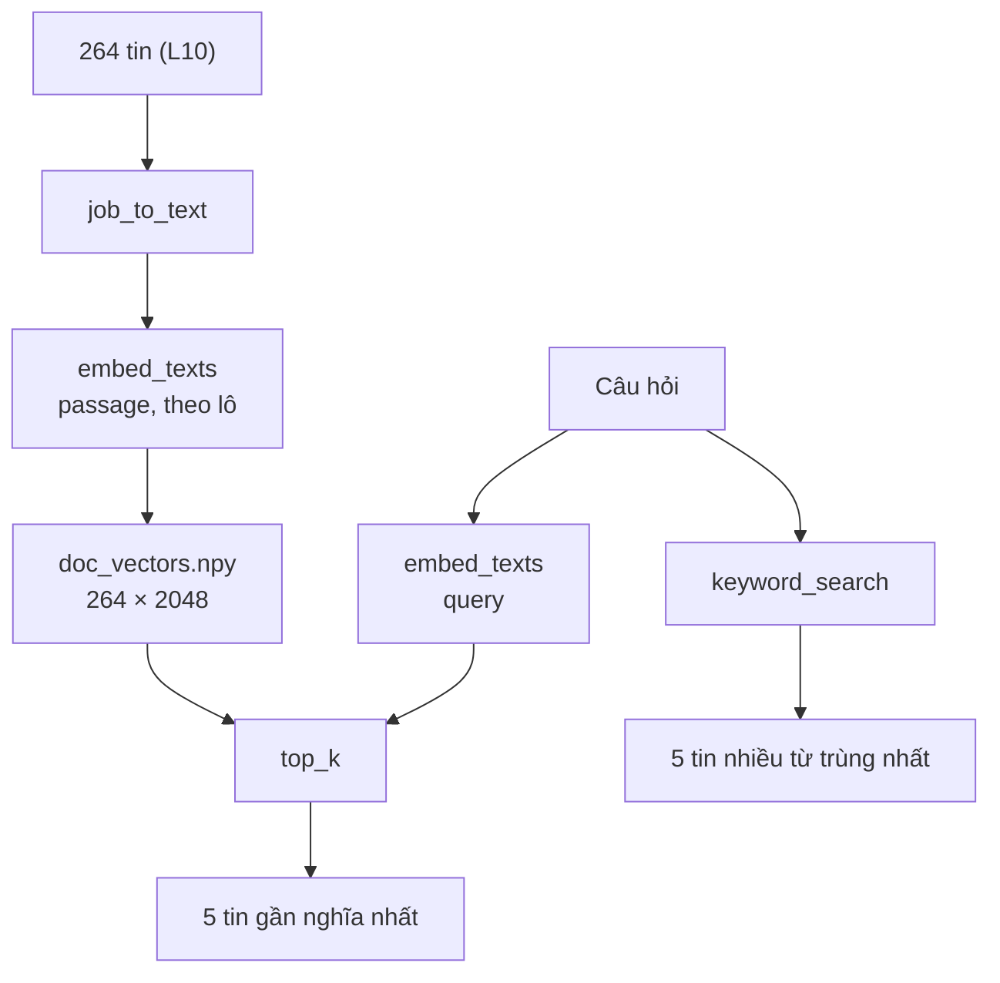

# L14 — Embedding & cosine similarity

> Tìm tin tuyển dụng theo **nghĩa** của câu hỏi, không phải theo từng chữ trong câu hỏi.

## 🎯 Mục tiêu

Sau buổi này (khoảng 3 giờ 20 phút) bạn sẽ:

- Hiểu **embedding**: biến văn bản thành một dãy số (**vector**) sao cho văn bản gần nghĩa → dãy số gần nhau.
- Tự viết **cosine similarity** (điểm đo hai vector "chỉ cùng hướng" tới mức nào) bằng vòng lặp, rồi bằng numpy, và biết vì sao numpy nhanh hơn dù cùng Big-O.
- Viết **top-k** (lấy k kết quả điểm cao nhất) và chọn cách làm hợp lý: sắp xếp hết O(n log n), heap O(n log k), `argpartition` O(n).
- Gọi API embedding theo lô, phân biệt `input_type` **query** (câu hỏi) và **passage** (tài liệu để tìm).
- So **tìm theo nghĩa** (semantic search) với **tìm theo từ khóa** trên một câu hỏi thật.
- **Kết quả đo được:** 4 hàm trong `semantic.py` qua hết **11 test**; `python semantic.py "làm pipeline dữ liệu cho ngân hàng"` trả về 5/5 tin của ngân hàng/fintech, còn tìm theo từ khóa trả về 0/5 tin liên quan.

> 🧠 **Ghi nhớ:** Tìm theo từ khóa hỏi "tài liệu có **chữ** này không?". Tìm theo nghĩa hỏi "tài liệu có **nói về** điều này không?".

## 📋 Đề bài

**Mở file:** `academy/workspace/L14-embedding-cosine/semantic.py`.

| Hàm | Việc |
|---|---|
| `cosine_similarity(a, b)` | cosine của 2 vector, xử lý vector 0 và khác độ dài |
| `top_k(query_vec, doc_vecs, k)` | k tài liệu có cosine cao nhất, `(chỉ_số, điểm)` |
| `keyword_search(query, docs, k)` | mốc so sánh (baseline): đếm từ khác nhau của query có trong tài liệu |
| `embed_texts(client, texts, input_type, ...)` | gọi API embedding theo lô, giữ đúng thứ tự |

Đã viết sẵn: `tokenize`, `job_header`, `job_to_text` (văn bản đại diện một tin = tiêu đề — công ty (thành phố) + mô tả), `load_jobs` (đọc CSDL L10, chỉ đọc), `load_api_key`, `make_client`, `load_or_embed_docs` (lưu vector ra `doc_vectors.npy`, chạy lại không gọi API).

**Xong khi:** bấm **Chạy test** thấy `11 passed`, và chạy thật được câu truy vấn ở Bước 6.

## 🤔 Tại sao? (kiến thức nền)

### Hiểu trước khi làm

**Bối cảnh.** Ứng viên gõ "làm pipeline dữ liệu cho ngân hàng". Không tin nào chứa đúng mấy chữ đó, nhưng có tin "Data Engineer — Trúc Xanh Bank" rất hợp. Tìm theo chữ thì trượt; cần cách tìm hiểu được rằng "ngân hàng" gần "Bank", "pipeline dữ liệu" gần "Data Engineer". Máy tính không hiểu nghĩa, nhưng tính toán trên số rất giỏi — nên ta đổi nghĩa của câu thành số.

**Ví dụ đời thường.** Thư viện xếp sách theo chủ đề: sách nấu ăn một kệ, sách lập trình một kệ khác, hai cuốn cùng chủ đề đứng sát nhau. Mỗi cuốn có một "tọa độ" trong thư viện. Embedding làm điều đó cho mọi đoạn văn: gán cho nó tọa độ trong một "thư viện nghĩa" có 2048 chiều thay vì 2 chiều (dãy, kệ). Tìm sách = lấy tọa độ của câu hỏi rồi chọn những cuốn đứng gần nhất. Cosine đo "gần" bằng góc: đứng ở cửa, hai cuốn nằm cùng một hướng nhìn thì điểm cao, dù một cuốn ở xa hơn.

**Bạn đã gặp nó ở đâu.**
- Google tìm ra trang đúng ý dù bạn gõ khác chữ, sai chính tả.
- Spotify, YouTube gợi ý bài hát / video "giống cái bạn vừa nghe".
- Shopee "sản phẩm tương tự", Google Photos gõ "biển" ra mọi ảnh chụp biển.
- Hệ thống trả lời tự động của ngân hàng hiểu "quên mật khẩu" và "không đăng nhập được" là một việc.

| Câu hỏi | Trả lời |
|---|---|
| **What** — là gì? | **Embedding**: dãy số cố định độ dài đại diện cho nghĩa của một đoạn văn. **Cosine similarity**: điểm đo hai dãy số "chỉ cùng hướng" tới đâu. **Semantic search**: tìm theo nghĩa bằng cách xếp tài liệu theo cosine với câu hỏi. |
| **Why** — vì sao cần? | Người dùng diễn đạt khác tài liệu: đồng nghĩa, viết tắt, tiếng Anh lẫn tiếng Việt. Tìm theo chữ bỏ lỡ những tài liệu đúng nghĩa. |
| **When** — khi nào dùng? | Câu hỏi tự nhiên, mô tả bằng lời; gợi ý "nội dung tương tự"; bước "tìm tài liệu" của RAG (L16). |
| **When not** — khi nào không? | Tìm mã, tên riêng hiếm ("JR-10015", số hóa đơn): tìm theo chữ chính xác hơn và miễn phí. |
| **Where** — nằm ở đâu? | Lúc nạp dữ liệu: embed mọi tài liệu một lần, lưu lại. Lúc người dùng hỏi: embed câu hỏi, so với vector đã lưu. |
| **How** — chạy thế nào? | Gọi model embedding → nhận vector → tính cosine giữa câu hỏi và từng tài liệu → lấy k điểm cao nhất. |

**Từ mới trong bài**

| Từ | Nghĩa đời thường |
|---|---|
| embedding | "tọa độ nghĩa" của một đoạn văn, do một model AI tính ra |
| vector | dãy số có thứ tự, vd. `[0.12, -0.5, 0.33]`; hình dung là một mũi tên đi từ gốc tọa độ |
| chiều (dimension) | số lượng con số trong vector; bài này dùng vector 2048 chiều |
| tích vô hướng (dot product) | nhân từng cặp số rồi cộng lại — như tính tổng tiền giỏ hàng = số lượng × đơn giá |
| độ dài vector, chuẩn hóa | độ dài mũi tên; chuẩn hóa = co giãn để độ dài bằng 1, chỉ giữ hướng |
| cosine similarity | điểm từ -1 đến 1: 1 là cùng hướng, 0 là không liên quan |
| semantic search | tìm theo nghĩa thay vì theo chữ |
| keyword search, baseline | tìm theo chữ trùng; baseline là cách đơn giản làm mốc để so |
| top-k | k kết quả điểm cao nhất (bài dùng k = 5) |
| heap | cấu trúc dữ liệu luôn biết ngay phần tử nhỏ nhất — giữ "k ứng viên tốt nhất" rất rẻ |
| `argsort`, `argpartition`, `argmax` | hàm numpy trả về **vị trí** (chỉ số) thay vì giá trị: vị trí sau khi sắp xếp / vị trí k phần tử lớn nhất / vị trí phần tử lớn nhất |
| numpy, BLAS | thư viện tính toán số; BLAS là phần lõi viết bằng C mà numpy gọi để nhân ma trận cực nhanh |
| ma trận | bảng số nhiều hàng; 264 vector 2048 chiều xếp chồng = ma trận 264 × 2048 |
| `input_type`: query / passage | báo cho model văn bản là câu hỏi hay là tài liệu, vì model mã hóa hai loại hơi khác nhau |
| hybrid search | kết hợp tìm theo chữ và theo nghĩa |
| âm tiết | tiếng Việt tách theo khoảng trắng ra từng âm tiết ("ngân", "hàng"), không phải từng từ |



### Từ khóa thất bại ở đâu

Kết quả thật khi chuẩn bị bài, câu hỏi `"làm pipeline dữ liệu cho ngân hàng"` trên 264 tin sạch của L10:

| Cách tìm | Kết quả số 1 | Vì sao |
|---|---|---|
| Từ khóa | Golang Developer Intern — Hanoi Analytics | khớp 5 âm tiết: `làm`, `cho`, `dữ`, `liệu` và `ngân` (của "**ngân** sách học tập") |
| Theo nghĩa | Junior AI Engineer — Trúc Xanh Bank | công ty là ngân hàng; top 3 có thêm 2 Data Engineer ở Saigon Fintech, PayNow |

Không tin nào chứa chữ "pipeline" hay "ngân hàng". Tiếng Việt còn khó hơn: tách theo khoảng trắng ra **âm tiết**, nên "ngân sách" và "ngân hàng" chung chữ "ngân".

### Embedding là gì

Model dùng trong bài, `nvidia/nemotron-3-embed-1b`, trả vector **2048 chiều**, đã chuẩn hóa độ dài 1. Model được huấn luyện để hai văn bản gần nghĩa có vector chỉ về gần cùng một hướng.

| | Từ khóa | Embedding |
|---|---|---|
| So khớp | chữ giống chữ | hướng vector |
| Đồng nghĩa ("code" ~ "lập trình") | không | có |
| Tên riêng, mã hiếm ("JR-10015", "SSIS") | rất tốt | kém hơn |
| Chi phí | không | 1 lần gọi API mỗi văn bản, lưu lại dùng mãi |

Vì vậy hệ thống thật thường **kết hợp** cả hai (hybrid search). Bài này làm từng loại riêng để thấy điểm mạnh, yếu.

### Cosine similarity

`cos(a, b) = (a · b) / (|a| · |b|)` — chỉ đo **hướng**, không đo độ dài: `[1, 1]` và `[5, 5]` có cosine 1. Giá trị trong [-1, 1]; với embedding văn bản thường nằm khoảng 0–0.5.

Khi mọi vector đã có độ dài 1, cosine **bằng** tích vô hướng `a · b` — bỏ được phép chia.

> ⚠️ **Lỗi hay gặp:** coi điểm cosine như xác suất. 0.33 không có nghĩa "đúng 33%". Câu hỏi về Rust (không có tin nào) vẫn có điểm 0.35, cao hơn câu hỏi ngân hàng ở trên. Điểm chỉ dùng để **xếp hạng** trong cùng một câu hỏi.

### Query và passage

Model này cần biết văn bản là **câu hỏi** (`input_type="query"`) hay **tài liệu** để tìm (`"passage"`). Demo thật, cùng model, 4 cuốn sách:

```python
import numpy as np
from semantic import make_client                      # client đã viết sẵn trong semantic.py

client = make_client()
books = ["Sách dạy nấu ăn cho người mới bắt đầu", "Tiểu thuyết trinh thám ly kỳ",
         "Giáo trình lập trình Python cơ bản", "Truyện tranh thiếu nhi"]
question = "Tôi muốn học code từ đầu"

def embed(texts, input_type=None):
    extra = {}
    if input_type:                                  # chỉ gửi input_type khi có
        extra["input_type"] = input_type
    resp = client.embeddings.create(model="nvidia/nemotron-3-embed-1b", input=texts, extra_body=extra)
    vectors = []
    for item in resp.data:
        vectors.append(item.embedding)
    return np.array(vectors)

for label, q_type, d_type in [("không input_type", None, None), ("query / passage ", "query", "passage")]:
    scores = embed(books, d_type) @ embed([question], q_type)[0]     # vector đã có độ dài 1
    best = books[int(np.argmax(scores))]                              # argmax = chỉ số của điểm lớn nhất
    print(f"{label}: {np.round(scores, 3).tolist()} → {best}")
```
```output
không input_type: [0.627, 0.611, 0.677, 0.727] → Truyện tranh thiếu nhi
query / passage : [0.245, 0.067, 0.265, 0.071] → Giáo trình lập trình Python cơ bản
```

Thiếu `input_type`: mọi điểm dồn về 0.6–0.7 và kết quả sai. Có `input_type`: điểm tách rõ, kết quả đúng. Các model embedding khác có quy ước riêng (tiền tố `"query: "`, tham số `task_type`...) — luôn đọc tài liệu model trước khi dùng.

> 💡 **Mẹo:** build.nvidia.com hiện chỉ còn `nemotron-3-embed-1b` chạy được trong nhóm model embedding đã thử khi soạn bài (các model khác trả 404 hoặc 410 — hết hạn). Đổi model embedding = phải tạo lại **toàn bộ** vector tài liệu: vector của hai model khác nhau không so được với nhau.

## 🛠️ Làm

Toàn cảnh:



Các demo dùng giỏ hàng, bài hát, sách — không phải dữ liệu bài.

### Bước 1 — Chuẩn bị

Cần CSDL sạch của L10 (`workspace/L10-etl-chat-luong-du-lieu/jobradar.db`) và `NVIDIA_API_KEY` trong `.env` ở gốc repo. Test **không** cần cả hai.

### Bước 2 — Cosine → `cosine_similarity`

Viên gạch đầu tiên của cosine là **tích vô hướng** `a · b` = tổng `a[i] * b[i]`. Ví dụ ngoài đời: tổng tiền giỏ hàng = tích vô hướng của số lượng và đơn giá.

```python
import numpy as np

# giỏ hàng: số lượng từng món, và đơn giá (nghìn đồng) tương ứng
quantities = [2, 1, 3]
prices = [15, 40, 8]

# Cách 1 — vòng lặp for: cộng dồn tích từng cặp
total1 = 0
for i in range(len(quantities)):
    total1 += quantities[i] * prices[i]
print("Cách 1:", total1)

# Cách 2 — zip + sum (generator)
total2 = sum(q * p for q, p in zip(quantities, prices))
print("Cách 2:", total2)

# Cách 3 — numpy: toán tử @ là tích vô hướng
total3 = np.array(quantities) @ np.array(prices)
print("Cách 3:", int(total3))
```
```output
Cách 1: 94
Cách 2: 94
Cách 3: 94
```

`zip(quantities, prices)` ghép từng cặp `(quantities[i], prices[i])` — tương đương `for i in range(len(quantities))`. `sum(q * p for ...)` là vòng `total1 += ...` viết trên một dòng. `a @ b` là tích vô hướng của numpy.

> ⚖️ **So sánh:** cả ba cùng O(d) với d = số phần tử. Cách 2 chỉ gọn hơn. Cách 3 chạy vòng lặp trong C nên nhanh hơn nhiều khi d = 2048 — xem Bước 3.

Phần còn lại của `cosine_similarity` bạn tự ghép theo công thức ở mục "Cosine similarity" (① Hiểu trước): độ dài `|a|` = căn bậc hai của tích vô hướng `a · a` (`math.sqrt`), rồi chia. Docstring còn hai trường hợp: vector toàn 0 và hai vector khác độ dài.

### Bước 3 — Xếp hạng → `top_k`

Hai việc: **tính điểm** cho mọi tài liệu, rồi **chọn** k điểm cao nhất. Tính điểm:

```python
import time

import numpy as np

rng = np.random.default_rng(0)
n, d = 2000, 2048                                   # 2000 bài hát, vector 2048 chiều
songs = rng.standard_normal((n, d)).astype(np.float32)
songs /= np.linalg.norm(songs, axis=1, keepdims=True)   # độ dài 1 → cosine = tích vô hướng
query = songs[42]
songs_list, query_list = songs.tolist(), query.tolist()

# Cách 1 — hai vòng for lồng nhau
t = time.perf_counter()
scores1 = []
for i in range(n):                  # từng bài hát
    s = 0.0
    for j in range(d):              # từng chiều
        s += songs_list[i][j] * query_list[j]
    scores1.append(s)
t1 = time.perf_counter() - t

# Cách 2 — numpy: một phép nhân ma trận (n×d) @ (d,)
songs @ query                       # chạy nháp 1 lần: lần đầu numpy còn khởi động thư viện BLAS
t = time.perf_counter()
scores2 = songs @ query
t2 = time.perf_counter() - t

print("giống nhau:", np.allclose(scores1, scores2, atol=1e-4))
print(f"Cách 1: {t1 * 1000:.0f} ms · Cách 2: {t2 * 1000:.2f} ms · nhanh hơn ~{t1 / t2:.0f} lần")
```
```output
giống nhau: True
Cách 1: 219 ms · Cách 2: 0.08 ms · nhanh hơn ~2640 lần
```

Cùng O(n·d), nhưng numpy nhanh hơn **hàng chục đến hàng nghìn lần tùy máy**: phép nhân chạy trong thư viện BLAS viết bằng C, có thể dùng nhiều nhân CPU. Cùng đoạn code này, máy soạn bài từng đo được ~37 lần ở một lần chạy khác. Đo lại trên máy bạn.

Chọn k lớn nhất, trên 1 triệu điểm:

```python
import heapq
import time

import numpy as np

rng = np.random.default_rng(1)
scores = rng.random(1_000_000).tolist()     # điểm cosine của 1 triệu tài liệu (list Python)
arr = np.array(scores)                      # cùng dữ liệu, dạng numpy cho Cách 3, 4
k = 5

# Cách 1 — vòng lặp: giữ danh sách k ứng viên tốt nhất
t = time.perf_counter()
best = []                                   # các cặp (điểm, chỉ_số), tối đa k phần tử
for i in range(len(scores)):
    s = scores[i]
    if len(best) < k:
        best.append((s, i))                 # chưa đủ k → nhận luôn
    else:
        worst = 0                           # tìm ứng viên kém nhất trong k cái đang giữ
        for j in range(1, k):
            if best[j][0] < best[worst][0]:
                worst = j
        if s > best[worst][0]:
            best[worst] = (s, i)            # thay ứng viên kém nhất
best.sort(reverse=True)                     # chỉ sắp k phần tử ở cuối
best1 = [i for s, i in best]
t1 = time.perf_counter() - t

# Cách 2 — heapq.nlargest: heap kích thước k
t = time.perf_counter()
best2 = heapq.nlargest(k, range(len(scores)), key=lambda i: scores[i])   # so các chỉ số i theo điểm scores[i]
t2 = time.perf_counter() - t

# Cách 3 — numpy argsort: sắp xếp hết rồi lấy k đầu
t = time.perf_counter()
best3 = np.argsort(-arr)[:k].tolist()       # đổi dấu để sắp giảm dần
t3 = time.perf_counter() - t

# Cách 4 — numpy argpartition: tách k phần tử lớn nhất, rồi chỉ sắp k phần tử đó
t = time.perf_counter()
part = np.argpartition(-arr, k)[:k]
best4 = part[np.argsort(-arr[part])].tolist()
t4 = time.perf_counter() - t

print("giống nhau:", best1 == best2 == best3 == best4)
print(f"vòng lặp {t1 * 1000:.0f} ms · heapq {t2 * 1000:.0f} ms · argsort {t3 * 1000:.0f} ms · argpartition {t4 * 1000:.1f} ms")
```
```output
giống nhau: True
vòng lặp 266 ms · heapq 24 ms · argsort 25 ms · argpartition 4.5 ms
```

Cách 1 chỉ dùng `for` và `if`: giữ k ứng viên, mỗi điểm mới so với ứng viên kém nhất. `key=lambda i: scores[i]` ở Cách 2 nghĩa là "so các chỉ số `i` theo điểm `scores[i]` của chúng". `np.argsort(-arr)` trả **chỉ số** theo điểm giảm dần (đổi dấu để sắp giảm). Số đo trên máy soạn bài; máy bạn sẽ khác.

| Cách | Big-O | Tốt ở đâu |
|---|---|---|
| 1 — vòng lặp giữ k ứng viên | O(n·k) | dễ đọc, không cần thư viện, bộ nhớ O(k); chậm vì chạy từng phần tử bằng Python |
| 2 — `heapq.nlargest` | O(n log k) | thư viện chuẩn, nhanh hơn Cách 1 khi k lớn; nhận cả list lẫn dữ liệu đọc dần |
| 3 — `np.argsort` | O(n log n) | một dòng, có cả thứ hạng đầy đủ nếu cần nhiều hơn k |
| 4 — `np.argpartition` | O(n) + O(k log k) | nhanh nhất khi n lớn, k nhỏ; khó đọc nhất |

> ⚖️ **So sánh:** tính điểm — vòng for và numpy **cùng O(n·d)**, numpy nhanh hơn chỉ vì vòng lặp chạy trong C (BLAS). Chọn top-k — Big-O không phải tất cả: `argsort` O(n log n) chạy ngang `heapq` O(n log k) vì phần sắp xếp chạy trong C, còn `heapq` duyệt từng phần tử bằng Python. Với 264 tin, mọi cách đều dưới 10 ms — viết cách bạn đọc hiểu được (Cách 1 hoàn toàn ổn); bằng điểm thì chỉ số nhỏ phải đứng trước (`kind="stable"` hoặc so theo `(-điểm, chỉ_số)`).

> ⚠️ **Lỗi hay gặp:** `top_k` trả **tích vô hướng** thay vì cosine. Vector API đã có độ dài 1 nên chạy thật vẫn đúng, nhưng test có vector chưa chuẩn hóa — đúng như khi bạn đổi sang model khác.

### Bước 4 — Mốc so sánh → `keyword_search`

Làm theo docstring: `tokenize` cả query lẫn tài liệu, đếm số từ **khác nhau** của query có trong tài liệu. Đây là mốc (baseline) để chứng minh tìm theo nghĩa tốt hơn — không có mốc thì không có so sánh.

> 💡 **Mẹo:** `set(a) & set(b)` là các phần tử chung của hai tập (L13).

### Bước 5 — Gọi API theo lô → `embed_texts`

Một lần gọi nhận **nhiều** văn bản (`input=[...]`). 264 tin, lô 64 → 5 lần gọi thay vì 264 — nhanh hơn và ít bị 429 hơn (L12).

| Cần làm | Vì sao |
|---|---|
| Kiểm `input_type` trước khi gọi | sai tham số thì báo ngay, không tốn request |
| Chia lô `texts[start:start + batch_size]` | API giới hạn kích thước mỗi request |
| Sắp `response.data` theo `.index` | không dựa vào thứ tự trả về; test cố tình trả ngược |

Kết quả thật: 264 tin = **24.318 token**, 5 lần gọi, khoảng 9 giây. Mỗi lần gọi trả vector cho cả lô.

### Bước 6 — Chạy thật

```bash
python semantic.py "làm pipeline dữ liệu cho ngân hàng"
```

Kết quả khi chuẩn bị bài (19/10/2026):

```output
264 tin, vector 2048 chiều (gọi API, 8.9s)
Embedding câu hỏi: 366 ms · top_k trên 264 tin: 6.2 ms

Tìm theo nghĩa: 'làm pipeline dữ liệu cho ngân hàng'
  0.333  JR-10104  Junior AI Engineer — Trúc Xanh Bank (Hà Nội)
  0.313  JR-10108  Fresher Data Engineer — Saigon Fintech (Hà Nội)
  0.304  JR-10015  Junior Data Engineer — PayNow (Hồ Chí Minh)
  0.299  JR-10134  Fresher BI Developer — Trúc Xanh Bank (Hồ Chí Minh)
  0.297  JR-10208  Senior Backend Developer (Java) — Trúc Xanh Bank (Hà Nội)

Tìm theo từ khóa:
  5 từ  JR-10085  Golang Developer Intern — Hanoi Analytics (Hà Nội)
  4 từ  JR-10010  Frontend Developer — Sky Mobile (Đà Nẵng)
  4 từ  JR-10045  Junior Fullstack Developer — Sao Mai Tech (Hà Nội)
  4 từ  JR-10048  Junior AI Engineer — MediCare Tech (Hồ Chí Minh)
  4 từ  JR-10120  Senior Golang Developer — EduViet (Hà Nội)
```

Đọc kết quả như một engineer:

1. **5/5 tin theo nghĩa** thuộc công ty ngân hàng/fintech; 2 Data Engineer — đúng ý "pipeline dữ liệu" — ở hạng 2 và 3. Hạng 1 là AI Engineer ở ngân hàng: model coi "ngân hàng" nặng hơn "pipeline".
2. **0/5 tin theo từ khóa** liên quan.
3. Lần chạy sau đọc `doc_vectors.npy`, chỉ còn 1 lần gọi API cho câu hỏi (~0,4–0,9 giây). Gần như toàn bộ thời gian trả lời là lần gọi đó; `top_k` chỉ vài mili giây.

Thử thêm: `"việc làm app di động cho người mới ra trường"` → 4 tin đầu là Mobile Developer (Flutter), 3 tin Fresher — dù không tin nào có chữ "di động" hay "ra trường".

## ✅ Tự kiểm tra

Bấm **Chạy test**, hoặc từ thư mục `academy/`:

```bash
PYTHONPATH=workspace/L14-embedding-cosine python3 -m pytest curriculum/L14-embedding-cosine/tests -q
```

> 💡 **Mẹo:** Windows PowerShell: `$env:PYTHONPATH="workspace\L14-embedding-cosine"; python -m pytest curriculum\L14-embedding-cosine\tests -q`

Mục tiêu: `11 passed`. Test dùng client giả: vector = `[độ dài văn bản, 1]`, trả `data` theo thứ tự ngược.

## 🎤 Câu hỏi phỏng vấn

> 🎯 **Phỏng vấn hay hỏi:** "Tìm theo nghĩa hay theo từ khóa?" — nêu ví dụ đo được: câu "pipeline dữ liệu cho ngân hàng" không khớp chữ nào có nghĩa trong 264 tin, từ khóa trả tin Golang vì "ngân sách"; embedding trả 5/5 tin ngân hàng/fintech. Rồi nói điểm yếu: tên riêng, mã kỹ năng hiếm → hệ thống thật dùng hybrid (BM25 + embedding).
