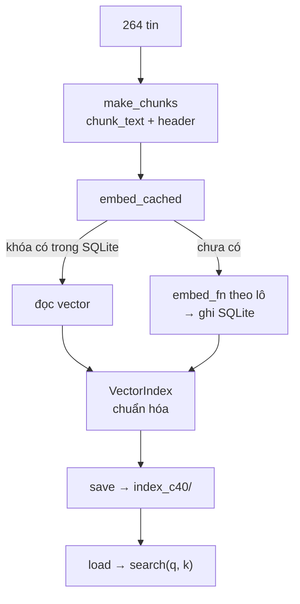

# L15 — Chunking & vector index

> Chia tài liệu thành đoạn vừa cỡ, tạo embedding **một lần**, lưu đĩa, và tìm trong chưa tới 0,1 mili giây.

## 🎯 Mục tiêu

Sau buổi này (khoảng 3,5 giờ) bạn sẽ:

- **Chunking**: chia văn bản theo cửa sổ từ có **overlap**, gắn header để chunk không mất ngữ cảnh.
- **Cache embedding** trong SQLite theo nội dung: chạy lại, đổi tham số chunk → chỉ gọi API cho đoạn **mới**.
- Dựng **vector index** vét cạn (brute force) bằng numpy, lưu/đọc đĩa, mỗi tin xuất hiện tối đa một lần trong kết quả.
- Biết khi nào brute force là đủ, khi nào cần index xấp xỉ (ANN: HNSW, IVF).
- **Kết quả đo được:** 4 phần trong `index.py` qua hết **12 test**; chạy thật: 264 tin → 475 chunk, lần 2 `calls: 0`, mỗi lần `search` trên index ~0,02 ms (chỉ phép tìm, vector câu hỏi đã có sẵn).

> 🧠 **Ghi nhớ:** Embedding tài liệu là việc **làm một lần, dùng nhiều lần**. Thứ chạy mỗi câu hỏi chỉ là: embedding câu hỏi + một phép nhân ma trận.

## 📋 Đề bài

**Mở file:** `academy/workspace/L15-chunking-vector-index/index.py`.

**Trước tiên:** copy `semantic.py` (L14) **của bạn** vào thư mục bài này — xem Bước 1.

| Phần | Việc |
|---|---|
| `chunk_text(text, size, overlap)` | cửa sổ `size` từ, trượt `size - overlap` từ |
| `make_chunks(jobs, size, overlap)` | mỗi tin → các chunk `{"chunk_id", "job_id", "text"}`, có header |
| `embed_cached(texts, embed_fn, cache_path, ...)` | embedding có cache SQLite, gọi theo lô |
| `VectorIndex` (`__init__`, `search`, `save`, `load`) | chuẩn hóa vector, tìm top-k theo tin, lưu/đọc đĩa |

Đã viết sẵn: `embedding_key` (khóa cache, như `cache_key` ở L12), `job_header`, `build_index`, `make_query_embedder`, phần chạy thật.

**Xong khi:** bấm **Chạy test** thấy `12 passed`; `python index.py` chạy lần 2 in `'calls': 0`.

## 🤔 Tại sao? (kiến thức nền)

### Vì sao chia nhỏ (chunking)

Một vector đại diện cho **cả** đoạn văn bản. Đoạn càng dài, càng nhiều ý, vector càng "trung bình" và mờ đi. Model cũng có giới hạn đầu vào (`nemotron-3-embed-1b`: 4096 token, quá thì bị cắt). Nên tài liệu dài (hợp đồng, tài liệu kỹ thuật, CV) được chia thành đoạn vài trăm từ trước khi tạo embedding.

| Tham số | Nhỏ quá | Lớn quá |
|---|---|---|
| `size` | đoạn thiếu ngữ cảnh, nhiều vector, tốn tiền | ý bị pha loãng, đưa nhiều chữ thừa vào prompt (L16) |
| `overlap` | ý nằm vắt qua ranh giới bị cắt đôi | trùng lặp, tốn thêm embedding |

**Header** (tiêu đề — công ty (thành phố)) gắn vào **mọi** chunk: đoạn "Yêu cầu thành thạo SQL và MLflow" một mình không cho biết là tin nào, ở công ty nào.

> ⚠️ **Lỗi hay gặp:** chia rồi mà không đo. Mô tả tin trong JobRadar ngắn — trung bình **47 từ**, dài nhất 64 — nên chia có thể **không** giúp gì. L17 đo điều này bằng số liệu.

### Cache theo nội dung

Khóa cache = hash của `(model, input_type, text)`. Hệ quả:

- Chạy lại cùng dữ liệu → 0 lần gọi API.
- Đổi `size` từ 40 sang 20 → chunk nào **trùng nội dung** với lần trước (tin ngắn hơn 20 từ, đoạn đầu giống nhau) vẫn dùng lại. Lần chạy thật: 871 chunk, **120 lấy từ cache**, chỉ gọi 751.
- Đổi model → khóa đổi hết → embedding lại toàn bộ (đúng: vector hai model không so được).

SQLite thay vì 1 file/khóa như L12: vài trăm nghìn vector trong **một** file, tra theo khóa có index, ghi theo giao dịch (`commit` sau mỗi lô).

### Brute force hay index xấp xỉ

`VectorIndex` của bài so câu hỏi với **mọi** vector: chính xác tuyệt đối, O(n·d) mỗi truy vấn. Đo trên máy soạn bài, d = 2048, float32, gồm cả chọn top 5:

| Số chunk | Bộ nhớ vector | Thời gian / truy vấn |
|---|---|---|
| 475 (JobRadar) | 4 MB | 0,02 ms |
| 10.000 | 82 MB | 3 ms |
| 50.000 | 410 MB | 6 ms |

Thời gian tăng theo n (cộng thêm chi phí khởi động luồng của numpy ở n nhỏ). Ở vài triệu chunk, bộ nhớ lên hàng chục GB và mỗi truy vấn hàng trăm ms → dùng **ANN** (Approximate Nearest Neighbor): HNSW, IVF trong FAISS, pgvector, Qdrant, Chroma... Truy vấn dưới tuyến tính, đổi lại có thể **bỏ sót** vài kết quả đúng (recall < 1).

> 🎯 **Phỏng vấn hay hỏi:** "Bạn chọn vector database nào?" — trả lời bằng quy mô: 475 chunk thì numpy brute force (chính xác, 0 phụ thuộc, ~0,02 ms); hàng triệu chunk mới cần ANN, và phải đo recall của ANN so với brute force.

## 🛠️ Làm

Toàn cảnh:



Các demo dùng câu chuyện, mã sản phẩm — không phải dữ liệu bài.

### Bước 1 — Chuẩn bị: copy semantic.py

Từ thư mục `academy/workspace/`:

```bash
cp L14-embedding-cosine/semantic.py L15-chunking-vector-index/
```

> 💡 **Mẹo:** Windows PowerShell: `Copy-Item L14-embedding-cosine\semantic.py L15-chunking-vector-index\`

Phần chạy thật lấy `embed_texts`, `load_jobs`, `make_client` từ đó. Test **không** cần `semantic.py` (test truyền embedder giả).

### Bước 2 — Chia đoạn → `chunk_text`

Bài dùng cửa sổ theo **số từ**. Một cách khác hay gặp là gom theo **câu**, minh họa dưới đây (không phải đáp án của `chunk_text`):

```python
story = ("Sáng nay trời mưa. Cô Lan mang ô đi chợ. Chợ đông hơn mọi ngày. "
         "Cô mua cá, rau và một ít trái cây. Trên đường về, cô gặp bạn cũ.")
max_chars = 60

# Cách 1 — vòng lặp: gom câu vào đoạn cho tới khi vượt max_chars
sentences = []
for part in story.split(". "):
    sentences.append(part.strip().rstrip(".") + ".")
chunks = []
current = ""
for sentence in sentences:
    if current and len(current) + 1 + len(sentence) > max_chars:
        chunks.append(current)          # đoạn đầy → cất đi, bắt đầu đoạn mới
        current = sentence
    elif current:
        current = current + " " + sentence
    else:
        current = sentence
if current:
    chunks.append(current)
for c in chunks:
    print(len(c), c)
```
```output
40 Sáng nay trời mưa. Cô Lan mang ô đi chợ.
57 Chợ đông hơn mọi ngày. Cô mua cá, rau và một ít trái cây.
29 Trên đường về, cô gặp bạn cũ.
```

Với `chunk_text`, tự kiểm bằng tay trước khi code: 10 từ, `size=4`, `overlap=1` → đoạn bắt đầu ở từ 0, 3, 6; đoạn thứ 3 đã chứa từ cuối nên **dừng**, không sinh đoạn `[w9]` chỉ toàn phần lặp.

> ⚠️ **Lỗi hay gặp:** `for start in range(0, len(words), step)` sinh thêm đoạn cuối thừa (với ví dụ trên: đoạn bắt đầu ở từ 9). Kiểm điều kiện dừng: đoạn hiện tại đã tới từ cuối chưa.

### Bước 3 — Chunk có header → `make_chunks`

Theo docstring: `chunk_id = "JR-10015#0"`, `"#1"`... trong cùng tin; `text = job_header(job) + "\n" + đoạn`; `size=None` → không chia (1 chunk = nguyên mô tả, dùng làm cấu hình so sánh ở L17).

### Bước 4 — Cache SQLite → `embed_cached`

Lưu vector vào SQLite dạng `BLOB` (chuỗi byte):

```python
import sqlite3

import numpy as np

conn = sqlite3.connect(":memory:")
conn.execute("CREATE TABLE vecs (name TEXT PRIMARY KEY, vec BLOB NOT NULL)")
v = np.array([0.25, -1.5, 3.0], dtype=np.float32)
conn.execute("INSERT INTO vecs VALUES (?, ?)", ("táo", v.tobytes()))
blob = conn.execute("SELECT vec FROM vecs WHERE name = ?", ("táo",)).fetchone()[0]
print(len(blob), "byte =", len(v), "số × 4 byte (float32)")
print(np.frombuffer(blob, dtype=np.float32))
print(conn.execute("SELECT vec FROM vecs WHERE name = ?", ("lê",)).fetchone())
```
```output
12 byte = 3 số × 4 byte (float32)
[ 0.25 -1.5   3.  ]
None
```

Không có dòng → `fetchone()` trả `None`: đó là "chưa có trong cache". Một vector 2048 chiều = 8 KB; sau 3 lần chạy ở Bước 6, cache có 1.227 vector (475 + 751 chunk + 1 câu hỏi) = file 10,8 MB.

Ba điểm hay sai, theo đúng các bước trong docstring:

| Điểm | Đúng |
|---|---|
| Văn bản lặp trong `texts` | gửi API **một** lần, trả vector cho **mọi** vị trí |
| Ghi cache | sau **mỗi** lô + `commit()`; chết giữa chừng không mất các lô đã xong |
| `stats["cached"]` | đếm theo phần tử của `texts` (kể cả lặp); `"embedded"` đếm văn bản khác nhau |

> ⚖️ **So sánh:** tra cache từng văn bản trong vòng `for` + `SELECT ... WHERE key = ?` — mỗi lần O(log N) nhờ `PRIMARY KEY` (SQLite có index B-tree), tổng O(n log N). Gom một `SELECT ... WHERE key IN (...)` ít lượt gọi hơn nhưng cùng Big-O; với vài trăm văn bản, viết cách dễ đọc.

### Bước 5 — Chỉ mục → `VectorIndex`

- `__init__`: chuẩn hóa mỗi dòng về độ dài 1 **một lần**, lúc dựng index → `search` chỉ cần `self.vectors @ q` (L14: cosine = tích vô hướng khi độ dài 1).
- `search`: duyệt theo điểm giảm dần, **bỏ** chunk của tin đã có trong kết quả, dừng khi đủ k tin. Người dùng hỏi "tin nào", không phải "đoạn nào" — 3 chunk của cùng một tin chiếm 3 chỗ trong top 5 là lãng phí.
- `save`/`load`: `np.save`/`np.load` cho ma trận, JSON cho `records` và `model`. Lưu `model` để biết index này dùng embedding nào — câu hỏi phải embedding bằng **đúng** model đó.

> ⚠️ **Lỗi hay gặp:** sửa thẳng `record` gốc khi thêm `"score"` (`rec["score"] = ...`). Lần search sau, record đã mang điểm cũ. Trả bản sao: `{**rec, "score": ...}` hoặc `dict(rec)`.

### Bước 6 — Chạy thật, 2 lần

```bash
python index.py
python index.py
```

Kết quả khi chuẩn bị bài (19/10/2026), lần 1:

```output
264 tin → 475 chunk (size=40, overlap=10) · {'cached': 0, 'embedded': 475, 'calls': 8} · 17.5s
search trên 475 chunk: 0.02 ms/truy vấn (trung bình 100 lần)
  0.333  JR-10104#0  'Junior AI Engineer — Trúc Xanh Bank (Hà Nội)\nTrúc Xanh Bank đang tìm Junior AI Engineer ch'
  0.322  JR-10108#0  'Fresher Data Engineer — Saigon Fintech (Hà Nội)\nSaigon Fintech đang tìm Fresher Data Engin'
  0.314  JR-10134#0  'Fresher BI Developer — Trúc Xanh Bank (Hồ Chí Minh)\nChúng tôi cần tuyển Fresher BI Develop'
  0.308  JR-10015#0  'Junior Data Engineer — PayNow (Hồ Chí Minh)\nPayNow đang tìm Junior Data Engineer cho đội s'
  0.299  JR-10046#0  'Senior Machine Learning Engineer — Trúc Xanh Bank (Hồ Chí Minh)\nChúng tôi cần tuyển Senior'
```

Lần 2: `{'cached': 475, 'embedded': 0, 'calls': 0} · 0.0s`. Thử `python index.py 20 5` (chunk 20 từ, overlap 5): 871 chunk, 120 lấy từ cache.

Con số `search` chỉ gồm phép nhân ma trận + chọn top 5, không gồm đọc index hay embedding câu hỏi. Thỉnh thoảng một lần chạy đo ra ~2 ms: numpy chia phép nhân cho nhiều luồng CPU, ở ma trận nhỏ thì chi phí chia luồng lớn hơn phép tính. Thời gian cả một câu hỏi: embedding câu hỏi qua API ~380 ms (trung vị 20 câu ở L17) + `search` ~0,02 ms. Muốn nhanh hơn thì cache embedding câu hỏi (`make_query_embedder` đã làm) — không phải đổi index.

## ✅ Tự kiểm tra

Bấm **Chạy test**, hoặc từ thư mục `academy/`:

```bash
PYTHONPATH=workspace/L15-chunking-vector-index python3 -m pytest curriculum/L15-chunking-vector-index/tests -q
```

> 💡 **Mẹo:** Windows PowerShell: `$env:PYTHONPATH="workspace\L15-chunking-vector-index"; python -m pytest curriculum\L15-chunking-vector-index\tests -q`

Mục tiêu: `12 passed`. Embedder giả trả vector `[số ký tự, số dấu cách, 1]` và ghi lại từng lô — test đếm được chính xác bạn gọi API mấy lần.

## 🎤 Câu hỏi phỏng vấn

> 🎯 **Phỏng vấn hay hỏi:** câu 3 — "Dữ liệu thay đổi thì cập nhật index thế nào?": khóa cache theo nội dung → tin mới/sửa chỉ embedding phần thay đổi; xóa record của tin đã gỡ; đổi model embedding thì dựng lại toàn bộ và chạy lại bộ đánh giá (L17) trước khi chuyển.
