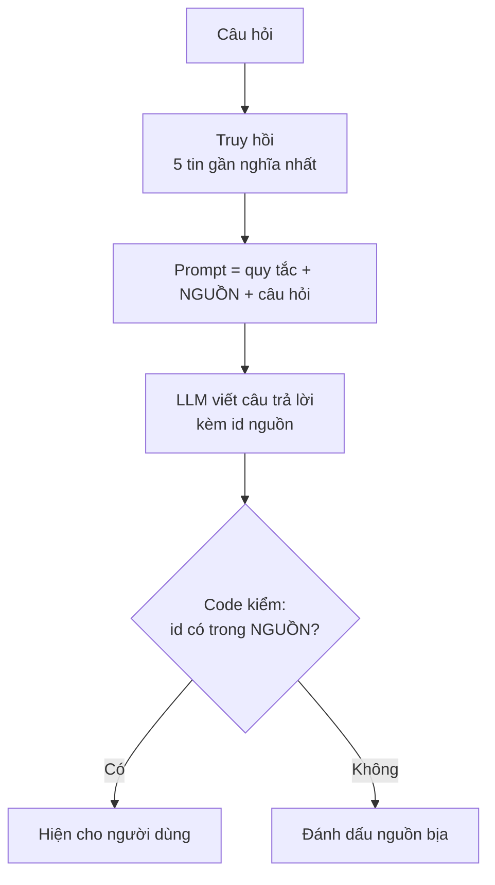
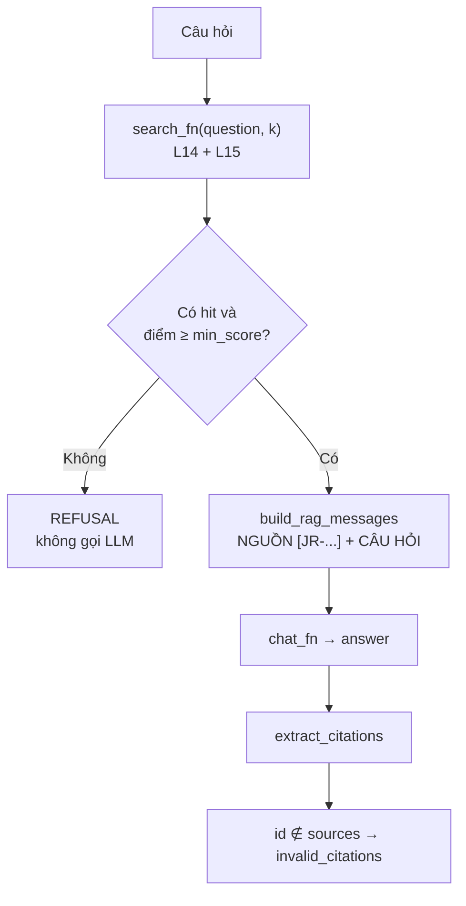

# L16 — RAG có trích nguồn

> Model chỉ trả lời từ các tin tìm được, ghi id tin sau mỗi ý, và code **kiểm tra** id đó trước khi tin.

## 🎯 Mục tiêu

Sau buổi này (khoảng 3 giờ 15 phút) bạn sẽ:

- Hiểu **RAG** (Retrieval-Augmented Generation): tìm tài liệu liên quan (truy hồi) → đưa chúng vào prompt làm nguồn → model viết câu trả lời từ nguồn đó.
- Viết prompt **có nguồn đánh số theo id**, quy tắc trích dẫn (ghi id nguồn sau mỗi ý) và câu **từ chối** chuẩn khi nguồn không có đáp án.
- Tách id được trích bằng regex (mẫu tìm chuỗi) và **kiểm tra** id đó có thật sự nằm trong nguồn đã truy hồi.
- Chặn gọi LLM khi truy hồi không có gì đủ tốt (tiết kiệm tiền, giảm bịa — hallucination).
- **Kết quả đo được:** 4 hàm trong `rag.py` qua hết **8 test**; chạy thật 3 câu hỏi: 1 câu trả lời có nguồn hợp lệ, 2 câu không có đáp án → model từ chối đúng; đầu-cuối (embedding câu hỏi + search + LLM, chưa cache) trung vị **1,8 giây** mỗi câu trên 20 câu của L17.

> 🧠 **Ghi nhớ:** LLM không "biết" dữ liệu của bạn. RAG đưa dữ liệu vào prompt mỗi lần hỏi; trích nguồn để người dùng — và code — kiểm chứng được câu trả lời.

## 📋 Đề bài

**Mở file:** `academy/workspace/L16-rag-trich-nguon/rag.py`.

**Trước tiên:** copy `semantic.py` (L14) và `index.py` (L15) **của bạn** vào thư mục bài này — xem Bước 1.

| Hàm | Việc |
|---|---|
| `format_sources(hits)` | các chunk tìm được (hit) → khối `[JR-xxxxx] text`, gộp chunk cùng tin |
| `build_rag_messages(question, hits)` | system = `RAG_RULES`, user = NGUỒN + CÂU HỎI |
| `extract_citations(answer)` | id trong ngoặc vuông, không trùng, theo thứ tự |
| `answer_question(question, search_fn, chat_fn, k, min_score)` | truy hồi → (chặn) → gọi model → kiểm trích dẫn |

Đã viết sẵn: `REFUSAL`, `RAG_RULES`, `make_chat` (gọi model có cache đĩa như L12), `make_search` (đọc chỉ mục `index_c40/` của L15).

**Xong khi:** bấm **Chạy test** thấy `8 passed`, và `python rag.py` in được 3 câu trả lời ở Bước 6.

## 🤔 Tại sao? (kiến thức nền)

### Hiểu trước khi làm

**Bối cảnh.** Hỏi một chatbot thông thường "Ngân hàng nào đang tuyển kỹ sư dữ liệu?", nó không biết 264 tin của JobRadar — nó chỉ học từ dữ liệu trên Internet tới một ngày nào đó. Tệ hơn, nó vẫn trả lời trôi chảy, kể tên công ty nghe rất thật nhưng do nó tự bịa. Muốn chatbot trả lời đúng về dữ liệu của mình, ta tìm các tin liên quan (L14, L15), đưa cho model đọc ngay trong câu hỏi, và bắt nó ghi rõ tin nào là căn cứ để kiểm tra được.

**Ví dụ đời thường.** Thi **mở tài liệu**: thí sinh không cần thuộc lòng, nhưng chỉ được viết từ tài liệu mang vào và phải ghi "theo trang 12". Giám khảo lật trang 12 để kiểm. Không có trong tài liệu thì ghi "không có thông tin", không bịa. RAG đặt LLM vào đúng phòng thi đó; code của bạn là giám khảo kiểm số trang.

**Bạn đã gặp nó ở đâu.**
- Perplexity, Google AI Overviews: câu trả lời kèm số [1] [2] dẫn tới trang nguồn.
- ChatGPT / Claude khi bạn tải file PDF lên rồi hỏi về nội dung file.
- Chatbot chăm sóc khách hàng của ngân hàng, nhà mạng trả lời dựa trên trang câu hỏi thường gặp của chính họ.
- Notion AI, Microsoft Copilot trả lời từ tài liệu nội bộ công ty.

| Câu hỏi | Trả lời |
|---|---|
| **What** — là gì? | **RAG**: tìm tài liệu liên quan → đưa vào prompt → model trả lời chỉ từ đó. **Citation**: id nguồn ghi sau mỗi ý, vd. `[JR-10108]`. **Hallucination**: model viết thông tin nghe hợp lý nhưng không có căn cứ. |
| **Why** — vì sao cần? | Model không biết dữ liệu riêng và mới của bạn; có trích nguồn thì người dùng và code kiểm chứng được, bịa nguồn thì bị bắt. |
| **When** — khi nào dùng? | Hỏi đáp trên tài liệu riêng, thay đổi thường xuyên, cần chỉ ra căn cứ: tin tuyển dụng, quy định nội bộ, tài liệu sản phẩm. |
| **When not** — khi nào không? | Câu hỏi kiến thức chung, viết sáng tạo; hoặc cần con số tổng hợp chính xác ("có bao nhiêu tin lương trên 30 triệu") — truy vấn SQL (L09) đúng hơn. |
| **Where** — nằm ở đâu? | Lớp cuối của hệ thống tìm kiếm: sau truy hồi (L14–L15), trước khi hiện câu trả lời cho người dùng. |
| **How** — chạy thế nào? | Truy hồi top-k → không có gì đủ tốt thì từ chối luôn → ghép NGUỒN + CÂU HỎI vào prompt → gọi model → tách id trích dẫn → kiểm id có nằm trong nguồn đã đưa. |

**Từ mới trong bài**

| Từ | Nghĩa đời thường |
|---|---|
| RAG | Retrieval-Augmented Generation: "viết câu trả lời có tra cứu tài liệu trước" |
| truy hồi (retrieval), hit | bước tìm tài liệu liên quan; mỗi chunk tìm được là một hit |
| nguồn (sources) | các tin đã đưa vào prompt cho model đọc |
| citation (trích dẫn) | id nguồn trong ngoặc vuông sau mỗi ý, vd. `[JR-10108]` |
| hallucination (bịa) | model nói điều không có trong nguồn hay sự thật, giọng vẫn rất tự tin |
| câu từ chối (`REFUSAL`) | câu cố định model phải trả khi nguồn không có đáp án; cố định để code nhận ra bằng phép `in` |
| `min_score` | ngưỡng điểm truy hồi; dưới ngưỡng thì từ chối luôn, không tốn lời gọi model |
| fine-tune | huấn luyện thêm model trên dữ liệu của bạn — tốn kém, phải làm lại khi dữ liệu đổi |
| regex (biểu thức chính quy) | mẫu để tìm chuỗi, vd. `JR-\d{5}` = "JR-" + 5 chữ số |
| `⊆` (tập con) | mọi phần tử của tập này đều nằm trong tập kia: mọi id trích phải nằm trong nguồn |
| `invalid_citations` | các id model trích nhưng **không** có trong nguồn đã đưa — dấu hiệu bịa nguồn |
| citation recall | trong các tin đúng, câu trả lời trích được bao nhiêu (đo ở L17) |
| LLM-as-judge | dùng một LLM khác chấm câu trả lời có khớp nguồn không |



### Ba cách để model trả lời về dữ liệu riêng

| | Hỏi thẳng model | Fine-tune | RAG |
|---|---|---|---|
| Model biết dữ liệu mới | không | đến lúc huấn luyện | có, mỗi lần hỏi |
| Thêm 1 tin tuyển dụng | — | huấn luyện lại | thêm vào index |
| Chỉ ra nguồn | không | không | có |
| Chi phí mỗi câu hỏi | thấp | thấp | cao hơn: prompt dài thêm phần nguồn |

Với dữ liệu thay đổi hằng ngày và cần kiểm chứng, RAG là lựa chọn mặc định.

### Prompt RAG: nguồn, quy tắc, câu từ chối



`RAG_RULES` (đọc trong `rag.py`) quy định 3 điều: chỉ dùng NGUỒN; mỗi ý kèm `[JR-xxxxx]`; không có thông tin thì trả **đúng** câu `REFUSAL`. Câu từ chối cố định giúp code nhận ra từ chối bằng một phép `in`, không phải đoán.

### Kiểm tra trích dẫn: không tin model

Model có thể ghi một id **không có** trong nguồn (bịa nguồn), hoặc trả lời mà không trích gì. Hai việc code làm được, rẻ, không cần gọi model thêm:

| Kiểm tra | Phát hiện |
|---|---|
| `citations ⊆ sources` | id bịa (`invalid_citations`) |
| `citations` không rỗng | câu trả lời không có căn cứ |
| `REFUSAL in answer` | model đã từ chối |

Điều code **không** kiểm được ở bài này: id có thật trong nguồn nhưng **nội dung** gán sai. Ví dụ thật ở L17: model viết "SmartFarm VN tuyển Fresher Golang Developer [JR-10114]" — JR-10114 có trong nguồn, nhưng là tin của **Hùng Vương Tech**. Bắt lỗi này cần tập nhãn (L17).

> ⚠️ **Lỗi hay gặp:** lọc theo điểm cosine để quyết định từ chối. L14: câu hỏi về Rust (không có tin nào) có điểm cao nhất 0.35, cao hơn câu hỏi ngân hàng (0.33). `min_score` chỉ chặn được trường hợp truy hồi **rỗng** hoặc rất kém; việc "nguồn có trả lời được không" phải để model quyết, rồi đo (L17). Phần chạy thật dùng `min_score=0.0`.

## 🛠️ Làm

Các demo dùng mã sản phẩm, đơn hàng — không phải dữ liệu bài.

### Bước 1 — Chuẩn bị: copy semantic.py, index.py

Cần đã chạy `python index.py` ở L15 (tạo `workspace/L15-chunking-vector-index/index_c40/`). Từ thư mục `academy/workspace/`:

```bash
cp L14-embedding-cosine/semantic.py L16-rag-trich-nguon/
cp L15-chunking-vector-index/index.py L16-rag-trich-nguon/
```

> 💡 **Mẹo:** Windows PowerShell: `Copy-Item L14-embedding-cosine\semantic.py L16-rag-trich-nguon\; Copy-Item L15-chunking-vector-index\index.py L16-rag-trich-nguon\`

Test **không** cần hai file này (test truyền `search_fn`, `chat_fn` giả).

### Bước 2 — Phần NGUỒN → `format_sources`

`search` của L15 đã trả mỗi tin một lần, nhưng `format_sources` vẫn phải gộp chunk cùng `job_id` (nguồn có thể đến từ hàm search khác). Cần danh sách id **không trùng, giữ thứ tự** — dùng lại cho `sources` ở Bước 5:

```python
codes = ["B7", "A1", "B7", "C3", "A1", "B7"]

# Cách 1 — vòng lặp + set "đã thấy"
seen = set()
unique1 = []
for code in codes:
    if code not in seen:        # tra set: O(1)
        seen.add(code)
        unique1.append(code)
print(unique1)

# Cách 2 — dict.fromkeys: dict giữ thứ tự chèn, key không trùng
unique2 = list(dict.fromkeys(codes))
print(unique2)
```
```output
['B7', 'A1', 'C3']
['B7', 'A1', 'C3']
```

> ⚖️ **So sánh:** cả hai O(n). Nếu Cách 1 kiểm `if code not in unique1` (tra **list**) thì mỗi lần tra O(n), cả vòng O(n²) — với 5 hit không sao, với 100.000 phần tử thì rõ chậm. Cách 2 gọn hơn nhưng phải biết "dict giữ thứ tự chèn" (Python 3.7+); viết Cách 1 nếu bạn chưa quen.

### Bước 3 — Messages → `build_rag_messages`

Ghép đúng định dạng trong docstring. Nguồn đặt trong **user** message (thay đổi mỗi câu hỏi); quy tắc đặt trong **system** (cố định) — giống L04.

### Bước 4 — Tách id → `extract_citations`

```python
import re

note = "Còn hàng: áo [SP-0012], quần [SP-0040; SP-0012]. Mã SP-0099 đã ngừng bán. [ghi chú]"
groups = re.findall(r"\[([^\[\]]*)\]", note)       # nội dung trong từng cặp ngoặc vuông
print(groups)
print(re.findall(r"SP-\d{4}", "SP-0040; SP-0012"))
```
```output
['SP-0012', 'SP-0040; SP-0012', 'ghi chú']
['SP-0040', 'SP-0012']
```

`[^\[\]]*` = "mọi ký tự trừ ngoặc vuông" → mỗi kết quả là nội dung **một** cặp ngoặc. `\d{4}` = đúng 4 chữ số. Id JobRadar có **5** chữ số (`JR-10015`). Id ngoài ngoặc (`SP-0099` ở trên) không tính.

### Bước 5 — Ghép lại → `answer_question`

Theo 4 bước trong docstring. Ba điểm hay sai:

- Chặn ở bước 2 (không hit / điểm thấp) → trả ngay, `llm_called = False`, **không** gọi `chat_fn`.
- `invalid_citations` so với `sources` của **chính câu hỏi này**, không phải mọi id trong CSDL — id có thật trong CSDL nhưng không được đưa vào prompt thì model không thể đọc được nó.
- `ok` cần đủ 3 điều kiện: không từ chối, có trích dẫn, không có id bịa.

### Bước 6 — Chạy thật

```bash
python rag.py
```

Kết quả khi chuẩn bị bài (19/10/2026, `nemotron-3-super`, chỉ mục `index_c40` của L15, k = 5):

```output
Hỏi: Ngân hàng hoặc công ty tài chính nào đang tuyển kỹ sư dữ liệu?
Saigon Fintech đang tuyển Fresher Data Engineer [JR-10108].
→ nguồn truy hồi: ['JR-10108', 'JR-10125', 'JR-10007', 'JR-10015', 'JR-10039']
→ trích: ['JR-10108'] · id bịa: [] · từ chối: False · ok: True · 1.4s

Hỏi: Có tin thực tập AI nào làm remote không?
Không tìm thấy thông tin trong các tin tuyển dụng hiện có.
→ nguồn truy hồi: ['JR-10035', 'JR-10093', 'JR-10250', 'JR-10105', 'JR-10127']
→ trích: [] · id bịa: [] · từ chối: True · ok: False · 1.3s

Hỏi: Có công ty nào tuyển lập trình viên Rust không?
Không tìm thấy thông tin trong các tin tuyển dụng hiện có.
→ nguồn truy hồi: ['JR-10114', 'JR-10088', 'JR-10011', 'JR-10161', 'JR-10168']
→ trích: [] · id bịa: [] · từ chối: True · ok: False · 0.9s
```

Đọc kết quả như một engineer:

1. **Câu 1** đúng và có nguồn, nhưng **thiếu**: JR-10015 (Junior Data Engineer — PayNow) có trong nguồn mà không được nhắc. Nguồn không nói PayNow là công ty tài chính, nên model không suy ra — đúng quy tắc "chỉ dùng NGUỒN", nhưng người dùng mất một tin. Chỉ số bắt được lỗi này: citation recall (L17).
2. **Câu 2, 3** từ chối đúng: dữ liệu có 4 tin AI Engineer Intern nhưng không tin nào remote; không tin nào nhắc Rust. Truy hồi **vẫn** trả 5 tin (luôn có 5 vector gần nhất) — chính model đọc nguồn và từ chối.
3. Chi phí đo trên 20 câu hỏi của L17: trung bình **723 token vào, 49 token ra** mỗi câu; theo giá giả định của L12 ≈ 0.00026 USD/câu. Thời gian đầu-cuối (trung vị 20 câu): **1,8 giây** = embedding câu hỏi 380 ms + search dưới 0,1 ms + LLM 1,4 s. Ba câu mẫu ở trên in 0,9–1,4 giây vì là phép đo một lần, không phải trung vị.

> 💡 **Mẹo:** `python rag.py "câu hỏi của bạn"` để hỏi câu khác. Câu trả lời được cache trong `cache/` (khóa gồm cả prompt) — hỏi lại cùng câu không tốn lời gọi model.

## ✅ Tự kiểm tra

Bấm **Chạy test**, hoặc từ thư mục `academy/`:

```bash
PYTHONPATH=workspace/L16-rag-trich-nguon python3 -m pytest curriculum/L16-rag-trich-nguon/tests -q
```

> 💡 **Mẹo:** Windows PowerShell: `$env:PYTHONPATH="workspace\L16-rag-trich-nguon"; python -m pytest curriculum\L16-rag-trich-nguon\tests -q`

Mục tiêu: `8 passed`. Test có một câu trả lời trích `[JR-10999]` — id không có trong nguồn — để kiểm tra bạn bắt được nguồn bịa.

## 🎤 Câu hỏi phỏng vấn

> 🎯 **Phỏng vấn hay hỏi:** "Làm sao giảm hallucination trong RAG?" — 4 lớp, từ rẻ tới đắt: prompt chỉ cho dùng nguồn + câu từ chối chuẩn; bắt trích id và kiểm `citations ⊆ sources` bằng code; đo trên tập nhãn (từ chối đúng, citation precision/recall — L17); cuối cùng mới tới LLM-as-judge kiểm từng ý có khớp nguồn.
