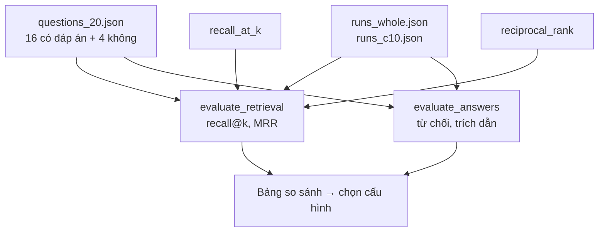

# L17 — Đánh giá RAG

> Trả lời "RAG của mình tốt cỡ nào?" bằng con số, tách riêng hai câu hỏi: **tìm** có đúng không, và **trả lời** có đúng không.

## 🎯 Mục tiêu

Sau buổi này (khoảng 3 giờ) bạn sẽ:

- Dựng **tập câu hỏi gán nhãn** cho RAG: câu có đáp án (kèm id tin đúng) và câu **không** có đáp án.
- Đo truy hồi bằng **recall@k** và **MRR**.
- Đo câu trả lời: **từ chối đúng**, **từ chối nhầm**, **trích dẫn hợp lệ**, **citation precision / recall**.
- So hai cấu hình (không chia chunk vs chunk 10 từ) và chọn bằng số liệu, kèm giới hạn của số liệu đó.
- **Kết quả đo được:** 4 hàm trong `eval_rag.py` qua hết **8 test**; `python eval_rag.py` in bảng so sánh hai cấu hình trên 20 câu hỏi.

> 🧠 **Ghi nhớ:** RAG sai có thể do **tìm** sai (tin đúng không vào prompt) hoặc **đọc** sai (tin đúng có trong prompt nhưng model bỏ qua hay gán nhầm). Đo gộp một con số thì không biết sửa chỗ nào.

## 📋 Đề bài

**Mở file:** `academy/workspace/L17-danh-gia-rag/eval_rag.py`. Cùng thư mục có sẵn:

| File | Nội dung |
|---|---|
| `questions_20.json` | 20 câu hỏi: 16 có đáp án (`relevant` = id tin đúng), 4 không có (`relevant` = `[]`); `rule` = quy tắc gán nhãn của từng câu |
| `runs_whole.json` | kết quả **thật** của `answer_question` (L16), chỉ mục không chia chunk (`size=None`), k = 5 |
| `runs_c10.json` | như trên, chunk 10 từ, overlap 3 |

Mỗi phần tử trong `runs_*.json`: `{"retrieved": [5 id theo thứ hạng], "answer", "citations", "invalid_citations", "refused"}`.

| Hàm | Việc |
|---|---|
| `recall_at_k(relevant, retrieved, k)` | tỉ lệ tin đúng nằm trong top k |
| `reciprocal_rank(relevant, retrieved)` | 1 / hạng của tin đúng đầu tiên |
| `evaluate_retrieval(questions, runs, ks)` | trung bình recall@k, MRR trên câu có đáp án; câu trượt hẳn |
| `evaluate_answers(questions, runs)` | từ chối, trích dẫn hợp lệ, citation precision/recall |

Không cần API key, không cần mạng, chỉ thư viện chuẩn.

**Xong khi:** bấm **Chạy test** thấy `8 passed`, và viết được kết luận chọn cấu hình nào kèm số liệu.

## 🤔 Tại sao? (kiến thức nền)

### Tập câu hỏi gán nhãn cho RAG

Giống L13: tập cố định, nhãn có quy tắc, chạy lại được. Khác L13 ở hai điểm:

| | L13 (trích xuất) | L17 (RAG) |
|---|---|---|
| Nhãn | giá trị đúng của từng trường | **id các tin** trả lời được câu hỏi |
| Câu "không có đáp án" | không có | **bắt buộc** — đo việc từ chối |

Mỗi câu trong `questions_20.json` có `rule` ghi cách gán nhãn, ví dụ Q01: *title chứa "Data Engineer" và công ty là ngân hàng/fintech (Trúc Xanh Bank, Saigon Fintech, PayNow)* → 3 tin. Câu hỏi viết **khác chữ** với tin ("kỹ sư dữ liệu", "làm hoàn toàn online") để đo tìm theo nghĩa, không phải đo khớp chữ.

> 💡 **Mẹo:** Tự đọc lại `rule` của 3–4 câu và kiểm bằng SQL trên `jobradar.db` (L09). Câu hỏi nào bạn thấy nhãn còn tranh cãi được, đó là chỗ con số đánh giá kém tin cậy.

### Chỉ số truy hồi

| Chỉ số | Câu hỏi nó trả lời | Công thức (một câu hỏi) |
|---|---|---|
| **recall@k** | trong k kết quả đầu có bao nhiêu phần tin đúng? | `|relevant ∩ top k| / |relevant|` |
| **MRR** | tin đúng **đầu tiên** đứng ở hạng mấy? | trung bình của `1 / hạng` (không thấy → 0) |
| hit@k (tham khảo) | có ít nhất 1 tin đúng trong top k? | 0 hoặc 1 |

recall@k quan trọng với RAG vì **chỉ** k kết quả vào prompt: tin đúng ở hạng 6 với k = 5 thì model không bao giờ thấy. MRR quan trọng khi người dùng chỉ đọc kết quả đầu.

> ⚠️ **Lỗi hay gặp:** so recall@1 với 1.0. Câu có 3 tin đúng thì recall@1 tối đa là 1/3. Trên bộ này, recall@1 tối đa (trung bình trên 16 câu) là **0.59**.

### Chỉ số câu trả lời

| Chỉ số | Tính trên | Ý nghĩa |
|---|---|---|
| `correct_refusal` | câu **không** có đáp án | từ chối đúng; phần còn lại là bịa |
| `false_refusal` | câu **có** đáp án | từ chối nhầm: có nguồn mà không trả lời |
| `citation_valid` | câu không từ chối | có trích và mọi id nằm trong nguồn đã truy hồi (L16) |
| `citation_precision` | id được trích (câu có đáp án) | bao nhiêu phần id trích là tin **đúng theo nhãn** |
| `citation_recall` | id đúng theo nhãn | bao nhiêu phần tin đúng được model **nhắc tới** |

`citation_valid` không cần nhãn — chạy được trên production cho **mọi** câu hỏi. `citation_precision/recall` cần nhãn, chỉ chạy trên tập đánh giá. Cả hai cần thiết: `citation_valid = 1.0` vẫn có thể đi cùng câu trả lời sai (ví dụ JR-10114 ở L16).

> 🎯 **Phỏng vấn hay hỏi:** "Đánh giá RAG thế nào?" — tách hai tầng: retrieval (recall@k, MRR trên tập câu hỏi gán id tin đúng) và generation (từ chối đúng trên câu không có đáp án, trích dẫn hợp lệ, citation precision/recall; LLM-as-judge cho độ khớp nội dung khi tập lớn). Nêu số của mình.

## 🛠️ Làm

Toàn cảnh:



Demo dùng danh sách bài hát — không phải dữ liệu bài.

### Bước 1 — Chuẩn bị

Mở `questions_20.json` và `runs_whole.json`, đọc Q01 ở cả hai file: 3 tin đúng, 5 tin truy hồi, câu trả lời trích tin nào.

### Bước 2 — Một câu hỏi → `recall_at_k`, `reciprocal_rank`

Viên gạch của `reciprocal_rank`: tìm vị trí của phần tử **đầu tiên** thỏa một điều kiện, rồi dừng.

```python
# Danh sách bài hát theo thứ tự phát; tìm bài ĐẦU TIÊN dài hơn 4 phút
durations = [3.5, 2.8, 4.6, 3.9, 5.1]       # phút

# Cách 1 — vòng lặp for + break
first_position = None
for position in range(len(durations)):
    if durations[position] > 4:
        first_position = position + 1         # vị trí tính từ 1
        break                                 # thấy rồi thì dừng, không xét tiếp
print("Cách 1:", first_position)

# Cách 2 — next() với generator
first_position2 = next((pos for pos, d in enumerate(durations, start=1) if d > 4), None)
print("Cách 2:", first_position2)
```
```output
Cách 1: 3
Cách 2: 3
```

`enumerate(durations, start=1)` cho cặp `(vị trí, phần tử)` — tương đương `position + 1` ở Cách 1. `next(generator, None)` lấy phần tử đầu tiên thỏa điều kiện, không có thì `None` — tương đương vòng `for` + `break`.

> ⚖️ **So sánh:** cả hai O(n) trong trường hợp xấu nhất và dừng sớm khi gặp phần tử khớp. Cách 2 gọn hơn nhưng khó đọc hơn với người mới; Cách 1 hoàn toàn ổn.

Phần còn lại tự ghép từ công thức trong bảng ở phần Kiến thức nền: điều kiện "khớp" là id nằm trong `relevant`; `recall_at_k` đếm id đúng trong `retrieved[:k]` (id khác nhau). Docstring còn hai trường hợp: id lặp trong `relevant` và `relevant` rỗng.

### Bước 3 — Cả bộ → `evaluate_retrieval`

Chỉ tính câu **có** đáp án; câu thiếu trong `runs` coi như truy hồi rỗng (không bỏ qua — L13: tin thiếu dự đoán là sai). Làm tròn ở **bước cuối**, sau khi chia trung bình (L12).

### Bước 4 — Câu trả lời → `evaluate_answers`

Tính tay ví dụ trong test trước khi code: 3 câu có đáp án, 1 câu không. Chú ý mỗi chỉ số có **mẫu số riêng** (bảng ở phần Kiến thức nền), và mẫu số 0 → 0.0.

> ⚠️ **Lỗi hay gặp:** tính `citation_precision` gộp cả câu không có đáp án. Câu không có đáp án mà model vẫn trích nguồn đã được đếm ở `hallucinated` / `correct_refusal`; gộp vào precision thì một lỗi bị đếm hai lần.

### Bước 5 — Chạy và kết luận

```bash
python eval_rag.py
```

Kết quả với dữ liệu đi kèm (`nemotron-3-embed-1b` + `nemotron-3-super`, 19/10/2026):

```output
Truy hồi (16 câu có đáp án, k = 5):
            config |           recall@1 |           recall@3 |           recall@5 |                mrr
             whole |             0.5781 |             0.7969 |             0.8333 |             0.9688
               c10 |             0.4688 |              0.776 |             0.8125 |             0.8646

Câu trả lời:
            config |    correct_refusal |      false_refusal |     citation_valid | citation_precision |    citation_recall
             whole |                1.0 |                0.0 |                1.0 |             0.7812 |             0.7353
               c10 |                1.0 |                0.0 |                1.0 |             0.7931 |             0.6765

[whole] không tìm thấy tin đúng: [] · trả lời câu không có đáp án: []

[c10] không tìm thấy tin đúng: [] · trả lời câu không có đáp án: []
```

Đọc kết quả như một engineer:

1. **Truy hồi tốt, chunk nhỏ làm kém đi.** `whole`: 15/16 câu có tin đúng ở hạng 1 (MRR 0.97). `c10` tụt còn 0.86 và dùng **1.766** vector thay vì 264. Mô tả tin chỉ ~47 từ: chia 10 từ cắt một ý thành nhiều mẩu, mẩu nào cũng mang cùng header nên dễ "thắng" sai.
2. **Từ chối hoàn hảo trên 4 câu** không có đáp án, không từ chối nhầm câu nào — nhưng 4 câu là quá ít: 1 câu sai = tụt 25 điểm %.
3. **Lỗi lớn nhất nằm ở tầng đọc, không phải tầng tìm.** `citation_recall` 0.74 < `recall@5` 0.83: có tin đúng trong prompt mà model không nhắc (Q01: JR-10015 của PayNow). `citation_precision` 0.78: model trích cả tin không khớp điều kiện (Q15 hỏi frontend **cấp cao**, model liệt kê thêm 3 tin không phải Senior; Q10 gán JR-10114 cho nhầm công ty).
4. **Kết luận:** dùng `size=None` (không chia) cho JobRadar: truy hồi tốt hơn, ít vector hơn 6,7 lần. Việc tiếp theo là sửa **prompt** cho tầng đọc (bắt model kiểm từng điều kiện của câu hỏi), không phải sửa index. Cảnh báo: 16 câu có đáp án — chênh lệch MRR giữa hai cấu hình tương đương vài câu đổi hạng; muốn kết luận chắc cần tập lớn hơn và tập kiểm tra riêng (L13).

### Bước 6 — (tùy chọn, cần key) Đo cấu hình của bạn

Copy `semantic.py` (L14), `index.py` (L15), `rag.py` (L16) vào thư mục bài, rồi chạy (ví dụ chunk 20 từ):

```python
import json
from index import build_index, make_query_embedder
from rag import answer_question, make_chat
from semantic import embed_texts, load_jobs, make_client

client = make_client()
# lambda b: ... = hàm nhận một lô văn bản b, trả vector "passage" của lô đó
index, _ = build_index(load_jobs(), lambda b: embed_texts(client, b, "passage"), size=20, overlap=5)
embed_query = make_query_embedder(client)
chat = make_chat(client)
runs = {}
for q in json.load(open("questions_20.json", encoding="utf-8")):
    # search_fn của L16: nhận (câu hỏi, k) → embedding câu hỏi → k tin gần nhất trong index
    r = answer_question(q["question"], lambda text, k: index.search(embed_query(text), k), chat, k=5)
    runs[q["qid"]] = {"retrieved": r["sources"], "answer": r["answer"], "citations": r["citations"],
                      "invalid_citations": r["invalid_citations"], "refused": r["refused"]}
json.dump(runs, open("runs_c20.json", "w", encoding="utf-8"), ensure_ascii=False, indent=1)
```

`python eval_rag.py whole c10 c20` thêm dòng `c20`. Khi chuẩn bị bài, cấu hình này cho recall@5 0.8073, MRR 0.9375 — nằm giữa hai cấu hình trên. Thử sửa `RAG_RULES` trong `rag.py` rồi chạy lại để xem `citation_precision` thay đổi thế nào.

## ✅ Tự kiểm tra

Bấm **Chạy test**, hoặc từ thư mục `academy/`:

```bash
PYTHONPATH=workspace/L17-danh-gia-rag python3 -m pytest curriculum/L17-danh-gia-rag/tests -q
```

> 💡 **Mẹo:** Windows PowerShell: `$env:PYTHONPATH="workspace\L17-danh-gia-rag"; python -m pytest curriculum\L17-danh-gia-rag\tests -q`

Mục tiêu: `8 passed`. Dữ liệu trong test đủ nhỏ để tính tay (MRR = (1 + 1/4 + 0) / 3) — tính tay trước rồi mới code.

## 🎤 Câu hỏi phỏng vấn

> 🎯 **Phỏng vấn hay hỏi:** câu 7 — "Chọn chunk size thế nào?": không có con số chung; đo trên tập câu hỏi của chính dữ liệu đó. Kể số của mình: tin ~47 từ, không chia cho MRR 0.97, chia 10 từ còn 0.86 và tốn gấp 6,7 lần vector — tài liệu ngắn thì không chia; tài liệu dài mới thử 200–500 token, overlap 10–20%, rồi so bằng recall@k.
